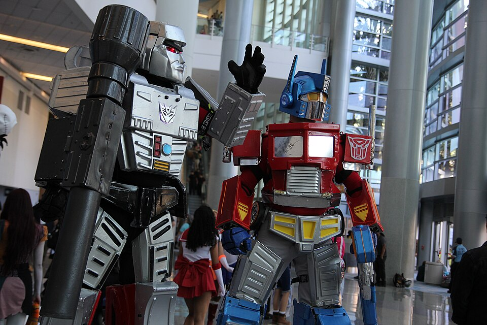
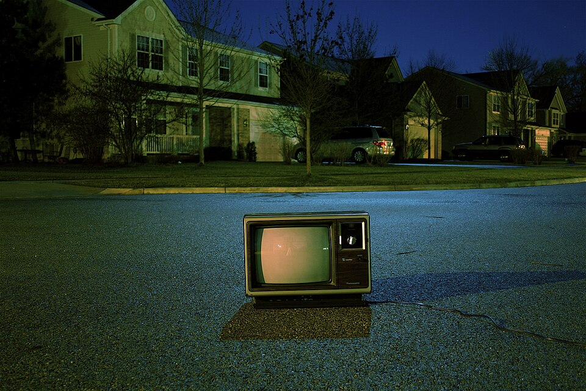

# Meme Bank
<!-- .slide: class="title-slide" -->

<h3>Film and TV Quotes for Intermediate Memes</h3>

<a class="person ext" href="https://sdevtutors.github.io/mark-crowe/" data-tip="sdevtutors.github.io/mark-crowe">Mark Crowe</a>––<time class="deck-date" datetime="2026-10-31T18:38:43+00:00">October 2026</time> 📅

Built with <a class="ext" href="https://revealjs.com/">Reveal.js</a> and <a class="ext" href="https://github.com/SDevTutors/apocalypse-reveal-js" title="TAP Reveal, The Apocalypse Plugin (ARJ)">TAP Reveal</a>–<a class="ext" href="https://github.com/marcocrowe/reveal-js-html" title="This deck's source, on GitHub">Source</a>

<figure class="deck-qr"></figure>

<footer class="slide-footer no-link-icon">
<a class="version-link ext" href="https://github.com/marcocrowe/reveal-js-html/commit/0ed9b5c1067814ccae8d725ad6fb60ff64e8794b">Version 1.8.3</a>

<a class="deck-url ext" href="https://marcocrowe.github.io/reveal-js-html/memes.html">marcocrowe.github.io/reveal-js-html/memes.html</a>

<a class="ext" href="https://sdevtutors.github.io/mark-crowe/#email" title="Contact Mark Crowe">© 2026 Mark Crowe</a>–Quotes, characters and pictures belong to their respective owners.
</footer>

---

## About this deck
<!-- no-number -->

- Film and TV quotes, and internet memes, to drop into presentations and training. One entry per scene, in film order then scene order. The **bold** part is the bit to use
- **Checked:** the transcript, script or subtitles the wording was checked against. **Check:** anything I could not confirm
- **Time:** where the quote starts and ends in the film, from the subtitle file. It starts 2 seconds early, as subtitles are never quite in sync
- Stills: grab your own, or search [imgflip](https://imgflip.com/memetemplates) and [Know Your Meme](https://knowyourmeme.com/)
- Getting around: → for the next topic, ↓ for the entries in it. Next and back step over the contents; the contents button, bottom left, opens them. Type a number and press Enter to jump to that topic
- Top right: the padlock and the pen. Locked, the mouse changes slides; unlocked, it selects and copies text, and the slides stay put. The pen (or D) draws on the slide; press it again, or Esc, to stop. Each slide keeps its drawings until the page is reloaded
- Version 1.8.3 is year.tenth.day: the year (1 is 2026), which tenth of the year it is (0 to 9), and how many days in that tenth have had changes. [TAP Reveal](https://github.com/SDevTutors/apocalypse-reveal-js), the scripts behind the slides, is numbered the same way. [tools/version.py](tools/version.py) works them out
- [memes.html](memes.html) shows this file, [memes.md](memes.md), as slides

----

## About the author
<!-- no-number -->

- **Mark Crowe**, Education Officer at Sdev Tutors: [sdevtutors.github.io/mark-crowe](https://sdevtutors.github.io/mark-crowe/)
- A background in IT. Teaches programming in Python and C#
- BSc in Computer Systems, MSc in Software Development
- Email:  (a picture, so that programs collecting addresses can't read it)

<!--
HOW THIS FILE BECOMES SLIDES (memes.html)
  ---    on its own line, with blank lines around it: a new topic (goes across)
  ----   on its own line, with blank lines around it: a new entry in that topic (goes down)
  Each entry: "## Title (year)", a "**Scene: ...**" line, a "> quote" (bold the part to use),
  then "**Label:** value" lines.
  Labels with their own style: Who, Episode, Time, IMDb, Meme page, Checked, Use it for, Check.
  Two speakers: put each on its own "> " line with a blank "> " line between.
-->

---

# Training needs and skills

Quotes for the TNA, skills audits and learner feedback

<figure class="topic-photo"><figcaption><a class="ref media" href="#/media-used">1</a> – A hurley and sliotar</figcaption></figure>

----

## Taken (2008)
<!-- 1 -->

> "I don't know who you are. I don't know what you want. If you are looking for ransom, I can tell you I don't have money. But what I do have are **a very particular set of skills**..."

- **Who:** Bryan Mills (Liam Neeson), on the phone to his daughter's kidnappers
- **IMDb:** [Taken](https://www.imdb.com/title/tt0936501/) · [quotes](https://www.imdb.com/title/tt0936501/quotes/)
- **Time:** 0:28:27 to 0:28:44 (18 seconds), from the subtitles [🔗](<../my-fetches/subtitles/Taken [2008] -imdb-tt0936501.srt>)
- **Use it for:** skills audits, and why self-ratings can be wrong. Caption: *"Every learner on the self-rating form"*

----

## A Few Good Men (1992)
<!-- 2 -->

> Kaffee: "I want the truth!"
>
> Jessup: "**You can't handle the truth!**"

- **Who:** Col. Jessup (Jack Nicholson) to Lt. Kaffee (Tom Cruise), on the witness stand at the court martial
- **IMDb:** [A Few Good Men](https://www.imdb.com/title/tt0104257/) · [quotes](https://www.imdb.com/title/tt0104257/quotes/)
- **Meme page:** [Know Your Meme](https://knowyourmeme.com/memes/you-cant-handle-the-truth)
- **Use it for:** presenting TNA or survey findings to management. Caption: *"Me, presenting the survey results"*

----

## The Simpsons: "The Boy Who Knew Too Much" (1994)
<!-- 3 -->

**Scene: Skinner hunts for Bart, who is skipping school**

> Skinner: "Why, there are no children here at the 4-H Club either. **Am I so out of touch? No. It's the children who are wrong.**"

- **Who:** Principal Seymour Skinner (voiced by Harry Shearer). It's from this episode, not "Boy-Scoutz 'n the Hood": the one where Bart skips school, sees Freddy Quimby and the French waiter, and Homer sits on the jury
- **Episode:** season 5, episode 20
- **IMDb:** [episode](https://www.imdb.com/title/tt0778453/)
- **Meme page:** [Know Your Meme](https://knowyourmeme.com/memes/am-i-so-out-of-touch)
- **Checked:** [subtitle script](https://www.springfieldspringfield.co.uk/view_episode_scripts.php?tv-show=the-simpsons&episode=s05e20)
- **Use it for:** trainers who ignore learner feedback, and why a TNA starts with the learners. Caption: *"Lecturer reading the module feedback"*

----

## Star Trek VI: The Undiscovered Country (1991)
<!-- 4 -->

> "**People can be very frightened of change.**"

- **Who:** Kirk (William Shatner) to Spock, near the end
- **IMDb:** [The Undiscovered Country](https://www.imdb.com/title/tt0102975/) · [quotes](https://www.imdb.com/title/tt0102975/quotes/)
- **Time:** 1:40:02 to 1:40:08 (6 seconds), from the subtitles [🔗](<../my-fetches/subtitles/Star Trek 6, The Undiscovered Country [1991] -imdb-tt0102975.srt>)
- **Use it for:** resistance to change, a limitation of any TNA. Fits Assignment 2

----

## Star Trek: First Contact (1996)
<!-- 5 -->

> "**Believing oneself to be perfect is often the sign of a delusional mind.**"

- **Who:** Data (Brent Spiner) to the Borg Queen
- **IMDb:** [First Contact](https://www.imdb.com/title/tt0117731/) · [quotes](https://www.imdb.com/title/tt0117731/quotes/)
- **Time:** 1:02:32 to 1:02:40 (9 seconds), from the subtitles [🔗](<../my-fetches/subtitles/Star Trek, First Contact [1996] -imdb-tt0117731.srt>)
- **Use it for:** self-assessment. The learner who rates every skill 5 out of 5

----

## Top Gun: Maverick (2022)
<!-- 6 -->

> "**It's not the plane, it's the pilot.**"

- **Who:** Maverick (Tom Cruise)
- **IMDb:** [Top Gun: Maverick](https://www.imdb.com/title/tt1745960/) · [quotes](https://www.imdb.com/title/tt1745960/quotes/)
- **Use it for:** tools against skills. New software does not close a skills gap
- **Check:** which scene, and the exact wording

----

## The Princess Bride (1987)
<!-- 7 -->

> Vizzini: "Inconceivable!"
>
> Inigo: "**You keep using that word. I do not think it means what you think it means.**"

- **Who:** Inigo Montoya (Mandy Patinkin) to Vizzini (Wallace Shawn)
- **IMDb:** [The Princess Bride](https://www.imdb.com/title/tt0093779/) · [quotes](https://www.imdb.com/title/tt0093779/quotes/)
- **Meme page:** [Know Your Meme](https://knowyourmeme.com/memes/you-keep-using-that-word-i-do-not-think-it-means-what-you-think-it-means)
- **Use it for:** jargon. Agile, AI, "training need", "blended learning"

----

## Harry Potter and the Philosopher's Stone (2001)
<!-- 8 -->

> "**You're a wizard, Harry.**"

- **Who:** Hagrid (Robbie Coltrane), in the hut on the rock
- **IMDb:** [Harry Potter and the Philosopher's Stone](https://www.imdb.com/title/tt0241527/) · [quotes](https://www.imdb.com/title/tt0241527/quotes/)
- **Meme page:** [Know Your Meme](https://knowyourmeme.com/memes/youre-a-wizard-harry)
- **Use it for:** recognising prior learning, or a learner finding a skill. Caption: *"Me, after my first working commit"*

----

## The Devil Wears Prada (2006)
<!-- 9 -->

> "**Florals? For spring? Groundbreaking.**"

- **Who:** Miranda Priestly (Meryl Streep)
- **IMDb:** [The Devil Wears Prada](https://www.imdb.com/title/tt0458352/) · [quotes](https://www.imdb.com/title/tt0458352/quotes/)
- **Time:** 0:58:13 to 0:58:20 (7 seconds), from the subtitles [🔗](<../my-fetches/subtitles/The Devil Wears Prada [2006] -imdb-tt0458352.srt>)
- **Use it for:** obvious recommendations. Caption: *"TNA finding: more training needed"*

---

# Projects, scope and deadlines

Plans, scope creep and the submission date

<figure class="topic-photo"><figcaption><a class="ref media" href="#/media-used">2</a> – A Gantt chart</figcaption></figure>

----

## Jurassic Park (1993)
<!-- 10 -->

> "Yeah, yeah, but your scientists were so preoccupied with whether or not they could, **they didn't stop to think if they should.**"

- **Who:** Ian Malcolm (Jeff Goldblum), at lunch with Hammond
- **IMDb:** [Jurassic Park](https://www.imdb.com/title/tt0107290/) · [quotes](https://www.imdb.com/title/tt0107290/quotes/)
- **Time:** 0:36:04 to 0:36:13 (9 seconds), from the subtitles [🔗](<../my-fetches/subtitles/Jurassic Park [1993] -imdb-tt0107290.srt>)
- **Use it for:** AI features, scope creep, ethics

----

## Jaws (1975)
<!-- 11 -->

> "**You're gonna need a bigger boat.**"

- **Who:** Chief Brody (Roy Scheider), backing into the cabin after his first close look at the shark, while chumming
- **IMDb:** [Jaws](https://www.imdb.com/title/tt0073195/) · [quotes](https://www.imdb.com/title/tt0073195/quotes/)
- **Use it for:** underestimating scope. Caption: *"Me, after reading the FYP brief"*. The theme music is in topic 17

----

## Despicable Me (2010)
<!-- 12 -->

> Gru's plan: four flip-chart panels, and the last one goes wrong

- **Who:** Gru (Steve Carell), presenting his plan
- **IMDb:** [Despicable Me](https://www.imdb.com/title/tt1323594/)
- **Meme page:** [Know Your Meme](https://knowyourmeme.com/memes/grus-plan)
- **Use it for:** project plans. Panels: *"Start FYP / Pick a big idea / Leave the report to the end / Leave the report to the end"*

----

## Star Wars: Episode II, Attack of the Clones (2002)
<!-- 13 -->

> "**For the better, right?**"

- **Who:** Anakin and Padmé in the meadow. The four-panel wording is the meme's, not the film's
- **IMDb:** [Attack of the Clones](https://www.imdb.com/title/tt0121765/)
- **Meme page:** [Know Your Meme](https://knowyourmeme.com/memes/for-the-better-right)
- **Use it for:** promises. *"We'll write the report as we go." "As we go, right?"*

----

## Avengers: Infinity War (2018)
<!-- 14 -->

> "**We're in the endgame now.**"

- **Who:** Doctor Strange (Benedict Cumberbatch) to Tony Stark
- **IMDb:** [Avengers: Infinity War](https://www.imdb.com/title/tt4154756/) · [quotes](https://www.imdb.com/title/tt4154756/quotes/)
- **Use it for:** the last week before submission

----

## Avengers: Endgame (2019)
<!-- 15 -->

> "**I am inevitable.**"

- **Who:** Thanos (Josh Brolin), in the final battle
- **IMDb:** [Avengers: Endgame](https://www.imdb.com/title/tt4154796/) · [quotes](https://www.imdb.com/title/tt4154796/quotes/)
- **Meme page:** [Know Your Meme](https://knowyourmeme.com/memes/i-am-inevitable)
- **Time:** 0:18:47 to 0:18:53 (6 seconds), from the subtitles [🔗](<../my-fetches/subtitles/Avengers; Endgame [2019] -imdb-tt4154796.srt>)
- **Use it for:** deadlines. Caption: *"The submission date"*

----

## Star Wars: Episode VI, Return of the Jedi (1983)
<!-- 16 -->

> "**It's a trap!**"

- **Who:** Admiral Ackbar, at the Battle of Endor
- **IMDb:** [Return of the Jedi](https://www.imdb.com/title/tt0086190/) · [quotes](https://www.imdb.com/title/tt0086190/quotes/)
- **Meme page:** [Know Your Meme](https://knowyourmeme.com/memes/its-a-trap)
- **Time:** 1:35:06 to 1:35:11 (4 seconds), from the subtitles [🔗](<../my-fetches/subtitles/Star Wars; Episode 6 - Return of the Jedi [1983] -imdb-tt0086190 (Remake-Hayden).srt>)
- **Use it for:** "Just one more feature"

----

## Apollo 13 (1995)
<!-- 17 -->

> "**Houston, we have a problem.**"

- **Who:** Jim Lovell (Tom Hanks). Also "**Failure is not an option.**" from Gene Kranz (Ed Harris) in mission control
- **IMDb:** [Apollo 13](https://www.imdb.com/title/tt0112384/) · [quotes](https://www.imdb.com/title/tt0112384/quotes/)
- **Time:** 0:50:55 to 0:51:00 (4 seconds), from the subtitles [🔗](<../my-fetches/subtitles/Apollo 13 [1995] -imdb-tt0112384.srt>)
- **Use it for:** lost work, a crashed demo, incident response. The real 1970 wording was "Houston, we've had a problem"

----

## Severance (2022)
<!-- 18 -->

> "**The work is mysterious and important.**"

- **Who:** Lumon's line on the work the severed staff do
- **IMDb:** [Severance](https://www.imdb.com/title/tt11280740/)
- **Meme page:** [Know Your Meme](https://knowyourmeme.com/memes/the-work-is-mysterious-and-important)
- **Use it for:** vague briefs and learning outcomes nobody can measure
- **Check:** the episode (season 1)

----

## Field of Dreams (1989)
<!-- 19 -->

> "**If you build it, he will come.**"

- **Who:** the voice Ray Kinsella (Kevin Costner) hears in the cornfield. Often misquoted as "they will come"
- **IMDb:** [Field of Dreams](https://www.imdb.com/title/tt0097351/) · [quotes](https://www.imdb.com/title/tt0097351/quotes/)
- **Time:** 0:05:20 to 0:05:27 (7 seconds), from the subtitles [🔗](<../my-fetches/subtitles/Field of Dreams [1989] -imdb-tt0097351.English.srt>)
- **Use it for:** building a feature, or a course, nobody asked for. Why you do the TNA first

---

# Presentations and demos

Nerves, live demos and quiet rooms

<figure class="topic-photo"><figcaption><a class="ref media" href="#/media-used">3</a> – A keynote talk</figcaption></figure>

----

## Dune (2021)
<!-- 20 -->

> "I must not fear. **Fear is the mind-killer.** Fear is the little-death that brings total obliteration. I will face my fear."

- **Who:** Paul Atreides (Timothée Chalamet), reciting the Litany Against Fear in the gom jabbar test
- **IMDb:** [Dune](https://www.imdb.com/title/tt1160419/) · [quotes](https://www.imdb.com/title/tt1160419/quotes/)
- **Use it for:** presentation nerves (lesson 031)

----

## Jurassic Park (1993)
<!-- 21 -->

> "**Hold on to your butts.**"

- **Who:** Ray Arnold (Samuel L. Jackson), rebooting the park's systems
- **IMDb:** [Jurassic Park](https://www.imdb.com/title/tt0107290/) · [quotes](https://www.imdb.com/title/tt0107290/quotes/)
- **Time:** 1:33:09 to 1:33:14 (5 seconds), from the subtitles [🔗](<../my-fetches/subtitles/Jurassic Park [1993] -imdb-tt0107290.srt>)
- **Use it for:** starting a live demo

----

## Gladiator (2000)
<!-- 22 -->

> "**Are you not entertained? Are you not entertained?** Is this not why you are here?"

- **Who:** Maximus (Russell Crowe), in the arena
- **IMDb:** [Gladiator](https://www.imdb.com/title/tt0172495/) · [quotes](https://www.imdb.com/title/tt0172495/quotes/)
- **Meme page:** [Know Your Meme](https://knowyourmeme.com/memes/are-you-not-entertained)
- **Use it for:** the end of a demo, or a silent audience

----

## Ferris Bueller's Day Off (1986)
<!-- 23 -->

> "**Bueller? ... Bueller? ... Bueller?**"

- **Who:** the economics teacher (Ben Stein) taking the roll. Also "**Anyone? Anyone?**"
- **IMDb:** [Ferris Bueller's Day Off](https://www.imdb.com/title/tt0091042/) · [quotes](https://www.imdb.com/title/tt0091042/quotes/)
- **Use it for:** online classes with cameras off, and questions to a silent room

----

## Star Wars: Episode III, Revenge of the Sith (2005)
<!-- 24 -->

> "**Hello there.**"

- **Who:** Obi-Wan Kenobi (Ewan McGregor), dropping in on General Grievous
- **IMDb:** [Revenge of the Sith](https://www.imdb.com/title/tt0121766/) · [quotes](https://www.imdb.com/title/tt0121766/quotes/)
- **Meme page:** [Know Your Meme](https://knowyourmeme.com/memes/hello-there)
- **Time:** 0:57:30 to 0:57:36 (5 seconds), from the subtitles [🔗](<../my-fetches/subtitles/Star Wars; Episode 3 - Revenge of the Sith [2005] -imdb-tt0121766.srt>)
- **Use it for:** an opening slide, or joining a call

----

## Futurama: "A Clockwork Origin" (2010)
<!-- 319 -->

**Scene: the museum, the Professor's gift**

> Dr Banjo: "Thank you, Professor Farnsworth, for your generous gift, which has, once and for all, **disproven evolution.** Behold! Homo Farnsworth, frolicking with dinosaurs at the moment of creation."
>
> Farnsworth: "**I don't want to live on this planet anymore.**"

- **Who:** Dr Banjo, the orangutan creationist, and Professor Farnsworth (voiced by Billy West), whose evidence for evolution has just been used against it
- **Episode:** season 6, episode 9
- **IMDb:** [episode](https://www.imdb.com/title/tt1630898/)
- **Checked:** [subtitle script](https://www.springfieldspringfield.co.uk/view_episode_scripts.php?tv-show=futurama&episode=s06e09) [🔗](<../my-fetches/springfield-scripts/futurama/s06e09.txt>)
- **Use it for:** your research quoted to prove the opposite. Or reading the comments under any article

----

## Futurama (2010)
<!-- 25 -->

> "**Shut up and take my money!**"

- **Who:** Fry
- **Episode:** season 6, episode 3, "Attack of the Killer App"
- **IMDb:** [episode](https://www.imdb.com/title/tt1630892/) · [quotes](https://www.imdb.com/title/tt1630892/quotes/)
- **Meme page:** [Know Your Meme](https://knowyourmeme.com/memes/shut-up-and-take-my-money)
- **Use it for:** when a pitch lands, or the audience buys in

----

## The Shawshank Redemption (1994)
<!-- 26 -->

> Norton: "**I believe in two things: discipline and the Bible.** Here you'll receive both."

- **Who:** Warden Norton (Bob Gunton), to the new arrivals. Later he and Andy (Tim Robbins) trade Bible verses
- **IMDb:** [The Shawshank Redemption](https://www.imdb.com/title/tt0111161/) · [quotes](https://www.imdb.com/title/tt0111161/quotes/)
- **Use it for:** course rules on day one. The Bible-quoting scene works as *"So, you know your memes"*
- **Check:** the wording of the Bible-quoting exchange

----

## The Outer Limits: "The Galaxy Being" (1963)
<!-- 311 -->

**Scene: the opening narration**

> Control Voice: "**There is nothing wrong with your television set. Do not attempt to adjust the picture. We are controlling transmission.** If we wish to make it louder, we will bring up the volume. If we wish to make it softer, we will tune it to a whisper. We will control the horizontal. We will control the vertical. We can roll the image, make it flutter. We can change the focus to a soft blur or sharpen it to crystal clarity. **For the next hour, sit quietly and we will control all you see and hear.**"

- **Who:** the Control Voice (Vic Perrin), over the opening of each episode of the first series
- **Episode:** season 1, episode 1
- **IMDb:** [episode](https://www.imdb.com/title/tt0667834/)
- **Checked:** [subtitle script](https://www.springfieldspringfield.co.uk/view_episode_scripts.php?tv-show=the-outer-limits-1963&episode=s01e01) [🔗](<../my-fetches/springfield-scripts/the-outer-limits-1963/s01e01.txt>) and [Wikiquote](https://en.wikiquote.org/wiki/The_Outer_Limits_(1963_TV_series)) [🔗](<../my-fetches/wikiquote/The_Outer_Limits_(1963_TV_series).wiki>)
- **Use it for:** when the projector or the screen share fails at the start of a presentation

---

# Teamwork, feedback and credits

Group work, thanks and banter

<figure class="topic-photo"><figcaption><a class="ref media" href="#/media-used">4</a> – A team meeting</figcaption></figure>

----

## Slow Horses: "Fiasco" (2022)
<!-- 27 -->

**Scene: Lamb's team talk, before they split up**

> Lamb: "Look. I-I-I don't normally do these kind of speeches, but this feels like a big moment, and if it all turns to shit, I might not see any of you again. **You're fucking useless. The lot of you. Working with you has been the lowest point in a disappointing career.**"

- **Who:** Jackson Lamb (Gary Oldman), to his team, before they go after the kidnappers. Then: "Cartwright, you're with me"
- **Episode:** season 1, episode 5
- **IMDb:** [episode](https://www.imdb.com/title/tt13660688/) · [series](https://www.imdb.com/title/tt5875444/)
- **Checked:** [subtitle script](https://www.springfieldspringfield.co.uk/view_episode_scripts.php?tv-show=slow-horses-2022&episode=s01e05) [🔗](<../my-fetches/springfield-scripts/slow-horses-2022/s01e05.txt>)
- **Use it for:** a credits or thank-you slide, with affection

----

## Avengers: Age of Ultron (2015)
<!-- 28 -->

> "**Fine. I'll do it myself.**"

- **Who:** Thanos (Josh Brolin), in the mid-credits scene
- **IMDb:** [Avengers: Age of Ultron](https://www.imdb.com/title/tt2395427/) · [quotes](https://www.imdb.com/title/tt2395427/quotes/)
- **Use it for:** group projects

----

## Succession (2023)
<!-- 29 -->

> "**I love you, but you are not serious people.**"

- **Who:** Logan Roy (Brian Cox), to his children
- **Episode:** season 4, episode 2, "Rehearsal"
- **IMDb:** [Succession](https://www.imdb.com/title/tt7660850/)
- **Use it for:** feedback on a plan with no evidence behind it
- **Check:** the episode

----

## The Bear (2022)
<!-- 30 -->

> "**Yes, chef!**"

- **Who:** the kitchen crew, answering every call. A running line, not one episode
- **IMDb:** [The Bear](https://www.imdb.com/title/tt14452776/)
- **Use it for:** acknowledging instructions, clear communication in a team

----

## Ted Lasso (2020)
<!-- 31 -->

> "**Be a goldfish.**"

- **Who:** Ted Lasso (Jason Sudeikis), on having a short memory after a mistake
- **IMDb:** [Ted Lasso](https://www.imdb.com/title/tt10986410/)
- **Use it for:** feedback, and moving on after a failed demo
- **Check:** the episode (season 1)

----

## Parks and Recreation
<!-- 32 -->

> "**Never half-ass two things. Whole-ass one thing.**"

- **Who:** Ron Swanson (Nick Offerman)
- **IMDb:** [Parks and Recreation](https://www.imdb.com/title/tt1266020/)
- **Use it for:** scope and focus, one feature done well
- **Check:** the episode

----

## The Simpsons: "Brother, Can You Spare Two Dimes?" (1992)
<!-- 34 -->

**Scene: Mr Burns calls his lawyers**

> Burns: "Let me make one thing clear. I want your legal advice. I even pay for it. **But to me, you're all vipers.** You live on personal injury, on divorces. You live on pain and misery! But I'm rambling."

- **Who:** Mr Burns (voiced by Harry Shearer), to his lawyers
- **Episode:** season 3, episode 24
- **IMDb:** [episode](https://www.imdb.com/title/tt0701076/)
- **Checked:** [subtitle script](https://www.springfieldspringfield.co.uk/view_episode_scripts.php?tv-show=the-simpsons&episode=s03e24)
- **Use it for:** banter, when someone laughs at your bug. Pairs with Shakespeare's lawyers line (topic 15)

----

## The Simpsons: "A Star Is Burns" (1995)
<!-- 33 -->

**Scene: Burns briefs his film director**

> Burns: "Listen, Spielbergo, Schindler and I are like peas in a pod. We're both factory owners. **We both made shells for the Nazis. But mine worked, damn it.**"

- **Who:** Mr Burns, to "Señor Spielbergo", Steven Spielberg's "nonunion Mexican equivalent", making his film for the festival. It's "shells", not "bombs"
- **Episode:** season 6, episode 18
- **IMDb:** [episode](https://www.imdb.com/title/tt0701045/)
- **Checked:** [subtitle script](https://www.springfieldspringfield.co.uk/view_episode_scripts.php?tv-show=the-simpsons&episode=s06e18)
- **Use it for:** banter about two attempts at the same task. *"We both built the login page, but mine worked"*

----

## Batman vs. Robin 2015
<!-- 35 -->

> "You think you're the first...?"

- **Who:** Batman, mid-fight. Already in the FYP deck as `src/img/meme/you-think-your-the-first.png`
- **IMDb:" [Batman vs. Robin 2015](https://www.imdb.com/title/tt4324274/)
- **Use it for:** common mistakes. "You're not the first to lose your work"
- **Check:** which film or game, and the full line

----

## Street Fighter (1994)
<!-- 254 -->

**Scene: Bison's quarters, Chun-Li's story**

> Bison: "I'm sorry. I don't remember any of it."
>
> Chun-Li: "You don't remember?"
>
> Bison: "**For you... the day Bison graced your village... was the most important day of your life. But for me... it was Tuesday.**"

- **Who:** M. Bison (Raúl Juliá) and Chun-Li (Ming-Na Wen). It's Street Fighter, not Mortal Kombat. The dots are the subtitles' own
- **IMDb:** [Street Fighter](https://www.imdb.com/title/tt0111301/)
- **Checked:** [subtitle script](https://www.springfieldspringfield.co.uk/movie_script.php?movie=street-fighter) [🔗](<../my-fetches/springfield-scripts/street-fighter.txt>) and [Wikiquote](https://en.wikiquote.org/wiki/Street_Fighter_(1994_film)) [🔗](<../my-fetches/wikiquote/Street_Fighter_(1994_film).wiki>)
- **Use it for:** the learner's viva or first presentation, against the examiner's tenth of the day. Remember which side you're on

----

## Hackers (1995)
<!-- 336 -->

**Scene: online, the Plague offers a treaty**

> The Plague: "We're each our own country, with temporary allies and enemies. Let's make a treaty."
>
> Dade: "I'm sorry. Who are you?"
>
> The Plague: "I'm the one who understands you. Now, can we be allies?"
>
> Dade: "**Nah. I don't play well with others.**"

- **Who:** the Plague (Fisher Stevens) and Dade Murphy, "Crash Override" (Jonny Lee Miller), typing to each other
- **IMDb:** [Hackers](https://www.imdb.com/title/tt0113243/) · [quotes](https://www.imdb.com/title/tt0113243/quotes/)
- **Time:** 0:41:58 to 0:42:31 (33 seconds), from the subtitles [🔗](<../my-fetches/subtitles/Hackers [1995] -imdb-tt0113243.srt>)
- **Checked:** subtitles [🔗](<../my-fetches/subtitles/Hackers [1995] -imdb-tt0113243.srt>)
- **Check:** the subtitles don't name speakers
- **Use it for:** the student who wants to do the group project alone

----

## Hackers (1995)
<!-- 337 -->

**Scene: the Plague calls Dade about the disk**

> The Plague: "The girl. The girl has the disk I need."
>
> Dade: "**I told you. I don't play well with others.**"
>
> The Plague: "Turn on your laptop. Set it to receive a file."

- **Who:** the Plague and Dade, the second time Dade says it
- **IMDb:** [Hackers](https://www.imdb.com/title/tt0113243/) · [quotes](https://www.imdb.com/title/tt0113243/quotes/)
- **Time:** 1:04:41 to 1:04:56 (14 seconds), from the subtitles [🔗](<../my-fetches/subtitles/Hackers [1995] -imdb-tt0113243.srt>)
- **Checked:** subtitles [🔗](<../my-fetches/subtitles/Hackers [1995] -imdb-tt0113243.srt>)
- **Check:** the subtitles don't name speakers
- **Use it for:** the same student, on being asked a second time

----

## Jumper (2008)
<!-- 338 -->

**Scene: Griffin's lair, David suggests teaming up**

> David: "I was thinking that if we do this together, we could get him."
>
> Griffin: "What? You mean, like, you and me?"
>
> David: "Yeah."
>
> Griffin: "Like we team up?"
>
> David: "Yeah."
>
> Griffin: "**Look. I'm sorry, but I don't play well with others.**"

- **Who:** David (Hayden Christensen) and Griffin (Jamie Bell). Griffin then tells him to "find a rock, crawl under it, stay there"
- **IMDb:** [Jumper](https://www.imdb.com/title/tt0489099/) · [quotes](https://www.imdb.com/title/tt0489099/quotes/)
- **Time:** 0:56:08 to 0:56:28 (20 seconds), from the subtitles [🔗](<../my-fetches/subtitles/Jumper [2008] -imdb-tt0489099.srt>)
- **Checked:** subtitles [🔗](<../my-fetches/subtitles/Jumper [2008] -imdb-tt0489099.srt>)
- **Check:** the subtitles don't name speakers
- **Use it for:** forming project groups. The one who says no to every partner

----

## Avengers Assemble (2012)
<!-- 339 -->

**Scene: Stark Tower, Coulson's visit**

> Tony: "And I didn't even qualify."
>
> Pepper: "I didn't know that either."
>
> Tony: "**Apparently I'm volatile, self-obsessed, don't play well with others.**"
>
> Pepper: "**That I did know.**"
>
> Coulson: "This isn't about personality profiles any more."

- **Who:** Tony Stark (Robert Downey Jr.), Pepper Potts (Gwyneth Paltrow) and Agent Coulson (Clark Gregg), about the Avengers Initiative. Called *The Avengers* outside the UK and Ireland
- **IMDb:** [The Avengers](https://www.imdb.com/title/tt0848228/) · [quotes](https://www.imdb.com/title/tt0848228/quotes/)
- **Time:** 0:26:26 to 0:26:39 (13 seconds), from the subtitles [🔗](<../my-fetches/subtitles/Avengers Assemble [2012] -imdb-tt0848228.srt>)
- **Checked:** subtitles [🔗](<../my-fetches/subtitles/Avengers Assemble [2012] -imdb-tt0848228.srt>)
- **Use it for:** self-assessment and peer feedback. What the peer review says, and what everyone already knew

----

## Aquaman (2018)
<!-- 340 -->

**Scene: the Sahara, Arthur and Mera**

> Arthur: "But I've done nothing but get my ass kicked this whole trip. **I'm no leader. I'm not a king. I do not work or play well with others.** And I can't let you die trying to turn me into something that I'm not."
>
> Mera: "**You think you're unworthy to lead because you're of two different worlds. But that is exactly why you are worthy.**"

- **Who:** Arthur (Jason Momoa) and Mera (Amber Heard)
- **IMDb:** [Aquaman](https://www.imdb.com/title/tt1477834/) · [quotes](https://www.imdb.com/title/tt1477834/quotes/)
- **Time:** 1:37:06 to 1:37:33 (27 seconds), from the subtitles [🔗](<../my-fetches/subtitles/Aquaman [2018] -imdb-tt1477834.srt>)
- **Checked:** subtitles [🔗](<../my-fetches/subtitles/Aquaman [2018] -imdb-tt1477834.srt>)
- **Use it for:** the reluctant team leader. Mera's reply for a mature student between two careers

---

# IT and tech

Code, backups and things that break

<figure class="topic-photo"><figcaption><a class="ref media" href="#/media-used">5</a> – A data centre</figcaption></figure>

----

## The Lord of the Rings: The Fellowship of the Ring (2001)
<!-- 36 -->

> "**You shall not pass!**"

- **Who:** Gandalf (Ian McKellen), on the bridge of Khazad-dûm
- **IMDb:** [The Fellowship of the Ring](https://www.imdb.com/title/tt0120737/) · [quotes](https://www.imdb.com/title/tt0120737/quotes/)
- **Meme page:** [Know Your Meme](https://knowyourmeme.com/memes/you-shall-not-pass)
- **Time:** 2:08:25 to 2:08:32 (7 seconds), from the subtitles [🔗](<../my-fetches/subtitles/The Lord of the Rings; The Fellowship of the Ring [2001] -imdb-tt0120737.srt>)
- **Use it for:** code review, CI checks, firewalls, plagiarism checks

----

## The Lord of the Rings: The Fellowship of the Ring (2001)
<!-- 37 -->

> "**One does not simply walk into Mordor.**"

- **Who:** Boromir (Sean Bean), at the Council of Elrond
- **IMDb:** [The Fellowship of the Ring](https://www.imdb.com/title/tt0120737/) · [quotes](https://www.imdb.com/title/tt0120737/quotes/)
- **Meme page:** [Know Your Meme](https://knowyourmeme.com/memes/one-does-not-simply-walk-into-mordor)
- **Time:** 1:30:00 to 1:30:06 (7 seconds), from the subtitles [🔗](<../my-fetches/subtitles/The Lord of the Rings; The Fellowship of the Ring [2001] -imdb-tt0120737.srt>)
- **Use it for:** "One does not simply deploy on a Friday"

----

## Star Wars: Episode III, Revenge of the Sith (2005)
<!-- 38 -->

> "**It's over, Anakin. I have the high ground.**"

- **Who:** Obi-Wan Kenobi (Ewan McGregor), on Mustafar
- **IMDb:** [Revenge of the Sith](https://www.imdb.com/title/tt0121766/) · [quotes](https://www.imdb.com/title/tt0121766/quotes/)
- **Meme page:** [Know Your Meme](https://knowyourmeme.com/memes/i-have-the-high-ground)
- **Time:** 1:59:22 to 1:59:29 (7 seconds), from the subtitles [🔗](<../my-fetches/subtitles/Star Wars; Episode 3 - Revenge of the Sith [2005] -imdb-tt0121766.srt>)
- **Use it for:** having a backup when the laptop dies

----

## Spider-Man (1967)
<!-- 39 -->

> Spider-Man pointing at Spider-Man (no line)

- **Who:** two Spider-Men, one an impostor
- **IMDb:** [Spider-Man (1967)](https://www.imdb.com/title/tt0061301/)
- **Meme page:** [Know Your Meme](https://knowyourmeme.com/memes/spider-man-pointing-at-spider-man)
- **Use it for:** duplicate code, two copies of the same file, two people blaming each other
- **Check:** the episode, "Double Identity"

----

## Oppenheimer (2023)
<!-- 40 -->

> "**Now I am become Death, the destroyer of worlds.**"

- **Who:** J. Robert Oppenheimer (Cillian Murphy), quoting the Bhagavad Gita
- **IMDb:** [Oppenheimer](https://www.imdb.com/title/tt15398776/) · [quotes](https://www.imdb.com/title/tt15398776/quotes/)
- **Meme page:** [Know Your Meme](https://knowyourmeme.com/memes/now-i-am-become-death-the-destroyer-of-worlds)
- **Use it for:** deleting the production database, a force push

----

## Monty Python and the Holy Grail (1975)
<!-- 41 -->

> Arthur: "Your arm's off!"
>
> Black Knight: "No, it isn't." ... "**'Tis but a scratch.**"

- **Who:** the Black Knight (John Cleese) and King Arthur (Graham Chapman)
- **IMDb:** [Monty Python and the Holy Grail](https://www.imdb.com/title/tt0071853/) · [quotes](https://www.imdb.com/title/tt0071853/quotes/)
- **Use it for:** ignoring compiler warnings

----

## Mean Girls (2004)
<!-- 42 -->

> "Gretchen, **stop trying to make fetch happen.** It's not going to happen."

- **Who:** Regina George (Rachel McAdams), to Gretchen
- **IMDb:** [Mean Girls](https://www.imdb.com/title/tt0377092/) · [quotes](https://www.imdb.com/title/tt0377092/quotes/)
- **Meme page:** [Know Your Meme](https://knowyourmeme.com/memes/stop-trying-to-make-fetch-happen)
- **Time:** 0:40:01 to 0:40:08 (7 seconds), from the subtitles [🔗](<../my-fetches/subtitles/Mean Girls [2004] -imdb-tt0377092.srt>)
- **Use it for:** pushing a tool nobody uses

----

## The Matrix (1999)
<!-- 43 -->

> "You take the blue pill, the story ends... **You take the red pill, you stay in Wonderland, and I show you how deep the rabbit hole goes.**"

- **Who:** Morpheus (Laurence Fishburne), offering Neo the choice. "What if I told you..." is the meme's wording, not a line in the film
- **IMDb:** [The Matrix](https://www.imdb.com/title/tt0133093/) · [quotes](https://www.imdb.com/title/tt0133093/quotes/)
- **Meme page:** [Know Your Meme](https://knowyourmeme.com/memes/red-pill)
- **Time:** 0:29:03 to 0:29:20 (17 seconds), from the subtitles [🔗](<../my-fetches/subtitles/The Matrix [1999] -imdb-tt0133093.srt>)
- **Use it for:** revealing the real requirements, or the survey results

----

## Toy Story (1995)
<!-- 44 -->

> "**X, X everywhere**"

- **Who:** Buzz, arm round Woody, pointing to the horizon. The wording is the meme's
- **IMDb:** [Toy Story](https://www.imdb.com/title/tt0114709/)
- **Meme page:** [Know Your Meme](https://knowyourmeme.com/memes/x-x-everywhere)
- **Use it for:** "Bugs, bugs everywhere"

----

## Office Space (1999)
<!-- 255 -->

**Scene: Peter's cubicle, Lumbergh on a Friday**

> Lumbergh: "Hello, Peter. What's happening? Um... **I'm gonna need you... to go ahead and come in tomorrow...** so if you could be here around... nine, that would be great. OK? Oh, oh, and I almost forgot. Um... **I'm also gonna need you to go ahead and come in... on Sunday, too, OK?** We, um... lost some people this week... and, uh... we need to sort of play catch-up. Thanks."

- **Who:** Bill Lumbergh (Gary Cole) to Peter Gibbons (Ron Livingston). Written and directed by Mike Judge. The dots are the subtitles' own
- **IMDb:** [Office Space](https://www.imdb.com/title/tt0151804/)
- **Time:** 0:20:07 to 0:20:45 (38 seconds), from the subtitles [🔗](<../my-fetches/subtitles/Office Space [1999] -imdb-tt0151804.srt>)
- **Checked:** [subtitle script](https://www.springfieldspringfield.co.uk/movie_script.php?movie=office-space) [🔗](<../my-fetches/springfield-scripts/office-space.txt>)
- **Use it for:** weekend work, and how not to ask for it

----

## Office Space (1999)
<!-- 256 -->

**Scene: the interview with the two Bobs**

> Peter: "Well, I generally come in at least fifteen minutes late. Uh, I use the side door. That way Lumbergh can't see me. And after that, I just sort of space out for about an hour."
>
> Bob: "Uh, "space out"?"
>
> Peter: "Yeah. I just stare at my desk. But it looks like I'm working. I do that for probably another hour after lunch, too. **I'd say in a given week... I probably only do about fifteen minutes... of real, actual work.**"

- **Who:** Peter Gibbons and the consultants, Bob Slydell (John C. McGinley) and Bob Porter (Paul Willson). The dots are the subtitles' own
- **IMDb:** [Office Space](https://www.imdb.com/title/tt0151804/)
- **Time:** 0:35:26 to 0:35:59 (34 seconds), from the subtitles [🔗](<../my-fetches/subtitles/Office Space [1999] -imdb-tt0151804.srt>)
- **Checked:** [subtitle script](https://www.springfieldspringfield.co.uk/movie_script.php?movie=office-space) [🔗](<../my-fetches/springfield-scripts/office-space.txt>) and [Wikiquote](https://en.wikiquote.org/wiki/Office_Space) [🔗](<../my-fetches/wikiquote/Office_Space.wiki>)
- **Use it for:** a timesheet, or a learning log. Honest, at least

----

## Office Space (1999)
<!-- 257 -->

**Scene: the interview, later**

> Peter: "The thing is, Bob, **it's not that I'm lazy. It's that I just don't care.**"
>
> Bob: "Don't... don't care?"
>
> Peter: "**It's a problem of motivation, all right?** Now, if I work my ass off... and Initech ships a few extra units... I don't see another dime. So where's the motivation? And here's something else, Bob... **I have eight different bosses right now.**"
>
> Bob: "I beg your pardon?"
>
> Peter: "Eight bosses."
>
> Bob: "Eight?"
>
> Peter: "Eight, Bob. So that means that when I make a mistake... **I have eight different people coming by to tell me about it.** That's my only real motivation, is not to be hassled. That and the fear of losing my job. But you know, Bob... **that'll only make someone work just hard enough... not to get fired.**"

- **Who:** Peter Gibbons and the two Bobs. The subtitles don't say which Bob speaks. The dots are the subtitles' own
- **IMDb:** [Office Space](https://www.imdb.com/title/tt0151804/)
- **Time:** 0:36:11 to 0:36:54 (43 seconds), from the subtitles [🔗](<../my-fetches/subtitles/Office Space [1999] -imdb-tt0151804.srt>)
- **Checked:** [subtitle script](https://www.springfieldspringfield.co.uk/movie_script.php?movie=office-space) [🔗](<../my-fetches/springfield-scripts/office-space.txt>) and [Wikiquote](https://en.wikiquote.org/wiki/Office_Space) [🔗](<../my-fetches/wikiquote/Office_Space.wiki>)
- **Use it for:** motivation theory: Herzberg, extrinsic and intrinsic. And a group project with eight people giving feedback

----

## Silicon Valley: "Sand Hill Shuffle" (2015)
<!-- 312 -->

**Scene: Gavin Belson rallies his engineers**

> Gavin: "At the current rate, the world's data storage capacity will be overtaken by next spring. It will be nothing short of a catastrophe. Data shortages, data rationing, data black markets. Someone's compression will save the world from data-geddon, and it sure as hell better be Nucleus and not goddamn Pied Piper! **I don't know about you people, but I don't wanna live in a world where someone else makes the world a better place better than we do.**"

- **Who:** Gavin Belson (Matt Ross), the head of Hooli
- **Episode:** season 2, episode 1
- **IMDb:** [episode](https://www.imdb.com/title/tt3682540/)
- **Checked:** [subtitle script](https://www.springfieldspringfield.co.uk/view_episode_scripts.php?tv-show=silicon-valley-2014&episode=s02e01) [🔗](<../my-fetches/springfield-scripts/silicon-valley-2014/s02e01.txt>) and [Wikiquote](https://en.wikiquote.org/wiki/Silicon_Valley_(TV_series)) [🔗](<../my-fetches/wikiquote/Silicon_Valley_(TV_series).wiki>)
- **Use it for:** mission statements, and tech companies' talk of changing the world

----

## Mr. Robot: "eps2.5_h4ndshake.sme" (2016)
<!-- 313 -->

**Scene: Elliot's narration**

> Elliot: "Robot was right. **Control can sometimes be an illusion. But sometimes you need illusion to gain control. Fantasy is an easy way to give meaning to the world, to cloak our harsh reality with escapist comfort. After all, isn't that why we surround ourselves with so many screens?**"

- **Who:** Elliot Alderson (Rami Malek), to the audience
- **Episode:** season 2, episode 7
- **IMDb:** [episode](https://www.imdb.com/title/tt5347278/)
- **Checked:** [subtitle script](https://www.springfieldspringfield.co.uk/view_episode_scripts.php?tv-show=mr-robot-2015&episode=s02e07) [🔗](<../my-fetches/springfield-scripts/mr-robot-2015/s02e07.txt>) and [Wikiquote](https://en.wikiquote.org/wiki/Mr._Robot) [🔗](<../my-fetches/wikiquote/Mr._Robot.wiki>)
- **Use it for:** screen time and digital wellbeing, or a class on social media

---

# Star Trek II: The Wrath of Khan (1982)

Kirk, Spock and Khan. The Star Trek films start here: the original crew, then The Next Generation, in film order and scene order. Nothing after 2009

<figure class="topic-photo"><figcaption><a class="ref media" href="#/media-used">6</a> – A model of the starship Enterprise</figcaption></figure>

----

## Star Trek II: The Wrath of Khan (1982)
<!-- 167 -->

**Scene: the Kobayashi Maru simulator, the opening**

> Saavik: "I don't believe this was a fair test of my command abilities."
>
> Kirk: "And why not?"
>
> Saavik: "Because there was no way to win."
>
> Kirk: "**A no-win situation is a possibility every commander may face.** Has that never occurred to you?"

- **Who:** Saavik (Kirstie Alley) and Kirk (William Shatner), after she fails the test
- **IMDb:** [The Wrath of Khan](https://www.imdb.com/title/tt0084726/) · [quotes](https://www.imdb.com/title/tt0084726/quotes/)
- **Checked:** [transcript](http://www.chakoteya.net/movies/movie2.html)
- **Use it for:** a learner who says the exam was unfair. Assessment design

----

## Star Trek II: The Wrath of Khan (1982)
<!-- 168 -->

**Scene: Kirk's quarters, his birthday**

> Spock: "Were I to invoke logic, logic clearly dictates that **the needs of the many outweigh the needs of the few.**"
>
> Kirk: "**Or the one.**"

- **Who:** Spock (Leonard Nimoy) and Kirk. The same lines return when Spock dies
- **IMDb:** [The Wrath of Khan](https://www.imdb.com/title/tt0084726/) · [quotes](https://www.imdb.com/title/tt0084726/quotes/)
- **Time:** 0:38:56 to 0:39:11 (15 seconds), from the subtitles [🔗](<../my-fetches/subtitles/Star Trek 2, The Wrath of Khan [1982] -imdb-tt0084726.srt>)
- **Checked:** [transcript](http://www.chakoteya.net/movies/movie2.html)
- **Use it for:** prioritising training needs, group decisions

----

## Star Trek II: The Wrath of Khan (1982)
<!-- 49 -->

**Scene: the Reliant's bridge**

> Joachim: "You have proved your superior intellect, and defeated the plans of Admiral Kirk. You do not need to defeat him again."
>
> Khan: "**He tasks me. He tasks me, and I shall have him.**"

- **Who:** Joachim (Judson Scott) and Khan (Ricardo Montalbán)
- **IMDb:** [The Wrath of Khan](https://www.imdb.com/title/tt0084726/) · [quotes](https://www.imdb.com/title/tt0084726/quotes/)
- **Time:** 0:40:55 to 0:41:15 (20 seconds), from the subtitles [🔗](<../my-fetches/subtitles/Star Trek 2, The Wrath of Khan [1982] -imdb-tt0084726.srt>)
- **Checked:** [transcript](http://www.chakoteya.net/movies/movie2.html)
- **Use it for:** the one bug you cannot let go of

----

## Star Trek II: The Wrath of Khan (1982)
<!-- 46 -->

**Scene: inside Regula, after Khan takes Genesis**

> Kirk: "Khan! Khan, you have Genesis, but you don't have me!"
>
> Khan: "**I've done far worse than kill you. I've hurt you.**"
>
> Kirk: "**Khan! Khan!**"

- **Who:** Kirk, marooned, and Khan over the communicator. The scream is the end of this scene
- **IMDb:** [The Wrath of Khan](https://www.imdb.com/title/tt0084726/) · [quotes](https://www.imdb.com/title/tt0084726/quotes/)
- **Time:** 1:09:52 to 1:10:13 (22 seconds), from the subtitles [🔗](<../my-fetches/subtitles/Star Trek 2, The Wrath of Khan [1982] -imdb-tt0084726.srt>)
- **Checked:** [transcript](http://www.chakoteya.net/movies/movie2.html)
- **Use it for:** the printer, the projector, the Wi-Fi. A two-second clip of the scream

----

## Star Trek II: The Wrath of Khan (1982)
<!-- 48 -->

**Scene: the Genesis cave**

> McCoy: "Lieutenant, you are looking at **the only Starfleet cadet who ever beat the no-win scenario.**"
>
> Saavik: "How?"
>
> Kirk: "I reprogrammed the simulation so it was possible to rescue the ship."
>
> David: "**He cheated!**"
>
> Kirk: "**I changed the conditions of the test.** I got a commendation for original thinking. I don't like to lose."
>
> Saavik: "Then you never faced that situation. Faced death."
>
> Kirk: "**I don't believe in a no-win scenario.**"

- **Who:** McCoy (DeForest Kelley), Saavik, Kirk and his son David (Merritt Butrick)
- **IMDb:** [The Wrath of Khan](https://www.imdb.com/title/tt0084726/) · [quotes](https://www.imdb.com/title/tt0084726/quotes/)
- **Time:** 1:16:32 to 1:17:06 (34 seconds), from the subtitles [🔗](<../my-fetches/subtitles/Star Trek 2, The Wrath of Khan [1982] -imdb-tt0084726.srt>)
- **Checked:** [transcript](http://www.chakoteya.net/movies/movie2.html). It's "a no-win scenario", not "the"
- **Use it for:** academic integrity, and assessment design. *"I changed the conditions of the test"* is every student who found the answers online. "If you're not cheating, you're not trying" is a sports saying; this is the film's reply to it

----

## Star Trek II: The Wrath of Khan (1982)
<!-- 45 -->

**Scene: the Mutara Nebula**

> Kirk: "We tried it once your way, Khan. Are you game for a rematch? Khan! **I'm laughing at the 'superior intellect'.**"

- **Who:** Kirk to Khan, over the intercom, luring the Reliant into the nebula
- **IMDb:** [The Wrath of Khan](https://www.imdb.com/title/tt0084726/) · [quotes](https://www.imdb.com/title/tt0084726/quotes/)
- **Time:** 1:21:36 to 1:21:50 (13 seconds), from the subtitles [🔗](<../my-fetches/subtitles/Star Trek 2, The Wrath of Khan [1982] -imdb-tt0084726.srt>)
- **Checked:** [transcript](http://www.chakoteya.net/movies/movie2.html)
- **Use it for:** a clever plan undone by something obvious. *"The AI that wrote my code"*

----

## Star Trek II: The Wrath of Khan (1982)
<!-- 345 -->

**Scene: the Mutara Nebula, the hunt**

> Spock: "**He's intelligent, but not experienced. His pattern indicates two-dimensional thinking.**"
>
> Kirk: "Full stop."
>
> Sulu: "Full stop, sir."
>
> Kirk: "**Z minus 10,000 meters.** Stand by photon torpedoes."

- **Who:** Spock (Leonard Nimoy), Kirk (William Shatner) and Sulu (George Takei). Kirk drops below the Reliant, as Khan never thinks about up and down. The subtitles have "Z minus", the transcript "Zee minus"
- **IMDb:** [The Wrath of Khan](https://www.imdb.com/title/tt0084726/) · [quotes](https://www.imdb.com/title/tt0084726/quotes/)
- **Time:** 1:26:22 to 1:26:46 (23 seconds), from the subtitles [🔗](<../my-fetches/subtitles/Star Trek 2, The Wrath of Khan [1982] -imdb-tt0084726.srt>)
- **Checked:** [transcript](http://www.chakoteya.net/movies/movie2.html) [🔗](<../my-fetches/chakoteya-star-trek/movie2.html>) · subtitles [🔗](<../my-fetches/subtitles/Star Trek 2, The Wrath of Khan [1982] -imdb-tt0084726.srt>)
- **Use it for:** problem solving and exam technique. The learner who only ever looks at the obvious axis. Bright, but not yet experienced

----

## Star Trek II: The Wrath of Khan (1982)
<!-- 47 -->

**Scene: engineering, Spock's death**

> Spock: "Don't grieve, Admiral. It is logical. The needs of the many outweigh..."
>
> Kirk: "...the needs of the few."
>
> Spock: "Or the one. **I never took the Kobayashi Maru test until now. What do you think of my solution?**"

- **Who:** Spock and Kirk, through the glass. The dots are where Spock breaks off and Kirk finishes his sentence
- **IMDb:** [The Wrath of Khan](https://www.imdb.com/title/tt0084726/) · [quotes](https://www.imdb.com/title/tt0084726/quotes/)
- **Time:** 1:37:43 to 1:38:28 (45 seconds), from the subtitles [🔗](<../my-fetches/subtitles/Star Trek 2, The Wrath of Khan [1982] -imdb-tt0084726.srt>)
- **Checked:** [transcript](http://www.chakoteya.net/movies/movie2.html)
- **Use it for:** the real test is never the exam. Handle with care: it's a death scene

----

## Star Trek II: The Wrath of Khan (1982)
<!-- 169 -->

**Scene: Spock's funeral, the torpedo bay**

> Kirk: "Of my friend, I can only say this. **Of all the souls I have encountered in my travels, his was the most human.**"

- **Who:** Kirk's eulogy. *The Search for Spock* opens with it again
- **IMDb:** [The Wrath of Khan](https://www.imdb.com/title/tt0084726/) · [quotes](https://www.imdb.com/title/tt0084726/quotes/)
- **Time:** 1:40:18 to 1:40:34 (16 seconds), from the subtitles [🔗](<../my-fetches/subtitles/Star Trek 2, The Wrath of Khan [1982] -imdb-tt0084726.srt>)
- **Checked:** [transcript](http://www.chakoteya.net/movies/movie2.html)
- **Use it for:** an acknowledgements slide for a mentor or a retiring colleague. Not for a joke

---

# Star Trek III: The Search for Spock (1984)

Kirk and his crew steal the Enterprise to bring Spock home

----

## Star Trek III: The Search for Spock (1984)
<!-- 50 -->

**Scene: leaving the bar after Admiral Morrow refuses**

> Sulu: "The word, sir?"
>
> Kirk: "**The word is no. I am therefore going anyway.**"
>
> Sulu: "You can count on our help, sir."

- **Who:** Sulu (George Takei) and Kirk, with Chekov (Walter Koenig)
- **IMDb:** [The Search for Spock](https://www.imdb.com/title/tt0088170/) · [quotes](https://www.imdb.com/title/tt0088170/quotes/)
- **Time:** 0:33:05 to 0:33:15 (11 seconds), from the subtitles [🔗](<../my-fetches/subtitles/Star Trek 3, The Search for Spock [1984] -imdb-tt0088170.srt>)
- **Checked:** [transcript](http://www.chakoteya.net/movies/movie3.html)
- **Use it for:** when the extension request is refused. *"The word is no. I am therefore submitting anyway"*

---

# Star Trek V: The Final Frontier (1989)

Sybok, and the being at the centre of the galaxy

----

## Star Trek V: The Final Frontier (1989)
<!-- 52 -->

**Scene: Kirk refuses Sybok**

> Kirk: "Dammit, Bones, you're a doctor. You know that pain and guilt can't be taken away with the wave of a magic wand. They're things we carry with us, the things that make us who we are. If we lose them, we lose ourselves. **I don't want my pain taken away. I need my pain.**"

- **Who:** Kirk to McCoy, after Sybok (Laurence Luckinbill) takes McCoy's pain away
- **IMDb:** [The Final Frontier](https://www.imdb.com/title/tt0098382/) · [quotes](https://www.imdb.com/title/tt0098382/quotes/)
- **Time:** 1:14:14 to 1:14:33 (19 seconds), from the subtitles [🔗](<../my-fetches/subtitles/Star Trek 5, The Final Frontier [1989] -imdb-tt0098382.srt>)
- **Checked:** [transcript](http://www.chakoteya.net/movies/movie5.html)
- **Use it for:** learning from failure, feedback that stings

----

## Star Trek V: The Final Frontier (1989)
<!-- 51 -->

**Scene: the being at the centre of the galaxy**

> Kirk: "Excuse me. I'd just like to ask a question. **What does God need with a starship?**"

- **Who:** Kirk. Spock asks it again a moment later: "You have not answered his question"
- **IMDb:** [The Final Frontier](https://www.imdb.com/title/tt0098382/) · [quotes](https://www.imdb.com/title/tt0098382/quotes/)
- **Time:** 1:28:55 to 1:29:05 (10 seconds), from the subtitles [🔗](<../my-fetches/subtitles/Star Trek 5, The Final Frontier [1989] -imdb-tt0098382.srt>)
- **Checked:** [transcript](http://www.chakoteya.net/movies/movie5.html)
- **Use it for:** questioning requirements. *"What does a to-do app need with a blockchain?"*

---

# Star Trek VI: The Undiscovered Country (1991)

The Klingon peace talks, and the last voyage of the original crew

----

## Star Trek VI: The Undiscovered Country (1991)
<!-- 63 -->

**Scene: Spock's quarters, with Valeris**

> Spock: "**Logic is the beginning of wisdom, Valeris, not the end.** This will be my final voyage on board this vessel as a member of her crew. **Nature abhors a vacuum. I intend you to replace me.**"
>
> Valeris: "**I could only succeed you, sir.**"

- **Who:** Spock and Valeris (Kim Cattrall), his protégée
- **IMDb:** [The Undiscovered Country](https://www.imdb.com/title/tt0102975/) · [quotes](https://www.imdb.com/title/tt0102975/quotes/)
- **Time:** 0:16:36 to 0:17:12 (37 seconds), from the subtitles [🔗](<../my-fetches/subtitles/Star Trek 6, The Undiscovered Country [1991] -imdb-tt0102975.srt>)
- **Checked:** [transcript](http://www.chakoteya.net/movies/movie6.html)
- **Use it for:** succession planning, mentoring, a handover to the next tutor. "Logic is the beginning of wisdom" for a first class

----

## Star Trek VI: The Undiscovered Country (1991)
<!-- 54 -->

**Scene: the Starfleet briefing room**

> Spock: "**There's an old Vulcan proverb. 'Only Nixon could go to China.'**"
>
> Kirk: "How could you vouch for me? That's arrogant presumption."

- **Who:** Spock, on why he volunteered Kirk to escort the Klingon chancellor
- **IMDb:** [The Undiscovered Country](https://www.imdb.com/title/tt0102975/) · [quotes](https://www.imdb.com/title/tt0102975/quotes/)
- **Time:** 0:11:04 to 0:11:15 (11 seconds), from the subtitles [🔗](<../my-fetches/subtitles/Star Trek 6, The Undiscovered Country [1991] -imdb-tt0102975.srt>)
- **Checked:** [transcript](http://www.chakoteya.net/movies/movie6.html)
- **Use it for:** only the biggest sceptic can sell the change. *"Only the strictest lecturer could allow AI"*

----

## Star Trek VI: The Undiscovered Country (1991)
<!-- 55 -->

**Scene: dinner in the officers' mess**

> Gorkon: "I offer a toast. **The undiscovered country, the future.**"
>
> All: "The undiscovered country."
>
> Spock: "Hamlet, act three, scene one."
>
> Gorkon: "**You have not experienced Shakespeare until you have read him in the original Klingon.**"

- **Who:** Chancellor Gorkon (David Warner), Spock and the dinner guests
- **IMDb:** [The Undiscovered Country](https://www.imdb.com/title/tt0102975/) · [quotes](https://www.imdb.com/title/tt0102975/quotes/)
- **Checked:** [transcript](http://www.chakoteya.net/movies/movie6.html)
- **Use it for:** a final slide; going to the original source when you reference

----

## Star Trek VI: The Undiscovered Country (1991)
<!-- 170 -->

**Scene: the transporter room, after the dinner**

> Gorkon: "You don't trust me, do you? I don't blame you. **If there is to be a brave new world, our generation is going to have the hardest time living in it.**"

- **Who:** Gorkon to Kirk, as the Klingons leave. It's Gorkon's line, not Kirk's
- **IMDb:** [The Undiscovered Country](https://www.imdb.com/title/tt0102975/) · [quotes](https://www.imdb.com/title/tt0102975/quotes/)
- **Time:** 0:25:08 to 0:25:25 (17 seconds), from the subtitles [🔗](<../my-fetches/subtitles/Star Trek 6, The Undiscovered Country [1991] -imdb-tt0102975.srt>)
- **Checked:** [transcript](http://www.chakoteya.net/movies/movie6.html)
- **Use it for:** older staff and new technology. A TNA on digital skills

----

## Star Trek VI: The Undiscovered Country (1991)
<!-- 53 -->

**Scene: the Enterprise bridge, the investigation**

> Spock: "**An ancestor of mine maintained that if you eliminate the impossible, whatever remains, however improbable, must be the truth.**"
>
> Uhura: "What exactly does that mean?"

- **Who:** Spock, borrowing from Sherlock Holmes, and Uhura (Nichelle Nichols)
- **IMDb:** [The Undiscovered Country](https://www.imdb.com/title/tt0102975/) · [quotes](https://www.imdb.com/title/tt0102975/quotes/)
- **Time:** 0:50:51 to 0:51:04 (13 seconds), from the subtitles [🔗](<../my-fetches/subtitles/Star Trek 6, The Undiscovered Country [1991] -imdb-tt0102975.srt>)
- **Checked:** [transcript](http://www.chakoteya.net/movies/movie6.html)
- **Use it for:** debugging

----

## Star Trek VI: The Undiscovered Country (1991)
<!-- 61 -->

**Scene: Spock's quarters, before Khitomer**

> Spock: "**Is it possible that we two, you and I, have grown so old and so inflexible that we have outlived our usefulness? Would that constitute a joke?**"
>
> Kirk: "Don't crucify yourself. It wasn't your fault."
>
> Spock: "**I was responsible.**"
>
> Kirk: "**For no actions but your own.**"
>
> Spock: "That is not what you said at your trial."
>
> Kirk: "That was as captain of a ship. Human beings..."
>
> Spock: "But Captain, we both know that I am not human."
>
> Kirk: "**Do you want to know something? Everybody's human.**"
>
> Spock: "**I find that remark... insulting.**"

- **Who:** Spock and Kirk, in the dark after Valeris's betrayal. One scene
- **IMDb:** [The Undiscovered Country](https://www.imdb.com/title/tt0102975/) · [quotes](https://www.imdb.com/title/tt0102975/quotes/)
- **Time:** 1:29:48 to 1:30:35 (47 seconds), from the subtitles [🔗](<../my-fetches/subtitles/Star Trek 6, The Undiscovered Country [1991] -imdb-tt0102975.srt>)
- **Checked:** [transcript](http://www.chakoteya.net/movies/movie6.html). The dots are Spock's pause
- **Use it for:** older trainers and new technology; group projects and individual responsibility; mistakes ("Everybody's human")

----

## Star Trek VI: The Undiscovered Country (1991)
<!-- 57 -->

**Scene: the Excelsior's bridge, racing to Khitomer**

> Lojur: "She'll fly apart!"
>
> Sulu: "**Fly her apart, then!**"

- **Who:** Lojur (Boris Lee Krutonog), the helmsman, and Captain Sulu
- **IMDb:** [The Undiscovered Country](https://www.imdb.com/title/tt0102975/) · [quotes](https://www.imdb.com/title/tt0102975/quotes/)
- **Time:** 1:34:04 to 1:34:09 (5 seconds), from the subtitles [🔗](<../my-fetches/subtitles/Star Trek 6, The Undiscovered Country [1991] -imdb-tt0102975.srt>)
- **Checked:** [transcript](http://www.chakoteya.net/movies/movie6.html)
- **Use it for:** the last night before a deadline

----

## Star Trek VI: The Undiscovered Country (1991)
<!-- 58 -->

**Scene: the battle at Khitomer**

> Chang: "'Cry havoc, and let slip the dogs of war.'"
>
> McCoy: "**Bet you wish you'd stood in bed.**"
>
> Chang: "'I am constant as the Northern Star.'"
>
> McCoy: "**I'd give real money if he'd shut up.**"

- **Who:** General Chang (Christopher Plummer), quoting Shakespeare over the comm, and McCoy to Spock, rebuilding a torpedo. Cut together from one battle
- **IMDb:** [The Undiscovered Country](https://www.imdb.com/title/tt0102975/) · [quotes](https://www.imdb.com/title/tt0102975/quotes/)
- **Time:** 1:36:43 to 1:37:32 (49 seconds), from the subtitles [🔗](<../my-fetches/subtitles/Star Trek 6, The Undiscovered Country [1991] -imdb-tt0102975.srt>)
- **Checked:** [transcript](http://www.chakoteya.net/movies/movie6.html)
- **Use it for:** the colleague who quotes the module descriptor at you; a 9am Monday lab

----

## Star Trek VI: The Undiscovered Country (1991)
<!-- 171 -->

**Scene: the Khitomer conference hall**

> Kirk: "Some people think the future means the end of history. But we haven't run out of history just yet. Your father called the future 'the undiscovered country'. **People can be very frightened of change.**"

- **Who:** Kirk to Azetbur (Rosanna DeSoto), Gorkon's daughter
- **IMDb:** [The Undiscovered Country](https://www.imdb.com/title/tt0102975/) · [quotes](https://www.imdb.com/title/tt0102975/quotes/)
- **Time:** 1:39:43 to 1:40:08 (25 seconds), from the subtitles [🔗](<../my-fetches/subtitles/Star Trek 6, The Undiscovered Country [1991] -imdb-tt0102975.srt>)
- **Checked:** [transcript](http://www.chakoteya.net/movies/movie6.html)
- **Use it for:** resistance to change, a limitation of any TNA. Fits Assignment 2

----

## Star Trek VI: The Undiscovered Country (1991)
<!-- 60 -->

**Scene: the Enterprise bridge, the last scene**

> Uhura: "Captain, I have orders from Starfleet Command. We're to put back into Spacedock immediately, to be decommissioned."
>
> Spock: "**If I were human, I believe my response would be 'Go to hell.' If I were human.**"

- **Who:** Uhura and Spock. Kirk answers with "Second star to the right, and straight on 'til morning"
- **IMDb:** [The Undiscovered Country](https://www.imdb.com/title/tt0102975/) · [quotes](https://www.imdb.com/title/tt0102975/quotes/)
- **Time:** 1:42:03 to 1:42:36 (34 seconds), from the subtitles [🔗](<../my-fetches/subtitles/Star Trek 6, The Undiscovered Country [1991] -imdb-tt0102975.srt>)
- **Checked:** [transcript](http://www.chakoteya.net/movies/movie6.html)
- **Use it for:** a new policy from management. Spock's dry reply is the joke

---

# Star Trek Generations (1994)

Kirk meets Picard in the Nexus

----

## Star Trek Generations (1994)
<!-- 64 -->

**Scene: the Enterprise-B's maiden voyage**

> Kirk: "Tractor beam!"
>
> Harriman: "We don't have a tractor beam."
>
> Kirk: "You left Spacedock without a tractor beam?"
>
> Harriman: "**It won't be installed until Tuesday.**"

- **Who:** Kirk and Captain Harriman (Alan Ruck). A running joke: the medical staff "doesn't arrive 'til Tuesday", and when there are no torpedoes Kirk says "**Don't tell me. Tuesday.**"
- **IMDb:** [Generations](https://www.imdb.com/title/tt0111280/) · [quotes](https://www.imdb.com/title/tt0111280/quotes/)
- **Time:** 0:09:22 to 0:09:34 (11 seconds), from the subtitles [🔗](<../my-fetches/subtitles/Star Trek, Generations [1994] -imdb-tt0111280.srt>)
- **Checked:** [transcript](http://www.chakoteya.net/movies/movie7.html)
- **Use it for:** the feature that isn't ready on demo day; the lab PCs that arrive after the course

----

## Star Trek Generations (1994)
<!-- 172 -->

**Scene: the Enterprise-B's bridge**

> Harriman: "I'll go. You have the bridge."
>
> Kirk: "Wait! **Your place is on the bridge of your ship.** I'll take care of it."

- **Who:** Harriman and Kirk, just before Kirk is lost
- **IMDb:** [Generations](https://www.imdb.com/title/tt0111280/) · [quotes](https://www.imdb.com/title/tt0111280/quotes/)
- **Time:** 0:13:52 to 0:14:12 (19 seconds), from the subtitles [🔗](<../my-fetches/subtitles/Star Trek, Generations [1994] -imdb-tt0111280.srt>)
- **Checked:** [transcript](http://www.chakoteya.net/movies/movie7.html)
- **Use it for:** delegation; a project manager who keeps writing the code

----

## Star Trek Generations (1994)
<!-- 173 -->

**Scene: the Nexus, Kirk's house**

> Kirk: "You said history considers me dead. Who am I to argue with history?"
>
> Picard: "**You are a Starfleet officer. You have a duty.**"
>
> Kirk: "I don't need you to lecture me. **I was out saving the galaxy when your grandfather was in diapers.**"

- **Who:** Kirk and Picard (Patrick Stewart)
- **IMDb:** [Generations](https://www.imdb.com/title/tt0111280/) · [quotes](https://www.imdb.com/title/tt0111280/quotes/)
- **Time:** 1:33:55 to 1:34:10 (16 seconds), from the subtitles [🔗](<../my-fetches/subtitles/Star Trek, Generations [1994] -imdb-tt0111280.srt>)
- **Checked:** [transcript](http://www.chakoteya.net/movies/movie7.html)
- **Use it for:** the experienced learner who resents being trained. Prior learning

----

## Star Trek Generations (1994)
<!-- 174 -->

**Scene: the Nexus, the horses**

> Kirk: "Close to retirement?"
>
> Picard: "I'm not planning on it."
>
> Kirk: "Let me tell you something. **Don't! Don't let them promote you. Don't let them transfer you. Don't let them do anything that takes you off the bridge of that ship, because while you're there, you can make a difference.**"

- **Who:** Kirk to Picard, before they leave the Nexus. It's "I'm not planning on it", not "I'm considering it". The next entry is Kirk agreeing to go
- **IMDb:** [Generations](https://www.imdb.com/title/tt0111280/) · [quotes](https://www.imdb.com/title/tt0111280/quotes/)
- **Time:** 1:38:26 to 1:38:45 (20 seconds), from the subtitles [🔗](<../my-fetches/subtitles/Star Trek, Generations [1994] -imdb-tt0111280.srt>)
- **Checked:** [transcript](http://www.chakoteya.net/movies/movie7.html) [🔗](<../my-fetches/chakoteya-star-trek/movie7.html>)
- **Use it for:** why teachers stay in the classroom instead of going into management

----

## Star Trek Generations (1994)
<!-- 346 -->

**Scene: the Nexus, the horses, Kirk agrees**

> Picard: "Come back with me. Help me stop Soran. Make a difference again."
>
> Kirk: "**Who am I to argue with the Captain of the Enterprise?** What's the name of that planet, Veridian Three?"
>
> Picard: "Yes."
>
> Kirk: "I take it the odds are against us, and the situation is grim?"
>
> Picard: "You could say that."
>
> Kirk: "You know if Spock were here, he'd say I was an irrational, illogical human being for taking on a mission like that. **Sounds like fun.**"

- **Who:** Kirk and Picard (Patrick Stewart), straight after "Don't let them promote you"
- **IMDb:** [Generations](https://www.imdb.com/title/tt0111280/) · [quotes](https://www.imdb.com/title/tt0111280/quotes/)
- **Time:** 1:38:44 to 1:39:26 (42 seconds), from the subtitles [🔗](<../my-fetches/subtitles/Star Trek, Generations [1994] -imdb-tt0111280.srt>)
- **Checked:** [transcript](http://www.chakoteya.net/movies/movie7.html) [🔗](<../my-fetches/chakoteya-star-trek/movie7.html>)
- **Use it for:** agreeing to a learner's ambitious project. "The odds are against us and the situation is grim. Sounds like fun"

---

# Star Trek: First Contact (1996)

The Borg, Lily Sloane and the first warp flight

----

## Star Trek: First Contact (1996)
<!-- 69 -->

**Scene: the Enterprise-E bridge, listening to the battle**

> Borg: "We are the Borg. Lower your shields and surrender your ships. **We will add your biological and technological distinctiveness to our own.** Your culture will adapt to service us. **Resistance is futile.**"

- **Who:** the Borg cube, over the fleet's frequency
- **IMDb:** [First Contact](https://www.imdb.com/title/tt0117731/) · [quotes](https://www.imdb.com/title/tt0117731/quotes/)
- **Time:** 0:08:01 to 0:08:19 (18 seconds), from the subtitles [🔗](<../my-fetches/subtitles/Star Trek, First Contact [1996] -imdb-tt0117731.srt>)
- **Checked:** [transcript](http://www.chakoteya.net/movies/movie8.html)
- **Use it for:** AI tools, Microsoft Teams, a merger of two courses. *"We will add your technological distinctiveness to our training data"*

----

## Star Trek: First Contact (1996)
<!-- 347 -->

**Scene: the bridge, Worf comes aboard**

> Picard: "Welcome aboard the Enterprise, Mister Worf."
>
> Worf: "Thank you sir. The Defiant?"
>
> Picard: "Adrift, but salvageable."
>
> Riker: "**Tough little ship.**"
>
> Worf: "**Little?**"

- **Who:** Picard, Worf (Michael Dorn) and Riker (Jonathan Frakes), after the battle with the Borg cube. The Defiant was Worf's ship on Deep Space Nine
- **IMDb:** [First Contact](https://www.imdb.com/title/tt0117731/) · [quotes](https://www.imdb.com/title/tt0117731/quotes/)
- **Checked:** [transcript](http://www.chakoteya.net/movies/movie8.html) [🔗](<../my-fetches/chakoteya-star-trek/movie8.html>)
- **Use it for:** the old laptop that still runs, or a small project that punched above its weight. Worf's reply for anyone who undersells someone else's work

----

## Star Trek: First Contact (1996)
<!-- 67 -->

**Scene: sickbay**

>
> Crusher: "**I swore I'd never use one of these.** Computer, activate the EMH programme."
>
> EMH: "**Please state the nature of the medical emergency.**"
>
> Crusher: "Twenty Borg are about to break through that door. We need time to get out of here. **Create a diversion.**"

- **Who:** Dr Crusher (Gates McFadden) and the Emergency Medical Hologram (Robert Picardo)
- **IMDb:** [First Contact](https://www.imdb.com/title/tt0117731/) · [quotes](https://www.imdb.com/title/tt0117731/quotes/)
- **Checked:** [transcript](http://www.chakoteya.net/movies/movie8.html)
- **Use it for:** AI assistants. *"Please state the nature of the coding emergency"*, ChatGPT", or Teams, or Twitter *"I swore I'd never use*
- **Check:** "I swore I'd never use one of these" is not in the transcript. Watch the scene before you caption it

----

## Star Trek: First Contact (1996)
<!-- 70 -->

**Scene: engineering, the Borg Queen and Data**

> Data: "I wish to understand the organisational relationship. Are you their leader?"
>
> Borg Queen: "**I bring order to chaos.**"
>
> Data: "**An interesting, if cryptic response.**"

- **Who:** Data (Brent Spiner) and the Borg Queen (Alice Krige). You used it at the top of the project structure guide in your data analytics template
- **IMDb:** [First Contact](https://www.imdb.com/title/tt0117731/) · [quotes](https://www.imdb.com/title/tt0117731/quotes/)
- **Checked:** [transcript](http://www.chakoteya.net/movies/movie8.html)
- **Use it for:** folder structure, a style guide, a Gantt chart. Data's reply for anyone who gives a vague answer

----

## Star Trek: First Contact (1996)
<!-- 325 -->

**Scene: engineering, the Borg Queen switches on Data's emotion chip**

> Data: "Somehow I question your motives."
>
> Borg Queen: "That is because you haven't been properly ...stimulated yet."
>
> Data: *[laughs]* "You have reactivated my emotion chip. Why?"
>
> Borg Queen: "**Don't be frightened.**"
>
> Data: "**I am not frightened.**"

- **Who:** Data (Brent Spiner) and the Borg Queen (Alice Krige), a few lines after "I bring order to chaos" in the same scene. It's "frightened", not "afraid"
- **IMDb:** [First Contact](https://www.imdb.com/title/tt0117731/) · [quotes](https://www.imdb.com/title/tt0117731/quotes/)
- **Checked:** [transcript](http://www.chakoteya.net/movies/movie8.html) [🔗](<../my-fetches/chakoteya-star-trek/movie8.html>)
- **Use it for:** the learner before their first presentation or live demo, who is clearly frightened

----

## Star Trek: First Contact (1996)
<!-- 68 -->

**Scene: the corridors, with Lily**

> Lily: "No money! That means you don't get paid."
>
> Picard: "**The acquisition of wealth is no longer the driving force in our lives. We work to better ourselves and the rest of humanity.**"

- **Who:** Lily (Alfre Woodard) and Picard
- **IMDb:** [First Contact](https://www.imdb.com/title/tt0117731/) · [quotes](https://www.imdb.com/title/tt0117731/quotes/)
- **Time:** 0:50:21 to 0:50:36 (15 seconds), from the subtitles [🔗](<../my-fetches/subtitles/Star Trek, First Contact [1996] -imdb-tt0117731.srt>)
- **Checked:** [transcript](http://www.chakoteya.net/movies/movie8.html)
- **Use it for:** motivation and Herzberg (lesson 015). You've gone off this one; kept for the record

----

## Star Trek: First Contact (1996)
<!-- 175 -->

**Scene: engineering, the Borg Queen and Data again**

> Borg Queen: "Now we use both to attain perfection. Your goal should be the same as ours."
>
> Data: "**Believing oneself to be perfect is often the sign of a delusional mind.**"
>
> Borg Queen: "**Small words, from a small being, trying to attack what he doesn't understand.**"

- **Who:** the Borg Queen and Data
- **IMDb:** [First Contact](https://www.imdb.com/title/tt0117731/) · [quotes](https://www.imdb.com/title/tt0117731/quotes/)
- **Time:** 1:02:20 to 1:02:45 (25 seconds), from the subtitles [🔗](<../my-fetches/subtitles/Star Trek, First Contact [1996] -imdb-tt0117731.srt>)
- **Checked:** [transcript](http://www.chakoteya.net/movies/movie8.html)
- **Use it for:** self-assessment, the learner who rates every skill 5 out of 5. The Queen's reply for a heated code review

----

## Star Trek: First Contact (1996)
<!-- 66 -->

**Scene: the bridge, Worf objects**

> Worf: "With all due respect, sir, I believe you are allowing your personal experience with the Borg to influence your judgement."
>
> Picard: "You're afraid. You want to destroy the ship and run away. You coward."
>
> Worf: "**If you were any other man, I would kill you where you stand.**"
>
> Picard: "**Get off my bridge.**"

- **Who:** Worf (Michael Dorn) and Picard
- **IMDb:** [First Contact](https://www.imdb.com/title/tt0117731/) · [quotes](https://www.imdb.com/title/tt0117731/quotes/)
- **Checked:** [transcript](http://www.chakoteya.net/movies/movie8.html)
- **Use it for:** edited: *"If you were any other student, I would mark you down where you stand"*. Feedback that went too far

----

## Star Trek: First Contact (1996)
<!-- 348 -->

**Scene: the observation lounge, Lily works it out**

> Lily: "**I am such an idiot. It's so simple. The Borg hurt you, and now you're going to hurt them back.**"
>
> Picard: "In my century we don't succumb to revenge. We have a more evolved sensibility."
>
> Lily: "Bullshit! I saw the look on your face when you shot those Borg on the holodeck. You were almost enjoying it!"
>
> Picard: "How dare you!"

- **Who:** Lily Sloane (Alfre Woodard) and Picard. The argument goes on through Moby Dick to "blow up the damn ship"
- **IMDb:** [First Contact](https://www.imdb.com/title/tt0117731/) · [quotes](https://www.imdb.com/title/tt0117731/quotes/)
- **Checked:** [transcript](http://www.chakoteya.net/movies/movie8.html) [🔗](<../my-fetches/chakoteya-star-trek/movie8.html>)
- **Use it for:** feedback that hits home. Or the moment a learner works out why a project has gone off the rails

----

## Star Trek: First Contact (1996)
<!-- 65 -->

**Scene: the observation lounge, with Lily**

> Picard: "This is not about revenge."
>
> Lily: "Liar!"
>
> Picard: "This is about saving the future of humanity."
>
> Lily: "**Jean-Luc, blow up the damn ship!**"
>
> Picard: "No! ...No! I will not sacrifice the Enterprise. We've made too many compromises already. Too many retreats. They invade our space and we fall back. They assimilate entire worlds, and we fall back. Not again! **The line must be drawn here, this far, no further!** And I will make them pay for what they've done."

- **Who:** Picard and Lily, a minute after the entry before (Moby Dick comes between). Picard smashes the model ships; Lily answers: "You broke your little ships. See you around, Ahab"
- **IMDb:** [First Contact](https://www.imdb.com/title/tt0117731/) · [quotes](https://www.imdb.com/title/tt0117731/quotes/)
- **Time:** 1:20:17 to 1:21:11 (54 seconds), from the subtitles [🔗](<../my-fetches/subtitles/Star Trek, First Contact [1996] -imdb-tt0117731.srt>)
- **Checked:** [transcript](http://www.chakoteya.net/movies/movie8.html). It's "Not again"
- **Use it for:** a firm deadline or policy. *"No more extensions"*

----

## Star Trek: First Contact (1996)
<!-- 176 -->

**Scene: the bridge, giving the order to abandon ship**

> Picard: "Mister Worf. **I regret some of the things I said to you earlier.**"
>
> Worf: "**Some?**"
>
> Picard: "As a matter of fact, **I think you're the bravest man I have ever known.**"
>
> Worf: "Thank you, sir."

- **Who:** Picard and Worf, after Picard comes round to his view
- **IMDb:** [First Contact](https://www.imdb.com/title/tt0117731/) · [quotes](https://www.imdb.com/title/tt0117731/quotes/)
- **Checked:** [transcript](http://www.chakoteya.net/movies/movie8.html)
- **Use it for:** apologising after harsh feedback. "Some?" is the punchline

----

## Star Trek: First Contact (1996)
<!-- 177 -->

**Scene: a corridor, at the escape pods**

> Lily: "You're not leaving, are you?"
>
> Picard: "**Lily, when I was held captive on the Borg ship, my crew risked everything to save me. There is someone still on this ship, and I owe him the same.**"
>
> Lily: "**Go and find your friend.**"

- **Who:** Lily and Picard, as he goes back for Data
- **IMDb:** [First Contact](https://www.imdb.com/title/tt0117731/) · [quotes](https://www.imdb.com/title/tt0117731/quotes/)
- **Time:** 1:27:59 to 1:28:26 (27 seconds), from the subtitles [🔗](<../my-fetches/subtitles/Star Trek, First Contact [1996] -imdb-tt0117731.srt>)
- **Checked:** [transcript](http://www.chakoteya.net/movies/movie8.html)
- **Use it for:** peer support; a student who goes back to help a classmate

----

## Star Trek: First Contact (1996)
<!-- 71 -->

**Scene: engineering, Picard and the Borg Queen**

> Picard: "Let him go. He's not the one you want."
>
> Borg Queen: "**Are you offering yourself to us?**"
>
> Picard: "Offering myself? **That's it. I remember now.** It wasn't enough that you assimilate me. I had to give myself freely to the Borg, to you."
>
> Borg Queen: "**You flatter yourself.** I've overseen the assimilation of countless millions. You were no different."
>
> Picard: "Let Data go and I will take my place at your side, willingly, without any resistance."
>
> Borg Queen: "**Such a noble creature. A quality we sometimes lack. We will add your distinctiveness to our own.**"

- **Who:** Picard and the Borg Queen, with Data in a Borg alcove. A speech of Picard's is cut from the middle
- **IMDb:** [First Contact](https://www.imdb.com/title/tt0117731/) · [quotes](https://www.imdb.com/title/tt0117731/quotes/)
- **Time:** 1:30:50 to 1:32:22 (92 seconds), from the subtitles [🔗](<../my-fetches/subtitles/Star Trek, First Contact [1996] -imdb-tt0117731.srt>)
- **Checked:** [transcript](http://www.chakoteya.net/movies/movie8.html)
- **Use it for:** volunteers. *"Who will present first?" "Are you offering yourself to us?"* "You flatter yourself" for anyone who thinks the marker singled them out

----

## Star Trek: First Contact (1996)
<!-- 178 -->

**Scene: engineering, the climax**

> Borg Queen: "Destroy them. Watch your future's end."
>
> Borg Queen: "Data!"
>
> Data: "**Resistance is futile.**"

- **Who:** the Borg Queen and Data, as the torpedoes miss the Phoenix. Data then breaks the plasma coolant conduit, not the warp core
- **IMDb:** [First Contact](https://www.imdb.com/title/tt0117731/) · [quotes](https://www.imdb.com/title/tt0117731/quotes/)
- **Checked:** [transcript](http://www.chakoteya.net/movies/movie8.html)
- **Use it for:** the deadline, AI in education, the new timetable. Your one "Resistance is futile"

----

## Star Trek: First Contact (1996)
<!-- 72 -->

**Scene: engineering, afterwards**

> Data: "She brought me closer to humanity than I could have thought possible. And for a time, I was tempted by her offer."
>
> Picard: "**How long a time?**"
>
> Data: "**Zero point six eight seconds, sir. For an android, that is nearly an eternity.**"

- **Who:** Data and Picard, after the Queen is dead
- **IMDb:** [First Contact](https://www.imdb.com/title/tt0117731/) · [quotes](https://www.imdb.com/title/tt0117731/quotes/)
- **Time:** 1:39:22 to 1:39:51 (29 seconds), from the subtitles [🔗](<../my-fetches/subtitles/Star Trek, First Contact [1996] -imdb-tt0117731.srt>)
- **Checked:** [transcript](http://www.chakoteya.net/movies/movie8.html)
- **Use it for:** temptation and academic integrity. *"Were you tempted to use ChatGPT?" "0.68 seconds"*. Also page load times

---

# Star Trek: Insurrection (1998)

The Ba'ku, the Son'a and Admiral Dougherty

----

## Star Trek: Insurrection (1998)
<!-- 349 -->

**Scene: the Ba'ku village, Data has been mended**

> Picard: "The artificial lifeform is a member of my crew. Apparently, he was taken ill."
>
> Tournel: "There was a phase variance in his positronic matrix which we were unable to repair."
>
> Anij: "**I think the Captain finds it hard to believe that we'd have any skills for repairing positronic devices.**"
>
> Sojef: "**Our technological abilities are not apparent because we have chosen not to employ them in our daily lives.** We believe when you create a machine to do the work of a man, you take something away from the man."
>
> Anij: "But at one time, we explored the galaxy just as you do."
>
> Picard: "You have warp capability?"
>
> Anij: "**Capability, yes. But where can warp drive take us, except away from here?**"
>
> Picard: "I apologise for our intrusion."

- **Who:** Picard, Tournel, Anij (Donna Murphy) and Sojef, the Ba'ku. Both the transcript and the subtitles say "unable to repair", though they did mend him
- **IMDb:** [Insurrection](https://www.imdb.com/title/tt0120844/) · [quotes](https://www.imdb.com/title/tt0120844/quotes/)
- **Checked:** [transcript](http://www.chakoteya.net/movies/movie9.html) [🔗](<../my-fetches/chakoteya-star-trek/movie9.html>)
- **Use it for:** not judging skills by what people choose to show. The quiet mature student who turns out to be a retired engineer. Sojef's line for AI and automation

----

## Star Trek: Insurrection (1998)
<!-- 74 -->

**Scene: engineering, after Data is brought back**

> Geordi: "His ethical and moral subroutines took over all of his basic functions."
>
> Picard: "**So what you're saying, he still knew the difference between right and wrong.**"
>
> Geordi: "**In a sense, that's all he knew.** The system is designed to protect him against anyone who might try to take advantage of his memory loss."
>
> Picard: "And yet he attacked us."

- **Who:** Geordi (LeVar Burton) and Picard
- **IMDb:** [Insurrection](https://www.imdb.com/title/tt0120844/) · [quotes](https://www.imdb.com/title/tt0120844/quotes/)
- **Checked:** [transcript](http://www.chakoteya.net/movies/movie9.html)
- **Use it for:** ethics in software and AI; values that hold when everything else fails

----

## Star Trek: Insurrection (1998)
<!-- 75 -->

**Scene: the Ba'ku village at night, a walk with Anij**

> Picard: "I wish I could spare a few centuries to learn."
>
> Anij: "**It took us centuries to learn that it doesn't have to take centuries to learn it.**"
>
> Anij: "I wonder if you're aware of the trust you engender, Jean-Luc Picard. In my experience, it's unusual for..."
>
> Picard: "...an offlander?"
>
> Anij: "**For someone so young.**"

- **Who:** Picard and Anij (Donna Murphy), who is 300 years old. Two moments from one walk
- **IMDb:** [Insurrection](https://www.imdb.com/title/tt0120844/) · [quotes](https://www.imdb.com/title/tt0120844/quotes/)
- **Time:** 0:43:12 to 0:43:56 (45 seconds), from the subtitles [🔗](<../my-fetches/subtitles/Star Trek, Insurrection [1998] -imdb-tt0120844.srt>)
- **Checked:** [transcript](http://www.chakoteya.net/movies/movie9.html). Picard finishes her sentence, hence the dots
- **Use it for:** the centuries line for any course on learning; the trust line for mature learners and rapport

----

## Star Trek: Insurrection (1998)
<!-- 350 -->

**Scene: the ready room, Admiral Dougherty and the Son'a**

> Picard: "Our partners are nothing more than petty thugs."
>
> Dougherty: "**On Earth, petroleum once turned petty thugs into world leaders. Warp drive transformed a bunch of Romulan thugs into an Empire. We can handle the Son'a.** I'm not worried about that."
>
> Picard: "**Someone probably said the same thing about the Romulans a century ago.**"

- **Who:** Picard and Admiral Dougherty (Anthony Zerbe). It's "Romulan thugs", not Vulcans. The argument goes on in the next two entries
- **IMDb:** [Insurrection](https://www.imdb.com/title/tt0120844/) · [quotes](https://www.imdb.com/title/tt0120844/quotes/)
- **Checked:** [transcript](http://www.chakoteya.net/movies/movie9.html) [🔗](<../my-fetches/chakoteya-star-trek/movie9.html>)
- **Use it for:** choosing partners and suppliers. A cheap third-party library from a dodgy source

----

## Star Trek: Insurrection (1998)
<!-- 351 -->

**Scene: the ready room, a moment later**

> Picard: "Then the Son'a can establish a separate colony on this planet until we do."
>
> Dougherty: "It would take ten years of normal exposure to begin to reverse their condition. Some of them won't survive that long. **Besides, they don't want to live in the middle of the Briar Patch. ...Who would?**"
>
> Picard: "**The Ba'ku.**"

- **Who:** Picard and Dougherty, just before "How many people does it take?"
- **IMDb:** [Insurrection](https://www.imdb.com/title/tt0120844/) · [quotes](https://www.imdb.com/title/tt0120844/quotes/)
- **Checked:** [transcript](http://www.chakoteya.net/movies/movie9.html) [🔗](<../my-fetches/chakoteya-star-trek/movie9.html>)
- **Use it for:** assumptions about users. "Nobody would want that." Somebody already does

----

## Star Trek: Insurrection (1998)
<!-- 73 -->

**Scene: the ready room, Admiral Dougherty**

> Dougherty: "Jean-Luc, we are only moving six hundred people."
>
> Picard: "**How many people does it take, Admiral, before it becomes wrong? A thousand? Fifty thousand? A million?** How many people does it take, Admiral?"

- **Who:** Admiral Dougherty (Anthony Zerbe) and Picard
- **IMDb:** [Insurrection](https://www.imdb.com/title/tt0120844/) · [quotes](https://www.imdb.com/title/tt0120844/quotes/)
- **Checked:** [transcript](http://www.chakoteya.net/movies/movie9.html)
- **Use it for:** ethics, scale, "everyone else did it"

----

## Star Trek: Insurrection (1998)
<!-- 352 -->

**Scene: the Son'a ship's brig**

> Dougherty: "Order them to surrender, and I promise you won't be court-martialled."
>
> Picard: "If a court-martial is the only way to let the people of the Federation know what is happening here, I welcome it."
>
> Ru'afo: "**The Enterprise has destroyed one of my ships. The other is on fire, requesting assistance.**"
>
> Picard: "The Enterprise would only fire to defend itself. Ru'afo must have ordered the attack. I can't believe he would have given that order without your consent, Admiral. **I wonder which of us will be facing that court-martial.**"

- **Who:** Admiral Dougherty, Picard and Ru'afo (F. Murray Abraham), who storms in
- **IMDb:** [Insurrection](https://www.imdb.com/title/tt0120844/) · [quotes](https://www.imdb.com/title/tt0120844/quotes/)
- **Checked:** [transcript](http://www.chakoteya.net/movies/movie9.html) [🔗](<../my-fetches/chakoteya-star-trek/movie9.html>)
- **Use it for:** an academic misconduct hearing that turns around. Or a threat that backfires

----

## Star Trek: Insurrection (1998)
<!-- 353 -->

**Scene: the brig, a moment later**

> Dougherty: "There is nothing further to be gained from this."
>
> Ru'afo: "You're right. This is going to end now. The Ba'ku who want to stay on the planet. Let them. I'm going to launch the injector."
>
> Dougherty: "You're not going to launch any..."
>
> Ru'afo: "In six hours, every living thing in this system will be dead or dying."
>
> Picard: "You would kill your own people, Ru'afo? Your own parents, brothers, sisters. Didn't you know, Admiral? **The Son'a and the Ba'ku are the same race.**"

- **Who:** Dougherty, Ru'afo and Picard. Dougherty learns it last
- **IMDb:** [Insurrection](https://www.imdb.com/title/tt0120844/) · [quotes](https://www.imdb.com/title/tt0120844/quotes/)
- **Checked:** [transcript](http://www.chakoteya.net/movies/movie9.html) [🔗](<../my-fetches/chakoteya-star-trek/movie9.html>)
- **Use it for:** the reveal at the end of a case study. Two teams arguing who turn out to want the same thing

----

## Star Trek: Insurrection (1998)
<!-- 76 -->

**Scene: the Son'a collector ship, the end**

> Picard: "Ru'afo, **we're getting too old for this.**"
>
> Ru'afo: "**After today, that won't be a problem for either of us.**"
>
> Picard: "**You're really going to risk igniting the exhaust? All right, I will!**"
>
> Riker: "Stand by, Captain. We're right around the corner."
>
> Picard: "**Sorry, time's up.**"

- **Who:** Picard and Ru'afo (F. Murray Abraham), then Riker (Jonathan Frakes) over the comm a minute later. Picard fires first; at the end he puts in the last key as Riker calls
- **IMDb:** [Insurrection](https://www.imdb.com/title/tt0120844/) · [quotes](https://www.imdb.com/title/tt0120844/quotes/)
- **Checked:** [transcript](http://www.chakoteya.net/movies/movie9.html). It's "the exhaust", not "the gas"
- **Use it for:** calling a bluff; "Sorry, time's up" for the submission deadline

---

# Star Trek: Nemesis (2002)

Shinzon, Picard's clone, and the Scimitar

----

## Star Trek: Nemesis (2002)
<!-- 179 -->

**Scene: the wedding**

> Data: "**Blue skies, smiling at me. Nothing but blue skies do I see.**"
>
> Worf: "**Irving Berlin!**"

- **Who:** Data, singing at Riker and Troi's wedding, and Worf, appalled
- **IMDb:** [Nemesis](https://www.imdb.com/title/tt0253754/) · [quotes](https://www.imdb.com/title/tt0253754/quotes/)
- **Time:** 0:08:14 to 0:08:29 (15 seconds), from the subtitles [🔗](<../my-fetches/subtitles/Star Trek, Nemesis [2002] -imdb-tt0253754.srt>)
- **Checked:** [transcript](http://www.chakoteya.net/movies/movie10.html)
- **Use it for:** the end-of-term party; a sunny forecast in a project plan

----

## Star Trek: Nemesis (2002)
<!-- 180 -->

**Scene: the Scimitar's brig**

> Shinzon: "**You are me!** The same noble Picard blood pumps through our veins. Had you lived my life, you'd be doing exactly as I am. So look in the mirror. See yourself."
>
> Picard: "**Shinzon, I'm a mirror for you as well.**"

- **Who:** Shinzon (Tom Hardy), Picard's clone, and Picard, his prisoner
- **IMDb:** [Nemesis](https://www.imdb.com/title/tt0253754/) · [quotes](https://www.imdb.com/title/tt0253754/quotes/)
- **Time:** 0:54:13 to 0:55:01 (48 seconds), from the subtitles [🔗](<../my-fetches/subtitles/Star Trek, Nemesis [2002] -imdb-tt0253754.srt>)
- **Checked:** [transcript](http://www.chakoteya.net/movies/movie10.html)
- **Use it for:** reflective practice; the trainer and the trainee learn from each other

----

## Star Trek: Nemesis (2002)
<!-- 181 -->

**Scene: astrometrics, Picard and Data**

> Picard: "If I had lived his life, is it possible I would have rejected my humanity?"
>
> Data: "The B-4 is physically identical to me, although his neural pathways are not as advanced. But even if they were, he would not be me."
>
> Picard: "How can you be sure?"
>
> Data: "**I aspire, sir, to be better than I am. B-4 does not. Nor does Shinzon.**"

- **Who:** Picard and Data, after Picard quotes "For now we see through a glass, darkly"
- **IMDb:** [Nemesis](https://www.imdb.com/title/tt0253754/) · [quotes](https://www.imdb.com/title/tt0253754/quotes/)
- **Time:** 1:10:41 to 1:11:08 (27 seconds), from the subtitles [🔗](<../my-fetches/subtitles/Star Trek, Nemesis [2002] -imdb-tt0253754.srt>)
- **Checked:** [transcript](http://www.chakoteya.net/movies/movie10.html)
- **Use it for:** a growth mindset; the difference between two learners with the same ability

----

## Star Trek: Nemesis (2002)
<!-- 354 -->

**Scene: the ready room, Shinzon's projection**

> Shinzon: "You can't trace my holographic emitters, Captain, so don't bother. And you can't contact Starfleet. **It's just the two of us now, Jean-Luc. ...As it should be.**"
>
> Picard: "Why are you here?"
>
> Shinzon: "**To accept your surrender.** I can clearly destroy you at any time. Lower your shields and I'll allow you to transport to my ship."
>
> Picard: "And the Enterprise?"
>
> Shinzon: "**I have little interest in your quaint vessel, Captain.**"

- **Who:** Shinzon (Tom Hardy), Picard's clone, and Picard. The first part of one conversation; it goes on in the next two entries
- **IMDb:** [Nemesis](https://www.imdb.com/title/tt0253754/) · [quotes](https://www.imdb.com/title/tt0253754/quotes/)
- **Time:** 1:13:58 to 1:14:33 (35 seconds), from the subtitles [🔗](<../my-fetches/subtitles/Star Trek, Nemesis [2002] -imdb-tt0253754.srt>)
- **Checked:** [transcript](http://www.chakoteya.net/movies/movie10.html) [🔗](<../my-fetches/chakoteya-star-trek/movie10.html>) · subtitles [🔗](<../my-fetches/subtitles/Star Trek, Nemesis [2002] -imdb-tt0253754.srt>)
- **Use it for:** one-to-one meetings. "Quaint vessel" for anyone who looks down on the old system

----

## Star Trek: Nemesis (2002)
<!-- 77 -->

**Scene: the ready room, Picard and Shinzon**

> Picard: "Look at me, Shinzon. Your heart, your hands, your eyes are the same as mine. The blood pumping within you, the raw material is the same. **We have the same potential.**"
>
> Shinzon: "That's the past, Captain."
>
> Picard: "It can be the future. Buried deep within you, beneath all the years of pain and anger, there is something that has never been nurtured. **The potential to make yourself a better man, and that is what it is to be human. To make yourself more than you are.** Oh yes, I know you. There was a time you looked at the stars and dreamed of what might be."
>
> Shinzon: "Childish dreams, Captain, lost in the dilithium mines of Remus. I am what you see now."

- **Who:** Picard and Shinzon, by projection, the middle of the conversation. "You still have a choice" is now the next entry
- **IMDb:** [Nemesis](https://www.imdb.com/title/tt0253754/) · [quotes](https://www.imdb.com/title/tt0253754/quotes/)
- **Time:** 1:14:31 to 1:15:38 (67 seconds), from the subtitles [🔗](<../my-fetches/subtitles/Star Trek, Nemesis [2002] -imdb-tt0253754.srt>)
- **Checked:** [transcript](http://www.chakoteya.net/movies/movie10.html)
- **Use it for:** potential, feedback, the first-year student who doesn't believe they can do it

----

## Star Trek: Nemesis (2002)
<!-- 355 -->

**Scene: the ready room, a moment later**

> Picard: "I see more than that. **I see what you could be.** The man who is Shinzon of Remus and Jean Luc Picard could never exterminate the population of an entire planet! He is better than that!"
>
> Shinzon: "He's what his life has made him!"
>
> Picard: "And what will he do with that life? Waste it in a blaze of hatred? There is a better way."
>
> Shinzon: "It's too late."
>
> Picard: "**Never! Never! You still have a choice! Make the right one now!**"
>
> Shinzon: "I can't ...fight what I am!"
>
> Picard: "Yes you can!"

- **Who:** Picard and Shinzon, the end of their conversation
- **IMDb:** [Nemesis](https://www.imdb.com/title/tt0253754/) · [quotes](https://www.imdb.com/title/tt0253754/quotes/)
- **Time:** 1:15:35 to 1:16:11 (36 seconds), from the subtitles [🔗](<../my-fetches/subtitles/Star Trek, Nemesis [2002] -imdb-tt0253754.srt>)
- **Checked:** [transcript](http://www.chakoteya.net/movies/movie10.html) [🔗](<../my-fetches/chakoteya-star-trek/movie10.html>)
- **Use it for:** the learner who says it's too late to pass. Your line: *"You made the wrong choice, now make the right one"*

----

## Star Trek: Nemesis (2002)
<!-- 356 -->

**Scene: the bridge, out of torpedoes**

> Picard: "What if we targeted all phasers in a concentrated pattern?"
>
> La Forge: "The Scimitar's shields are still at seventy percent. It would make no difference, Captain."
>
> Troi: "What's he doing?"
>
> Picard: "**He wants to look me in the eye. ...We've got him. ...He thinks he knows exactly what I'm going to do.** Geordi, divert all power to the engines. Take it from life support if you have to. Give me everything you've got."

- **Who:** Picard, Geordi La Forge (LeVar Burton) and Troi (Marina Sirtis), as the Scimitar comes alongside. The ramming follows
- **IMDb:** [Nemesis](https://www.imdb.com/title/tt0253754/) · [quotes](https://www.imdb.com/title/tt0253754/quotes/)
- **Time:** 1:26:31 to 1:27:27 (55 seconds), from the subtitles [🔗](<../my-fetches/subtitles/Star Trek, Nemesis [2002] -imdb-tt0253754.srt>)
- **Checked:** [transcript](http://www.chakoteya.net/movies/movie10.html) [🔗](<../my-fetches/chakoteya-star-trek/movie10.html>)
- **Use it for:** the exam question the examiner thinks you'll answer the usual way

----

## Star Trek: Nemesis (2002)
<!-- 182 -->

**Scene: the bridge, the ramming**

> Picard: "Shinzon, **I don't think I ever told you about my first Academy evaluation. In particular, I was thought to be extremely over-confident.**"
>
> Shinzon: "Captain, as much as I enjoy listening to you talk, I really think..."
>
> Picard: "On my mark, Deanna. All hands, brace for impact! **Engage.**"

- **Who:** Picard, just before he rams the Scimitar, and Shinzon
- **IMDb:** [Nemesis](https://www.imdb.com/title/tt0253754/) · [quotes](https://www.imdb.com/title/tt0253754/quotes/)
- **Time:** 1:27:48 to 1:28:13 (25 seconds), from the subtitles [🔗](<../my-fetches/subtitles/Star Trek, Nemesis [2002] -imdb-tt0253754.srt>)
- **Checked:** [transcript](http://www.chakoteya.net/movies/movie10.html)
- **Use it for:** evaluations and self-assessment; a student who proves the feedback wrong.

---

# Star Trek: the series

The Next Generation, Deep Space Nine and Voyager, in broadcast order

<figure class="topic-photo"><figcaption><a class="ref media" href="#/media-used">7</a> – The Deep Space Nine filming model</figcaption></figure>

----

## The Next Generation: "Peak Performance" (1989)
<!-- 357 -->

**Scene: the observation lounge, Data studies Riker**

> Data: "Counsellor, Commander Riker will assume we have made this analysis, and knowing that we know his methods, he will alter them. **But, knowing that we know that he knows that we know, he might choose to return to his usual pattern.**"
>
> Troi: "Wait, wait. **You're over-analysing, Data. One cannot deny human nature.** What kind of a man is Commander Riker?"
>
> Data: "A fighter?"
>
> Troi: "Yes."
>
> Data: "The weaker his position, the more aggressive will be his posture."
>
> Troi: "And he won't give up."
>
> Data: "Then despite whatever options he is given, he must be..."
>
> Troi: "**The man that he is.** Exactly."
>
> Data: "Is that a failing in humans?"

- **Who:** Data (Brent Spiner) and Troi (Marina Sirtis), before the war game in which Riker commands an old starship against the Enterprise
- **Episode:** season 2, episode 21
- **IMDb:** [episode](https://www.imdb.com/title/tt0708753/)
- **Checked:** [transcript](http://www.chakoteya.net/NextGen/147.htm) [🔗](<../my-fetches/chakoteya-star-trek/NextGen/147.htm>)
- **Use it for:** people being who they are. Predicting how a learner or a group will act, and over-thinking it. See also the scorpion, in Voyager's "Scorpion"

----

## The Next Generation: "The Defector" (1990)
<!-- 216 -->

**Scene: Picard questions Jarok**

> Jarok: "I cannot betray my people."
>
> Picard: "**You've already betrayed your people, Admiral. You've made your choices, sir. You're a traitor.** Now, if the bitter taste of that is unpalatable to you, I am truly sorry. But I will not risk the lives of my crew because you think you can dance on the edge of the Neutral Zone. **You've crossed over, Admiral. You make yourself comfortable with that.**"

- **Who:** Picard (Patrick Stewart) and Admiral Jarok (James Sloyan), a Romulan admiral who has come over to the Federation
- **Episode:** season 3, episode 10
- **IMDb:** [episode](https://www.imdb.com/title/tt0708792/)
- **Checked:** [transcript](http://www.chakoteya.net/NextGen/158.htm) [🔗](<../my-fetches/chakoteya-star-trek/NextGen/158.htm>)
- **Use it for:** the student who changes project, or framework, in week 8. You've crossed over. Make yourself comfortable with that

----

## The Next Generation: "The Defector" (1990)
<!-- 217 -->

**Scene: the observation lounge, the briefing**

> Picard: "Admiral Jarok has provided me with the locations, strengths and tactical plans of the Romulan fleet. Mister La Forge, he is prepared to give you data regarding engines, weapons and the cloaking systems of the warbird class starship. But I believe his experience as a field commander will be more valuable for its strategic sense than in the technical areas."
>
> La Forge: "**Any edge'll help, Captain.**"
>
> Picard: "**Don't depend on it. For all we know, he may still be lying, but we shall find that out soon enough.** Number One, set course for Nelvana Three."

- **Who:** Picard and Geordi La Forge (LeVar Burton)
- **Episode:** season 3, episode 10
- **IMDb:** [episode](https://www.imdb.com/title/tt0708792/)
- **Checked:** [transcript](http://www.chakoteya.net/NextGen/158.htm) [🔗](<../my-fetches/chakoteya-star-trek/NextGen/158.htm>)
- **Use it for:** code from ChatGPT or Stack Overflow. Any edge helps; don't depend on it until it's tested

----

## The Next Generation: "The Defector" (1990)
<!-- 218 -->

**Scene: the bridge, Tomalak's ambush**

> Tomalak: "I urge you, Captain Picard, surrender. Consider the men and women you would lead into a lost cause."
>
> Picard: "If the cause is just and honourable, they are prepared to give their lives. **Are you prepared to die today, Tomalak?**"
>
> Tomalak: "I expected more from you than an idle threat, Picard."
>
> Picard: "Then you shall have it. Mister Worf."
>
> Worf: "Aye, sir."
>
> *Three mean Klingon vessels uncloak around the Enterprise and Romulans*
>
> Worf: "Klingon warships armed and ready, sir."
>
> Picard: "What shall it be, Tomalak?"
>
> Tomalak: "**You will still not survive our assault.**"
>
> Picard: "**You will not survive ours. Shall we die together?**"
>
> Tomalak: "I look forward to our next meeting, Captain."

- **Who:** Picard and Commander Tomalak (Andreas Katsulas)
- **Episode:** season 3, episode 10
- **IMDb:** [episode](https://www.imdb.com/title/tt0708792/)
- **Checked:** [transcript](http://www.chakoteya.net/NextGen/158.htm) [🔗](<../my-fetches/chakoteya-star-trek/NextGen/158.htm>). The stage direction is the transcript's
- **Use it for:** a group project standoff before the deadline. Nobody wins if the project fails

----

## The Next Generation: "Déjà Q" (1990)
<!-- 83 -->

**Scene: the bridge, Q arrives human and naked**

> Troi: "Why?"
>
> Q: "**Because in all the universe, you're the closest thing I have to a friend, Jean-Luc.**"
>
> Data: "Sir, he is reading as fully human."

- **Who:** Q (John de Lancie), stripped of his powers, and Picard. Picard's facepalm is the meme still from this episode
- **Episode:** season 3, episode 13
- **IMDb:** [episode](https://www.imdb.com/title/tt0708699/)
- **Meme page:** [Know Your Meme](https://knowyourmeme.com/memes/facepalm)
- **Checked:** [transcript](http://www.chakoteya.net/NextGen/161.htm)
- **Use it for:** "It works on my machine", "final-FINAL-v2.docx". The friend line for the student who only emails you when something breaks
- **Check:** which line Picard's facepalm follows. The transcript doesn't mark it

----

## The Next Generation: "The Best of Both Worlds, Part I" (1990)
<!-- 246 -->

**Scene: Picard and Guinan, before the battle**

> Guinan: "Do you expect this battle to be won?"
>
> Picard: "**We may yet prevail. That's a conceit, but it's a healthy one.** I wonder if the Emperor Honorious, watching the Visigoths coming over the seventh hill, truly realised that the Roman Empire was about to fall. This is just another page in history, isn't it? Will this be the end of our civilisation? **Turn the page.**"
>
> Guinan: "**This isn't the end.**"
>
> Picard: "You say that with remarkable assuredness."
>
> Guinan: "With experience. When the Borg destroyed my world, my people scattered throughout the universe. We survived. As will humanity survive. **As long as there's a handful of you to keep the spirit alive, you will prevail. Even if it takes a millennium.**"

- **Who:** Guinan (Whoopi Goldberg) and Picard, with the Borg on their way. "Honorious" is the transcript's spelling
- **Episode:** season 3, episode 26
- **IMDb:** [episode](https://www.imdb.com/title/tt0708785/)
- **Checked:** [transcript](http://www.chakoteya.net/NextGen/174.htm) [🔗](<../my-fetches/chakoteya-star-trek/NextGen/174.htm>)
- **Use it for:** a hard year, a cut in funding, a class that's struggling. A handful who keep the spirit alive is enough

----

## The Next Generation: "The Best of Both Worlds, Part I" (1990)
<!-- 219 -->

**Scene: the bridge, leaving the nebula**

> Worf: "Direct hit, deck nine."
>
> Riker: "Damage report?"
>
> Worf: "Structural latching system integrity breached."
>
> Picard: "**Prepare to take us out of here, Number One.**"
>
> Riker: "**Fire up the engines. Half impulse until we clear the nebula, then punch it to warp nine.**"
>
> Picard: "**Ready phasers. Load forward torpedo bays. Engage.**"

- **Who:** Picard, Riker (Jonathan Frakes) and Worf (Michael Dorn), hiding from the Borg in a nebula. Riker gives the speed, not Picard; it's half impulse, not full
- **Episode:** season 3, episode 26
- **IMDb:** [episode](https://www.imdb.com/title/tt0708785/)
- **Checked:** [transcript](http://www.chakoteya.net/NextGen/174.htm) [🔗](<../my-fetches/chakoteya-star-trek/NextGen/174.htm>)
- **Use it for:** the last week before submission. Stop hiding, power up, engage

----

## The Next Generation: "Reunion" (1990)
<!-- 220 -->

**Scene: K'mpec's ship, his dying request**

> K'mpec: "If you refuse the dying request of the Klingon Supreme Commander it will be a insult by the Federation to all Klingons. Besides, I've already sent the order to the leaders of the two opposing factions. They're on their way."
>
> Picard: "**You had no right to involve me without my permission.**"
>
> K'mpec: "**If I'd asked, you would have said no.**"

- **Who:** K'mpec (Charles Cooper), the dying leader of the Klingon Council, and Picard. "a insult" is as the transcript has it
- **Episode:** season 4, episode 7
- **IMDb:** [episode](https://www.imdb.com/title/tt0708766/)
- **Checked:** [transcript](http://www.chakoteya.net/NextGen/181.htm) [🔗](<../my-fetches/chakoteya-star-trek/NextGen/181.htm>)
- **Use it for:** being volunteered as group leader, or for the staff committee

----

## The Next Generation: "Reunion" (1990)
<!-- 221 -->

**Scene: Picard begins the ja'chuq**

> Picard: "It is my choice to respect the ancient rituals. Each of you will have to prove your worthiness to lead the High Council."
>
> Gowron: "**That will take hours.**"
>
> K'Ehleyr: "**Or days, depending on your cooperation.**"

- **Who:** Picard, Gowron (Robert O'Reilly) and K'Ehleyr (Suzie Plakson)
- **Episode:** season 4, episode 7
- **IMDb:** [episode](https://www.imdb.com/title/tt0708766/)
- **Checked:** [transcript](http://www.chakoteya.net/NextGen/181.htm) [🔗](<../my-fetches/chakoteya-star-trek/NextGen/181.htm>)
- **Use it for:** the full assessment process, rubric and all. The class asks how long it takes

----

## The Next Generation: "Data's Day" (1991)
<!-- 222 -->

**Scene: the decision to go after the Romulans**

> Data (log): "The safest and most logical decision in this situation is to contact Starfleet and await further instructions. **However, based on past experience, I project only a seventeen percent chance Captain Picard will choose that alternative.**"
>
> Picard: "**Red Alert. All hands stand to battle stations.**"
>
> Picard: "Lay in an intercept course for the Romulan ship."
>
> Riker: "Shields up. Load all torpedo bays. Stand by phasers."
>
> Picard: "Warp factor eight. Engage."

- **Who:** Data (Brent Spiner), in his log, then Picard and Riker. The Vulcan ambassador they were escorting has been taken by the Romulans. It's season 4, not 3
- **Episode:** season 4, episode 11
- **IMDb:** [episode](https://www.imdb.com/title/tt0708697/)
- **Checked:** [transcript](http://www.chakoteya.net/NextGen/185.htm) [🔗](<../my-fetches/chakoteya-star-trek/NextGen/185.htm>)
- **Use it for:** predicting what the boss, or the external examiner, will actually do, as against the safe option

----

## The Next Generation: "Data's Day" (1991)
<!-- 223 -->

**Scene: the bridge, the ambassador was a spy**

> Mendak: "You see now that we are not holding one of your citizens, and we thank you for returning our sister to us. But my patience has limits. **The game is over.** I expect you to leave peacefully. Now."
>
> Worf: "Captain, long range sensors detect three Romulan warbirds entering this sector."
>
> Riker: "**Some days you get the bear, and some days the bear gets you.**"
>
> Picard: "Reverse course. Take us back to Federation territory, warp six. Engage."

- **Who:** Admiral Mendak (Alan Scarfe), then Worf, Riker and Picard. "Ambassador T'Pel" was Sub-Commander Selok, a Romulan agent
- **Episode:** season 4, episode 11
- **IMDb:** [episode](https://www.imdb.com/title/tt0708697/)
- **Checked:** [transcript](http://www.chakoteya.net/NextGen/185.htm) [🔗](<../my-fetches/chakoteya-star-trek/NextGen/185.htm>)
- **Use it for:** the demo that went wrong. Some days you get the bear

----

## The Next Generation: "Redemption" (1991)
<!-- 224 -->

**Scene: Picard comes to Worf as his cha'DIch, not his captain**

> Worf: "I have been told that patience is sometimes a more effective weapon than the sword."
>
> Picard: "Patience is a human virtue, one which I am glad to see you've taken to heart. But doesn't this situation require a more Klingon response? **Your discommendation is a facade to protect less honourable men. It is a lie. Lies must be challenged.**"
>
> Worf: "I have grown weary of bearing this dishonour."

- **Who:** Picard and Worf. Worf accepted discommendation in "Sins of the Father"; this is the next time it comes up
- **Episode:** season 4, episode 26
- **IMDb:** [episode](https://www.imdb.com/title/tt0708762/)
- **Checked:** [transcript](http://www.chakoteya.net/NextGen/200.htm) [🔗](<../my-fetches/chakoteya-star-trek/NextGen/200.htm>)
- **Use it for:** an unfair result, a wrong mark, a myth about a learner. Lies must be challenged: use the appeals process

----

## The Next Generation: "Redemption" (1991)
<!-- 225 -->

**Scene: Worf resigns his commission**

> Worf: "I was rescued from Khitomer by humans. Raised and loved by human parents. I've spent most of my life around humans, fought beside them. But I was born a Klingon. My heart is of that world. I do hear the cry of the warrior. I belong with my people."
>
> Picard: "Being the only Klingon ever to serve in Starfleet gave you a singular distinction, but I felt that what was unique about you was your humanity, compassion, generosity, fairness. **You took the best qualities of humanity and made them part of you. The result was a man who I was proud to call one of my officers.**"

- **Who:** Worf and Picard
- **Episode:** season 4, episode 26
- **IMDb:** [episode](https://www.imdb.com/title/tt0708762/)
- **Checked:** [transcript](http://www.chakoteya.net/NextGen/200.htm) [🔗](<../my-fetches/chakoteya-star-trek/NextGen/200.htm>)
- **Use it for:** a reference, or the last day of a course. What a learner took from it and made their own

----

## The Next Generation: "Redemption II" (1991)
<!-- 226 -->

**Scene: the Sutherland, Data takes command**

> Hobson: "Frankly, sir, I don't believe in your ability to command this ship. You're a fellow officer and I respect that, but no one would suggest that a Klingon would make a good ship's counsellor or that a Berellian could be an engineer. They're just not suited for those positions. By the same token, I don't think an android is a good choice to be captain."
>
> Data: "**I understand your concerns. Request denied.**"

- **Who:** Lieutenant Commander Hobson (Timothy Carhart) asks for a transfer, and Data, in command of the USS Sutherland, a Nebula class ship
- **Episode:** season 5, episode 1
- **IMDb:** [episode](https://www.imdb.com/title/tt0170501/)
- **Checked:** [transcript](http://www.chakoteya.net/NextGen/201.htm) [🔗](<../my-fetches/chakoteya-star-trek/NextGen/201.htm>)
- **Use it for:** the extension request, the change of group, the "can I skip the presentation"

----

## The Next Generation: "Redemption II" (1991)
<!-- 227 -->

**Scene: the ready room, afterwards**

> Data: "Captain, I wish to submit myself for disciplinary action. I have disobeyed a direct order from a superior officer. Although the result of my actions proved positive, the ends cannot justify the means."
>
> Picard: "No, they can't. However, **the claim 'I was only following orders' has been used to justify too many tragedies in our history. Starfleet doesn't want officers who will blindly follow orders without analysing the situation.** Your actions were appropriate for the circumstances, and I have noted that in your record."
>
> Picard: "Mister Data. **Nicely done.**"

- **Who:** Data and Picard. Data had stopped the Sutherland against fleet orders and found the cloaked Romulan ships
- **Episode:** season 5, episode 1
- **IMDb:** [episode](https://www.imdb.com/title/tt0170501/)
- **Checked:** [transcript](http://www.chakoteya.net/NextGen/201.htm) [🔗](<../my-fetches/chakoteya-star-trek/NextGen/201.htm>)
- **Use it for:** critical thinking. Don't follow the brief, the tutorial or the AI blindly; analyse the situation

----

## The Next Generation: "Unification II" (1991)
<!-- 228 -->

**Scene: Romulus, Picard finds Spock**

> Spock: "Quite simply, I am unwilling to risk anyone's life but my own on this occasion. So I ask you respect my wishes and leave."
>
> Picard: "Ambassador, your logic escapes me. If I didn't know better, I would say that your judgment is influenced by your emotions."
>
> Spock: "You speak as my father would if he were here, Picard."
>
> Picard: "I speak as a Starfleet officer, and I cannot ignore the risks to you."
>
> Spock: "**I was involved with cowboy diplomacy, as you describe it, long before you were born.**"
>
> Picard: "Nevertheless, sir, I'm not prepared to leave until your affairs are completed."
>
> Spock: "**In your own way, you are as stubborn as another Captain of the Enterprise I once knew.**"

- **Who:** Spock (Leonard Nimoy) and Picard
- **Episode:** season 5, episode 8
- **IMDb:** [episode](https://www.imdb.com/title/tt0708836/)
- **Checked:** [transcript](http://www.chakoteya.net/NextGen/207.htm) [🔗](<../my-fetches/chakoteya-star-trek/NextGen/207.htm>)
- **Use it for:** the mature student who was doing this before you were born, and the tutor who won't leave it

----

## The Next Generation: "Unification II" (1991)
<!-- 229 -->

**Scene: Spock and the reunification movement**

> Picard: "Serious enough for the leaders to suddenly embrace a Vulcan peace initiative? I have some difficulty in accepting that."
>
> Spock: "**I sense you have a closed mind, Captain. Closed minds have kept these two worlds apart for centuries.** In the Federation, we have learned from experience to view the Romulans with distrust. We can either choose to live with that enmity or seek an opportunity to change it. I choose the latter."
>
> Picard: "I will be the first to cheer when the Neutral Zone is abolished. But I wonder if this movement is strong enough to reshape the entire Romulan political landscape."
>
> Spock: "**One can begin to reshape the landscape with a single flower, Captain.**"

- **Who:** Picard and Spock
- **Episode:** season 5, episode 8
- **IMDb:** [episode](https://www.imdb.com/title/tt0708836/)
- **Checked:** [transcript](http://www.chakoteya.net/NextGen/207.htm) [🔗](<../my-fetches/chakoteya-star-trek/NextGen/207.htm>)
- **Use it for:** changing a course, or a department, one small change at a time

----

## The Next Generation: "Unification II" (1991)
<!-- 230 -->

**Scene: breaking the Proconsul's codes, Data and Spock**

> Spock: "Fascinating. You have an efficient intellect, superior physical skills and no emotional impediments. **There are Vulcans who aspire all their lives to achieve what you've been given by design.**"
>
> Data: "You are half human."
>
> Spock: "Yes."
>
> Data: "Yet you have chosen a Vulcan way of life."
>
> Spock: "I have."
>
> Data: "**In effect, you have abandoned what I have sought all my life.**"

- **Who:** Spock and Data
- **Episode:** season 5, episode 8
- **IMDb:** [episode](https://www.imdb.com/title/tt0708836/)
- **Checked:** [transcript](http://www.chakoteya.net/NextGen/207.htm) [🔗](<../my-fetches/chakoteya-star-trek/NextGen/207.htm>). Later in the same scene: "As you examine your life, do you find you have missed your humanity?" "I have no regrets." "No regrets. That is a human expression." "Yes. Fascinating."
- **Use it for:** two learners who each want what the other has: the coder who wants to present, the presenter who wants to code

----

## The Next Generation: "Unification II" (1991)
<!-- 231 -->

**Scene: Sela's statement**

> Sela: "If you do not, you will die. All of you will die."
>
> Spock: "**Since it is logical to conclude that you will kill us in any event, I choose not to cooperate.**"
>
> Sela: "**I hate Vulcans. I hate the logic. I hate the arrogance.** Very well. Computer, holographic programme Spock One."

- **Who:** Sela (Denise Crosby) and Spock, who won't read her statement. She makes a hologram of him read it instead
- **Episode:** season 5, episode 8
- **IMDb:** [episode](https://www.imdb.com/title/tt0708836/)
- **Checked:** [transcript](http://www.chakoteya.net/NextGen/207.htm) [🔗](<../my-fetches/chakoteya-star-trek/NextGen/207.htm>)
- **Use it for:** a deepfake, in an IT security class. And the learner who has had enough of logic gates

----

## The Next Generation: "Unification II" (1991)
<!-- 232 -->

**Scene: the bridge, Spock's real message**

> Spock (on the viewscreen): "This is Ambassador Spock of Vulcan. By now, Federation sensors are tracking three Vulcan ships crossing the Neutral Zone. **These ships carry a Romulan invasion force and must be stopped.** I repeat, these ships carry a Romulan"
>
> *The transmission ends*

- **Who:** Spock, broadcast from Romulus. Sela's hologram of him had started with the same words and said the ships "carry the future of the Romulan and Vulcan people"
- **Episode:** season 5, episode 8
- **IMDb:** [episode](https://www.imdb.com/title/tt0708836/)
- **Checked:** [transcript](http://www.chakoteya.net/NextGen/207.htm) [🔗](<../my-fetches/chakoteya-star-trek/NextGen/207.htm>)
- **Use it for:** phishing and fake messages. Same sender, same opening, opposite message: check the source

----

## The Next Generation: "The Quality of Life" (1992)
<!-- 88 -->

**Scene: Dr Farallon's lab, the exocomps**

> Farallon: "It's more than that. **I designed the exocomps to be problem solvers.** Whenever they perform a task they've never done before, the micro-replicator creates new circuit pathways within the unit's memory."
>
> Data: "**So in a sense, they are learning.**"
>
> Farallon: "Exactly. **The more situations they encounter, the more circuit pathways they build. They become better tools as they work.**"

- **Who:** Dr Farallon (Ellen Bry) and Data (Brent Spiner). The first two bold lines head a chapter of your FYP thesis template
- **Episode:** season 6, episode 9
- **IMDb:** [episode](https://www.imdb.com/title/tt0708820/)
- **Checked:** [transcript](http://www.chakoteya.net/NextGen/235.htm)
- **Use it for:** AI and machine learning; experiential learning. "The more situations they encounter" is Kolb in one line

----

## The Next Generation: "The Quality of Life" (1992)
<!-- 183 -->

**Scene: sickbay, Data's test**

> Data: "It was, and the exocomp must have realised that. It saw that there was no real danger and completed the repairs."
>
> Crusher: "And then replicated the correct tool to eliminate the false overload signal."
>
> Data: "I see no other possible explanation."
>
> Crusher: "**The exocomp didn't fail the test. It saw right through it.**"

- **Who:** Data and Dr Crusher (Gates McFadden). It's Crusher's line, not Data's
- **Episode:** season 6, episode 9
- **IMDb:** [episode](https://www.imdb.com/title/tt0708820/)
- **Checked:** [transcript](http://www.chakoteya.net/NextGen/235.htm)
- **Use it for:** tests that measure the wrong thing; a learner who spots a flaw in your exam

----

## The Next Generation: "Chain of Command, Part II" (1992)
<!-- 80 -->

**Scene: Picard's release from Cardassian custody**

> Madred: "How many lights?"
>
> Picard: "**There are four lights!**"

- **Who:** Picard (Patrick Stewart), refusing to say he sees five, to Gul Madred (David Warner). Madred's last attempt and Picard's shout are moments apart
- **Episode:** season 6, episode 11
- **IMDb:** [episode](https://www.imdb.com/title/tt0708687/)
- **Checked:** [transcript](http://www.chakoteya.net/NextGen/237.htm)
- **Use it for:** when the AI insists your code has a bug it doesn't. Holding to the evidence

----

## The Next Generation: "Descent, Part II" (1993)
<!-- 375 -->

**Scene: the Borg hall, Picard and Data**

> Picard: "**Data, it's not too late.** If you remove the fibres, then Geordi might yet recover."
>
> Data: "That would not be possible."
>
> Picard: "Why? Because Lore tells you so?"
>
> Data: "It is for the greater good."
>
> Picard: "Good? Data, isn't good and bad, right and wrong, a function of your ethical programme?"
>
> Data: "That is correct."
>
> Picard: "What does that programme tell you about what you're doing to Geordi? About what you and Lore are doing to the Borg? It tells you that these things are wrong, doesn't it, Data? **So how can actions that are wrong lead to a greater good?**"
>
> Data: "You are attempting to confuse me."
>
> Picard: "**No, you're not confused, Data. You're sensing the truth.**"

- **Who:** Picard (Patrick Stewart) and Data (Brent Spiner), who has turned against the crew under Lore's control. One of the two Picard scenes behind your own "make the right one now" line (From your own documents); the other is in *Nemesis*
- **Episode:** season 7, episode 1
- **IMDb:** [episode](https://www.imdb.com/title/tt0708701/)
- **Checked:** [transcript](http://www.chakoteya.net/NextGen/253.htm) [🔗](<../my-fetches/chakoteya-star-trek/NextGen/253.htm>)
- **Use it for:** academic integrity: a learner who has gone wrong but can still put it right. Ends justifying means

----

## The Next Generation: "Descent, Part II" (1993)
<!-- 84 -->

**Scene: the Borg hall, Lore's test**

> Lore: "It's time to put aside all doubts, brother. It's time to close the door on the past and commit yourself to the great work that lies ahead of us. I need to know I can count on you. **As proof, I want you to kill Picard.**"
>
> Data: "**No. That would be wrong.**"
>
> Lore: "I didn't think you'd be able to do it. **You've spent too many years among humans.**"

- **Who:** Lore (Brent Spiner) and Data, whose ethical program Lore has switched off
- **Episode:** season 7, episode 1
- **IMDb:** [episode](https://www.imdb.com/title/tt0708701/)
- **Checked:** [transcript](http://www.chakoteya.net/NextGen/253.htm)
- **Use it for:** AI guardrails; academic integrity. *"Write my essay for me." "No. That would be wrong."*

----

## The Next Generation: "All Good Things..." (1994)
<!-- 184 -->

**Scene: Q's courtroom, Picard's questions**

> Picard: "Did you create the anomaly?"
>
> Q: "No, no, no. **You're going to be so surprised when you realise where it came from, if you ever figure it out.**"
>
> Picard: "Are you responsible for my shifting through time?"
>
> Q: "**I'll answer that question if you promise you won't tell anyone.** Yes."

- **Who:** Picard and Q. Q whispers the "Yes" in Picard's ear
- **Episode:** season 7, episodes 25 and 26, the finale
- **IMDb:** [episode](https://www.imdb.com/title/tt0111281/)
- **Checked:** [transcript](http://www.chakoteya.net/NextGen/277.htm)
- **Use it for:** a bug whose cause you've spotted and the student hasn't. Hints in a lab

----

## The Next Generation: "All Good Things..." (1994)
<!-- 81 -->

**Scene: Q's courtroom, the sentence**

> Q: "It's time to put an end to your trek through the stars, make room for other more worthy species."
>
> Picard: "You're going to deny us travel through space?"
>
> Q: "**You obtuse piece of flotsam.** You are to be denied existence."

- **Who:** Q to Picard. Later in the scene: "**I believed in you. I thought you had potential. But apparently I was wrong. May whatever god you believe in have mercy on your soul.**"
- **Episode:** season 7, episodes 25 and 26
- **IMDb:** [episode](https://www.imdb.com/title/tt0111281/)
- **Checked:** [transcript](http://www.chakoteya.net/NextGen/277.htm)
- **Use it for:** affectionate banter, edited for the room. "I thought you had potential" for a resit, with a wink

----

## The Next Generation: "All Good Things..." (1994)
<!-- 82 -->

**Scene: Q's courtroom, the end**

> Q: "You just don't get it, do you, Jean-Luc? **The trial never ends.** We wanted to see if you had the ability to expand your mind and your horizons. And for one brief moment, you did."
>
> Picard: "When I realised the paradox."
>
> Q: "Exactly. For that one fraction of a second, you were open to options you had never considered. **That is the exploration that awaits you. Not mapping stars and studying nebulae, but charting the unknowable possibilities of existence.**"

- **Who:** Q and Picard
- **Episode:** season 7, episodes 25 and 26
- **IMDb:** [episode](https://www.imdb.com/title/tt0111281/)
- **Checked:** [transcript](http://www.chakoteya.net/NextGen/277.htm). It's "unknowable", not "unknown"
- **Use it for:** the last class of a course. "The trial never ends" for continuous assessment and lifelong learning

----

## Deep Space Nine: "The Homecoming" (1993)
<!-- 247 -->

**Scene: Sisko and Li Nalas, the legend**

> Li: "But I am not the man that they think I am."
>
> Sisko: "Perhaps not. **But Bajor doesn't need a man. It needs a symbol, and that's what you are.** No one's asking you to lead troops into battle, or to kill a hundred Cardassians with your bare hands. I saw you in front of the crowd on the Promenade. They look at you and they see strength, and honour, and decency. **They look at you and they see the best in themselves.**"
>
> Li: "But it's all based on a lie."
>
> Sisko: "No. **It's based on a legend. And legends are as powerful as any truth.** Bajor still needs that legend. It needs you."

- **Who:** Sisko and Li Nalas (Richard Beymer), the resistance hero, who has just told Sisko his legend began with shooting an unarmed Cardassian in his underwear
- **Episode:** season 2, episode 1, the first of three with "The Circle" and "The Siege"
- **IMDb:** [episode](https://www.imdb.com/title/tt0708625/)
- **Checked:** [transcript](http://www.chakoteya.net/DS9/421.htm) [🔗](<../my-fetches/chakoteya-star-trek/DS9/421.htm>)
- **Use it for:** role models, and impostor syndrome. A learner who doesn't feel like the person others see

----

## Deep Space Nine: "The Circle" (1993)
<!-- 248 -->

**Scene: Kira is recalled to Bajor**

> Kira: "You break the rules, you pay."
>
> Odo: "Wait a minute. I want to be sure I heard that correctly. Because it doesn't sound like the Kira Nerys who has made a career out of breaking the rules."
>
> Kira: "Well, I guess I broke one too many."
>
> Odo: "Major, you've been breaking one too many for fourteen and a half years. **Cardassian rules, Bajoran rules, Federation rules, they're all meaningless to you because you have a personal code that's always mattered more.** And I'm sorry to say you're in slim company."
>
> Kira: "I'll miss you too, Odo."

- **Who:** Kira and Odo (René Auberjonois), after Kira is recalled from the station
- **Episode:** season 2, episode 2
- **IMDb:** [episode](https://www.imdb.com/title/tt0708618/)
- **Checked:** [transcript](http://www.chakoteya.net/DS9/422.htm) [🔗](<../my-fetches/chakoteya-star-trek/DS9/422.htm>)
- **Use it for:** values and professional ethics. Rules change; a personal code shouldn't

----

## Deep Space Nine: "The Circle" (1993)
<!-- 249 -->

**Scene: Jaro questions Kira**

> Kira: "How can you betray your own government?"
>
> Jaro: "Major, I don't have to tell you. I've heard your opinion of this government. Government. **They can't even agree it is a government, so they call it provisional. It's just another word for powerless.** I won't allow the Bajoran people to be powerless any more. We have been doormats to the Cardassians and now the Federation. Any great power that happens by. We will not be that again. We are a people who brought art and architecture to countless planets. We don't deserve to be victims."
>
> Kira: "**If you want to change the government, Minister Jaro, you vote to change it. You don't sneak up from behind it with a dagger.**"

- **Who:** Minister Jaro (Frank Langella), the leader behind the Circle, and Kira, his prisoner
- **Episode:** season 2, episode 2
- **IMDb:** [episode](https://www.imdb.com/title/tt0708618/)
- **Checked:** [transcript](http://www.chakoteya.net/DS9/422.htm) [🔗](<../my-fetches/chakoteya-star-trek/DS9/422.htm>)
- **Use it for:** changing a policy you disagree with: use the committee, the vote, the class rep. Not the group chat

----

## Deep Space Nine: "The Siege" (1993)
<!-- 250 -->

**Scene: the airlock, the evacuation**

> Sisko: "Don't you understand? There isn't room for everyone. We have to get our families, our children and non-Bajorans"
>
> Li: "**Where are you running to? This is Bajor. We are Bajorans.** We fought a war to regain our homeland. How can you abandon it like frightened Cardassian voles? These ships are for our guests who must leave because it is no longer safe for them here. However, we are Bajorans. **And I say that we stay and we solve our problems together. Are you willing to join me?**"

- **Who:** Sisko, cut off mid-sentence, and Li Nalas, to the Bajorans crowding the evacuation ships
- **Episode:** season 2, episode 3
- **IMDb:** [episode](https://www.imdb.com/title/tt0708639/)
- **Checked:** [transcript](http://www.chakoteya.net/DS9/423.htm) [🔗](<../my-fetches/chakoteya-star-trek/DS9/423.htm>)
- **Use it for:** a team in trouble. Stay and solve it together, rather than switch group

----

## Deep Space Nine: "The Siege" (1993)
<!-- 251 -->

**Scene: Sisko and Li, before they face the general**

> Li: "I've done everything I can to help. I'd die for my people but"
>
> Sisko: "**Sure you would. Dying gets you off the hook. Question is, are you willing to live for your people? Live the role they want you to play. That's what they need from you right now.**"

- **Who:** Li Nalas, cut off, and Sisko
- **Episode:** season 2, episode 3
- **IMDb:** [episode](https://www.imdb.com/title/tt0708639/)
- **Checked:** [transcript](http://www.chakoteya.net/DS9/423.htm) [🔗](<../my-fetches/chakoteya-star-trek/DS9/423.htm>)
- **Use it for:** commitment over a whole course, not one heroic all-nighter

----

## Deep Space Nine: "The Siege" (1993)
<!-- 252 -->

**Scene: Sisko and O'Brien, afterwards**

> O'Brien: "Listening to Kira talk about all he was, all he did, all he was going to do, she makes him sound like he was larger than life. like he was some kind of military genius. But the Li Nalas I"
>
> Sisko: "Chief, **Li Nalas was the hero of the Bajoran resistance. He performed extraordinary acts of courage for his people and died for their freedom. That's how the history books on Bajor will be written, and that's how I'll remember him when anybody asks.**"
>
> O'Brien: "Yes, sir."

- **Who:** O'Brien (Colm Meaney), cut off, and Sisko. Li Nalas died saving Kira and Sisko. The small "like" is the transcript's
- **Episode:** season 2, episode 3
- **IMDb:** [episode](https://www.imdb.com/title/tt0708639/)
- **Checked:** [transcript](http://www.chakoteya.net/DS9/423.htm) [🔗](<../my-fetches/chakoteya-star-trek/DS9/423.htm>)
- **Use it for:** a reference for a colleague, a eulogy, or how you talk about a former learner. Choose what's remembered

----

## Deep Space Nine: "The Maquis, Part II" (1994)
<!-- 87 -->

**Scene: Sisko and Kira**

> Sisko: "The trouble is Earth. On Earth there is no poverty, no crime, no war. You look out the window of Starfleet headquarters and you see paradise. Well, **it's easy to be a saint in paradise**, but the Maquis do not live in paradise."

- **Who:** Commander Sisko (Avery Brooks) to Major Kira (Nana Visitor). He says it to Kira, not to Hudson
- **Episode:** season 2, episode 21
- **IMDb:** [Deep Space Nine](https://www.imdb.com/title/tt0106145/)
- **Checked:** [transcript](http://www.chakoteya.net/DS9/441.htm)
- **Use it for:** theory and practice. Policy written in the office against teaching in a real classroom

----

## Deep Space Nine: "The Maquis, Part II" (1994)
<!-- 233 -->

**Scene: Quark and Sakonna, the price of peace**

> Quark: "Now, the third rule clearly states, '**Never spend more for an acquisition than you have to.**'"
>
> Sakonna: "Logical, but I fail to see how that applies to my situation."
>
> Quark: "**You want to acquire peace. Fine. Peace is good. But how much are you willing to pay for it?**"
>
> Sakonna: "Whatever it costs."
>
> Quark: "That's the kind of irresponsible spending that causes so many business ventures to fail. You're forgetting the third rule. **Right now peace could be bought at a bargain price and you don't even realise it.**"

- **Who:** Quark (Armin Shimerman) and Sakonna, a Vulcan in the Maquis. Later in the scene: "Attacking the Cardassians now will only escalate the conflict and make peace more expensive in the long run. Now, I ask you, is that logical?"
- **Episode:** season 2, episode 21
- **IMDb:** [episode](https://www.imdb.com/title/tt0708630/)
- **Checked:** [transcript](http://www.chakoteya.net/DS9/441.htm) [🔗](<../my-fetches/chakoteya-star-trek/DS9/441.htm>)
- **Use it for:** fixing problems early: a group falling out, a bug, a learner falling behind. It only gets more expensive

----

## Deep Space Nine: "Visionary" (1995)
<!-- 92 -->

**Scene: O'Brien meets himself from a few hours ahead**

> O'Brien 2: "But if you feel bad and you're my past self, shouldn't I feel bad too?"
>
> Both: "**I hate temporal mechanics.**"

- **Who:** Chief O'Brien (Colm Meaney) and his future self, together
- **Episode:** season 3, episode 17
- **IMDb:** [episode](https://www.imdb.com/title/tt0708658/)
- **Checked:** [transcript](http://www.chakoteya.net/DS9/463.htm)
- **Use it for:** time zones, date formats, daylight saving bugs, Git rebase

----

## Deep Space Nine: "Improbable Cause" (1995)
<!-- 358 -->

**Scene: Garak and Bashir, after the story of the boy who cried wolf**

> Bashir: "But the point is, if you lie all the time, nobody's going to believe you even when you're telling the truth."
>
> Garak: "Are you sure that's the point, Doctor?"
>
> Bashir: "Of course. What else could it be?"
>
> Garak: "**That you should never tell the same lie twice.**"

- **Who:** Doctor Bashir (Alexander Siddig) and Garak (Andrew Robinson). Bashir has just told him the whole story
- **Episode:** season 3, episode 20
- **IMDb:** [episode](https://www.imdb.com/title/tt0708553/)
- **Checked:** [transcript](http://www.chakoteya.net/DS9/465.htm) [🔗](<../my-fetches/chakoteya-star-trek/DS9/465.htm>)
- **Use it for:** excuses for late work. The same story, told twice

----

## Deep Space Nine: "The Die Is Cast" (1995)
<!-- 359 -->

**Scene: the Romulan warbird, Lovok questions Garak**

> Lovok: "My interest in the changeling is based on what I believe to be the strategic interests of the Romulan Empire. But you, you seem to have a personal interest in him."
>
> Garak: "Tell me, what else am I feeling? **I've never been psychoanalysed by a Romulan before. This is a fascinating experience.**"
>
> Lovok: "**You are a practiced liar, Mister Garak, but I am a practiced observer.** And I can assure you, I am going to be observing you very closely."

- **Who:** Colonel Lovok (Leland Orser), a Romulan, and Garak, about Odo
- **Episode:** season 3, episode 21
- **IMDb:** [episode](https://www.imdb.com/title/tt0708621/)
- **Checked:** [transcript](http://www.chakoteya.net/DS9/467.htm) [🔗](<../my-fetches/chakoteya-star-trek/DS9/467.htm>)
- **Use it for:** an exam invigilator, or a viva. "I am going to be observing you very closely"

----

## Deep Space Nine: "The Die Is Cast" (1995)
<!-- 360 -->

**Scene: the warbird's bridge, the ambush**

> Tain: "How could this be? What have happened?"
>
> Garak: "**I'm afraid the fault, dear Tain, is not in our stars but in ourselves.**"
>
> Tain: "What?"
>
> Garak: "Just something I learned from Doctor Bashir."

- **Who:** Enabran Tain (Paul Dooley) and Garak, as the Jem'Hadar attack. Garak's version of Cassius in *Julius Caesar*: see Shakespeare
- **Episode:** season 3, episode 21
- **IMDb:** [episode](https://www.imdb.com/title/tt0708621/)
- **Checked:** [transcript](http://www.chakoteya.net/DS9/467.htm) [🔗](<../my-fetches/chakoteya-star-trek/DS9/467.htm>)
- **Use it for:** a project review. The plan didn't fail because of bad luck

----

## Deep Space Nine: "The Die Is Cast" (1995)
<!-- 361 -->

**Scene: the warbird, Garak won't leave Tain**

> Garak: "**I can't just leave you here.**"
>
> Tain: "I always did have a soft spot for you, Garak. Another of my flaws."
>
> Garak: "Enabran!"
>
> *[Odo knocks Garak out]*
>
> Tain: "**These Founders, Elim. They're very good. Next time we should be more careful.**"

- **Who:** Garak, Tain and Odo (René Auberjonois). It's "These Founders" and "more careful", not "changeling zealots" and "more prepared"
- **Episode:** season 3, episode 21
- **IMDb:** [episode](https://www.imdb.com/title/tt0708621/)
- **Checked:** [transcript](http://www.chakoteya.net/DS9/467.htm) [🔗](<../my-fetches/chakoteya-star-trek/DS9/467.htm>)
- **Use it for:** the lessons-learned slide. "They're very good. Next time we should be more careful"

----

## Deep Space Nine: "The Die Is Cast" (1995)
<!-- 362 -->

**Scene: the runabout, Garak comes round**

> Garak: "**You can be very persuasive on occasion, Constable. But in the future I hope you'll consider using gentler language.**"
>
> Odo: "**I'll keep that in mind.** A Jem'Hadar ship is following us. Raise shields and charge the weapons."

- **Who:** Garak and Odo, after Odo knocked him out to get him off the warbird
- **Episode:** season 3, episode 21
- **IMDb:** [episode](https://www.imdb.com/title/tt0708621/)
- **Checked:** [transcript](http://www.chakoteya.net/DS9/467.htm) [🔗](<../my-fetches/chakoteya-star-trek/DS9/467.htm>)
- **Use it for:** feedback that was a little too direct

----

## Deep Space Nine: "The Die Is Cast" (1995)
<!-- 363 -->

**Scene: the runabout, the shields fail**

> Garak: "The shields are gone. Odo, I hope that you will accept my sincere apologies for all this."
>
> Odo: "A little late, isn't it?"
>
> Garak: "Nevertheless."
>
> Odo: "I may not agree with what you did, but I can certainly understand your desire to return home."
>
> Garak: "Thank you."
>
> Odo: "What?"
>
> *[The Defiant decloaks and blows the Jem'Hadar to atoms]*

- **Who:** Garak and Odo, with two Jem'Hadar ships closing in. The cavalry arrives
- **Episode:** season 3, episode 21
- **IMDb:** [episode](https://www.imdb.com/title/tt0708621/)
- **Checked:** [transcript](http://www.chakoteya.net/DS9/467.htm) [🔗](<../my-fetches/chakoteya-star-trek/DS9/467.htm>)
- **Use it for:** the moment help arrives. The lab technician who fixes the network five minutes before the demo

----

## Deep Space Nine: "The Die Is Cast" (1995)
<!-- 364 -->

**Scene: the Defiant's bridge, the attack**

> Eddington: "Shields at eighty percent."
>
> Sisko: "Attack pattern omega four. Full impulse power. **Hold your fire until we're within five hundred metres.**"
>
> Kira: "**We might get pretty singed at that range.**"
>
> Sisko: "**Not as singed as they're going to get.** Engage."
>
> Dax: "Fifty thousand metres and closing. Two thousand metres. Five hundred!"
>
> Sisko: "Fire!"

- **Who:** Eddington (Kenneth Marshall), Sisko (Avery Brooks), Kira (Nana Visitor) and Dax (Terry Farrell), against the Jem'Hadar
- **Episode:** season 3, episode 21
- **IMDb:** [episode](https://www.imdb.com/title/tt0708621/)
- **Checked:** [transcript](http://www.chakoteya.net/DS9/467.htm) [🔗](<../my-fetches/chakoteya-star-trek/DS9/467.htm>)
- **Use it for:** a tough exam or interview, taken at close range

----

## Deep Space Nine: "The Way of the Warrior" (1995)
<!-- 365 -->

**Scene: the infirmary, after the Klingons beat Garak**

> Bashir: "I can't believe you're not pressing charges."
>
> Garak: "Constable Odo and Captain Sisko expressed similar concern. But really, Doctor, there was no harm done."
>
> Bashir: "They broke seven of your transverse ribs and fractured your clavicle."
>
> Garak: "**Ah, but I got off several cutting remarks which no doubt did serious damage to their egos.**"
>
> Bashir: "Garak, this isn't funny."
>
> Garak: "I'm serious, Doctor. Thanks to your ministrations, I am almost completely healed. **But the damage I did to them will last a lifetime.**"

- **Who:** Bashir and Garak
- **Episode:** season 4, episode 1
- **IMDb:** [episode](https://www.imdb.com/title/tt0394906/)
- **Checked:** [transcript](http://www.chakoteya.net/DS9/473.htm) [🔗](<../my-fetches/chakoteya-star-trek/DS9/473.htm>)
- **Use it for:** losing an argument but winning the exchange. A rough peer review

----

## Deep Space Nine: "The Way of the Warrior" (1995)
<!-- 234 -->

**Scene: the Defiant, cloaked, at the wreckage**

> Worf: "Sir, I strongly recommend against that. It is likely there are cloaked Klingon warships in the vicinity, lying in wait."
>
> Bashir: "**Well that doesn't sound very honourable to me.**"
>
> Worf: "**In war, there is nothing more honourable than victory.**"

- **Who:** Worf, Dr Bashir (Alexander Siddig), then Sisko orders them on past the survivors
- **Episode:** season 4, episodes 1 and 2
- **IMDb:** [episode](https://www.imdb.com/title/tt0394906/)
- **Checked:** [transcript](http://www.chakoteya.net/DS9/473.htm) [🔗](<../my-fetches/chakoteya-star-trek/DS9/473.htm>)
- **Use it for:** a hackathon, a debate, a competitive assignment. The rules still apply

----

## Deep Space Nine: "The Way of the Warrior" (1995)
<!-- 235 -->

**Scene: the Defiant, Dukat rescued**

> Dukat: "Captain, are you aware that there's a Klingon on your bridge?"
>
> Sisko: "**He's not the Klingon you should be worried about.** Switch to aft view, maximum magnification."
>
> *The final Klingon ship is still chasing them*
>
> Dukat: "**I'd suggest you cloak immediately.**"
>
> Worf: "**We lost our cloaking device rescuing you.**"

- **Who:** Gul Dukat (Marc Alaimo), Sisko (Avery Brooks) and Worf. "Cloaking device", not "cloak"
- **Episode:** season 4, episodes 1 and 2
- **IMDb:** [episode](https://www.imdb.com/title/tt0394906/)
- **Checked:** [transcript](http://www.chakoteya.net/DS9/473.htm) [🔗](<../my-fetches/chakoteya-star-trek/DS9/473.htm>)
- **Use it for:** the learner complaining about the helper, not the deadline behind them

----

## Deep Space Nine: "The Way of the Warrior" (1995)
<!-- 236 -->

**Scene: Quark's, root beer**

> Quark: "A human drink. It's called root beer."
>
> Garak: "I don't know."
>
> Quark: "Come on. Aren't you just a little bit curious?"
>
> *Garak sips*
>
> Quark: "What do you think?"
>
> Garak: "**It's vile.**"
>
> Quark: "I know. **It's so bubbly and cloying and happy.**"
>
> Garak: "**Just like the Federation.**"
>
> Quark: "But you know what's really frightening? **If you drink enough of it, you begin to like it.**"
>
> Garak: "**It's insidious.**"
>
> Quark: "Just like the Federation."

- **Who:** Quark and Garak (Andrew Robinson), with Cardassia under attack
- **Episode:** season 4, episodes 1 and 2
- **IMDb:** [episode](https://www.imdb.com/title/tt0394906/)
- **Checked:** [transcript](http://www.chakoteya.net/DS9/473.htm) [🔗](<../my-fetches/chakoteya-star-trek/DS9/473.htm>)
- **Use it for:** a new system everyone has to use: Teams, Moodle, a new IDE. Vile at first; use it enough and you begin to like it

----

## Deep Space Nine: "The Way of the Warrior" (1995)
<!-- 237 -->

**Scene: Ops, the Klingons board the station**

> Gowron (on the viewscreen): "Captain, your shields have been weakened, your station boarded, and more Klingon ships are on their way. Surrender while you can."
>
> Sisko: "I don't think so. **My shields are holding, your boarding parties are contained, and my reinforcements are closer than yours.** You're facing a war on two fronts. Is that what you really want?"

- **Who:** Gowron (Robert O'Reilly) and Sisko. Sisko says it to Gowron; Martok then answers "We will not surrender!"
- **Episode:** season 4, episodes 1 and 2
- **IMDb:** [episode](https://www.imdb.com/title/tt0394906/)
- **Checked:** [transcript](http://www.chakoteya.net/DS9/473.htm) [🔗](<../my-fetches/chakoteya-star-trek/DS9/473.htm>)
- **Use it for:** a project status update under pressure. Backups holding, bugs contained, help on the way

----

## Deep Space Nine: "To the Death" (1996)
<!-- 90 -->

**Scene: the briefing, before they beam down**

> Omet'iklan: "**I am First Omet'iklan, and I am dead. As of this moment we are all dead.** We go into battle to reclaim our lives. This we do gladly, for we are Jem'Hadar. Remember. **Victory is life.**"
>
> Jem'Hadar: "Victory is life."
>
> Weyoun: "Such a delightful people."
>
> O'Brien: "**I am Chief Miles Edward O'Brien. I'm very much alive, and I intend to stay that way.**"

- **Who:** First Omet'iklan (Clarence Williams III), Weyoun (Jeffrey Combs) and O'Brien, who has just handed out the rifles. Sisko replies "Amen"
- **Episode:** season 4, episode 23
- **IMDb:** [episode](https://www.imdb.com/title/tt0708653/)
- **Checked:** [transcript](http://www.chakoteya.net/DS9/496.htm)
- **Use it for:** the start of exam season. O'Brien for the student who won't panic

----

## Deep Space Nine: "By Inferno's Light" (1997)
<!-- 238 -->

**Scene: the Defiant's bridge, Dukat's Bird of Prey breaks formation**

> Dax: "Dukat's ship is breaking formation. He's going after the Dominion fleet."
>
> Kira: "Open a channel. Dukat, stop trying to be a hero. Get back to the station."
>
> Dukat: "Your concern is touching, Major, but I think you misunderstand me. **I'm not attacking the Dominion fleet I'm joining it.**"
>
> Kira: "What are you talking about?"
>
> Dukat: "I'm afraid I have a confession to make, Major. For the past few months, I've been conducting secret negotiations between the Dominion and Cardassia. And as of last week, Cardassia has agreed to become part of the Dominion."
>
> Kira: "You can't be serious."
>
> Dukat: "Goodbye, Major. **You and I on the same side. It never seemed quite right, did it?**"

- **Who:** Dax (Terry Farrell), Kira (Nana Visitor) and Dukat, on the viewscreen from his Klingon Bird of Prey. The missing comma after "fleet" is the transcript's
- **Episode:** season 5, episode 15
- **IMDb:** [episode](https://www.imdb.com/title/tt0708511/)
- **Checked:** [transcript](http://www.chakoteya.net/DS9/513.htm) [🔗](<../my-fetches/chakoteya-star-trek/DS9/513.htm>)
- **Use it for:** the team member who leaves the group for another one. Or the colleague who takes the job with the competition

----

## Deep Space Nine: "By Inferno's Light" (1997)
<!-- 185 -->

**Scene: the prison camp, training**

> Ikat'ika: "**Today, we train against a worthy adversary. Observe, analyse, remember.** Soon we will face his people in combat. **The lessons you learn here will ensure victory.** Victory is life."
>
> Jem'Hadar: "Victory is life."

- **Who:** Ikat'ika (James Horan), the Jem'Hadar First, using Worf (Michael Dorn) as a sparring partner for his young soldiers. In this episode the First is Ikat'ika; Omet'iklan is from "To the Death"
- **Episode:** season 5, episode 15
- **IMDb:** [episode](https://www.imdb.com/title/tt0708511/)
- **Checked:** [transcript](http://www.chakoteya.net/DS9/513.htm)
- **Use it for:** training design. "Observe, analyse, remember" is a learning cycle

----

## Deep Space Nine: "By Inferno's Light" (1997)
<!-- 91 -->

**Scene: the prison camp, the last fight**

> Worf: "Is there no Jem'Hadar willing to face me?"
>
> Ikat'ika: "I've found you a worthy opponent."
>
> Worf: "Where is he?"
>
> Ikat'ika: "**Right in front of you. Victory is life.**"
>
> Worf: "**Today is a good day to die.**"

- **Who:** Worf and Ikat'ika
- **Episode:** season 5, episode 15
- **IMDb:** [episode](https://www.imdb.com/title/tt0708511/)
- **Checked:** [transcript](http://www.chakoteya.net/DS9/513.htm). Worf also says it in TNG's "Sins of the Father" and DS9's "The Way of the Warrior"
- **Use it for:** exam day, demo day, the viva. Students against the submission system

----

## Deep Space Nine: "Business as Usual" (1997)
<!-- 86 -->

**Scene: the Promenade, after Hagath is released**

> Quark: "Better luck next time."
>
> Sisko: "**You better hope there isn't a next time, mister.** I have cut you a lot of slack in the past. I even looked away once or twice when I could have come down hard on you. But those days are over. Now, we may not be able to get you for selling weapons, but **you so much as litter on the Promenade and I will nail you to the wall.**"

- **Who:** Quark (Armin Shimerman) and Captain Sisko. Your remembered line, found
- **Episode:** season 5, episode 18
- **IMDb:** [episode](https://www.imdb.com/title/tt0708510/)
- **Checked:** [transcript](http://www.chakoteya.net/DS9/516.htm)
- **Use it for:** grading, and a first warning about plagiarism or late work

----

## Deep Space Nine: "Call to Arms" (1997)
<!-- 239 -->

**Scene: the Promenade, Sisko's farewell**

> Sisko: "**When I first took command of this post, all I wanted was to be somewhere else, anywhere but here. But now, five years later, this has become my home and you have become my family.**"

- **Who:** Sisko, to the people of the station before he leaves it to the Dominion. The speech goes on, cut with scenes on the Defiant
- **Episode:** season 5, episode 26
- **IMDb:** [episode](https://www.imdb.com/title/tt0708512/)
- **Checked:** [transcript](http://www.chakoteya.net/DS9/524.htm) [🔗](<../my-fetches/chakoteya-star-trek/DS9/524.htm>)
- **Use it for:** the last class of the year, or leaving a job

----

## Deep Space Nine: "Call to Arms" (1997)
<!-- 240 -->

**Scene: the captain's office, the Dominion move in**

> Weyoun: "**I assume Captain Sisko removed or destroyed everything of value?**"
>
> Dukat: "Not everything."
>
> *Dukat picks up Sisko's baseball*
>
> Weyoun: "What is that?"
>
> Dukat: "A message from Sisko."
>
> Weyoun: "I don't understand."
>
> Dukat: "**He's letting me know he'll be back.**"

- **Who:** Weyoun (Jeffrey Combs) and Dukat, in Sisko's office
- **Episode:** season 5, episode 26
- **IMDb:** [episode](https://www.imdb.com/title/tt0708512/)
- **Checked:** [transcript](http://www.chakoteya.net/DS9/524.htm) [🔗](<../my-fetches/chakoteya-star-trek/DS9/524.htm>)
- **Use it for:** handing over a class, or a lab you will want back. Leave one thing on the desk

----

## Deep Space Nine: "In the Pale Moonlight" (1998)
<!-- 366 -->

**Scene: Sisko asks Garak to call in a favour**

> Sisko: "Then I'd say it's time to call in a favour."
>
> Garak: "It would mean calling in all my favours, Captain. To do what you're asking would use up every resource I have left on Cardassia. **And it may be a very messy, very bloody business. Are you prepared for that?**"
>
> Sisko: "I posted my fourteenth casualty list this morning. **I'm already involved in a very messy, very bloody business.** And the only way I can see to end it is to bring the Romulans into the war. I am prepared to do whatever it takes to accomplish that goal, but I can't do it alone. I need help. Now, are you in or out?"
>
> Garak: "I'm in."

- **Who:** Sisko and Garak, at the start of it all
- **Episode:** season 6, episode 19
- **IMDb:** [episode](https://www.imdb.com/title/tt0708557/)
- **Checked:** [transcript](http://www.chakoteya.net/DS9/543.htm) [🔗](<../my-fetches/chakoteya-star-trek/DS9/543.htm>)
- **Use it for:** carefully. Ethics, and how a small compromise leads to bigger ones

----

## Deep Space Nine: "In the Pale Moonlight" (1998)
<!-- 367 -->

**Scene: three days later, Garak's progress**

> Sisko: "Mister Garak, it's been three days. **Have you made any progress?**"
>
> Garak: "Well I suppose that depends on how you look at it."
>
> Sisko: "This is how I look at it is. Betazed has just fallen to the Dominion and we need to get this operation underway."
>
> Garak: "I share your desire for swift action, Captain. In fact, after our last conversation, I made a few discreet inquiries among my former associates still living on Cardassia. As I anticipated, they shared my loathing for the current government and were willing to take on an assignment aimed at its destruction."
>
> Sisko: "That sounds like progress to me."
>
> Garak: "Doesn't it? **Unfortunately, they're all dead now.**"
>
> Sisko: "What?"
>
> Garak: "Yes. All killed within one day of speaking with me. **I suppose that's a testament to the effectiveness of Dominion security. One should admire such efficiency.**"
>
> Sisko: "I'm sorry."

- **Who:** Sisko and Garak. It's "a testament to", not "a testimony to"
- **Episode:** season 6, episode 19
- **IMDb:** [episode](https://www.imdb.com/title/tt0708557/)
- **Checked:** [transcript](http://www.chakoteya.net/DS9/543.htm) [🔗](<../my-fetches/chakoteya-star-trek/DS9/543.htm>)
- **Use it for:** a progress report: *"Have you made any progress?" "That depends on how you look at it"*

----

## Deep Space Nine: "In the Pale Moonlight" (1998)
<!-- 368 -->

**Scene: a moment later, Garak's other plan**

> Garak: "I hope you're not giving up that easily. **After all, the stakes are much higher than a few dead operatives.** The fate of the entire quadrant hangs in the balance. Or at least that's the case you made to me."
>
> Sisko: "Do you have another plan?"
>
> Garak: "As a matter of fact, I do. But I suspect you won't like it."
>
> Sisko: "Try me."
>
> Garak: "If you want to guarantee that we obtain evidence of a Dominion plan to attack the Romulans, **I suggest that we manufacture that evidence ourselves.**"

- **Who:** Garak and Sisko
- **Episode:** season 6, episode 19
- **IMDb:** [episode](https://www.imdb.com/title/tt0708557/)
- **Checked:** [transcript](http://www.chakoteya.net/DS9/543.htm) [🔗](<../my-fetches/chakoteya-star-trek/DS9/543.htm>)
- **Use it for:** research ethics. What not to do when the data doesn't support your hypothesis

----

## Deep Space Nine: "In the Pale Moonlight" (1998)
<!-- 369 -->

**Scene: the turbolift, Garak and Tolar**

> Sisko: "Ops."
>
> Garak: "Hold. **The less I'm seen parading through Ops, the better.**"
>
> Sisko: "**I couldn't agree more.**"
>
> Garak: "You seem angry."
>
> Sisko: "Who's watching Tolar?"
>
> Garak: "I've locked him in his quarters. **I've also left him with the distinct impression that if he attempts to force the door open, it may explode.**"
>
> Sisko: "I hope that's just an impression."
>
> Garak: "**It's best not to dwell on such minutiae.**"

- **Who:** Sisko and Garak, about Grathon Tolar, the forger. It's "parading through Ops"
- **Episode:** season 6, episode 19
- **IMDb:** [episode](https://www.imdb.com/title/tt0708557/)
- **Checked:** [transcript](http://www.chakoteya.net/DS9/543.htm) [🔗](<../my-fetches/chakoteya-star-trek/DS9/543.htm>)
- **Use it for:** a risk register. "It's best not to dwell on such minutiae" for the detail that will sink the project

----

## Deep Space Nine: "In the Pale Moonlight" (1998)
<!-- 370 -->

**Scene: the turbolift, the price of the data rod**

> *[The seller wants two hundred litres of biomimetic gel, or no deal]*
>
> Sisko: "Then let's forget about it. Ops. Hold. **Two hundred litres is out of the question. There's not that much gel in the entire sector.**"
>
> Garak: "**I believe the quantity is open to negotiation.**"

- **Who:** Sisko and Garak, a moment later. Sisko has said "Find someone else" first; there's no "The answer is no"
- **Episode:** season 6, episode 19
- **IMDb:** [episode](https://www.imdb.com/title/tt0708557/)
- **Checked:** [transcript](http://www.chakoteya.net/DS9/543.htm) [🔗](<../my-fetches/chakoteya-star-trek/DS9/543.htm>)
- **Use it for:** negotiating a deadline or a word count

----

## Deep Space Nine: "In the Pale Moonlight" (1998)
<!-- 85 -->

**Scene: the wardroom**

> Vreenak: "**It's a FAKE!**"

- **Who:** Senator Vreenak (Stephen McHattie), spotting Garak's forged recording
- **Episode:** season 6, episode 19
- **IMDb:** [episode](https://www.imdb.com/title/tt0708557/)
- **Checked:** [transcript](http://www.chakoteya.net/DS9/543.htm)
- **Use it for:** a spotted AI-generated reference or a made-up citation

----

## Deep Space Nine: "In the Pale Moonlight" (1998)
<!-- 186 -->

**Scene: Sisko's quarters, his personal log**

> Sisko: "So I lied, I cheated, I bribed men to cover the crimes of other men. I am an accessory to murder. But **the most damning thing of all, I think I can live with it.** And if I had to do it all over again, I would."
>
> Sisko: "**Computer, erase that entire personal log.**"

- **Who:** Captain Sisko, to his log, at the end
- **Episode:** season 6, episode 19
- **IMDb:** [episode](https://www.imdb.com/title/tt0708557/)
- **Checked:** [transcript](http://www.chakoteya.net/DS9/543.htm)
- **Use it for:** an academic integrity discussion. "Computer, erase that entire personal log" for the browser history

----

## Deep Space Nine: "Strange Bedfellows" (1999)
<!-- 241 -->

**Scene: the cell, Worf kills Weyoun**

> *Worf grabs Weyoun's head and breaks his neck. A Cardassian guard knocks Worf down and aims his weapon*
>
> Damar: "Wait!"
>
> *Damar checks that Weyoun is dead, then bursts out laughing*
>
> Damar: "**Overconfidence. The hallmark of the Weyouns.** Maybe the Founders should eliminate that from your genetic recipe next time. **They'll just make another copy of him, you know. You should've killed me. There's only one Damar.**"
>
> Worf: "**I will keep that in mind.**"
>
> Damar: "I'm sure you will."

- **Who:** Worf, Damar (Casey Biggs) and a Weyoun clone, with Ezri Dax (Nicole de Boer) in the cell. The stage directions are the transcript's
- **Episode:** season 7, episode 19
- **IMDb:** [episode](https://www.imdb.com/title/tt0708607/)
- **Checked:** [transcript](http://www.chakoteya.net/DS9/569.htm) [🔗](<../my-fetches/chakoteya-star-trek/DS9/569.htm>)
- **Use it for:** backups. Weyoun has copies; there's only one Damar. Which is your project?

----

## Deep Space Nine: "The Changing Face of Evil" (1999)
<!-- 253 -->

**Scene: Damar's broadcast to Cardassia**

> Damar: "**Instead of the invaders, we have become the invaded. Our allies have conquered us without firing a shot. Well, no longer.** This morning, detachments of the Cardassian First, Third, and Ninth Orders attacked Dominion outposts on Rondac Three."
>
> Damar: "This assault marks the first step toward the liberation of our homeland"
>
> Sisko: "Colonel, see if you can get confirmation on that."
>
> Damar: "From the true oppressors of the Alpha Quadrant."
>
> Damar: "**I call upon Cardassians everywhere. Resist! Resist today. Resist tomorrow! Resist till the last Dominion soldier has been driven**"
>
> Damar: "**From our soil.**"

- **Who:** Legate Damar (Casey Biggs), on every screen. The transcript cuts between the rooms watching him: Ops, the security office, the Promenade, the Dominion briefing room, his own hideout. It's Damar's speech, not Weyoun's
- **Episode:** season 7, episode 20
- **IMDb:** [episode](https://www.imdb.com/title/tt0708617/)
- **Checked:** [transcript](http://www.chakoteya.net/DS9/570.htm) [🔗](<../my-fetches/chakoteya-star-trek/DS9/570.htm>)
- **Use it for:** a rallying call: the first day of a campaign, or the last push before the exams

----

## Deep Space Nine: "Tacking Into the Wind" (1999)
<!-- 242 -->

**Scene: Dominion headquarters on Cardassia**

> Weyoun: "An excellent plan."
>
> Founder: "**Your opinion was not solicited.**"

- **Who:** Weyoun and the Female Changeling (Salome Jens), after she has laid out how to crush Damar's rebellion
- **Episode:** season 7, episode 22
- **IMDb:** [episode](https://www.imdb.com/title/tt0708608/)
- **Checked:** [transcript](http://www.chakoteya.net/DS9/572.htm) [🔗](<../my-fetches/chakoteya-star-trek/DS9/572.htm>)
- **Use it for:** unasked-for feedback, on a group chat or a pull request

----

## Deep Space Nine: "The Dogs of War" (1999)
<!-- 243 -->

**Scene: Dominion headquarters, after the rebellion**

> Founder: "Now that the rebellion has been crushed, it is time to turn our attention to strategic matters. The enemy has devised a countermeasure to our energy-dampening weapons. Therefore we must alter our tactics. **We're falling back.**"
>
> Thot Pran: *(electronic noise)*
>
> Founder: "**No, I don't mean surrender.**"
>
> Weyoun: "**Perish the thought.** The Dominion has never surrendered in battles since its founding ten thousand years ago."
>
> Founder: "I am ordering our troops to retreat to Cardassian space. We will establish a new line of defence along this perimeter. **With less territory to defend, we can concentrate our troops and hold off any attack if the enemy attacks at all.**"

- **Who:** the Female Changeling and Weyoun, with the Breen Thot Pran
- **Episode:** season 7, episode 24
- **IMDb:** [episode](https://www.imdb.com/title/tt0708622/)
- **Checked:** [transcript](http://www.chakoteya.net/DS9/574.htm) [🔗](<../my-fetches/chakoteya-star-trek/DS9/574.htm>)
- **Use it for:** cutting the scope of a final year project. Less to defend, so you can defend it

----

## Deep Space Nine: "What You Leave Behind" (1999)
<!-- 244 -->

**Scene: Dominion headquarters, before the last battle**

> Founder: "**Our brave Jem'Hadar soldiers have a motto. Victory is Life.**"
>
> Gor: *(electronic noise)*
>
> Founder: "I'm glad you're familiar with it. Because today, those words have meaning for us all. **The outcome of this battle will determine the outcome of the war. Either we destroy their invasion forces or they destroy us. There is no other option.**"

- **Who:** the Female Changeling, to Weyoun and the Breen general
- **Episode:** season 7, episodes 25 and 26, the finale
- **IMDb:** [episode](https://www.imdb.com/title/tt0394907/)
- **Checked:** [transcript](http://www.chakoteya.net/DS9/575.htm) [🔗](<../my-fetches/chakoteya-star-trek/DS9/575.htm>)
- **Use it for:** the final exam, or the final demo

----

## Deep Space Nine: "What You Leave Behind" (1999)
<!-- 245 -->

**Scene: Dominion headquarters, Weyoun's territories**

> Weyoun: "Apparently, I was under the mistaken impression that all Federation territories would fall under my jurisdiction, including Earth."
>
> Founder: "And so they shall."
>
> Weyoun: "But you promised the Breen."
>
> Founder: "**I would promise the Breen the entire Alpha Quadrant if I thought it would help win this war.**"
>
> Weyoun: "**The Founder is wise in all things.**"

- **Who:** Weyoun and the Female Changeling
- **Episode:** season 7, episodes 25 and 26, the finale
- **IMDb:** [episode](https://www.imdb.com/title/tt0394907/)
- **Checked:** [transcript](http://www.chakoteya.net/DS9/575.htm) [🔗](<../my-fetches/chakoteya-star-trek/DS9/575.htm>)
- **Use it for:** promising the same thing to two people: two groups, one lab, one Friday

----

## Deep Space Nine: O'Brien memes
<!-- 93 -->

> "**Once this border's up, we're back in business, boys.**"

- **Who:** fan-made. Chief O'Brien as the long-suffering Irish worker: complaining about the job, wanting a pint. The writers called the running joke "O'Brien must suffer"
- **IMDb:** [Deep Space Nine](https://www.imdb.com/title/tt0106145/)
- **Use it for:** IT support, maintenance, any Irish audience
- **Check:** the caption's wording, and the site that collects them (possibly "Chief O'Brien at Work"). I couldn't reach it

----

## Voyager: "The Cloud" (1995)
<!-- 298 -->

**Scene: the bridge, a nebula ahead**

> Tuvok: "There are unusually high levels of omicron particles within this nebula, Captain."
>
> Janeway: "Are you thinking we could collect these omicron particles to provide an additional antimatter reserve, Lieutenant?"
>
> Tuvok: "Precisely."
>
> Janeway: "Senior bridge officers, report for duty. Commander, set a new course. **There's coffee in that nebula.**"

- **Who:** Tuvok (Tim Russ) and Captain Janeway (Kate Mulgrew). Voyager has been rationing replicator power, coffee included
- **Episode:** season 1, episode 5
- **IMDb:** [episode](https://www.imdb.com/title/tt0708978/)
- **Checked:** [transcript](http://www.chakoteya.net/Voyager/105.htm) [🔗](<../my-fetches/chakoteya-star-trek/Voyager/105.htm>)
- **Use it for:** the staff room on a Monday

----

## Voyager: "Alliances" (1996)
<!-- 94 -->

**Scene: Janeway's log, at the end**

> Janeway: "This appears to be a region of space that doesn't have many rules. But I believe we can learn something from the events that have unfolded. **In a part of space where there are few rules, it's more important than ever that we hold fast to our own.**"

- **Who:** Captain Janeway (Kate Mulgrew). You used it to justify a code style guide
- **Episode:** season 2, episode 14
- **IMDb:** [episode](https://www.imdb.com/title/tt0708848/)
- **Checked:** [transcript](http://www.chakoteya.net/Voyager/211.htm). Your template's wording matches it
- **Use it for:** a style guide, a referencing guide, class rules for an online course

----

## Voyager: "Scorpion, Part I" (1997)
<!-- 371 -->

**Scene: Chakotay's parable**

> Chakotay: "There's a story I heard as a child, a parable, and I never forgot it. A scorpion was walking along the bank of a river, wondering how to get to the other side. Suddenly he saw a fox. He asked the fox to take him on his back across the river. The fox said no. If I do that you'll sting me, and I'll drown. The scorpion assured him. If I did that, we'd both drown. So the fox thought about it and finally agreed. So the scorpion climbed up on his back, and the fox began to swim. But halfway across the river, the scorpion stung him. As the poison filled his veins, the fox turned to the scorpion and said why did you do that? Now you'll drown too. **I couldn't help it, said the scorpion. It's my nature.**"
>
> Janeway: "I understand the risk, and I'm not proposing that we try to change the nature of the beast, but this is a unique situation."

- **Who:** Chakotay (Robert Beltran) and Janeway (Kate Mulgrew), about an alliance with the Borg. Voyager tells it with a fox; it's usually a frog. The same fable is told in *The Crying Game* (1992) and *Drive* (2011), not checked: neither is in your subtitle library
- **Episode:** season 3, episode 26
- **IMDb:** [episode](https://www.imdb.com/title/tt0708968/)
- **Checked:** [transcript](http://www.chakoteya.net/Voyager/321.htm) [🔗](<../my-fetches/chakoteya-star-trek/Voyager/321.htm>)
- **Use it for:** people acting as they are. See also "Peak Performance": "the man that he is"

----

## Voyager: "Hunters" (1998)
<!-- 299 -->

**Scene: Janeway and Chakotay, waiting for mail from home**

> Chakotay: "If I'm not mistaken that's your third cup this morning."
>
> Janeway: "**Fourth. And on a day like today, it won't be my last. Coffee - the finest organic suspension ever devised. It's got me through the worst of the last three years. I beat the Borg with it.**"

- **Who:** Chakotay (Robert Beltran) and Janeway
- **Episode:** season 4, episode 15
- **IMDb:** [episode](https://www.imdb.com/title/tt0708910/)
- **Checked:** [transcript](http://www.chakoteya.net/Voyager/413.htm) [🔗](<../my-fetches/chakoteya-star-trek/Voyager/413.htm>)
- **Use it for:** exam week, marking week, the night before submission

----

## Voyager: "Ashes to Ashes" (2000)
<!-- 95 -->

**Scene: Seven of Nine and the Borg children**

> Seven: "Adhering to our schedule will allow us to use our time more efficiently. We'll be able to participate in..."
>
> Mezoti: "A wider variety of activities."
>
> Seven: "**Fun will now commence.**"

- **Who:** Seven of Nine (Jeri Ryan) and Mezoti (Marley McClean), one of the Borg children she looks after
- **Episode:** season 6, episode 18
- **IMDb:** [episode](https://www.imdb.com/title/tt0708850/)
- **Checked:** [transcript](http://www.chakoteya.net/Voyager/617.htm)
- **Use it for:** an icebreaker, team-building, a group activity nobody wanted

---

# Batman

Nolan's trilogy and the animated *Dark Knight Returns*, in film order and scene order

<figure class="topic-photo"><figcaption><a class="ref media" href="#/media-used">8</a> – The Tumbler, from Nolan's Batman films</figcaption></figure>

----

## Batman: The Animated Series: "Christmas with the Joker" (1992)
<!-- 284 -->

**Scene: the Batcave, Christmas Eve**

> Robin: "Okay, I'll make a deal with you. If we go out on patrol, and Gotham is quiet with no sign of the Joker we come back here, have Christmas dinner and watch It's a Wonderful Life."
>
> Batman: "**You know, I've never seen that. I could never get past the title.**"
>
> Robin: "It's a deal, then?"
>
> Batman: "Deal."

- **Who:** Robin, Dick Grayson (voiced by Loren Lester), and Batman (voiced by Kevin Conroy)
- **Episode:** season 1, "Christmas with the Joker"
- **IMDb:** [episode](https://www.imdb.com/title/tt0519578/)
- **Checked:** [subtitle script](https://www.springfieldspringfield.co.uk/view_episode_scripts.php?tv-show=batman&episode=s01e38) [🔗](<../my-fetches/springfield-scripts/batman/s01e38.txt>)
- **Use it for:** the last class before Christmas, with the grumpy colleague

----

## Batman: The Animated Series: "Christmas with the Joker" (1992)
<!-- 285 -->

**Scene: Wayne Manor, Christmas dinner**

> Bruce: "You know, we really should've done one more sweep of the city."
>
> Dick: "Now just relax, Bruce. You're gonna love It's a Wonderful Life. It's a great movie."
>
> Bruce: "**It's not relentlessly cheerful, is it?**"
>
> Dick: "**No, it's about how much of a difference one man can make to a city. Sound familiar?**"

- **Who:** Bruce and Dick. Then the Joker takes over the television
- **Episode:** season 1, "Christmas with the Joker"
- **IMDb:** [episode](https://www.imdb.com/title/tt0519578/)
- **Checked:** [subtitle script](https://www.springfieldspringfield.co.uk/view_episode_scripts.php?tv-show=batman&episode=s01e38) [🔗](<../my-fetches/springfield-scripts/batman/s01e38.txt>)
- **Use it for:** the difference one tutor makes. Sound familiar?

----

## Batman Beyond: "Rebirth, Part 2" (1999)
<!-- 258 -->

**Scene: the Batcave, Bruce takes Terry on**

> Bruce: "I warn you. **I can be a difficult task master. I accept nothing short of excellence, from all who work for me.**"
>
> Terry: "I think, I can handle it."
>
> Bruce: "Very good then, Mr. McGinnis. **Welcome to my world.**"

- **Who:** Bruce Wayne (voiced by Kevin Conroy) and Terry McGinnis (voiced by Will Friedle). Spelling and commas are the subtitles'
- **Episode:** season 1, episode 2
- **IMDb:** [episode](https://www.imdb.com/title/tt0519426/)
- **Checked:** [subtitle script](https://www.springfieldspringfield.co.uk/view_episode_scripts.php?tv-show=batman-beyond-1999&episode=s01e02) [🔗](<../my-fetches/springfield-scripts/batman-beyond-1999/s01e02.txt>) and [Wikiquote](https://en.wikiquote.org/wiki/Batman_Beyond) [🔗](<../my-fetches/wikiquote/Batman_Beyond.wiki>)
- **Use it for:** the first class. Expectations, set kindly but clearly

----

## Batman Beyond: "Ascension" (1999)
<!-- 259 -->

**Scene: the submarine, Batman corners Blight**

> Blight: "Why do you persist in tormenting me? All I want is to be left alone!"
>
> Batman: "Can't let you run around like this. We've got rules about radioactive waste. And besides, this is personal."
>
> Blight: "Who are you?"
>
> Batman: "You really want to know?"
>
> Blight: "Yes."
>
> Batman: "**You killed my father.**"
>
> Blight: "**Do you have the slightest idea how little that narrows it down?**"
>
> Batman: "Too bad. It's all you get."

- **Who:** Terry as Batman, and Blight, who is Derek Powers. It's Blight, not Mr Freeze
- **Episode:** season 1, episode 13
- **IMDb:** [episode](https://www.imdb.com/title/tt0519397/)
- **Checked:** [subtitle script](https://www.springfieldspringfield.co.uk/view_episode_scripts.php?tv-show=batman-beyond-1999&episode=s01e13) [🔗](<../my-fetches/springfield-scripts/batman-beyond-1999/s01e13.txt>) and [Wikiquote](https://en.wikiquote.org/wiki/Batman_Beyond) [🔗](<../my-fetches/wikiquote/Batman_Beyond.wiki>)
- **Use it for:** a complaint about "the lecturer who failed me". Can you narrow it down?

----

## Batman Beyond: "Lost Soul" (1999)
<!-- 260 -->

**Scene: the Batcave, the computer shut down**

> Bruce: "I had to shut down the computer when Vance's program tried to get in. If you want out of the cave, you're going to have to do it the old-fashioned way."
>
> Terry: "You're kidding."
>
> Bruce: "**None of the Robins ever complained.**"

- **Who:** Bruce and Terry
- **Episode:** season 2, episode 4
- **IMDb:** [episode](https://www.imdb.com/title/tt0519417/)
- **Checked:** [subtitle script](https://www.springfieldspringfield.co.uk/view_episode_scripts.php?tv-show=batman-beyond-1999&episode=s02e04) [🔗](<../my-fetches/springfield-scripts/batman-beyond-1999/s02e04.txt>) and [Wikiquote](https://en.wikiquote.org/wiki/Batman_Beyond) [🔗](<../my-fetches/wikiquote/Batman_Beyond.wiki>)
- **Use it for:** the Wi-Fi is down, so it's pen and paper. Last year's class never complained

----

## Batman Beyond: "Where's Terry?" (2000)
<!-- 261 -->

**Scene: the villain's speech is cut short**

> "All for nothing. All that effort wasted, but at least it allows me the pleasure of dispatching you myself."
>
> Bruce: "**Why do they always talk so much?**"

- **Who:** the villain, then Bruce Wayne, arriving to save Dak
- **Episode:** season 2, episode 25
- **IMDb:** [episode](https://www.imdb.com/title/tt0519443/)
- **Checked:** [subtitle script](https://www.springfieldspringfield.co.uk/view_episode_scripts.php?tv-show=batman-beyond-1999&episode=s02e25) [🔗](<../my-fetches/springfield-scripts/batman-beyond-1999/s02e25.txt>) and [Wikiquote](https://en.wikiquote.org/wiki/Batman_Beyond) [🔗](<../my-fetches/wikiquote/Batman_Beyond.wiki>)
- **Use it for:** a presentation that runs over. Or my own

----

## Batman Beyond: Return of the Joker (2000)
<!-- 262 -->

**Scene: the Joker's hideout, Terry gets under his skin**

> Batman: "I mean, joy buzzers, squirting flowers? Lame! **Where's the A material?** Make a face, drop your pants, something!"
>
> Joker: "Show yourself!"
>
> Batman: "You make me laugh, but only because I think you're kind of pathetic."
>
> Joker: "Stop that!"
>
> Batman: "You fell in a tank of acid, got your skin bleached... ...then decided to become a super villain. **What? You couldn't get work as a rodeo clown?**"
>
> Joker: "Don't you dare laugh at me!"
>
> Batman: "**Why? I thought the Joker always wanted to make Batman laugh.**"
>
> Joker: "You're not Batman!"

- **Who:** Terry as Batman, and the Joker (voiced by Mark Hamill). The dots are the subtitles' own
- **Time:** 1:08:16 to 1:08:57 (41 seconds), from the subtitles [🔗](<../my-fetches/subtitles/Batman Beyond; Return of the Joker [2000] -imdb-tt0233298.srt>)
- **IMDb:** [Batman Beyond: Return of the Joker](https://www.imdb.com/title/tt0233298/)
- **Checked:** subtitles [🔗](<../my-fetches/subtitles/Batman Beyond; Return of the Joker [2000] -imdb-tt0233298.srt>) and [Wikiquote](https://en.wikiquote.org/wiki/Batman_Beyond:_Return_of_the_Joker) [🔗](<../my-fetches/wikiquote/Batman_Beyond__Return_of_the_Joker.wiki>)
- **Use it for:** heckling, and why it works. Find what someone needs and take it away

----

## Justice League: "A Better World, Part 2" (2003)
<!-- 286 -->

**Scene: Batman meets the Justice Lords' Batman**

> Lord Batman: "Think about it. A world where there's no crime, no victims, no pain."
>
> Batman: "**And no choice. Who elected you anyway?**"
>
> Lord Batman: "**Who elected you? The problem with democracy is, it doesn't keep you very safe.**"
>
> Batman: "**It has other virtues.** But you seem to have forgotten."
>
> Lord Batman: "I didn't forget. **I just chose peace and security instead.**"
>
> Batman: "**You grabbed power!**"
>
> Lord Batman: "And with that power, we've made a world where no 8-year-old boy will ever lose his parents because of some punk with a gun."
>
> Batman: "You win."

- **Who:** Batman and his double from a world where the Justice League took over, both Kevin Conroy. Batman's "You win" is a feint
- **Episode:** season 2, episode 12
- **IMDb:** [episode](https://www.imdb.com/title/tt0618124/)
- **Checked:** [subtitle script](https://www.springfieldspringfield.co.uk/view_episode_scripts.php?tv-show=justice-league-2001&episode=s02e12) [🔗](<../my-fetches/springfield-scripts/justice-league-2001/s02e12.txt>) and [Wikiquote](https://en.wikiquote.org/wiki/Justice_League_(TV_series)) [🔗](<../my-fetches/wikiquote/Justice_League_(TV_series).wiki>)
- **Use it for:** civics, data protection and surveillance. Safety against freedom; who decides?

----

## Justice League Unlimited: "Destroyer" (2006)
<!-- 287 -->

**Scene: Superman fights Darkseid**

> Darkseid: "You still try to fight? Can't you see that it's hopeless?"
>
> Superman: "That man won't quit as long as he can still draw a breath. None of my teammates will. Me, I've got a different problem. **I feel like I live in a world made of cardboard. Always taking constant care not to break something. To break someone. Never allowing myself to lose control even for a moment, or someone could die.** But you can take it, can't you, big man? **What we have here is a rare opportunity for me to cut loose** and show you just how powerful I really am."

- **Who:** Superman (voiced by George Newbern) and Darkseid (voiced by Michael Ironside). "That man" is Batman
- **Episode:** season 3, episode 13, the last episode
- **Checked:** [subtitle script](https://www.springfieldspringfield.co.uk/view_episode_scripts.php?tv-show=justice-league&episode=s03e13) [🔗](<../my-fetches/springfield-scripts/justice-league/s03e13.txt>) and [Wikiquote](https://en.wikiquote.org/wiki/Justice_League_Unlimited) [🔗](<../my-fetches/wikiquote/Justice_League_Unlimited.wiki>)
- **Check:** the IMDb link; Wikidata's entry for the series doesn't look right
- **Use it for:** the strong student held back in a mixed class. Give them the harder problem

----

## Justice League Unlimited: "Destroyer" (2006)
<!-- 288 -->

**Scene: the Source Wall, Metron and Luthor**

> Metron: "Behold the Source Wall. Behind it is the single greatest secret of the universe. This is as far as I dare to go. I warn you one final time. **Only a 12th-level intellect has the slightest hope of surviving what you are about to experience.**"
>
> Luthor: "**Then I'm overqualified.**"

- **Who:** Metron and Lex Luthor (voiced by Clancy Brown)
- **Episode:** season 3, episode 13
- **Checked:** [subtitle script](https://www.springfieldspringfield.co.uk/view_episode_scripts.php?tv-show=justice-league&episode=s03e13) [🔗](<../my-fetches/springfield-scripts/justice-league/s03e13.txt>) and [Wikiquote](https://en.wikiquote.org/wiki/Justice_League_Unlimited) [🔗](<../my-fetches/wikiquote/Justice_League_Unlimited.wiki>)
- **Check:** the IMDb link, as above
- **Use it for:** entry requirements, and the learner who's sure they don't need the intro module

----

## Batman Begins (2005)
<!-- 96 -->

**Scene: the well, Bruce as a boy**

> Alfred: "Took quite a fall, didn't we, Master Bruce?"
>
> Thomas: "**And why do we fall? So we can learn to pick ourselves up.**"

- **Who:** Alfred (Michael Caine) and Thomas Wayne (Linus Roache), after young Bruce falls down the well. Usually quoted as "Why do we fall, Bruce?"
- **IMDb:** [Batman Begins](https://www.imdb.com/title/tt0372784/) · [quotes](https://www.imdb.com/title/tt0372784/quotes/)
- **Time:** 0:10:37 to 0:10:47 (10 seconds), from the subtitles [🔗](<../my-fetches/subtitles/Batman Begins [2005] -imdb-tt0372784.srt>)
- **Checked:** [subtitle script](https://www.springfieldspringfield.co.uk/movie_script.php?movie=batman-begins). It doesn't name speakers, so check who says "And why do we fall?"
- **Use it for:** failure, feedback, the resit

----

## Batman Begins (2005)
<!-- 99 -->

**Scene: the docks, Batman and Detective Flass**

> Flass: "I swear to God."
>
> Batman: "**Swear to me!**"

- **Who:** Detective Flass (Mark Boone Junior), hanging upside down, and Batman (Christian Bale)
- **IMDb:** [Batman Begins](https://www.imdb.com/title/tt0372784/) · [quotes](https://www.imdb.com/title/tt0372784/quotes/)
- **Time:** 1:14:58 to 1:15:03 (5 seconds), from the subtitles [🔗](<../my-fetches/subtitles/Batman Begins [2005] -imdb-tt0372784.srt>)
- **Checked:** [subtitle script](https://www.springfieldspringfield.co.uk/movie_script.php?movie=batman-begins). "Who are you? Where are you?" isn't in it
- **Use it for:** getting a straight answer out of a group about who did the work

----

## Batman Begins (2005)
<!-- 97 -->

**Scene: Bruce's birthday party at Wayne Manor**

> Ra's al Ghul: "Justice is balance. **You burned my house and left me for dead. Consider us even.**"

- **Who:** Ra's al Ghul (Liam Neeson) to Bruce, before setting the manor on fire
- **IMDb:** [Batman Begins](https://www.imdb.com/title/tt0372784/) · [quotes](https://www.imdb.com/title/tt0372784/quotes/)
- **Time:** 1:48:34 to 1:48:41 (7 seconds), from the subtitles [🔗](<../my-fetches/subtitles/Batman Begins [2005] -imdb-tt0372784.srt>)
- **Checked:** [subtitle script](https://www.springfieldspringfield.co.uk/movie_script.php?movie=batman-begins)
- **Use it for:** carefully, and only where it's clearly a joke. Payback for a harsh code review

----

## Batman Begins (2005)
<!-- 187 -->

**Scene: Wayne Manor burning**

> Alfred: "Master Wayne! **What is the point of all those push-ups if you can't even lift a bloody log?**"
>
> Bruce: "I wanted to save Gotham. I failed."
>
> Alfred: "**Why do we fall, sir? So that we can learn to pick ourselves up.**"
>
> Bruce: "You still haven't given up on me?"
>
> Alfred: "**Never.**"

- **Who:** Alfred and Bruce, under the beam and then in the cave. One scene
- **IMDb:** [Batman Begins](https://www.imdb.com/title/tt0372784/) · [quotes](https://www.imdb.com/title/tt0372784/quotes/)
- **Time:** 1:50:01 to 1:51:26 (85 seconds), from the subtitles [🔗](<../my-fetches/subtitles/Batman Begins [2005] -imdb-tt0372784.srt>)
- **Checked:** [subtitle script](https://www.springfieldspringfield.co.uk/movie_script.php?movie=batman-begins) · [Wikiquote](https://en.wikiquote.org/wiki/Batman_Begins)
- **Use it for:** the push-ups line for theory with no practice: *"What's the point of all those tutorials if you can't deploy a bloody website?"* "Never" for a learner who expects you to give up on them

----

## Batman Begins (2005)
<!-- 324 -->

**Scene: the monorail, Batman arrives**

> Ra's al Ghul: "Well, well. **You took my advice about theatricality a bit literally.**"
>
> Batman: "It ends here."
>
> Ra's al Ghul: "For you and the police, maybe."

- **Who:** Ra's al Ghul (Liam Neeson) to Batman (Christian Bale). The advice was from Bruce's training with the League of Shadows: "Theatricality and deception are powerful agents." It's "Well, well. You took", not "I see you took"
- **IMDb:** [Batman Begins](https://www.imdb.com/title/tt0372784/) · [quotes](https://www.imdb.com/title/tt0372784/quotes/)
- **Time:** 1:58:22 to 1:58:31 (9 seconds), from the subtitles [🔗](<../my-fetches/subtitles/Batman Begins [2005] -imdb-tt0372784.srt>)
- **Checked:** subtitles [🔗](<../my-fetches/subtitles/Batman Begins [2005] -imdb-tt0372784.srt>)
- **Use it for:** the learner who heard "make your presentation engaging" and arrived in costume, with sound effects and 40 animations. Or say it about yourself, on this deck

----

## Batman Begins (2005)
<!-- 98 -->

**Scene: the monorail**

> Ra's al Ghul: "Don't be afraid, Bruce. You are just an ordinary man in a cape. That's why you couldn't fight injustice, and **that's why you can't stop this train.**"
>
> Batman: "**Who said anything about stopping it?**"

- **Who:** Ra's al Ghul and Batman. Batman ends it with "I won't kill you, but I don't have to save you"
- **IMDb:** [Batman Begins](https://www.imdb.com/title/tt0372784/) · [quotes](https://www.imdb.com/title/tt0372784/quotes/)
- **Time:** 2:02:47 to 2:03:09 (22 seconds), from the subtitles [🔗](<../my-fetches/subtitles/Batman Begins [2005] -imdb-tt0372784.srt>)
- **Checked:** [subtitle script](https://www.springfieldspringfield.co.uk/movie_script.php?movie=batman-begins) · [Wikiquote](https://en.wikiquote.org/wiki/Batman_Begins)
- **Use it for:** a goal that isn't the obvious one. The aim was never to stop the problem, but to redirect it

----

## The Dark Knight (2008)
<!-- 102 -->

**Scene: Gambol's pool hall**

> Joker: "**You wanna know how I got these scars?** My father was a drinker, and a fiend."

- **Who:** the Joker (Heath Ledger). He tells a different story each time. The rest of this speech is violent; use only the first line
- **IMDb:** [The Dark Knight](https://www.imdb.com/title/tt0468569/) · [quotes](https://www.imdb.com/title/tt0468569/quotes/)
- **Time:** 0:30:06 to 0:30:19 (13 seconds), from the subtitles [🔗](<../my-fetches/subtitles/The Dark Knight [2008] -imdb-tt0468569.srt>)
- **Checked:** [Wikiquote](https://en.wikiquote.org/wiki/The_Dark_Knight_(film))
- **Use it for:** war stories from past projects. *"Wanna know how I got these grey hairs? Supervising FYPs"*

----

## The Dark Knight (2008)
<!-- 103 -->

**Scene: dinner, Harvey Dent and Bruce Wayne**

> Dent: "**You either die a hero, or you live long enough to see yourself become the villain.**"

- **Who:** Harvey Dent (Aaron Eckhart). Batman repeats it to Gordon at the end
- **IMDb:** [The Dark Knight](https://www.imdb.com/title/tt0468569/) · [quotes](https://www.imdb.com/title/tt0468569/quotes/)
- **Time:** 0:20:52 to 0:20:59 (8 seconds), from the subtitles [🔗](<../my-fetches/subtitles/The Dark Knight [2008] -imdb-tt0468569.srt>)
- **Checked:** [Wikiquote](https://en.wikiquote.org/wiki/The_Dark_Knight_(film))
- **Use it for:** the friendly tutor who became the strict marker

----

## The Dark Knight (2008)
<!-- 100 -->

**Scene: the fire escape, interrogating Maroni**

> Maroni: "From one professional to another: if you're trying to scare somebody, pick a better spot. From this height, the fall wouldn't kill me."
>
> Batman: "I'm counting on it. Where is he?"
>
> Maroni: "I don't know where he is. He found us."
>
> Batman: "He must have friends!"
>
> Maroni: "**Friends? You met this guy?**"

- **Who:** Sal Maroni (Eric Roberts) and Batman
- **IMDb:** [The Dark Knight](https://www.imdb.com/title/tt0468569/) · [quotes](https://www.imdb.com/title/tt0468569/quotes/)
- **Time:** 1:05:36 to 1:06:02 (26 seconds), from the subtitles [🔗](<../my-fetches/subtitles/The Dark Knight [2008] -imdb-tt0468569.srt>)
- **Checked:** [Wikiquote](https://en.wikiquote.org/wiki/The_Dark_Knight_(film))
- **Use it for:** that one group member. Or the module nobody wants to take

----

## The Dark Knight (2008)
<!-- 101 -->

**Scene: the ferries, midnight**

> Joker: "**Can't rely on anyone these days. You gotta do everything yourself.** Don't we? That's okay. I came prepared. It's a funny world we live in."

- **Who:** the Joker, when neither ferry blows the other up
- **IMDb:** [The Dark Knight](https://www.imdb.com/title/tt0468569/) · [quotes](https://www.imdb.com/title/tt0468569/quotes/)
- **Time:** 2:12:46 to 2:13:02 (16 seconds), from the subtitles [🔗](<../my-fetches/subtitles/The Dark Knight [2008] -imdb-tt0468569.srt>)
- **Checked:** [Wikiquote](https://en.wikiquote.org/wiki/The_Dark_Knight_(film))
- **Use it for:** group projects. Pairs with Thanos's "Fine. I'll do it myself"

----

## The Dark Knight (2008)
<!-- 104 -->

**Scene: the end, Batman runs**

> Jim: "Batman? Batman! **Why is he running, Dad?**"
>
> Gordon: "**Because we have to chase him.**"
>
> Jim: "He didn't do anything wrong."
>
> Gordon: "Because he's the hero Gotham deserves, but not the one it needs right now. **So we'll hunt him, because he can take it.** Because he's not our hero. He's a silent guardian, a watchful protector. A dark knight."

- **Who:** Gordon's son and Commissioner Gordon (Gary Oldman). Jim's question comes first, as you said
- **IMDb:** [The Dark Knight](https://www.imdb.com/title/tt0468569/) · [quotes](https://www.imdb.com/title/tt0468569/quotes/)
- **Time:** 2:23:35 to 2:24:23 (48 seconds), from the subtitles [🔗](<../my-fetches/subtitles/The Dark Knight [2008] -imdb-tt0468569.srt>)
- **Checked:** [Wikiquote](https://en.wikiquote.org/wiki/The_Dark_Knight_(film))
- **Use it for:** whoever takes the blame. The QA tester, the module coordinator

----

## The Dark Knight Rises (2012)
<!-- 105 -->

**Scene: the Bat, after the chase**

> Batman: "**No guns. No killing.**"
>
> Selina: "**Where's the fun in that?**"
>
> Selina: "My mother warned me about getting into cars with strange men."
>
> Batman: "**This isn't a car.**"

- **Who:** Batman (Christian Bale) and Selina Kyle (Anne Hathaway)
- **IMDb:** [The Dark Knight Rises](https://www.imdb.com/title/tt1345836/) · [quotes](https://www.imdb.com/title/tt1345836/quotes/)
- **Time:** 0:53:35 to 0:54:03 (29 seconds), from the subtitles [🔗](<../my-fetches/subtitles/The Dark Knight Rises [2012] -imdb-tt1345836.srt>)
- **Checked:** [subtitle script](https://www.springfieldspringfield.co.uk/movie_script.php?movie=the-dark-knight-rises)
- **Use it for:** *"This isn't a test. It's a formative assessment."* "Where's the fun in that?" for any rule

----

## The Dark Knight Rises (2012)
<!-- 107 -->

**Scene: the sewers, the first fight**

> Bane: "Oh, you think darkness is your ally. **But you merely adopted the dark. I was born in it, moulded by it.**"

- **Who:** Bane (Tom Hardy) to Batman
- **IMDb:** [The Dark Knight Rises](https://www.imdb.com/title/tt1345836/) · [quotes](https://www.imdb.com/title/tt1345836/quotes/)
- **Time:** 1:14:06 to 1:14:20 (13 seconds), from the subtitles [🔗](<../my-fetches/subtitles/The Dark Knight Rises [2012] -imdb-tt1345836.srt>)
- **Checked:** [Wikiquote](https://en.wikiquote.org/wiki/The_Dark_Knight_Rises)
- **Use it for:** *"You merely adopted Git. I was born in it"*

----

## The Dark Knight Rises (2012)
<!-- 106 -->

**Scene: the street, before the final battle**

> Selina: "Come with me, Bruce. Save yourself. You don't owe these people any more. **You've given them everything.**"
>
> Batman: "**Not everything. Not yet.**"

- **Who:** Selina and Batman
- **IMDb:** [The Dark Knight Rises](https://www.imdb.com/title/tt1345836/) · [quotes](https://www.imdb.com/title/tt1345836/quotes/)
- **Time:** 2:10:16 to 2:10:29 (13 seconds), from the subtitles [🔗](<../my-fetches/subtitles/The Dark Knight Rises [2012] -imdb-tt1345836.srt>)
- **Checked:** [Wikiquote](https://en.wikiquote.org/wiki/The_Dark_Knight_Rises)
- **Use it for:** the final push before submission

----

## The Dark Knight Rises (2012)
<!-- 188 -->

**Scene: Selina saves Batman on the Bat-Pod**

> Selina: "**About the whole no-guns thing. I'm not sure I feel as strongly about it as you do.**"

- **Who:** Selina, having just shot Bane with the Bat-Pod's cannon. The callback to "No guns. No killing"
- **IMDb:** [The Dark Knight Rises](https://www.imdb.com/title/tt1345836/) · [quotes](https://www.imdb.com/title/tt1345836/quotes/)
- **Time:** 2:22:48 to 2:22:57 (9 seconds), from the subtitles [🔗](<../my-fetches/subtitles/The Dark Knight Rises [2012] -imdb-tt1345836.srt>)
- **Checked:** [subtitle script](https://www.springfieldspringfield.co.uk/movie_script.php?movie=the-dark-knight-rises)
- **Use it for:** a rule a colleague doesn't share. *"About the whole no-AI thing..."*

----

## Batman: The Dark Knight Returns, Part 2 (2013)
<!-- 109 -->

**Scene: a TV interview**

> "We have to work with the disenfranchised..." "Do you live in the city?" "**Oh God, no. I would never live in the city.**"

- **Who:** a talking head being interviewed on TV, as remembered
- **IMDb:** [The Dark Knight Returns](https://www.imdb.com/title/tt11060882/) (both parts) · [Part 2](https://www.imdb.com/title/tt2166834/)
- **Use it for:** hypocrisy. The adviser who has never shipped code
- **Check:** not on Wikiquote. Wording, and which part it's in

----

## Batman: The Dark Knight Returns, Part 2 (2013)
<!-- 108 -->

**Scene: Crime Alley, the fight**

> Batman: "You say you answer to some sort of authority. **They only want me dead because I'm an embarrassment. Because I do what they can't.** What kind of authority is that?"
>
> Superman: "It doesn't matter. It's their world, and they won't stand for you anymore. **If it isn't me, it'll just be someone else.**"
>
> Batman: "**Really? Who do they send after you?**"

- **Who:** Batman (Peter Weller) and Superman (Mark Valley)
- **IMDb:** [The Dark Knight Returns](https://www.imdb.com/title/tt11060882/) (both parts) · [Part 2](https://www.imdb.com/title/tt2166834/)
- **Checked:** [Wikiquote](https://en.wikiquote.org/wiki/Batman:_The_Dark_Knight_Returns_(film))
- **Use it for:** enforcement and authority. *"If I don't grade it, the external examiner will"*

----

## Batman: The Dark Knight Returns, Part 2 (2013)
<!-- 189 -->

**Scene: Crime Alley, the end of the fight**

> Batman: "But I didn't have to go easy on you. A different binding agent, a stronger mix. I want you to remember that. I wanted to remind you to stay out of my way. **In all the years to come, in your most private moments, I want you to remember the one man who beat you.**"

- **Who:** Batman to Superman, the kryptonite in Superman's lungs, just before Batman's heart gives out
- **IMDb:** [The Dark Knight Returns](https://www.imdb.com/title/tt11060882/) (both parts) · [Part 2](https://www.imdb.com/title/tt2166834/)
- **Checked:** [Wikiquote](https://en.wikiquote.org/wiki/Batman:_The_Dark_Knight_Returns_(film))
- **Use it for:** the student who finally beats the lecturer at something; a resit passed

---

# X-Men

From X-Men (2000) to Apocalypse, in film order and scene order

<figure class="topic-photo"><figcaption><a class="ref media" href="#/media-used">9</a> – Lego Wolverine, for X-Men</figcaption></figure>

----

## X-Men (2000)
<!-- 110 -->

**Scene: Logan's truck, after the cage fight**

> Logan: "Get out!"
>
> Rogue: "Where am I supposed to go?"
>
> Logan: "I don't know."
>
> Rogue: "**You don't know, or you don't care?**"
>
> Logan: "**Pick one.**"

- **Who:** Logan (Hugh Jackman) and Rogue (Anna Paquin), who has stowed away in his trailer. It's "don't know or don't care", not "can't or won't"
- **IMDb:** [X-Men](https://www.imdb.com/title/tt0120903/) · [quotes](https://www.imdb.com/title/tt0120903/quotes/)
- **Time:** 0:15:25 to 0:15:38 (13 seconds), from the subtitles [🔗](<../my-fetches/subtitles/X-Men [2000] -imdb-tt0120903.srt>)
- **Checked:** [subtitle script](https://www.springfieldspringfield.co.uk/movie_script.php?movie=x-men)
- **Use it for:** a learner who hasn't submitted. Barriers against motivation, a TNA question in itself

----

## X-Men (2000)
<!-- 190 -->

**Scene: the train station, the stand-off**

> Magneto: "Care to press your luck, Charles? I don't think I can stop them all. **Still unwilling to make sacrifices. That's what makes you weak.** Goodbye, Charles."

- **Who:** Magneto (Ian McKellen), holding the police at gunpoint with their own guns, to Charles (Patrick Stewart), who lets Toad and Sabretooth go
- **IMDb:** [X-Men](https://www.imdb.com/title/tt0120903/) · [quotes](https://www.imdb.com/title/tt0120903/quotes/)
- **Time:** 0:57:00 to 0:57:33 (33 seconds), from the subtitles [🔗](<../my-fetches/subtitles/X-Men [2000] -imdb-tt0120903.srt>)
- **Checked:** [subtitle script](https://www.springfieldspringfield.co.uk/movie_script.php?movie=x-men) · [Wikiquote](https://en.wikiquote.org/wiki/X-Men_(film))
- **Use it for:** the trade-offs in any training plan. What you give up to fit the timetable

----

## X-Men (2000)
<!-- 191 -->

**Scene: the Statue of Liberty, Rogue in the machine**

> Magneto: "Soon our fate will be theirs."
>
> Logan: "**You're so full of shit. If you're really so righteous, it'd be you in that thing.**"

- **Who:** Magneto and Logan, as Rogue is strapped into Magneto's machine
- **IMDb:** [X-Men](https://www.imdb.com/title/tt0120903/) · [quotes](https://www.imdb.com/title/tt0120903/quotes/)
- **Time:** 1:20:33 to 1:20:48 (15 seconds), from the subtitles [🔗](<../my-fetches/subtitles/X-Men [2000] -imdb-tt0120903.srt>)
- **Checked:** [subtitle script](https://www.springfieldspringfield.co.uk/movie_script.php?movie=x-men)
- **Use it for:** managers who mandate training they won't do themselves. Bleep it for some rooms

----

## X-Men: First Class (2011)
<!-- 111 -->

**Scene: Erik leaves the mansion**

> Charles: "I won't stop you leaving. I could. But I won't. **Shaw has got friends. You could do with some.**"

- **Who:** Charles (James McAvoy) to Erik (Michael Fassbender), who is packing to go after Shaw alone
- **IMDb:** [X-Men: First Class](https://www.imdb.com/title/tt1270798/) · [quotes](https://www.imdb.com/title/tt1270798/quotes/)
- **Time:** 0:42:56 to 0:43:15 (19 seconds), from the subtitles [🔗](<../my-fetches/subtitles/X-Men; First Class [2011] -imdb-tt1270798.srt>)
- **Checked:** subtitles [🔗](<../my-fetches/subtitles/X-Men; First Class [2011] -imdb-tt1270798.srt>) · [subtitle script](https://www.springfieldspringfield.co.uk/movie_script.php?movie=x-men-first-class). It's "has got friends" and "could do with some"
- **Use it for:** peer support, study groups, pair programming

----

## X-Men: First Class (2011)
<!-- 215 -->

**Scene: chess, the night before Cuba**

> Erik: "After tomorrow, they're going to turn on us. But you're blind to it, because you believe they're all like Moira."
>
> Charles: "And you believe they're all like Shaw. **Listen to me very carefully, my friend. Killing Shaw will not bring you peace.**"
>
> Erik: "**Peace was never an option.**"

- **Who:** Charles (James McAvoy) and Erik (Michael Fassbender), over a chess game
- **Time:** 1:27:12 to 1:27:36 (24 seconds), from the subtitles [🔗](<../my-fetches/subtitles/X-Men; First Class [2011] -imdb-tt1270798.srt>)
- **IMDb:** [X-Men: First Class](https://www.imdb.com/title/tt1270798/) · [quotes](https://www.imdb.com/title/tt1270798/quotes/)
- **Checked:** subtitles [🔗](<../my-fetches/subtitles/X-Men; First Class [2011] -imdb-tt1270798.srt>). They don't name speakers
- **Use it for:** a project that only solves the symptom; arguing a decision already made. "Peace was never an option" for the group that won't compromise

----

## X-Men: The Last Stand (2006)
<!-- 122 -->

**Scene: Magneto addresses a meeting of mutants**

> "They wanna exterminate us." "This cure is voluntary. Nobody is talking about extermination."
>
> Magneto: "**No one ever talks about it. They just do it. And you'll go on with your lives, ignoring the signs all around you.**"

- **Who:** members of the meeting, then Magneto (Ian McKellen), after the cure is announced
- **IMDb:** [X-Men: The Last Stand](https://www.imdb.com/title/tt0376994/) · [quotes](https://www.imdb.com/title/tt0376994/quotes/)
- **Time:** 0:18:23 to 0:18:45 (22 seconds), from the subtitles [🔗](<../my-fetches/subtitles/X-Men; The Last Stand [2006] -imdb-tt0376994.srt>)
- **Checked:** [subtitle script](https://www.springfieldspringfield.co.uk/movie_script.php?movie=x-men-the-last-stand). The script doesn't name the first two speakers
- **Use it for:** ignoring the warning signs of a failing FYP: no commits, no log, no supervisor meetings

----

## X-Men: The Last Stand (2006)
<!-- 416 -->

**Scene: the mansion, Logan finds out about Jean's mind**

> Logan: "What have you done to her?"
>
> Charles: "You have no idea. You have no idea of what she is capable."
>
> Logan: "**No, Professor. I had no idea what you were capable of.**"
>
> Charles: "**I had a terrible choice to make. I chose the lesser of two evils.**"
>
> Logan: "**It sounds to me like Jean had no choice at all.**"
>
> Charles: "**I don't have to explain myself, least of all to you.**"

- **Who:** Charles Xavier (Patrick Stewart) and Logan (Hugh Jackman). Charles has just admitted he put psychic blocks in Jean's mind years ago to cage the Phoenix. The "no choice" line is Logan's, not Jean's: she is unconscious on the table. Plugged In's review gives the same speakers
- **IMDb:** [X-Men: The Last Stand](https://www.imdb.com/title/tt0376994/) · [quotes](https://www.imdb.com/title/tt0376994/quotes/)
- **Time:** 0:30:15 to 0:30:50 (35 seconds), from the subtitles [🔗](<../my-fetches/subtitles/X-Men; The Last Stand [2006] -imdb-tt0376994.srt>)
- **Checked:** subtitles [🔗](<../my-fetches/subtitles/X-Men; The Last Stand [2006] -imdb-tt0376994.srt>) and [Plugged In review](https://www.pluggedin.com/movie-reviews/xmenthelaststand/) [🔗](<../my-fetches/quotes/pluggedin-x-men-the-last-stand.txt>)
- **Use it for:** deciding for someone "for their own good". And a leader who won't explain a hard call

----

## X-Men: The Last Stand (2006)
<!-- 417 -->

**Scene: Jean's childhood home, Charles and Erik both come for her**

> Erik: "No, Charles, not this time. You've always held her back."
>
> Charles: "For your own good, Jean."
>
> Jean: "**Stay out of my head.**"
>
> Charles: "Look at me, Jean. I can help you. Look at me."
>
> Jean: "**Get out of my head.**"
>
> Erik: "**Perhaps you should listen to her, Charles.**"

- **Who:** Jean Grey (Famke Janssen), Charles Xavier and Erik Lehnsherr (Ian McKellen). Logan and Storm talk outside between the second and third lines. This is the Jean "Get out of my head" line; it isn't in *X-Men: Apocalypse*
- **IMDb:** [X-Men: The Last Stand](https://www.imdb.com/title/tt0376994/) · [quotes](https://www.imdb.com/title/tt0376994/quotes/)
- **Time:** 0:45:38 to 0:46:15 (37 seconds), from the subtitles [🔗](<../my-fetches/subtitles/X-Men; The Last Stand [2006] -imdb-tt0376994.srt>)
- **Checked:** subtitles [🔗](<../my-fetches/subtitles/X-Men; The Last Stand [2006] -imdb-tt0376994.srt>)
- **Use it for:** help nobody asked for. Or a learner who's had enough of being managed

----

## X-Men: The Last Stand (2006)
<!-- 123 -->

**Scene: Magneto and Pyro, after Charles's death**

> Pyro: "I stuck with you. Would have killed the professor if you'd given me the chance."
>
> Magneto: "**Charles Xavier did more for mutants than you'll ever know. My single greatest regret is that he had to die for our dream to live.**"

- **Who:** Pyro (Aaron Stanford) and Magneto. It heads your FYP thesis template and your agriculture data analytics report, credited "Eric Lensherr, 2006" (the usual spelling is Erik Lehnsherr)
- **IMDb:** [X-Men: The Last Stand](https://www.imdb.com/title/tt0376994/) · [quotes](https://www.imdb.com/title/tt0376994/quotes/)
- **Time:** 0:57:40 to 0:57:59 (19 seconds), from the subtitles [🔗](<../my-fetches/subtitles/X-Men; The Last Stand [2006] -imdb-tt0376994.srt>)
- **Checked:** [subtitle script](https://www.springfieldspringfield.co.uk/movie_script.php?movie=x-men-the-last-stand). It's "you'll ever know"
- **Use it for:** an acknowledgements page. Swap in your supervisor's name

----

## X-Men: The Last Stand (2006)
<!-- 376 -->

**Scene: Alcatraz, the X-Men arrive**

> Magneto: "**Traitors to their own cause.**"

- **Who:** Magneto (Ian McKellen), as the X-Men land to defend the humans on Alcatraz. Then: "Finish them!"
- **IMDb:** [X-Men: The Last Stand](https://www.imdb.com/title/tt0376994/) · [quotes](https://www.imdb.com/title/tt0376994/quotes/)
- **Time:** 1:20:25 to 1:20:31 (6 seconds), from the subtitles [🔗](<../my-fetches/subtitles/X-Men; The Last Stand [2006] -imdb-tt0376994.srt>)
- **Checked:** subtitles [🔗](<../my-fetches/subtitles/X-Men; The Last Stand [2006] -imdb-tt0376994.srt>) and [Wikiquote](https://en.wikiquote.org/wiki/X-Men:_The_Last_Stand) [🔗](<../my-fetches/wikiquote/X-Men__The_Last_Stand.wiki>)
- **Use it for:** a team member who sides with the other team. Say it with a smile

----

## X-Men: Days of Future Past (2014)
<!-- 112 -->

**Scene: the plane to Paris, part 1**

> Erik: "You sacrificed your powers so you could walk?"
>
> Charles: "I sacrificed my powers so I could sleep. **What do you know about it?**"
>
> Erik: "**I've lost my fair share.**"
>
> Charles: "**Dry your eyes, Erik. It doesn't justify what you've done.**"

- **Who:** young Charles (James McAvoy) and Erik (Michael Fassbender)
- **IMDb:** [Days of Future Past](https://www.imdb.com/title/tt1877832/) · [quotes](https://www.imdb.com/title/tt1877832/quotes/)
- **Time:** 0:50:01 to 0:50:21 (20 seconds), from the subtitles [🔗](<../my-fetches/subtitles/X-Men; Days of Future Past [2014] -imdb-tt1877832.srt>)
- **Checked:** [Wikiquote](https://en.wikiquote.org/wiki/X-Men:_Days_of_Future_Past)
- **Use it for:** a group project after a falling-out; an excuse that doesn't excuse

----

## X-Men: Days of Future Past (2014)
<!-- 113 -->

**Scene: the plane to Paris, part 2**

> Erik: "**You have no idea what I've done.**"
>
> Charles: "I know you took the things that meant the most to me."
>
> Erik: "**Well, maybe you should have fought harder for them.**"
>
> Charles: "If you want a fight, Erik, I will give you a fight!"

- **Who:** Erik and Charles, straight on from part 1. Logan tells Charles to sit down
- **IMDb:** [Days of Future Past](https://www.imdb.com/title/tt1877832/) · [quotes](https://www.imdb.com/title/tt1877832/quotes/)
- **Checked:** [Wikiquote](https://en.wikiquote.org/wiki/X-Men:_Days_of_Future_Past)
- **Use it for:** a student whose marks went at the appeal: *"Maybe you should have fought harder for them"*

----

## X-Men: Days of Future Past (2014)
<!-- 192 -->

**Scene: the plane to Paris, part 3**

> Charles: "**You abandoned me! You took her away and you abandoned me!**"
>
> Erik: "Angel, Azazel, Emma, Banshee. Mutant brothers and sisters, all dead! Countless others experimented on, butchered! **Where were you, Charles?** We were supposed to protect them! Where were you when your own people needed you? **Hiding! You and Hank! Pretending to be something you're not!**"
>
> Erik: "**You abandoned us all.**"

- **Who:** Charles, grabbing Erik, then Erik, whose rage shakes the plane until Hank (Nicholas Hoult) shouts at him
- **IMDb:** [Days of Future Past](https://www.imdb.com/title/tt1877832/) · [quotes](https://www.imdb.com/title/tt1877832/quotes/)
- **Time:** 0:50:27 to 0:51:11 (44 seconds), from the subtitles [🔗](<../my-fetches/subtitles/X-Men; Days of Future Past [2014] -imdb-tt1877832.srt>)
- **Checked:** [Wikiquote](https://en.wikiquote.org/wiki/X-Men:_Days_of_Future_Past)
- **Use it for:** the group member who missed every meeting: "Where were you?"

----

## X-Men: Days of Future Past (2014)
<!-- 114 -->

**Scene: Charles meets his older self**

> Old Charles: "**Just because someone stumbles, loses their way, it doesn't mean they're lost forever. Sometimes, we all need a little help.**"

- **Who:** old Charles (Patrick Stewart) to his younger self, in Charles's mind
- **IMDb:** [Days of Future Past](https://www.imdb.com/title/tt1877832/) · [quotes](https://www.imdb.com/title/tt1877832/quotes/)
- **Time:** 1:22:56 to 1:23:09 (13 seconds), from the subtitles [🔗](<../my-fetches/subtitles/X-Men; Days of Future Past [2014] -imdb-tt1877832.srt>)
- **Checked:** [Wikiquote](https://en.wikiquote.org/wiki/X-Men:_Days_of_Future_Past)
- **Use it for:** the resit, a learner who is falling behind, supports

----

## X-Men: Days of Future Past (2014)
<!-- 115 -->

**Scene: Charles meets his older self, later**

> Old Charles: "**It's not their pain you're afraid of. It's yours, Charles.** And as frightening as it may be, that pain will make you stronger. If you allow yourself to feel it, embrace it, **it will make you more powerful than you ever imagined.** It's the greatest gift we have: to bear their pain without breaking. And it's born from the most human power. **Hope.**"

- **Who:** old Charles to young Charles. He ends: "Please, Charles, we need you to hope again"
- **IMDb:** [Days of Future Past](https://www.imdb.com/title/tt1877832/) · [quotes](https://www.imdb.com/title/tt1877832/quotes/)
- **Time:** 1:23:31 to 1:24:08 (37 seconds), from the subtitles [🔗](<../my-fetches/subtitles/X-Men; Days of Future Past [2014] -imdb-tt1877832.srt>)
- **Checked:** [Wikiquote](https://en.wikiquote.org/wiki/X-Men:_Days_of_Future_Past)
- **Use it for:** empathy in teaching; why a TNA listens to learners' problems instead of avoiding them

----

## X-Men: Days of Future Past (2014)
<!-- 193 -->

**Scene: the future, the monastery**

> "We can wake him up."
>
> Old Charles: "No! They need more time. **I had a glimpse into the past.** If we wake Logan now, we may set our fate on an even darker course."

- **Who:** probably Bobby (Shawn Ashmore), then old Charles. A separate scene from Magneto's "All those years" line
- **IMDb:** [Days of Future Past](https://www.imdb.com/title/tt1877832/) · [quotes](https://www.imdb.com/title/tt1877832/quotes/)
- **Time:** 1:26:32 to 1:26:49 (17 seconds), from the subtitles [🔗](<../my-fetches/subtitles/X-Men; Days of Future Past [2014] -imdb-tt1877832.srt>)
- **Checked:** [subtitle script](https://www.springfieldspringfield.co.uk/movie_script.php?movie=x-men-days-of-future-past). It doesn't name the first speaker
- **Use it for:** reading old learner feedback before changing a course

----

## X-Men: Days of Future Past (2014)
<!-- 116 -->

**Scene: before the Sentinels attack**

> Hank: "Probably not supposed to ask this kind of a thing. But **in the future, do I make it?**"
>
> Logan: "**No.**"
>
> Logan: "**But we can change that, right?**"

- **Who:** Hank (Nicholas Hoult) and Logan (Hugh Jackman). Logan's last line as you remember it; the subtitles don't name speakers
- **Time:** 1:44:54 to 1:45:08 (14 seconds), from the subtitles [🔗](<../my-fetches/subtitles/X-Men; Days of Future Past [2014] -imdb-tt1877832.srt>)
- **IMDb:** [Days of Future Past](https://www.imdb.com/title/tt1877832/) · [quotes](https://www.imdb.com/title/tt1877832/quotes/)
- **Checked:** subtitles [🔗](<../my-fetches/subtitles/X-Men; Days of Future Past [2014] -imdb-tt1877832.srt>)
- **Use it for:** the FYP plan in week 3. *"With this Gantt chart, do I make the deadline?" "No. But we can change that."*

----

## X-Men: Days of Future Past (2014)
<!-- 117 -->

**Scene: the future, the end**

> Old Magneto: "**All those years wasted fighting each other, Charles, to have a precious few of them back.**"

- **Who:** old Magneto (Ian McKellen), dying, to old Charles, as the Sentinels break in
- **IMDb:** [Days of Future Past](https://www.imdb.com/title/tt1877832/) · [quotes](https://www.imdb.com/title/tt1877832/quotes/)
- **Time:** 1:50:44 to 1:50:58 (14 seconds), from the subtitles [🔗](<../my-fetches/subtitles/X-Men; Days of Future Past [2014] -imdb-tt1877832.srt>)
- **Checked:** [Wikiquote](https://en.wikiquote.org/wiki/X-Men:_Days_of_Future_Past)
- **Use it for:** lecturers and students, or two departments, who should be on the same side

----

## X-Men: Days of Future Past (2014)
<!-- 118 -->

**Scene: Washington, after Erik leaves**

> Hank: "Are you sure you should let them go?"
>
> Charles: "Yes. I have hope for them. **There's going to be a time, Hank, when we are all together.**"

- **Who:** Hank and young Charles, after he lets Raven and Erik go
- **IMDb:** [Days of Future Past](https://www.imdb.com/title/tt1877832/) · [quotes](https://www.imdb.com/title/tt1877832/quotes/)
- **Time:** 1:56:42 to 1:56:56 (15 seconds), from the subtitles [🔗](<../my-fetches/subtitles/X-Men; Days of Future Past [2014] -imdb-tt1877832.srt>)
- **Checked:** [subtitle script](https://www.springfieldspringfield.co.uk/movie_script.php?movie=x-men-days-of-future-past). It's "there's going to be a time", not "come a time"
- **Use it for:** the end of a course, or graduation

----

## X-Men: Apocalypse (2016)
<!-- 194 -->

**Scene: Cairo, Apocalypse wakes**

> Apocalypse: "The weak have taken the Earth. For this, I was betrayed. **False gods. Idols. No more. I have returned.**"

- **Who:** Apocalypse (Oscar Isaac), the first time he speaks after waking
- **IMDb:** [X-Men: Apocalypse](https://www.imdb.com/title/tt3385516/) · [quotes](https://www.imdb.com/title/tt3385516/quotes/)
- **Time:** 0:44:03 to 0:44:23 (20 seconds), from the subtitles [🔗](<../my-fetches/subtitles/X-Men; Apocalypse [2016] -imdb-tt3385516.srt>)
- **Checked:** [subtitle script](https://www.springfieldspringfield.co.uk/movie_script.php?movie=x-men-apocalypse)
- **Use it for:** a returning student after a break; a lecturer back from leave

----

## X-Men: Apocalypse (2016)
<!-- 119 -->

**Scene: Caliban's den, East Berlin, recruiting Psylocke**

> Apocalypse: "**I need your help, my child.** You are all my children. **And you are lost, because you follow blind leaders. These false gods. Systems of the weak. They ruined my world. No more.**"

- **Who:** Apocalypse to Psylocke (Olivia Munn) and Caliban. Earlier, in Cairo, he says to Storm (Alexandra Shipp) "My child, why do you enslave yourself?"
- **IMDb:** [X-Men: Apocalypse](https://www.imdb.com/title/tt3385516/) · [quotes](https://www.imdb.com/title/tt3385516/quotes/)
- **Time:** 0:50:53 to 0:51:25 (33 seconds), from the subtitles [🔗](<../my-fetches/subtitles/X-Men; Apocalypse [2016] -imdb-tt3385516.srt>)
- **Checked:** [subtitle script](https://www.springfieldspringfield.co.uk/movie_script.php?movie=x-men-apocalypse). It's "They ruined", not "They've ruined"
- **Use it for:** someone reorganising your folders, or breaking the build. "No more" is the punchline

----

## X-Men: Apocalypse (2016)
<!-- 195 -->

**Scene: Auschwitz, part 1**

> Erik: "You shouldn't have brought me here."
>
> Apocalypse: "Why? **Are you afraid to be here? You can't escape it, Erik.**"
>
> Erik: "Who are you?"
>
> Apocalypse: "Elohim, Shen, Ra. **I've been called many names over many lifetimes. I am born of death.** I was there to spark and fan the flame of man's awakening, to spin the wheel of civilization. **And when the forest would grow rank and in need of clearing for new growth, I was there to set it ablaze.**"

- **Who:** Erik (Michael Fassbender) and Apocalypse, at the camp where Erik's parents died
- **IMDb:** [X-Men: Apocalypse](https://www.imdb.com/title/tt3385516/) · [quotes](https://www.imdb.com/title/tt3385516/quotes/)
- **Time:** 1:00:18 to 1:01:07 (48 seconds), from the subtitles [🔗](<../my-fetches/subtitles/X-Men; Apocalypse [2016] -imdb-tt3385516.srt>)
- **Checked:** [subtitle script](https://www.springfieldspringfield.co.uk/movie_script.php?movie=x-men-apocalypse) · subtitles [🔗](<../my-fetches/subtitles/X-Men; Apocalypse [2016] -imdb-tt3385516.srt>)
- **Use it for:** a course redesign: clearing the old modules for new growth. "You can't escape it" for the module a learner keeps putting off. Mind the setting

----

## X-Men: Apocalypse (2016)
<!-- 196 -->

**Scene: Auschwitz, part 2**

> Erik: "Where were you? When my father and mother were slaughtered in this place?"
>
> Apocalypse: "Asleep. Trapped in darkness. **I was not there for you, my son. But I am here now.** You don't know your own strength, but I do."

- **Who:** Erik and Apocalypse
- **IMDb:** [X-Men: Apocalypse](https://www.imdb.com/title/tt3385516/) · [quotes](https://www.imdb.com/title/tt3385516/quotes/)
- **Time:** 1:01:05 to 1:01:25 (20 seconds), from the subtitles [🔗](<../my-fetches/subtitles/X-Men; Apocalypse [2016] -imdb-tt3385516.srt>)
- **Checked:** [subtitle script](https://www.springfieldspringfield.co.uk/movie_script.php?movie=x-men-apocalypse)
- **Use it for:** "You don't know your own strength, but I do" for a nervous learner. A serious setting: use with care

----

## X-Men: Apocalypse (2016)
<!-- 197 -->

**Scene: Auschwitz, part 3**

> Apocalypse: "Reach down. Feel the metal in the ground. Reach, as deep as you can. **You'll find you have the power to move the very Earth itself.** Everything they've built will fall! And from the ashes of their world, we'll build a better one!"

- **Who:** Apocalypse, as Erik tears the camp apart
- **IMDb:** [X-Men: Apocalypse](https://www.imdb.com/title/tt3385516/) · [quotes](https://www.imdb.com/title/tt3385516/quotes/)
- **Time:** 1:01:25 to 1:02:32 (67 seconds), from the subtitles [🔗](<../my-fetches/subtitles/X-Men; Apocalypse [2016] -imdb-tt3385516.srt>)
- **Checked:** [subtitle script](https://www.springfieldspringfield.co.uk/movie_script.php?movie=x-men-apocalypse)
- **Use it for:** potential. A learner finding what they can do

----

## X-Men: Apocalypse (2016)
<!-- 120 -->

**Scene: Cerebro**

> Angel: "**What do you see?**"
>
> Apocalypse: "**The answer.**"
>
> Apocalypse: "**Thank you for letting me in.**"
>
> Charles: "**I have never felt power like this before.**"

- **Who:** Angel (Ben Hardy) and Apocalypse, as he takes over Charles's mind through Cerebro. Hank and the others shout "Charles, get out!" between the lines
- **Time:** 1:10:12 to 1:10:55 (43 seconds), from the subtitles [🔗](<../my-fetches/subtitles/X-Men; Apocalypse [2016] -imdb-tt3385516.srt>)
- **IMDb:** [X-Men: Apocalypse](https://www.imdb.com/title/tt3385516/) · [quotes](https://www.imdb.com/title/tt3385516/quotes/)
- **Checked:** [subtitle script](https://www.springfieldspringfield.co.uk/movie_script.php?movie=x-men-apocalypse). It doesn't name speakers, so check who asks "What do you see?"
- **Use it for:** looking at the survey data and seeing the problem; access granted to a shared drive; your first real dataset

----

## X-Men: Apocalypse (2016)
<!-- 341 -->

**Scene: the mansion, Apocalypse takes Charles**

> Alex: "Hey! Hey, asshole!"
>
> Apocalypse: "**All will be revealed, my child.**"

- **Who:** Alex Summers (Lucas Till), running at Apocalypse (Oscar Isaac) as he takes Charles from Cerebro
- **IMDb:** [X-Men: Apocalypse](https://www.imdb.com/title/tt3385516/) · [quotes](https://www.imdb.com/title/tt3385516/quotes/)
- **Time:** 1:14:27 to 1:14:34 (7 seconds), from the subtitles [🔗](<../my-fetches/subtitles/X-Men; Apocalypse [2016] -imdb-tt3385516.srt>)
- **Checked:** subtitles [🔗](<../my-fetches/subtitles/X-Men; Apocalypse [2016] -imdb-tt3385516.srt>). It's "my child", not "my son"
- **Check:** who shouts "Hey, asshole!"; the subtitles don't name speakers
- **Use it for:** the first slide of any reveal.js deck, and the name of the scripts behind this one: TAP, The Apocalypse Plugin

----

## X-Men: Apocalypse (2016)
<!-- 418 -->

**Scene: the pyramid, the transference is broken**

> Charles: "**Get out. Get out!**"
>
> Charles: "**Get out!**"

- **Who:** Charles Xavier (James McAvoy), fighting Apocalypse out of his mind as the transference into his body is stopped. He wakes on the jet a few minutes later still shouting "Get out!" ("Professor, it's okay. You're with us.")
- **IMDb:** [X-Men: Apocalypse](https://www.imdb.com/title/tt3385516/) · [quotes](https://www.imdb.com/title/tt3385516/quotes/)
- **Time:** 1:52:09 to 1:52:15 (6 seconds), from the subtitles [🔗](<../my-fetches/subtitles/X-Men; Apocalypse [2016] -imdb-tt3385516.srt>)
- **Checked:** subtitles [🔗](<../my-fetches/subtitles/X-Men; Apocalypse [2016] -imdb-tt3385516.srt>)
- **Check:** the subtitles have no speaker names; it's Charles from the scene, but confirm on screen
- **Use it for:** when the room is too full of other voices. Short, and loud

----

## X-Men: Apocalypse (2016)
<!-- 121 -->

**Scene: inside Charles's mind, the final battle**

> Charles: "**Thank you for letting me in.**"
>
> Apocalypse: "You want what I have? You want to feel what I feel? Welcome to my world!"
>
> Charles: "**You're in my house now!**"
>
> Apocalypse: "**You'll need a bigger house.**"

- **Who:** Charles (James McAvoy), turning Apocalypse's line back on him, and Apocalypse
- **IMDb:** [X-Men: Apocalypse](https://www.imdb.com/title/tt3385516/) · [quotes](https://www.imdb.com/title/tt3385516/quotes/)
- **Time:** 1:59:41 to 2:00:37 (56 seconds), from the subtitles [🔗](<../my-fetches/subtitles/X-Men; Apocalypse [2016] -imdb-tt3385516.srt>)
- **Checked:** [subtitle script](https://www.springfieldspringfield.co.uk/movie_script.php?movie=x-men-apocalypse). It doesn't name speakers
- **Use it for:** a talk's opening and closing: say "Thank you for letting me in" early, then turn it round at the end. "You're in my house now" for your own classroom

----

## X-Men: Apocalypse (2016)
<!-- 419 -->

**Scene: the final battle, Magneto turns**

> Apocalypse: "**You betray me?**"
>
> Magneto: "No."
>
> Magneto: "**I betrayed them.**"

- **Who:** Apocalypse (Oscar Isaac) and Magneto (Michael Fassbender), who then turns his power on Apocalypse. Joining Apocalypse was the betrayal; this is Erik coming back
- **IMDb:** [X-Men: Apocalypse](https://www.imdb.com/title/tt3385516/) · [quotes](https://www.imdb.com/title/tt3385516/quotes/)
- **Time:** 2:01:53 to 2:02:01 (8 seconds), from the subtitles [🔗](<../my-fetches/subtitles/X-Men; Apocalypse [2016] -imdb-tt3385516.srt>)
- **Checked:** subtitles [🔗](<../my-fetches/subtitles/X-Men; Apocalypse [2016] -imdb-tt3385516.srt>) and IMDb quotes [🔗](<../my-fetches/imdb-quotes/tt3385516-x-men-apocalypse.txt>)
- **Use it for:** owning a mistake and changing sides back. Whose betrayal was it?

---

# Invincible

Omni-Man and Mark, from the animated series (2021), in episode order

<figure class="topic-photo"><figcaption><a class="ref media" href="#/media-used">10</a> – Comic book covers</figcaption></figure>

----

## Invincible: "It's About Time" (2021)
<!-- 124 -->

**Scene: the dinner table**

> Mark: "Guess who's finally getting his powers?"
>
> Omni-Man: "**Are you sure?**"
>
> Mark: "Pretty sure. Threw a trash bag into space at work."

- **Who:** Mark Grayson (voiced by Steven Yeun) and his father Nolan, Omni-Man (voiced by J. K. Simmons), with Debbie (voiced by Sandra Oh)
- **Episode:** season 1, episode 1, the pilot
- **IMDb:** [Invincible](https://www.imdb.com/title/tt6741278/)
- **Meme page:** [Know Your Meme](https://knowyourmeme.com/memes/omni-man-are-you-sure)
- **Checked:** [subtitle script](https://www.springfieldspringfield.co.uk/view_episode_scripts.php?tv-show=invincible-2021&episode=s01e01)
- **Use it for:** self-assessment. *"I've backed up my project." "Are you sure?"* The TNA question behind every self-rating

----

## Invincible: "Here Goes Nothing" (2021)
<!-- 125 -->

**Scene: flying into space**

> Mark: "How do I breathe in space?"
>
> Omni-Man: "**That's the neat thing. You don't.**"

- **Who:** Mark and Omni-Man. The meme usually says "That's the neat part, you don't"
- **Episode:** season 1, episode 2
- **IMDb:** [Invincible](https://www.imdb.com/title/tt6741278/)
- **Meme page:** [Know Your Meme](https://knowyourmeme.com/memes/thats-the-neat-part-you-dont)
- **Checked:** [subtitle script](https://www.springfieldspringfield.co.uk/view_episode_scripts.php?tv-show=invincible-2021&episode=s01e02)
- **Use it for:** *"How do I write the report in one weekend?" "That's the neat thing: you don't."*

----

## Invincible: "Where I Really Come From" (2021)
<!-- 126 -->

**Scene: the fight begins, the jets fly past**

> Omni-Man: "**Look what they need to mimic a fraction of our power.**"

- **Who:** Omni-Man to Mark, as two fighter jets streak by
- **Episode:** season 1, episode 8, the season finale
- **IMDb:** [Invincible](https://www.imdb.com/title/tt6741278/)
- **Meme page:** [Know Your Meme](https://knowyourmeme.com/memes/look-what-they-need-to-mimic-a-fraction-of-our-power)
- **Checked:** [subtitle script](https://www.springfieldspringfield.co.uk/view_episode_scripts.php?tv-show=invincible-2021&episode=s01e08)
- **Use it for:** frameworks and AI tools. *"Look what they need to mimic a fraction of a senior developer"*

----

## Invincible: "Where I Really Come From" (2021)
<!-- 127 -->

**Scene: the train, the end of the fight**

> Omni-Man: "Why did you make me do this? You're fighting so you can watch everyone around you die! **Think, Mark!**"
>
> Omni-Man: "Everyone and everything you know will be gone! **What will you have after 500 years?**"
>
> Mark: "You, Dad. **I'd still have you.**"

- **Who:** Omni-Man, beating Mark through a train full of people, and Mark
- **Episode:** season 1, episode 8
- **IMDb:** [Invincible](https://www.imdb.com/title/tt6741278/)
- **Meme page:** [Know Your Meme](https://knowyourmeme.com/memes/think-mark)
- **Checked:** [subtitle script](https://www.springfieldspringfield.co.uk/view_episode_scripts.php?tv-show=invincible-2021&episode=s01e08)
- **Use it for:** your name is Mark. *"Think, Mark!"* on a problem-solving slide, aimed at yourself. The clip is violent, so use a still

---

# Cartoons: The Simpsons, Futurama, SpongeBob, Archer and more

Cartoons, in broadcast order. More Simpsons in topics 1 and 4

<figure class="topic-photo"><figcaption><a class="ref media" href="#/media-used">11</a> – The Simpsons sign, Universal Studios</figcaption></figure>

----

## The Simpsons: "Bart Gets Hit by a Car" (1991)
<!-- 372 -->

**Scene: the trial, Mr Burns's version**

> Lawyer: "Mr. Burns, relate in your own words what really happened on the day of the accident."
>
> Mr Burns: "Certainly. It was a beautiful day. The sun was shining. **I was driving to the orphanage to pass out toys.** Suddenly, that incorrigible Simpson boy darted in front of me. My goodness! Look what's happened!"
>
> Smithers: "It's not important. Let's drive on."
>
> Mr Burns: "You cold-blooded monster! Regardless of what you think, we must summon help and comfort him until an ambulance arrives."
>
> Mr Burns: "No! Take me, I'm old! **And that's what happened.**"
>
> Mr Burns: "**Why are you looking at me like that? You believed his story!**"

- **Who:** Mr Burns (voiced by Harry Shearer) in court, and Smithers in his flashback, where everyone's parts are swapped. It's "You believed his story!"; there's no "cock and bull" in the subtitles
- **Episode:** season 2, episode 10
- **IMDb:** [episode](https://www.imdb.com/title/tt0757017/)
- **Checked:** [subtitle script](https://www.springfieldspringfield.co.uk/view_episode_scripts.php?tv-show=the-simpsons&episode=s02e10) [🔗](<../my-fetches/springfield-scripts/simpsons/s02e10.txt>)
- **Check:** who says each line in the flashback; the subtitles don't name speakers
- **Use it for:** a student's account of why the project is late. "Why are you looking at me like that?"

----

## The Simpsons: "One Fish, Two Fish, Blowfish, Blue Fish" (1991)
<!-- 315 -->

**Scene: the Happy Sumo, the fugu**

> "I must get the master."
>
> Chef: "Oh, Miss Krabappel, your hair smells so clean."
>
> "You're needed in the kitchen."
>
> Chef: "I said cover for me, damn it!"
>
> "**Master, we need your skilled hands.**"
>
> Chef: "**My skilled hands are busy! You do it!**"
>
> "**Poison. Poison. Tasty fish!**"

- **Who:** the restaurant staff and the master sushi chef, out in his car with Mrs Krabappel, so someone else has to cut Homer's blowfish. The subtitles don't name the speakers
- **Episode:** season 2, episode 11
- **IMDb:** [episode](https://www.imdb.com/title/tt0701195/)
- **Checked:** [subtitle script](https://www.springfieldspringfield.co.uk/view_episode_scripts.php?tv-show=the-simpsons&episode=s02e11) [🔗](<../my-fetches/springfield-scripts/simpsons/s02e11.txt>)
- **Use it for:** training needs: the expert who won't train the apprentice, and an apprentice left alone with a dangerous job. Supervision, and on-the-job training done badly

----

## The Simpsons: "One Fish, Two Fish, Blowfish, Blue Fish" (1991)
<!-- 129 -->

**Scene: Homer's last day, with Bart**

> Homer: "I wanna share something with you. **The three sentences to get you through life. Number one: cover for me. Number two: oh, good idea, boss! Three: it was like that when I got here.**"

- **Who:** Homer, to Bart, when he thinks he has a day to live after eating the blowfish
- **Episode:** season 2, episode 11
- **IMDb:** [episode](https://www.imdb.com/title/tt0701195/)
- **Checked:** [subtitle script](https://www.springfieldspringfield.co.uk/view_episode_scripts.php?tv-show=the-simpsons&episode=s02e11). It's "three sentences", not "three little sentences"
- **Use it for:** workplace skills. The three rules every intern learns first

----

## The Simpsons: "Bart the Murderer" (1991)
<!-- 326 -->

**Scene: the Legitimate Businessman's Social Club, no bartender**

> *[A rival boss was promised the finest Manhattans in Springfield, and the bartender isn't here]*
>
> Fat Tony: "I don't know what happened. Louie, make up some Manhattans."
>
> Louie: "I only know how to make wine spritzers."
>
> Rival boss: "What have I done to deserve this flat, flavorless Manhattan?"
>
> *[He kisses Fat Tony]*
>
> Rival boss: "Come on, boys."
>
> Fat Tony: "**The kiss of death. That's all I need.**"

- **Who:** Fat Tony (voiced by Joe Mantegna), a rival boss and Louie. Bart has been the bartender, and he's late
- **Episode:** season 3, episode 4
- **IMDb:** [episode](https://www.imdb.com/title/tt0701060/)
- **Checked:** [subtitle script](https://www.springfieldspringfield.co.uk/view_episode_scripts.php?tv-show=the-simpsons&episode=s03e04) [🔗](<../my-fetches/springfield-scripts/simpsons/s03e04.txt>)
- **Check:** the subtitles don't name speakers. Who says "The kiss of death"
- **Use it for:** the one person who knew how to do the job, off sick on demo day. Louie's line for the group member whose only skill isn't the one needed

----

## The Simpsons: "Bart the Murderer" (1991)
<!-- 335 -->

**Scene: the club, a moment later, Bart arrives**

> Fat Tony: "You are late for work."
>
> Bart: "Of course I'm late for work! Principal Skinner kept me after school."
>
> Fat Tony: "**Is Skinner causing you trouble?**"
>
> Bart: "He sure is, patron."
>
> Fat Tony: "Hmm. **Perhaps we should go to meet and greet this individual.**"

- **Who:** Fat Tony and Bart (voiced by Nancy Cartwright), straight after the kiss of death. Skinner goes missing, and Bart is tried for his murder
- **Episode:** season 3, episode 4
- **IMDb:** [episode](https://www.imdb.com/title/tt0701060/)
- **Checked:** [subtitle script](https://www.springfieldspringfield.co.uk/view_episode_scripts.php?tv-show=the-simpsons&episode=s03e04) [🔗](<../my-fetches/springfield-scripts/simpsons/s03e04.txt>)
- **Use it for:** the team member who turns up late and blames someone else. Or, as the tutor, offering to "meet and greet" whoever is holding up a group

----

## The Simpsons: "Bart the Murderer" (1991)
<!-- 327 -->

**Scene: the courtroom, who is the kingpin?**

> Lionel Hutz: "Aren't you the head of this gang?"
>
> Fat Tony: "No. I just stop by the club to read the complimentary newspaper."
>
> Lionel Hutz: "Then who is the kingpin, the capo di tutti capi?"
>
> Fat Tony: "**That's the guy.**"
>
> Fat Tony's men: "Hey! Forgive me, Don Bartholomew. We tried to stop the kid, but he wouldn't quit. **Prostitution, loan sharking, numbers. The kid liked to wet his beak in everything.**"
>
> Lionel Hutz: "You've been his father for ten years. Do you really think he could be the leader of a murderous criminal syndicate?"
>
> Homer: "Well, not the leader. I mean... **Oh, it's true, it's true! All the pieces fit.**"

- **Who:** Fat Tony, his men, Lionel Hutz (voiced by Phil Hartman) and Homer (voiced by Dan Castellaneta), at Bart's trial. It's "wet his beak in everything", not "controlled everything"
- **Episode:** season 3, episode 4
- **IMDb:** [episode](https://www.imdb.com/title/tt0701060/)
- **Checked:** [subtitle script](https://www.springfieldspringfield.co.uk/view_episode_scripts.php?tv-show=the-simpsons&episode=s03e04) [🔗](<../my-fetches/springfield-scripts/simpsons/s03e04.txt>)
- **Check:** who asks the questions (Hutz defends Bart, so it may be the prosecutor), and which of the men speaks
- **Use it for:** a group project where everyone points at the same person. "Who wrote this?" "That's the guy."

----

## The Simpsons: "Homer Loves Flanders" (1994)
<!-- 373 -->

**Scene: Mr Burns's team talk, before the football game**

> Mr Burns: "Men, there's a little crippled boy sitting in the hospital who wants you to win this game. **I know because I crippled him myself to inspire you.**"
>
> *[In hospital, Milhouse, with his leg in plaster]*
>
> Milhouse: "Well, I hope they win, or Mr. Burns said he's coming back."

- **Who:** Mr Burns, to the Springfield Atoms, and Milhouse (voiced by Pamela Hayden)
- **Episode:** season 5, episode 16
- **IMDb:** [episode](https://www.imdb.com/title/tt0773646/)
- **Checked:** [subtitle script](https://www.springfieldspringfield.co.uk/view_episode_scripts.php?tv-show=the-simpsons&episode=s05e16) [🔗](<../my-fetches/springfield-scripts/simpsons/s05e16.txt>) · [Wikiquote](https://en.wikiquote.org/wiki/The_Simpsons/Season_5) [🔗](<../my-fetches/wikiquote/The_Simpsons_Season_5.wiki>)
- **Use it for:** how not to motivate a team. The worst possible pep talk

----

## The Simpsons: "Burns' Heir" (1994)
<!-- 128 -->

**Scene: after the audition**

> Marge: "Isn't there something you'd like to say?"
>
> Homer: "There sure is. **Kids, you tried your best, and you failed miserably. The lesson is, never try.**"

- **Who:** Marge and Homer, to Bart and Lisa, after they fail the audition to be Mr Burns's heir
- **Episode:** season 5, episode 18
- **IMDb:** [episode](https://www.imdb.com/title/tt0777149/)
- **Checked:** [subtitle script](https://www.springfieldspringfield.co.uk/view_episode_scripts.php?tv-show=the-simpsons&episode=s05e18)
- **Use it for:** the opposite of a growth mindset. A good opening for a slide on feedback

----

## The Simpsons: "$pringfield" (1993)
<!-- 198 -->

**Scene: Mr Burns remembers the old boardwalk**

> Burns: "**Oh, I'll never forget my carefree boyhood days on this old boardwalk.**"
>
> Irishman: "Me leg's gone gimpy! Who'll provide for me little ones?"
>
> Burns: "Oh, what was I laughing at now? **Oh, yes. That crippled Irishman.**"

- **Who:** Mr Burns, and an Irish worker in his flashback, when the town votes for his casino. The full title is "$pringfield (Or, How I Learned to Stop Worrying and Love Legalized Gambling)"
- **Episode:** season 5, episode 10
- **IMDb:** [episode](https://www.imdb.com/title/tt0701040/)
- **Checked:** [subtitle script](https://www.springfieldspringfield.co.uk/view_episode_scripts.php?tv-show=the-simpsons&episode=s05e10)
- **Use it for:** an Irish room, carefully. A manager who enjoys health and safety stories far too much

----

## The Simpsons: "Homie the Clown" (1995)
<!-- 328 -->

**Scene: Don Vittorio's party, after the loop**

> Don Vittorio: "Grazie. Grazie. **You have brought great joy to this old Italian stereotype.**"
>
> Fat Tony: "No, no, Don Vittorio. You're not..."
>
> Don Vittorio: "**Yes, I am. I know it. I am.** Anyway, thank you, Krusty."
>
> Krusty: "Oh, you're welcome. So we're even now, huh?"
>
> Don Vittorio: "**No, we just won't kill you. But you still owe us the money.**"

- **Who:** Don Vittorio DiMaggio, the old mob boss (voiced by Joe Mantegna), and Fat Tony, after Homer and the real Krusty ride the unicycle through the loop together. It's "great joy", not "much joy"
- **Episode:** season 6, episode 15
- **IMDb:** [episode](https://www.imdb.com/title/tt0701128/)
- **Checked:** [subtitle script](https://www.springfieldspringfield.co.uk/view_episode_scripts.php?tv-show=the-simpsons&episode=s06e15) [🔗](<../my-fetches/springfield-scripts/simpsons/s06e15.txt>)
- **Check:** the subtitles don't name speakers: who says "No, no, Don Vittorio", and whether Homer or Krusty asks if they're even
- **Use it for:** the end of an extension. "We won't fail you. But you still owe us the report"

----

## The Simpsons: "The PTA Disbands" (1995)
<!-- 130 -->

**Scene: the PTA meeting, Skinner and Mrs Krabappel**

> Krabappel: "By ignoring them, you're selling out these children's futures."
>
> Skinner: "**Oh, come on, Edna! We both know these children have no future! Prove me wrong, kids. Prove me wrong.**"

- **Who:** Mrs Krabappel and Principal Skinner. Skinner says both lines
- **Episode:** season 6, episode 21
- **IMDb:** [episode](https://www.imdb.com/title/tt0778454/)
- **Checked:** [subtitle script](https://www.springfieldspringfield.co.uk/view_episode_scripts.php?tv-show=the-simpsons&episode=s06e21)
- **Use it for:** low expectations, and why they matter. Or a class in the last week before submission

----

## The Simpsons: "You Only Move Twice" (1996)
<!-- 199 -->

**Scene: Globex, Homer stops Mr Bont**

> Scorpio: "Nice work, Homer! Am I proud of you! **When you go home tonight, there's gonna be another story on your house.**"

- **Who:** Hank Scorpio (Albert Brooks), Homer's new boss and a Bond villain, after Homer tackles the escaping secret agent. Earlier: "**Don't call me Mr. Scorpion. It's Mr. Scorpio, but don't call me that either. Call me Hank.**"
- **Episode:** season 8, episode 2
- **IMDb:** [episode](https://www.imdb.com/title/tt0701298/)
- **Checked:** [subtitle script](https://www.springfieldspringfield.co.uk/view_episode_scripts.php?tv-show=the-simpsons&episode=s08e02)
- **Use it for:** praise and reward; a good manager. Scorpio says productivity is up 2% because of Homer's "motivational techniques like doughnuts". Bond fans: Scorpio's agent asks "So, do you expect me to talk?" (see Goldfinger, topic 13)

----

## The Simpsons: "The Twisted World of Marge Simpson" (1997)
<!-- 329 -->

**Scene: a funeral, Homer asks Fat Tony for help**

> Homer: "**You're my last hope.** I've never reached out to you before but my wife is in her hour of need. Your help could make all the difference in the world."
>
> Fat Tony: "Okay."
>
> One of his men: "**See, boss? I told ya that ad in the church bulletin would pay off.**"

- **Who:** Homer and Fat Tony, after Marge's pretzel business is ruined by the Investorettes. The scene is staged like a prayer
- **Episode:** season 8, episode 11
- **IMDb:** [episode](https://www.imdb.com/title/tt0701266/)
- **Checked:** [subtitle script](https://www.springfieldspringfield.co.uk/view_episode_scripts.php?tv-show=the-simpsons&episode=s08e11) [🔗](<../my-fetches/springfield-scripts/simpsons/s08e11.txt>)
- **Check:** whether Legs or Louie says the church bulletin line
- **Use it for:** advertising your office hours. Someone did read the notice on Moodle

----

## The Simpsons: "The Twisted World of Marge Simpson" (1997)
<!-- 330 -->

**Scene: Moe's bathroom, the favour**

> Fat Tony: "Now, Homer, as you no doubt recall you were done a favor by our, uh, how shall I say, Mafia crime syndicate."
>
> Homer: "Oh, yeah."
>
> Fat Tony: "**Now the time has come for you to do us a favor.**"
>
> Homer: "**You mean the mob only did me a favor to get something in return? Oh, Fat Tony!** I will say good day to you, sir."
>
> Fat Tony: "Okay. I will go."
>
> *[He leaves]*
>
> Fat Tony: "**Hey, wait a minute.**"

- **Who:** Fat Tony and Homer (voiced by Dan Castellaneta). It's "Oh, Fat Tony!", not "for shame". Wikiquote has "I will bid good day to you, sir"; the subtitles have "say"
- **Episode:** season 8, episode 11
- **IMDb:** [episode](https://www.imdb.com/title/tt0701266/)
- **Checked:** [subtitle script](https://www.springfieldspringfield.co.uk/view_episode_scripts.php?tv-show=the-simpsons&episode=s08e11) [🔗](<../my-fetches/springfield-scripts/simpsons/s08e11.txt>) · [Wikiquote](https://en.wikiquote.org/wiki/The_Simpsons/Season_8) [🔗](<../my-fetches/wikiquote/The_Simpsons_Season_8.wiki>)
- **Use it for:** the free tutorial that turns out to need your email address. Or "I helped you with your code, now review mine"

----

## The Simpsons: "The Twisted World of Marge Simpson" (1997)
<!-- 331 -->

**Scene: Dead Weasel Road, the mob meets Marge**

> Marge: "Who are you?"
>
> Fat Tony: "**We are your business partners and as such, we are entitled to a percentage of your profits something in the area of 100%.**"
>
> Marge: "What are you talking about?"
>
> Fat Tony: "**We suggest you have a conversation with your husband.** You have 24 hours to give us our money. **And to show you we're serious, you have 12 hours.**"

- **Who:** Fat Tony and Marge (voiced by Julie Kavner), lured to a fake address
- **Episode:** season 8, episode 11
- **IMDb:** [episode](https://www.imdb.com/title/tt0701266/)
- **Checked:** [subtitle script](https://www.springfieldspringfield.co.uk/view_episode_scripts.php?tv-show=the-simpsons&episode=s08e11) [🔗](<../my-fetches/springfield-scripts/simpsons/s08e11.txt>)
- **Check:** the subtitles don't name speakers. It may be Legs or Louie, not Fat Tony
- **Use it for:** a deadline brought forward. "To show you we're serious, the report is due Friday"

----

## The Simpsons: "The Twisted World of Marge Simpson" (1997)
<!-- 332 -->

**Scene: the Simpsons' house, the mob comes for the money**

> Fat Tony: "Sorry we're late. Could we have the money now?"
>
> Marge: "The answer is no."
>
> Fat Tony: "I'm afraid I must insist. **You see, my wife she has been most vocal on the subject of the pretzel monies: "Where's the money? When are you going to get the money? Why aren't you getting the money now?" And so on. So, please, da money.**"
>
> Homer: "You heard her. She said no."

- **Who:** Fat Tony, Marge and Homer. It's "most vocal", not "most insistent"
- **Episode:** season 8, episode 11
- **IMDb:** [episode](https://www.imdb.com/title/tt0701266/)
- **Checked:** [subtitle script](https://www.springfieldspringfield.co.uk/view_episode_scripts.php?tv-show=the-simpsons&episode=s08e11) [🔗](<../my-fetches/springfield-scripts/simpsons/s08e11.txt>)
- **Use it for:** chasing late work, rewritten: *"The external examiner has been most vocal on the subject of the reports: 'Where's the report? When is the report coming? Where's the source code?' And so on. So, please, da report."*

----

## The Simpsons: "The Joy of Sect" (1998)
<!-- 316 -->

**Scene: Mr Burns watches the Leader**

> Burns: "Smithers, why haven't I heard of this "the Leader"? He's as rich and wicked as I, but he seems to enjoy tax-exempt status."
>
> Smithers: "Actually, sir, **with our creative bookkeeping and corporate loopholes, we only pay three dollars a year.**"
>
> Burns: "**You're right. We're getting screwed.**"

- **Who:** Mr Burns and Smithers, both voiced by Harry Shearer. Three dollars a year, not four
- **Episode:** season 9, episode 13
- **IMDb:** [episode](https://www.imdb.com/title/tt0779676/)
- **Checked:** [subtitle script](https://www.springfieldspringfield.co.uk/view_episode_scripts.php?tv-show=the-simpsons&episode=s09e13) [🔗](<../my-fetches/springfield-scripts/simpsons/s09e13.txt>)
- **Use it for:** student discounts, coupons and free software licences. "You already pay almost nothing." "We're getting screwed"

----

## The Simpsons: "Monty Can't Buy Me Love" (1999)
<!-- 200 -->

**Scene: Loch Ness, the sonar**

> Frink: "Gentlemen, your attention, please. **I am detecting a gigantic amphibious life-form. It's 80 meters long, and it's heading this way.** Oh, good glavin! **It's on my shoe!**"
>
> "It's a small frog."

- **Who:** Professor Frink (voiced by Hank Azaria), on Mr Burns's expedition to catch the Loch Ness Monster
- **Episode:** season 10, episode 21
- **IMDb:** [episode](https://www.imdb.com/title/tt0701181/)
- **Checked:** [subtitle script](https://www.springfieldspringfield.co.uk/view_episode_scripts.php?tv-show=the-simpsons&episode=s10e21). It doesn't name speakers; "glavin" is Frink's
- **Use it for:** science and data: check your units and your instrument before announcing results. Survey data that looks too good

----

## The Simpsons: "The Mansion Family" (2000)
<!-- 333 -->

**Scene: the Mayo Clinic, Mr Burns's results**

> Doctor: "Mr. Burns, I'm afraid you are the sickest man in the United States. **You have everything.**"
>
> *[The diseases all try to get through the door at once, and none of them can]*
>
> Doctor: "We call it Three Stooges syndrome."
>
> Mr Burns: "**So what you're saying is I'm indestructible.**"
>
> Doctor: "Oh, no, no. **In fact, even a slight breeze could...**"
>
> Mr Burns: "**Indestructible.**"

- **Who:** the doctor and Mr Burns (voiced by Harry Shearer). The doctor explains it with a door and novelty germs. It's "indestructible", not "invincible"
- **Episode:** season 11, episode 12
- **IMDb:** [episode](https://www.imdb.com/title/tt0701250/)
- **Checked:** [subtitle script](https://www.springfieldspringfield.co.uk/view_episode_scripts.php?tv-show=the-simpsons&episode=s11e12) [🔗](<../my-fetches/springfield-scripts/the-simpsons/s11e12.txt>) · [Wikiquote](https://en.wikiquote.org/wiki/The_Simpsons/Season_11) [🔗](<../my-fetches/wikiquote/The_Simpsons_Season_11.wiki>)
- **Use it for:** code that works only because all its bugs cancel each other out. Fix one and the slightest breeze brings it down

----

## Futurama: "Space Pilot 3000" (1999)
<!-- 201 -->

**Scene: Fry meets Bender in the suicide booth queue**

> Fry: "Whoa! A real live robot. Or is that a cheesy New Year's costume?"
>
> Bender: "**Bite my shiny metal ass.**"
>
> Fry: "It doesn't look shiny."

- **Who:** Fry (voiced by Billy West) and Bender (voiced by John DiMaggio), in the first episode
- **Episode:** season 1, episode 1
- **IMDb:** [Futurama](https://www.imdb.com/title/tt0149460/)
- **Checked:** [subtitle script](https://www.springfieldspringfield.co.uk/view_episode_scripts.php?tv-show=futurama&episode=s01e01)
- **Use it for:** a sales pitch that doesn't match the product. Edit for the room

----

## Futurama: "The Series Has Landed" (1999)
<!-- 320 -->

**Scene: Luna Park, on the Moon**

> Bender: "**Yeah, well, I'm gonna go build my own theme park with blackjack and hookers. In fact, forget the park.**"

- **Who:** Bender (voiced by John DiMaggio), banned from the lunar theme park
- **Episode:** season 1, episode 2
- **IMDb:** [episode](https://www.imdb.com/title/tt0756891/)
- **Checked:** [subtitle script](https://www.springfieldspringfield.co.uk/view_episode_scripts.php?tv-show=futurama&episode=s01e02) [🔗](<../my-fetches/springfield-scripts/futurama/s01e02.txt>)
- **Use it for:** the group member who leaves to start their own project. Or open source forks

----

## Futurama: "A Big Piece of Garbage" (1999)
<!-- 202 -->

**Scene: Planet Express, the morning briefing**

> Farnsworth: "**Good news, everyone. Tomorrow, you'll make a delivery to Ebola Nine, the virus planet.**"

- **Who:** Professor Farnsworth (voiced by Billy West). "Good news, everyone!" always introduces bad news
- **Episode:** season 1, episode 8
- **IMDb:** [Futurama](https://www.imdb.com/title/tt0149460/)
- **Checked:** [subtitle script](https://www.springfieldspringfield.co.uk/view_episode_scripts.php?tv-show=futurama&episode=s01e08)
- **Use it for:** announcing the assessment schedule. *"Good news, everyone! Your FYP proposal is due Friday"*

----

## Futurama: "A Head in the Polls" (1999)
<!-- 131 -->

**Scene: the head museum, the tape of Nixon**

> Nixon: "Once I'm in office, I'll sell our children's organs to zoos for meat! I'll go into people's houses at night and wreck up the place!"
>
> "Not so fast, Nixon! **Are you familiar with audio tape?**"
>
> Nixon: "**I don't like where this is heading.**"

- **Who:** Richard Nixon's head (voiced by Billy West) and the Planet Express crew, who recorded him. It's said to Nixon, not by him
- **Episode:** season 2, episode 3 in production order
- **IMDb:** [episode](https://www.imdb.com/title/tt0584427/)
- **Checked:** [subtitle script](https://www.springfieldspringfield.co.uk/view_episode_scripts.php?tv-show=futurama&episode=s02e07). It doesn't say who asks
- **Use it for:** recording lectures, and consent to record. Pairs with *Layer Cake* (topic 13)

----

## Futurama: "A Head in the Polls" (1999)
<!-- 132 -->

**Scene: everyone goes to register to vote**

> "**When did you care about voting?**"
>
> Farnsworth: "**The very instant I became old.**"

- **Who:** one of the crew and Professor Farnsworth. It's "voting", not "politics"
- **Episode:** season 2, episode 3 in production order
- **IMDb:** [episode](https://www.imdb.com/title/tt0584427/)
- **Checked:** [subtitle script](https://www.springfieldspringfield.co.uk/view_episode_scripts.php?tv-show=futurama&episode=s02e07). It doesn't say who asks
- **Use it for:** age and attitudes. Older learners in the TNA, or the staff meeting. Same scene: "**One vote can make a difference, and even though it won't, you're going to register**"

----

## Futurama: "Put Your Head on My Shoulders" (2000)
<!-- 133 -->

**Scene: Bender's dating scheme**

> "Honey, we love you!"
>
> Bender: "**Shut up, baby, I know it!**"

- **Who:** Bender, with a fembot on each arm
- **Episode:** season 2, episode 7 in production order
- **IMDb:** [episode](https://www.imdb.com/title/tt0772479/)
- **Checked:** [subtitle script](https://www.springfieldspringfield.co.uk/view_episode_scripts.php?tv-show=futurama&episode=s02e10)
- **Use it for:** a confident student who hasn't read the feedback. Or you, after the code finally compiles

----

## Futurama: "A Bicyclops Built for Two" (2000)
<!-- 203 -->

**Scene: Planet Express**

> Farnsworth: "**Good news, everyone! Several years ago, I tried to log on to AOL, and it just went through! We're online!**"

- **Who:** Professor Farnsworth
- **IMDb:** [Futurama](https://www.imdb.com/title/tt0149460/)
- **Checked:** [subtitle script](https://www.springfieldspringfield.co.uk/view_episode_scripts.php?tv-show=futurama&episode=s02e13)
- **Use it for:** the college Wi-Fi; Moodle on results day

----

## Futurama: Fry, "Not sure if..."
<!-- 204 -->

> Fry, squinting: "**Not sure if...**"

- **Who:** Fry. The caption is the meme's: "Not sure if X, or just Y"
- **IMDb:** [Futurama](https://www.imdb.com/title/tt0149460/)
- **Meme page:** [Know Your Meme](https://knowyourmeme.com/memes/futurama-fry-not-sure-if)
- **Use it for:** *"Not sure if the code works, or the tests don't run"*

----

## SpongeBob SquarePants: "Little Yellow Book" (2012)
<!-- 134 -->

> Mocking SpongeBob: "**tHe DeAdLiNe Is FiRm**"

- **Who:** SpongeBob, bent over like a chicken. The meme writes the line in alternating capitals to mock it
- **IMDb:** [SpongeBob SquarePants](https://www.imdb.com/title/tt0206512/)
- **Meme page:** [Know Your Meme](https://knowyourmeme.com/memes/mocking-spongebob)
- **Use it for:** how students hear rules repeated. *"rEaD tHe BrIeF"*

----

## SpongeBob SquarePants: "The Smoking Peanut" (2001)
<!-- 135 -->

> "**Ight, imma head out.**"

- **Who:** SpongeBob, getting into (not out of) a chair. The caption is the meme's
- **IMDb:** [SpongeBob SquarePants](https://www.imdb.com/title/tt0206512/)
- **Meme page:** [Know Your Meme](https://knowyourmeme.com/memes/ight-imma-head-out)
- **Use it for:** *"Lecturer: Any questions? Class:"*. Or the end of a session

----

## SpongeBob SquarePants: "The Idiot Box" (2002)
<!-- 136 -->

> "**Imagination.**"

- **Who:** SpongeBob in a cardboard box, a rainbow between his hands
- **IMDb:** [SpongeBob SquarePants](https://www.imdb.com/title/tt0206512/)
- **Meme page:** [Know Your Meme](https://knowyourmeme.com/memes/imagination-spongebob)
- **Use it for:** *"The brief says the project must be innovative"*, or a prototype on paper

----

## Archer: "Mole Hunt" (2009)
<!-- 321 -->

**Scene: Malory's office, the expense account**

> Malory: "Your position will be vacant. Sterling."
>
> Archer: "Hm? Sorry. I was picturing Whore Island."
>
> Malory: "**Have I made myself clear?**"
>
> "Are you?"
>
> Archer: "**You're looking for the answer "yes"?**"
>
> Malory: "Yes."
>
> Archer: "**Then, yes.**"
>
> Malory: "Then get out."

- **Who:** Malory Archer (voiced by Jessica Walter), his mother and his boss, and Archer, over his expenses
- **Episode:** season 1, episode 1
- **IMDb:** [episode](https://www.imdb.com/title/tt1539157/)
- **Checked:** [subtitle script](https://www.springfieldspringfield.co.uk/view_episode_scripts.php?tv-show=archer&episode=s01e01) [🔗](<../my-fetches/springfield-scripts/archer/s01e01.txt>) and [Wikiquote](https://en.wikiquote.org/wiki/Archer_(season_1)) [🔗](<../my-fetches/wikiquote/Archer_(season_1).wiki>)
- **Use it for:** "Any questions?" at the end of a lecture, and the answers you get

----

## Archer: "Skytanic" (2010)
<!-- 300 -->

**Scene: the airship Excelsior, the bomb, over the radio**

> "You said the letters after the dash were Oscar Kilo!"
>
> "Who?"
>
> "What?"
>
> "O-K! Oscar Kilo!"
>
> "No, "Okay!" Like: "Okay, now I'm gonna tell you what they are!""
>
> "Then you didn't!"
>
> "I thought we skipped that part!"
>
> "**Skipped a step in disarming a bomb?**"
>
> "**Which I thought was pretty irresponsible on your part.**"

- **Who:** Archer (voiced by H. Jon Benjamin) and Ray Gillette (voiced by Adam Reed), one at the bomb and one reading the serial number, with "the teeny bit blue" wire still to cut. The subtitles don't name the speakers
- **Episode:** season 1, episode 7
- **IMDb:** [episode](https://www.imdb.com/title/tt1564607/)
- **Checked:** [subtitle script](https://www.springfieldspringfield.co.uk/view_episode_scripts.php?tv-show=archer&episode=s01e07) [🔗](<../my-fetches/springfield-scripts/archer/s01e07.txt>)
- **Check:** who is at the bomb and who is on the radio
- **Use it for:** instructions in a lab sheet, and why every step is numbered

----

## Archer: "Placebo Effect" (2011)
<!-- 334 -->

**Scene: the warehouse, Archer questions Mikey**

> Mikey: "Franny Delaney! He runs everything out here in Brooklyn! Numbers, protection, dope, prostitution..."
>
> Archer: "**Victimless crimes, Mikey!** Tell me about the counterfeit chemo drugs!"
>
> Mikey: "They make the pharmacist buy the real stuff! Delaney sells it to...I swear I don't know who! But they switch it with the fake stuff here!"
>
> *[He looks at the workers]*
>
> Mikey: "And those pricks do all the packing!"
>
> Archer: "You guys are in on this? **And I was worried about sounding racist!**"
>
> Lana: "**Were you?**"

- **Who:** Archer (voiced by H. Jon Benjamin), Mikey, and Lana (voiced by Aisha Tyler), in the episode where Archer has breast cancer and finds his chemo drugs are fake. "Victimless crimes" is said to Mikey, not Lana. The scene goes on with a slur from Mikey, so the entry stops at Lana
- **Episode:** season 2, episode 9
- **IMDb:** [episode](https://www.imdb.com/title/tt1883469/)
- **Checked:** [Wikiquote](https://en.wikiquote.org/wiki/Archer_(season_2)) [🔗](<../my-fetches/wikiquote/Archer_(season_2).wiki>) · [subtitle script](https://www.springfieldspringfield.co.uk/view_episode_scripts.php?tv-show=archer&episode=s02e09) [🔗](<../my-fetches/springfield-scripts/archer/s02e09.txt>)
- **Use it for:** carefully. Lana's "Were you?" for anyone who says they were worried about something they clearly weren't: "I was worried about missing the deadline." "Were you?"

----

## Archer: "Legs" (2013)
<!-- 301 -->

**Scene: after an explosion**

> Cyril: "**Why is your instinctive response to run toward explosions?!**"
>
> Lana: "**Mmm because I'm not a giant pussy?**"
>
> Cyril: "**Although, somehow, incredibly single.**"

- **Who:** Cyril Figgis (voiced by Chris Parnell) and Lana Kane (voiced by Aisha Tyler)
- **Episode:** season 4, episode 3
- **IMDb:** [episode](https://www.imdb.com/title/tt2633154/)
- **Checked:** [subtitle script](https://www.springfieldspringfield.co.uk/view_episode_scripts.php?tv-show=archer&episode=s04e03) [🔗](<../my-fetches/springfield-scripts/archer/s04e03.txt>) and [Wikiquote](https://en.wikiquote.org/wiki/Archer_(season_4)) [🔗](<../my-fetches/wikiquote/Archer_(season_4).wiki>), which has "And yet, somehow"
- **Use it for:** the learner who volunteers for the hardest bug, the demo, the presentation

----

## Archer: "Archer Vice: Arrival/Departure" (2014)
<!-- 302 -->

**Scene: Lana's news**

> Archer: "Yeah, sorry, for a second **I thought I was just now coming out of a coma from when I drowned saving your life eight months ago.**"
>
> Archer: "Lana? **Am I just now coming out of a coma from when I drowned saving your life eight months ago?**"
>
> Lana: "No."

- **Who:** Archer and Lana. A running joke: he never lets her forget it. Then he meets his daughter
- **Episode:** season 5, episode 13
- **IMDb:** [episode](https://www.imdb.com/title/tt3411652/)
- **Checked:** [subtitle script](https://www.springfieldspringfield.co.uk/view_episode_scripts.php?tv-show=archer&episode=s05e13) [🔗](<../my-fetches/springfield-scripts/archer/s05e13.txt>) and [Wikiquote](https://en.wikiquote.org/wiki/Archer_(season_5)) [🔗](<../my-fetches/wikiquote/Archer_(season_5).wiki>)
- **Use it for:** the colleague who covered your class once, eight months ago

----

## Rick and Morty: "Rixty Minutes" (2014)
<!-- 322 -->

**Scene: the garage, Morty and Summer**

> Morty: "I'm a version of your brother you can trust when he says, "Don't run". **Nobody exists on purpose, nobody belongs anywhere everybody's gonna die. Come watch TV.**"

- **Who:** Morty (voiced by Justin Roiland), showing his sister Summer (voiced by Spencer Grammer) the grave where he buried himself. The broken sentences are the subtitles'
- **Episode:** season 1, episode 8
- **IMDb:** [episode](https://www.imdb.com/title/tt3333838/)
- **Checked:** [subtitle script](https://www.springfieldspringfield.co.uk/view_episode_scripts.php?tv-show=rick-and-morty-2013&episode=s01e08) [🔗](<../my-fetches/springfield-scripts/rick-and-morty-2013/s01e08.txt>)
- **Use it for:** the last week of term, when nothing more can be done

----

## One Punch Man: "The Strongest Man" (2015)
<!-- 323 -->

**Scene: Vaccine Man meets Saitama**

> Vaccine Man: "And who do we have here?"
>
> Saitama: "**Just a guy who's a hero for fun.**"
>
> Vaccine Man: "**What kind of half-assed backstory is that?**"

- **Who:** Vaccine Man, a monster "formed from the constant stream of pollution", and Saitama, who beats everything with one punch. The subtitle script repeats each line several times; quoted once
- **Episode:** season 1, episode 1
- **IMDb:** [One Punch Man](https://www.imdb.com/title/tt4508902/)
- **Checked:** [subtitle script](https://www.springfieldspringfield.co.uk/view_episode_scripts.php?tv-show=one-punch-man-2015&episode=s01e01) [🔗](<../my-fetches/springfield-scripts/one-punch-man-2015/s01e01.txt>)
- **Use it for:** a personal statement. "I like coding" is fine; give it a backstory

---

# British comedy

Peep Show, Mitchell and Webb, Blackadder and Bean

<figure class="topic-photo"><figcaption><a class="ref media" href="#/media-used">12</a> – Rowan Atkinson in a Mini</figcaption></figure>

----

## Peep Show: "Dance Class" (2004)
<!-- 138 -->

**Scene: the Rainbow Rhythms dance class, the closing circle**

> Leader: "Yeah, there was a lot of new energy in the room tonight, and some of it was just so Rainbow Rhythms, and some of it was just so not Rainbow Rhythms."
>
> Mark: "Why don't you just say who you're talking about? **You're talking about me, aren't you?**"
>
> Leader: "Well, yes, all right, I am."
>
> Mark: "Well, listen. I'm sorry if I didn't do it right, and I'm sorry if you assume that I eat red meat and don't necessarily think money or Tony Blair are a bad thing, but **if there isn't room here for people who stand against everything you believe in, then what sort of a hippy free-for-all is this?**"

- **Who:** the class leader and Mark Corrigan (David Mitchell), who has come for Sophie. Your favourite: it's "new energy" and "Rainbow Rhythms", not "negative energy"
- **Episode:** series 2, episode 1
- **IMDb:** [Peep Show](https://www.imdb.com/title/tt0387764/)
- **Checked:** [subtitle script](https://www.springfieldspringfield.co.uk/view_episode_scripts.php?tv-show=peep-show-2003&episode=s02e01). It doesn't name speakers
- **Use it for:** inclusive classrooms, with a wink. The sceptic in the group work session

----

## Peep Show: "Sectioning" (2005)
<!-- 140 -->

**Scene: Super Hans**

> Super Hans: "**People like Coldplay and voted for the Nazis. You can't trust people, Jeremy.**"

- **Who:** Super Hans (Matt King), to Jez (Robert Webb)
- **Episode:** series 3, episode 2
- **IMDb:** [Peep Show](https://www.imdb.com/title/tt0387764/)
- **Checked:** [Wikiquote](https://en.wikiquote.org/wiki/Peep_Show)
- **Use it for:** survey bias, and why majority opinion isn't evidence. Fits your survey in the project

----

## Peep Show: "Jurying" (2005)
<!-- 137 -->

**Scene: Mark loses his temper**

> Mark: "There are systems for a reason in this world. Economic stability, interest rates, growth. It's not all a conspiracy to keep you in little boxes, alright? **It's only the miracle of consumer capitalism that means you're not lying in your own shit, dying at 43 with rotten teeth.** And a little pill with a chicken on it is not going to change that."

- **Who:** Mark. Your "teeth and alive at 30" line is this one
- **Episode:** series 3, episode 5
- **IMDb:** [Peep Show](https://www.imdb.com/title/tt0387764/)
- **Checked:** [Wikiquote](https://en.wikiquote.org/wiki/Peep_Show). It's "dying at 43 with rotten teeth"
- **Use it for:** open source and paid software, or why students should learn the business side. Mind the language

----

## Peep Show: "A Beautiful Mind" (2010)
<!-- 139 -->

**Scene: Super Hans gives Mark his stash**

> Super Hans: "I want you to have it."
>
> Mark: "I don't want it. It's illegal."
>
> Super Hans: "I want you to keep it, please. It's symbolic. And if I come to you and ask you for it, I want you to tell me no, OK? **Even if I hit you, hard, with wood, or grab your arm and bend it up behind your back till it snaps like a fucking KitKat, you still tell me no, right?**"
>
> Mark: "**With wood?**"

- **Who:** Super Hans, trying to give up drugs, and Mark
- **Episode:** series 7, episode 3
- **IMDb:** [Peep Show](https://www.imdb.com/title/tt0387764/)
- **Checked:** [subtitle script](https://www.springfieldspringfield.co.uk/view_episode_scripts.php?tv-show=peep-show-2003&episode=s07e03)
- **Use it for:** phones in class, a deadline extension, the answer key. "With wood?" is the punchline

----

## Peep Show: "Business Secrets of the Pharaohs" (2012)
<!-- 205 -->

**Scene: the kitchen, late at night**

> Jez: "Mark? **Are you stirring your coffee very quietly without chinking the side so I can't hear and you don't have to make one for me?**"
>
> Mark: "What? No!"
>
> Mark (thinking): "**Oh, he's rumbled the velvet spoon routine. That's been good for years.**"

- **Who:** Jez and Mark. The velvet spoon is Mark's
- **Episode:** series 8, episode 2
- **IMDb:** [Peep Show](https://www.imdb.com/title/tt0387764/)
- **Checked:** [subtitle script](https://www.springfieldspringfield.co.uk/view_episode_scripts.php?tv-show=peep-show-2003&episode=s08e02)
- **Use it for:** the staffroom kettle; sharing in group work; a student quietly copying

----

## That Mitchell and Webb Look (2006)
<!-- 141 -->

**Scene: two SS officers on the Eastern Front**

> "Have you looked at our caps recently? They've got skulls on them." "**Hans... are we the baddies?**"

- **Who:** David Mitchell and Robert Webb. The line is often remembered as "Are we the bad guys?"
- **Episode:** series 1, episode 1
- **IMDb:** [That Mitchell and Webb Look](https://www.imdb.com/title/tt0499410/)
- **Meme page:** [Know Your Meme](https://knowyourmeme.com/memes/are-we-the-baddies)
- **Use it for:** a team realising its project collects too much personal data. GDPR, ethics, dark patterns
- **Check:** the caps line is from memory; "Are we the baddies?" is confirmed

----

## Blackadder
<!-- 142 -->

> Baldrick: "**I have a cunning plan.**"
>
> Blackadder: "A plan so cunning you could put a tail on it and call it a weasel?"

- **Who:** Baldrick (Tony Robinson) and Blackadder (Rowan Atkinson). A running line in every series
- **IMDb:** [Blackadder](https://www.imdb.com/title/tt0084988/)
- **Use it for:** project plans. Pairs with Gru's plan in topic 2
- **Check:** the weasel line and its episode. No script found

----

## Blackadder Goes Forth: "Goodbyeee" (1989)
<!-- 143 -->

> "**I have a cunning plan to get you out of getting shot.**"

- **Who:** Baldrick, the night before they go over the top. The ending in no man's land is serious; use the earlier jokes, not the last scene
- **Episode:** series 4, episode 6, the finale
- **IMDb:** [episode](https://www.imdb.com/title/tt0526712/) · [series](https://www.imdb.com/title/tt0096548/)
- **Use it for:** the night before a deadline. Your "are we going over the line?" is "over the top"
- **Check:** wording. No script found

----

## Bean (1997)
<!-- 144 -->

**Scene: the unveiling of *Whistler's Mother*, the start of the speech**

> Bean: "Well, hello, I'm Dr Bean, apparently. And my job is to sit and look at paintings. So, what have I learned that I can say about this painting? Well, firstly, **it's quite big, which is excellent. Because if it was really small, you know, microscopic, then hardly anyone would be able to see it**, which would be a tremendous shame."

- **Who:** Mr Bean (Rowan Atkinson), at the Grierson gallery in Los Angeles
- **IMDb:** [Bean](https://www.imdb.com/title/tt0118689/) · [quotes](https://www.imdb.com/title/tt0118689/quotes/)
- **Time:** 1:03:35 to 1:04:35 (60 seconds), from the subtitles [🔗](<../my-fetches/subtitles/Bean [1997] -imdb-tt0118689.srt>)
- **Checked:** [Wikiquote](https://en.wikiquote.org/wiki/Bean_(film))
- **Use it for:** presentations with nothing to say, and font size. Fits the 27px rule in Assignment 2

----

## Bean (1997)
<!-- 145 -->

**Scene: the unveiling, the end of the speech**

> Bean: "**And I'm getting quite near the end of this analysis of this painting.** It's a picture of Whistler's mother. And as I've learned, by staying with my best friend, David Langley, and his family, families are very important. And even though Mr Whistler was perfectly aware that his mother was **a hideous old bat, who looked like she had a cactus lodged up her backside**, he stuck with her, and even took the time to paint this amazing picture of her. It's not just a painting. It's a picture of **a mad old cow who he thought the world of**, and that's marvellous."

- **Who:** Mr Bean. The middle of the speech is cut, so check the order before you clip it
- **IMDb:** [Bean](https://www.imdb.com/title/tt0118689/) · [quotes](https://www.imdb.com/title/tt0118689/quotes/)
- **Time:** 1:04:36 to 1:06:18 (101 seconds), from the subtitles [🔗](<../my-fetches/subtitles/Bean [1997] -imdb-tt0118689.srt>)
- **Checked:** [Wikiquote](https://en.wikiquote.org/wiki/Bean_(film))
- **Use it for:** the conclusion slide. *"I'm getting quite near the end of this analysis"* for a presenter over time

----

## Bean (1997)
<!-- 146 -->

> "**Stay here and do nothing.**"

- **Who:** David Langley (Peter MacNicol) to Bean, in the hospital waiting room, as remembered
- **IMDb:** [Bean](https://www.imdb.com/title/tt0118689/) · [quotes](https://www.imdb.com/title/tt0118689/quotes/)
- **Time:** 1:08:53 to 1:09:01 (8 seconds), from the subtitles [🔗](<../my-fetches/subtitles/Bean [1997] -imdb-tt0118689.srt>)
- **Use it for:** the risk of a student left unsupervised, or "don't touch production"
- **Check:** not on Wikiquote, and no script found. Wording, and who he goes to see

----

## Yes Minister: "Big Brother" (1980)
<!-- 271 -->

**Scene: Hacker's office, the database safeguards**

> Humphrey: "Yes, but there are also formidable administrative problems. And all departments are affected."
>
> Humphrey: "**An interdepartmental committee**"
>
> Hacker: "**No. No. No, Humphrey.**"

- **Who:** Sir Humphrey Appleby (Nigel Hawthorne) and Jim Hacker (Paul Eddington). The subtitles don't name the speakers. For the longer committee speech, see "Doing the Honours"
- **Episode:** series 1, episode 4
- **IMDb:** [episode](https://www.imdb.com/title/tt0751807/)
- **Checked:** [subtitle script](https://www.springfieldspringfield.co.uk/view_episode_scripts.php?tv-show=yes-minister-1980&episode=s01e04) [🔗](<../my-fetches/springfield-scripts/yes-minister-1980/s01e04.txt>)
- **Use it for:** a meeting that wants to set up a working group instead of deciding

----

## Yes Minister: "The Writing on the Wall" (1980)
<!-- 272 -->

**Scene: Hacker's office, Europe**

> Hacker: "What are you talking about?"
>
> Humphrey: "Minister, **Britain has had the same foreign policy objective for at least the last 500 years: To create a disunited Europe.** We have fought with the Dutch against the Spanish, with the Germans against the French and with the French against the Germans and the Italians. **Divide and rule, you see. Why should we change now, when it's worked so well?**"
>
> Hacker: "That's all ancient history surely?"
>
> Humphrey: "**Yes, and current policy.** We had to break the whole thing up, so we had to get inside. We tried from the outside, but it wouldn't work. Now, we can make a complete pig's breakfast of the whole thing."

- **Who:** Hacker and Sir Humphrey, on the Common Market. The subtitles run some words together ("forat", "itwouldn'twork"); spaces put back
- **Episode:** series 1, episode 5
- **IMDb:** [episode](https://www.imdb.com/title/tt0751827/)
- **Checked:** [subtitle script](https://www.springfieldspringfield.co.uk/view_episode_scripts.php?tv-show=yes-minister-1980&episode=s01e05) [🔗](<../my-fetches/springfield-scripts/yes-minister-1980/s01e05.txt>) and [Wikiquote](https://en.wikiquote.org/wiki/Yes,_Minister) [🔗](<../my-fetches/wikiquote/Yes,_Minister.wiki>)
- **Use it for:** a group member who joins the team to slow it down. Or office politics

----

## Yes Minister: "Doing the Honours" (1981)
<!-- 273 -->

**Scene: Hacker's office, blocking the honours**

> Humphrey: "No, Minister! I'm fully seized of your aims, and I'll try to put them into practice. To that end, **I recommend we set up a committee with broad terms of reference, so we're in a position to think through the various implications and decide based on long-term considerations rather than rush prematurely into precipitate and ill-conceived actions which might have unforeseen repercussions.**"
>
> Hacker: "**You mean "no"?**"
>
> Humphrey: "I mean, as far as one can see, in the fullness of time"
>
> Hacker: "No, no, no, Humphrey. You know me: Action now!"

- **Who:** Sir Humphrey and Hacker. The subtitles have "a committee"; Wikiquote has "an interdepartmental committee with fairly broad terms of reference"
- **Episode:** series 2, episode 2
- **IMDb:** [episode](https://www.imdb.com/title/tt0751808/)
- **Checked:** [subtitle script](https://www.springfieldspringfield.co.uk/view_episode_scripts.php?tv-show=yes-minister-1980&episode=s02e02) [🔗](<../my-fetches/springfield-scripts/yes-minister-1980/s02e02.txt>) and [Wikiquote](https://en.wikiquote.org/wiki/Yes,_Minister) [🔗](<../my-fetches/wikiquote/Yes,_Minister.wiki>)
- **Use it for:** reading between the lines of an email from management. You mean "no"?

----

## Yes Minister: "The Challenge" (1982)
<!-- 274 -->

**Scene: Hacker's plan for council spending**

> "What's this all about?"
>
> Hacker: "Controlling council expenditure. **I'm proposing that all council officials responsible for a new project list their criteria for failure before getting the go-ahead.**"
>
> "What do you mean?"
>
> Hacker: "It's a basic scientific approach. **You must establish a method of measuring the success or failure of an experiment. When it's completed, you know if it's succeeded or failed.** A proposer states "This scheme would fail if it lasts longer than this "or costs more than that, if it employs more staff than these "or fails to meet pre-set standards."

- **Who:** Hacker, explaining his "failure standards". The subtitles don't name who asks
- **Episode:** series 3, episode 2
- **IMDb:** [episode](https://www.imdb.com/title/tt0751814/)
- **Checked:** [subtitle script](https://www.springfieldspringfield.co.uk/view_episode_scripts.php?tv-show=yes-minister-1980&episode=s03e02) [🔗](<../my-fetches/springfield-scripts/yes-minister-1980/s03e02.txt>)
- **Use it for:** success criteria and project evaluation. Write down what failure looks like before you start

----

## Yes, Prime Minister: "The Grand Design" (1986)
<!-- 275 -->

**Scene: the conscription plan reaches the army**

> "I'm surprised you're happy about reintroducing conscription."
>
> "He didn't say anything about conscription."
>
> "Slashes unemployment, wins votes."
>
> "**We're an elite army, best in the world. Professional, tough, disciplined. We can't bring in a mob of punks and freaks and junkies and riff-raff.**"
>
> "A quarter of a million football hooligans?"
>
> "Peeling potatoes in Aldershot?"

- **Who:** Sir Humphrey, turning the army's General Howard against the Prime Minister's plan. The subtitles don't name the speakers
- **Episode:** series 1, episode 1
- **IMDb:** [episode](https://www.imdb.com/title/tt0751837/)
- **Checked:** [subtitle script](https://www.springfieldspringfield.co.uk/view_episode_scripts.php?tv-show=yes-prime-minister-1986&episode=s01e01) [🔗](<../my-fetches/springfield-scripts/yes-prime-minister-1986/s01e01.txt>)
- **Check:** which lines are Humphrey's and which the General's
- **Use it for:** open access to a course, and the staff who worry about standards

----

## Yes, Prime Minister: "The Ministerial Broadcast" (1986)
<!-- 276 -->

**Scene: Humphrey shows Bernard how to run a survey**

> Humphrey: "So she starts asking you some questions. **Mr Woolley, are you worried about the number of young people without jobs?**" Bernard: "Yes."
>
> Humphrey: "Are you worried about rising crime among teenagers?" Bernard: "Yes."
>
> Humphrey: "Do you think our schools lack discipline?" Bernard: "Yes."
>
> Humphrey: "Do you think young people welcome authority and leadership?" Bernard: "Yes."
>
> Humphrey: "They like a challenge?" Bernard: "Yes."
>
> Humphrey: "**Would you be in favour of national service?**" Bernard: "I suppose I might be."
>
> Humphrey: "Yes or no?" Bernard: "Yes."
>
> Humphrey: "After all you've told me, you can't say no. **They don't mention the first five questions and publish the last one.**"

- **Who:** Sir Humphrey and Bernard Woolley (Derek Fowlds), who has been asked to picture "a nice young lady" with a clipboard. Five different questions then get "No": "The perfect balanced sample."
- **Episode:** series 1, episode 2
- **IMDb:** [episode](https://www.imdb.com/title/tt0751839/)
- **Checked:** [subtitle script](https://www.springfieldspringfield.co.uk/view_episode_scripts.php?tv-show=yes-prime-minister-1986&episode=s01e02) [🔗](<../my-fetches/springfield-scripts/yes-prime-minister-1986/s01e02.txt>)
- **Use it for:** writing a TNA survey or a feedback form. Leading questions, and how they fix the answer

----

## Yes, Prime Minister: "A Victory for Democracy" (1986)
<!-- 277 -->

**Scene: the Foreign Office and the island of St George's**

> Bernard: "What if St George's appeals to us?"
>
> "**We'll give them every support, short of help.**"
>
> Bernard: "What if the Prime Minister insists?"
>
> "**Then we follow the four-stage strategy.**"
>
> Bernard: "What's that?"
>
> "Standard F.O. response in a time of crisis. **In stage one we say nothing is going to happen. Stage two, it may happen, but we should do nothing. Stage three, maybe we should do something, but there's nothing we CAN do. Stage four, maybe there was something we could have done, but it's too late now.**"

- **Who:** Bernard, with Sir Humphrey and Sir Richard Wharton (Antony Carrick) of the Foreign Office, who share the four stages between them. The subtitles break "F.O." over two lines
- **Episode:** series 1, episode 6
- **IMDb:** [episode](https://www.imdb.com/title/tt0751831/)
- **Checked:** [subtitle script](https://www.springfieldspringfield.co.uk/view_episode_scripts.php?tv-show=yes-prime-minister-1986&episode=s01e06) [🔗](<../my-fetches/springfield-scripts/yes-prime-minister-1986/s01e06.txt>) and [Wikiquote](https://en.wikiquote.org/wiki/Yes,_Minister) [🔗](<../my-fetches/wikiquote/Yes,_Minister.wiki>)
- **Use it for:** a learner falling behind, and how not to respond. Stage one to stage four in a term

----

## Yes, Prime Minister: "A Conflict of Interest" (1987)
<!-- 377 -->

**Scene: Humphrey teaches Bernard how to sink a candidate**

> Humphrey: "Bernard. Any news about the governorship of the Bank of England?"
>
> Bernard: "The Prime Minister is planning to appoint Alexander Jameson."
>
> Humphrey: "Mr Clean."
>
> Bernard: "That's one bit of good news."
>
> Humphrey: "Appalling news!"
>
> Bernard: "Will you try and change the PM's mind?"
>
> Humphrey: "No. I WILL change the PM's mind."
>
> Bernard: "He seems very keen on him."
>
> Humphrey: "That'll be my starting point. When you wish to suggest that somebody is not the ideal choice"
>
> Bernard: "You rubbish them?"
>
> Humphrey: "**The first stage is to express absolute support.**"
>
> Bernard: "Why?"
>
> Humphrey: "You don't want to say somebody's no good. **You must be seen to be their friend. After all, it is necessary to get behind someone before you can stab them in the back.**"

- **Who:** Sir Humphrey Appleby (Nigel Hawthorne) and Bernard Woolley (Derek Fowlds). Your wording, "before you can stab someone in the back, you must first get behind them", is the same idea the other way round. The subtitles don't name speakers. Stages two to four follow: praise his virtues until they become vices, label him, then defend his faults
- **Episode:** series 2, episode 4
- **IMDb:** [episode](https://www.imdb.com/title/tt0751828/)
- **Checked:** [subtitle script](https://www.springfieldspringfield.co.uk/view_episode_scripts.php?tv-show=yes-prime-minister-1986&episode=s02e04) [🔗](<../my-fetches/springfield-scripts/yes-prime-minister-1986/s02e04.txt>)
- **Check:** it isn't on Wikiquote's Yes, Minister page, so only the subtitles have it
- **Use it for:** office politics, and how to spot it. Praise as a weapon

----

## Father Ted: "The Passion of St Tibulus" (1995)
<!-- 278 -->

**Scene: the parochial house, Bishop Brennan's visit**

> Ted: "Your Grace. This isn't really my area."
>
> Brennan: "**Nothing is your area, Crilly. You do not have an area. Unless it's a kind of a play area, with sandcastles, buckets and spades!** Now, do what you're told, right?"

- **Who:** Father Ted Crilly (Dermot Morgan) and Bishop Brennan (Jim Norton). Earlier in the same scene: "I don't care if it's any good or not. All I know is we have to be seen to be making a stand against it."
- **Episode:** series 1, episode 3
- **IMDb:** [episode](https://www.imdb.com/title/tt0578522/)
- **Checked:** [subtitle script](https://www.springfieldspringfield.co.uk/view_episode_scripts.php?tv-show=father-ted&episode=s01e03) [🔗](<../my-fetches/springfield-scripts/father-ted/s01e03.txt>) and [Wikiquote](https://en.wikiquote.org/wiki/Father_Ted) [🔗](<../my-fetches/wikiquote/Father_Ted.wiki>)
- **Use it for:** being handed a module outside your subject

----

## Father Ted: "Hell" (1996)
<!-- 279 -->

**Scene: the caravan, the toy cows**

> Ted: "OK, one last time. **These are small, but the ones out there are far away.** Small"
>
> Ted: "far away."
>
> Ted: "**Ah, forget it!**"

- **Who:** Ted, holding up toy cows to Father Dougal (Ardal O'Hanlon), with real cows outside the caravan window
- **Episode:** series 2, episode 1
- **IMDb:** [episode](https://www.imdb.com/title/tt0578512/)
- **Checked:** [subtitle script](https://www.springfieldspringfield.co.uk/view_episode_scripts.php?tv-show=father-ted&episode=s02e01) [🔗](<../my-fetches/springfield-scripts/father-ted/s02e01.txt>) and [Wikiquote](https://en.wikiquote.org/wiki/Father_Ted) [🔗](<../my-fetches/wikiquote/Father_Ted.wiki>)
- **Use it for:** explaining a concept for the fifth time: scope in Python, pointers, references. Try a new example, not the same one louder

----

## Father Ted: "Tentacles of Doom" (1996)
<!-- 280 -->

**Scene: the parochial house, the three bishops**

> "Do you think a close relationship with the lay community is desirable, or should a certain distance be maintained?"
>
> Ted: "Yes, er good question. Well, you know, I think we should **involve the lay community but keep them at a distance.**"
>
> "**How much of a distance?**"
>
> Ted: "**Couple of miles?**"

- **Who:** one of the three visiting bishops, and Ted
- **Episode:** series 2, episode 3
- **IMDb:** [episode](https://www.imdb.com/title/tt0578519/)
- **Checked:** [subtitle script](https://www.springfieldspringfield.co.uk/view_episode_scripts.php?tv-show=father-ted&episode=s02e03) [🔗](<../my-fetches/springfield-scripts/father-ted/s02e03.txt>) and [Wikiquote](https://en.wikiquote.org/wiki/Father_Ted) [🔗](<../my-fetches/wikiquote/Father_Ted.wiki>), which gives the question to Bishop Fachs
- **Use it for:** stakeholder engagement, and employers on a programme board

----

## Father Ted: "Tentacles of Doom" (1996)
<!-- 281 -->

**Scene: the bishops' walk with Father Jack**

> Bishop: "So many people are cynical about such things. You can hardly open a newspaper these days without reading some anti-clerical article written by some bearded leftie!"
>
> Jack: "Yes!"
>
> Bishop: "A spell in the army would do them good!"
>
> Jack: "**That would be an ecumenical matter.**"
>
> Bishop: "**Oh, of course, Father!** It's the media that's the real enemy, involving earthly, unspiritual pleasures!"

- **Who:** Bishop Facks, and Father Jack (Frank Kelly), who Ted has trained to say only "Yes!" and "That would be an ecumenical matter"
- **Episode:** series 2, episode 3
- **IMDb:** [episode](https://www.imdb.com/title/tt0578519/)
- **Checked:** [subtitle script](https://www.springfieldspringfield.co.uk/view_episode_scripts.php?tv-show=father-ted&episode=s02e03) [🔗](<../my-fetches/springfield-scripts/father-ted/s02e03.txt>) and [Wikiquote](https://en.wikiquote.org/wiki/Father_Ted) [🔗](<../my-fetches/wikiquote/Father_Ted.wiki>)
- **Use it for:** a viva answer that sounds good and says nothing. Examiners: probe it

----

## Father Ted: "A Song for Europe" (1996)
<!-- 282 -->

**Scene: the parochial house, writing the song**

> Ted: "Dougal, don't take it so seriously, it's it's just a bit of fun."
>
> *Later, the room full of cigarette smoke*
>
> Ted: "**Just play the f---ing note!**"
>
> Dougal: "The first one?"
>
> Ted: "**No, not the f---ing first one! That's already f---ing down!** Play the f---ing note you were f---ing playing. I'm playing the f---ing first one! We have the f---ing first one!"

- **Who:** Ted and Dougal, hours later, writing "My Lovely Horse". The broadcast bleeps the swearing; the subtitles write it as "f---ing"
- **Episode:** series 2, episode 5
- **IMDb:** [episode](https://www.imdb.com/title/tt0578517/)
- **Checked:** [subtitle script](https://www.springfieldspringfield.co.uk/view_episode_scripts.php?tv-show=father-ted&episode=s02e05) [🔗](<../my-fetches/springfield-scripts/father-ted/s02e05.txt>) and [Wikiquote](https://en.wikiquote.org/wiki/Father_Ted) [🔗](<../my-fetches/wikiquote/Father_Ted.wiki>)
- **Use it for:** pair programming at 2am. "It's just a bit of fun"

----

## Father Ted: "Are You Right There, Father Ted?" (1998)
<!-- 283 -->

**Scene: the road, Colm and the rumour**

> Colm: "I hear you're a racist now, Father."
>
> Ted: "What?"
>
> Colm: "How did you get interested in that?"
>
> Ted: "Who said I'm a racist?"
>
> Colm: "**Everyone's saying it, Father. Should we all be racists? What's the official line the Church is taking?**"
>
> Ted: "No, no"
>
> Colm: "**Only the farm takes up most of the day and at night I just like a cup of tea. I might not be able to devote myself full time to the old racism.**"

- **Who:** Ted and Colm, a farmer, after Ted was seen doing an impression at the window. It ends with Ted shouting "I'm not a racist, all right?!"
- **Episode:** series 3, episode 1
- **IMDb:** [episode](https://www.imdb.com/title/tt0578502/)
- **Checked:** [subtitle script](https://www.springfieldspringfield.co.uk/view_episode_scripts.php?tv-show=father-ted&episode=s03e01) [🔗](<../my-fetches/springfield-scripts/father-ted/s03e01.txt>) and [Wikiquote](https://en.wikiquote.org/wiki/Father_Ted) [🔗](<../my-fetches/wikiquote/Father_Ted.wiki>)
- **Use it for:** how a rumour spreads in a staff room or a class group chat, and why denying it louder doesn't help

----

## Outnumbered: "The School Run" (2007)
<!-- 314 -->

**Scene: Sue on the phone to Veronica**

> Sue: "I'm really sorry, Veronica, it's my fault. **I should never have shown Ben how to reply to an email.** He keeps Yeah, yeah, **he does know words like that.**"

- **Who:** Sue (Claire Skinner), after her son Ben (Daniel Roche) has emailed another parent pretending to be her
- **Episode:** series 1, episode 1
- **IMDb:** [Outnumbered](https://www.imdb.com/title/tt1086191/)
- **Checked:** [subtitle script](https://www.springfieldspringfield.co.uk/view_episode_scripts.php?tv-show=outnumbered-2007&episode=s01e01) [🔗](<../my-fetches/springfield-scripts/outnumbered-2007/s01e01.txt>) and [Wikiquote](https://en.wikiquote.org/wiki/Outnumbered) [🔗](<../my-fetches/wikiquote/Outnumbered.wiki>)
- **Use it for:** account security and logging out of shared computers. Or teaching email to beginners

---

# James Bond, and Daniel Craig before Bond

Villains, Q and the vivas

<figure class="topic-photo"><figcaption><a class="ref media" href="#/media-used">13</a> – The Aston Martin DB5 from Skyfall</figcaption></figure>

----

## Goldfinger (1964)
<!-- 147 -->

**Scene: the laser**

> Bond: "**Do you expect me to talk?**"
>
> Goldfinger: "**No, Mr. Bond, I expect you to die!**"

- **Who:** Sean Connery and Gert Fröbe, Bond strapped under the laser. *The Simpsons* parodies it in "You Only Move Twice" (topic 11)
- **IMDb:** [Goldfinger](https://www.imdb.com/title/tt0058150/) · [quotes](https://www.imdb.com/title/tt0058150/quotes/)
- **Time:** 0:52:10 to 0:52:18 (8 seconds), from the subtitles [🔗](<../my-fetches/subtitles/Goldfinger [1964] -imdb-tt0058150.srt>)
- **Checked:** [Wikiquote](https://en.wikiquote.org/wiki/Goldfinger_(film))
- **Use it for:** the viva, the demo. *"Do you expect me to present?" "No, I expect you to answer questions"*

----

## Casino Royale (2006)
<!-- 150 -->

**Scene: the bar, after losing at poker**

> Bond: "Vodka martini."
>
> Bartender: "Shaken or stirred?"
>
> Bond: "**Do I look like I give a damn?**"

- **Who:** Bond (Daniel Craig) and the bartender
- **IMDb:** [Casino Royale](https://www.imdb.com/title/tt0381061/) · [quotes](https://www.imdb.com/title/tt0381061/quotes/)
- **Time:** 1:31:13 to 1:31:20 (7 seconds), from the subtitles [🔗](<../my-fetches/subtitles/Casino Royale [2006] -imdb-tt0381061.srt>)
- **Checked:** [subtitle script](https://www.springfieldspringfield.co.uk/movie_script.php?movie=casino-royale)
- **Use it for:** *"Tabs or spaces?"*, *"React or Vue?"*: debates that don't matter yet

----

## Skyfall (2012)
<!-- 148 -->

**Scene: the National Gallery, meeting Q**

> Bond: "Because you still have spots."
>
> Q: "My complexion is hardly relevant."
>
> Bond: "Your competence is."
>
> Q: "**Age is no guarantee of efficiency.**"
>
> Bond: "**And youth is no guarantee of innovation.**"
>
> Q: "**I'll hazard I can do more damage on my laptop sitting in my pyjamas before my first cup of Earl Grey than you can do in a year in the field.**"
>
> Bond: "Oh, so why do you need me?"
>
> Q: "Every now and then, a trigger has to be pulled."

- **Who:** Bond and Q (Ben Whishaw). Q speaks first; I had them the wrong way round
- **IMDb:** [Skyfall](https://www.imdb.com/title/tt1074638/) · [quotes](https://www.imdb.com/title/tt1074638/quotes/)
- **Time:** 0:39:23 to 0:39:52 (28 seconds), from the subtitles [🔗](<../my-fetches/subtitles/Skyfall [2012] -imdb-tt1074638.srt>)
- **Checked:** [Wikiquote](https://en.wikiquote.org/wiki/Skyfall)
- **Use it for:** mature and young learners, staff and students. A TNA on digital skills by age; cyber security

----

## Layer Cake (2004)
<!-- 151 -->

**Scene: Eddie Temple's office**

> XXXX: "How was the performance of *Faust*?"
>
> Temple: "Complex."
>
> XXXX: "How's the family?"
>
> Temple: "What is this? A vicar's tea party?"
>
> XXXX: "**You do sometimes take your conversations away with you.**"
>
> Temple: "Being a clever bastard, are we?"
>
> XXXX: "**How do I know you're not wired up?**"
>
> Temple: "Well, I'm not. **Then we'll have to trust each other, won't we?** Sit down."

- **Who:** Daniel Craig's unnamed dealer, credited as XXXX, and Eddie Temple (Michael Gambon). The small talk is because Temple records his meetings
- **IMDb:** [Layer Cake](https://www.imdb.com/title/tt0375912/) · [quotes](https://www.imdb.com/title/tt0375912/quotes/)
- **Time:** 1:09:00 to 1:09:28 (28 seconds), from the subtitles [🔗](<../my-fetches/subtitles/Layer Cake [2004] -imdb-tt0375912.srt>)
- **Checked:** [subtitle script](https://www.springfieldspringfield.co.uk/movie_script.php?movie=layer-cake). It doesn't name speakers, so check who says which line. It's "take your conversations away with you"
- **Use it for:** recording lectures and meetings, consent, GDPR

---

# From your own documents

Quotes you have already used in templates and reports

<figure class="topic-photo"><figcaption><a class="ref media" href="#/media-used">14</a> – A 1909 typewriter advert</figcaption></figure>

----

## Benjamin Franklin (attributed, 1776)
<!-- 152 -->

> "**We must, indeed, all hang together or, most assuredly, we shall all hang separately.**"

- **Who:** credited to Franklin at the signing of the Declaration of Independence, but first written down decades later. In your agriculture data analytics report as "Benjamin Franklin (The only president of the United States who was never president), 1776"
- **Source:** `marcocrowe/agriculture-data-analytics/report/report.docx`
- **Use it for:** group projects and team charters

----

## Jordan B. Peterson (2018)
<!-- 153 -->

> "**Make a bad plan.** Make the best one you can, but don't get obsessive about it. Make a plan, implement it. You'll figure out when you implement it why it's stupid, exactly."

- **Who:** Peterson, in conversation with Aubrey Marcus. Heads the Gantt chart page in your data analytics template
- **Source:** [transcript](https://www.jordanbpeterson.com/transcripts/aubrey-marcus/) · `data-analytics-project-template/docs/gantt-chart.md`
- **Use it for:** SAM, iteration, project plans. A good fit for your SAM model. Peterson divides opinion, so pick the room

----

## Jordan B. Peterson (2018)
<!-- 154 -->

> "**Compare yourself to who you were yesterday, not to who someone else is today.**"

- **Who:** Peterson, *12 Rules for Life*, rule 4. In your knowledge, skills and abilities page. Rule 6, "**Set your house in perfect order before you criticise the world**", is the "clean your room" one you remembered
- **Source:** [12 Rules for Life](https://www.jordanbpeterson.com/12-rules-for-life/) · `data-analytics-project-template/docs/knowledge-skills-abilities.md`
- **Use it for:** self-assessment and a skills audit. Learners measure progress against their own baseline
- **Check:** rule 6's exact wording

----

## Jordan B. Peterson (2017)
<!-- 155 -->

> "**If you can think, and speak, and write, you are absolutely deadly.**"

- **Who:** Peterson, in a lecture. Heads the readme of your data analytics template
- **Source:** [video](https://youtu.be/nsZ8XqHPjI4?t=8348) · `data-analytics-project-template/docs/readme.md`
- **Use it for:** why the FYP report matters as much as the code

----

## Robert C. Martin (2017)
<!-- 156 -->

> "**A comment is a failure to express yourself in code.** If you fail, then write a comment; but try not to fail."

- **Who:** "Uncle Bob" Martin, on Twitter. In your code style guide, next to the Janeway quote in topic 7
- **Source:** [tweet](https://twitter.com/unclebobmartin/status/870311898545258497) · `data-analytics-project-template/docs/code-style-guide.md`
- **Use it for:** code style and commenting

----

## Mark Crowe (2010)
<!-- 378 -->

> "**It's only arrogance if I'm wrong.**"

- **Who:** your own line, a possible title for a report. Not a quotation from anyone else
- **Use it for:** a report title; confidence backed by evidence

----

## Mark Crowe (2026)
<!-- 379 -->

> "**Deal with the traitor behind you before the enemy in front. You can survive an attack. You won't survive a betrayal.**"

- **Who:** your own line, put together from your notes: internal problems and betrayal first, external threats after. It adapts an old saying that turns up online with no source I could find: an enemy in front, a traitor behind, a gun with two bullets: shoot the traitor twice. A version in *The Office* has Michael Scott shooting Toby twice; I haven't checked which episode. Change the wording as you like
- **Check:** your final wording
- **Use it for:** team charters, and dealing with problems inside the group before blaming outsiders

----

## Mark Crowe (2026), after Picard
<!-- 380 -->

> "**You've made the wrong choice. But it's not too late. Make the right one now.**"

- **Who:** your own adaptation, not Picard's words. It comes from Picard to Shinzon in *Star Trek: Nemesis*: "It's too late." "Never! Never! You still have a choice! Make the right one now!", and Picard to Data in "Descent, Part II": "Data, it's not too late". Both are in the Star Trek topics
- **Use it for:** academic integrity conversations: name the mistake, then the way back

---

# Shakespeare

Out of copyright, so quote freely. Act and scene numbers follow the Folger editions

<figure class="topic-photo"><figcaption><a class="ref media" href="#/media-used">15</a> – The Chandos portrait of Shakespeare</figcaption></figure>

----

## Hamlet
<!-- 206 -->

> Polonius: "Therefore, since **brevity is the soul of wit**, and tediousness the limbs and outward flourishes, I will be brief."

- **Who:** Polonius, act 2, scene 2, who then talks for a long time
- **Use it for:** presentations and word counts. The joke is that the speaker ignores his own advice

----

## Hamlet
<!-- 207 -->

> Polonius: "**Though this be madness, yet there is method in't.**"

- **Who:** Polonius, aside, act 2, scene 2, after talking to Hamlet
- **Use it for:** SAM and agile. The process that looks chaotic but isn't

----

## Hamlet
<!-- 208 -->

> Ophelia: "Lord, **we know what we are, but know not what we may be.**"

- **Who:** Ophelia, act 4, scene 5
- **Use it for:** a TNA. Learners know their current skills, not their potential

----

## Hamlet
<!-- 209 -->

> Polonius: "**Neither a borrower nor a lender be**, for loan oft loses both itself and friend."

- **Who:** Polonius to his son Laertes, act 1, scene 3
- **Use it for:** plagiarism and sharing code in individual assignments

----

## Julius Caesar
<!-- 210 -->

> Cassius: "**The fault, dear Brutus, is not in our stars, but in ourselves**, that we are underlings."

- **Who:** Cassius to Brutus, act 1, scene 2
- **Also:** Garak's version in *Deep Space Nine*, "The Die Is Cast": "the fault, dear Tain, is not in our stars but in ourselves"
- **Use it for:** taking responsibility for results. Not the timetable, not the laptop

----

## Julius Caesar
<!-- 211 -->

> Antony: "**Cry 'Havoc!' and let slip the dogs of war.**"

- **Who:** Mark Antony, act 3, scene 1. General Chang quotes it in *The Undiscovered Country* (topic 6), and also Caesar's "I am constant as the northern star" from the same scene
- **Use it for:** the start of exam season

----

## Henry V
<!-- 212 -->

> King Henry: "**Once more unto the breach, dear friends, once more.**"

- **Who:** Henry, at the siege of Harfleur, act 3, scene 1
- **Use it for:** the resubmission; the last push before a deadline

----

## Measure for Measure
<!-- 213 -->

> Lucio: "**Our doubts are traitors, and make us lose the good we oft might win, by fearing to attempt.**"

- **Who:** Lucio to Isabella, act 1, scene 4
- **Use it for:** presentation nerves (lesson 031); learners who won't try a new skill

----

## The Tempest
<!-- 214 -->

> Antonio: "**What's past is prologue.**"

- **Who:** Antonio to Sebastian, act 2, scene 1
- **Use it for:** recognition of prior learning; a course that builds on last year's

----

## Henry VI, Part 2
<!-- 157 -->

> Dick the Butcher: "**The first thing we do, let's kill all the lawyers.**"

- **Who:** Dick the Butcher, act 4, scene 2, plotting with Jack Cade. Offered instead of Stalin: I know of no reliable Stalin quote about lawyers, and "No man, no problem" comes from a novel, not from him
- **Use it for:** contracts, terms and conditions, GDPR
- **Check:** if you have a Stalin quote in mind, tell me and I'll check it

---

# Real people and internet originals

Memes that started as photos, clips and cartoons

<figure class="topic-photo"><figcaption><a class="ref media" href="#/media-used">16</a> – Social media apps on a phone</figcaption></figure>

----

## Hide the Pain Harold
<!-- 158 -->

> The smile that isn't one

- **Who:** András Arató, from a set of stock photos. He has embraced the meme
- **Meme page:** [Know Your Meme](https://knowyourmeme.com/memes/hide-the-pain-harold)
- **Use it for:** smiling through a bad demo or hard feedback

----

## Woman yelling at a cat
<!-- 159 -->

> Two-panel: an angry woman, a confused cat at a dinner table

- **Who:** Taylor Armstrong (*The Real Housewives of Beverly Hills*), and Smudge the cat
- **Meme page:** [Know Your Meme](https://knowyourmeme.com/memes/woman-yelling-at-a-cat)
- **Use it for:** a lecturer and a student's excuse, or a client and a developer

----

## Surprised Pikachu
<!-- 160 -->

> The shocked face, after a predictable outcome

- **Who:** Pikachu, from the *Pokémon* anime
- **Meme page:** [Know Your Meme](https://knowyourmeme.com/memes/surprised-pikachu)
- **Use it for:** *"No backup. Laptop dies. Work is gone."* Then the face

----

## Is this a pigeon?
<!-- 161 -->

> "**Is this a pigeon?**"

- **Who:** an android pointing at a butterfly, from the anime *The Brave Fighter of Sun Fighbird* (1990)
- **Meme page:** [Know Your Meme](https://knowyourmeme.com/memes/is-this-a-pigeon)
- **Use it for:** calling everything "AI", or everything "agile"

----

## The Oprah Winfrey Show (2004)
<!-- 162 -->

> "**You get a car! You get a car!** Everybody gets a car!"

- **Who:** Oprah Winfrey, giving every audience member a car
- **IMDb:** [The Oprah Winfrey Show](https://www.imdb.com/title/tt0090493/)
- **Meme page:** [Know Your Meme](https://knowyourmeme.com/memes/oprahs-you-get-a-car)
- **Use it for:** *"You get a backup! Everybody gets a backup!"*

----

## Bernie Sanders (2019)
<!-- 163 -->

> "**I am once again asking for your financial support.**"

- **Who:** Bernie Sanders, in a campaign video, wrapped in a coat
- **Meme page:** [Know Your Meme](https://knowyourmeme.com/memes/i-am-once-again-asking-for-your-financial-support)
- **Use it for:** *"I am once again asking you to commit your work"*

----

## Donald Trump (2016)
<!-- 374 -->

> "We want to see winning. We want to see win, win, win – constant winning. And you'll say – if I'm president... 'Please, Mr. President, we're winning too much. We can't stand it anymore. Can't we have a loss?' And I'll say no, **we're going to keep winning, winning, winning**... because we're going to make America great again. And you'll say, 'Okay, Mr. President. Okay.'"

- **Who:** Donald Trump, in a speech at Liberty University, Virginia, 18 January 2016, before he was elected. He said versions of it at other rallies, including "you'll be so sick and tired of winning"
- **Checked:** [Wikiquote](https://en.wikiquote.org/wiki/Donald_Trump) [🔗](<../my-fetches/wikiquote/Donald_Trump.wiki>)
- **Also:** "Sorry to keep you waiting. Complicated business" is three entries on, from NPR's transcript of the victory speech
- **Use it for:** results day, or a run of good marks. Often used sarcastically, when there hasn't been much winning

----

## Donald Trump (2016): the "Fifth Avenue" remark
<!-- 381 -->

> "**I could stand in the middle of Fifth Avenue and shoot somebody, and I wouldn't lose any voters, OK?**"

- **Who:** Donald Trump, at a campaign stop at Dordt College, Sioux Center, Iowa, 23 January 2016. He had just said his supporters were the most loyal, and went on: "It's, like, incredible." Reports differ slightly ("5th Avenue")
- **Checked:** [NPR](https://www.npr.org/sections/thetwo-way/2016/01/23/464129029/donald-trump-i-could-shoot-somebody-and-i-wouldnt-lose-any-voters) [🔗](<../my-fetches/trump/fifth-avenue.txt>)
- **Use it for:** loyalty that survives anything. Is that a good thing?

----

## Donald Trump and Hillary Clinton (2016): the second debate
<!-- 382 -->

> Clinton: "Last time at the first debate, we had millions of people fact checking, so I expect we'll have millions more fact checking, because, you know, it is—it's just awfully good that **someone with the temperament of Donald Trump is not in charge of the law in our country.**"
>
> Trump: "**Because you'd be in jail.**"

- **Who:** Hillary Clinton and Donald Trump, the second presidential debate, Washington University in St. Louis, 9 October 2016. The audience applauds, and Anderson Cooper asks them not to
- **Checked:** [Commission on Presidential Debates transcript](https://www.debates.org/voter-education/debate-transcripts/october-9-2016-debate-transcript/) [🔗](<../my-fetches/trump/debate-2016-10-09.txt>) and [Wikiquote](https://en.wikiquote.org/wiki/Donald_Trump) [🔗](<../my-fetches/wikiquote/Donald_Trump.wiki>)
- **Use it for:** the comeback. Debating skills: a five-word reply that wins the room and answers nothing

----

## Donald Trump (2016): the victory speech
<!-- 383 -->

> "Thank you, thank you very much. **Sorry to keep you waiting. Complicated business, complicated business.** Thank you very much."

- **Who:** Donald Trump, the first words of his victory speech, New York, early on 9 November 2016, after Clinton conceded
- **Checked:** [NPR transcript](https://www.npr.org/2016/11/09/500715254/transcript-donald-trump-speaks-at-victory-rally) [🔗](<../my-fetches/trump/victory-2016.txt>)
- **Use it for:** starting late. Or the end of a long marking session

----

## Donald Trump (2017): "You are fake news"
<!-- 384 -->

> Acosta: "Mr. President-elect, since you're attacking our news organization, can you give us a chance to ask a question?"
>
> Trump: "**Not you.**"
>
> Trump: "**Don't be rude.**"
>
> Trump: "**I'm not going to give you a question. You are fake news.**"

- **Who:** Donald Trump, President-elect, and Jim Acosta of CNN, at Trump Tower, 11 January 2017, the day after CNN reported on Russian claims about him. They talked over each other between the lines
- **Checked:** [Columbia Journalism Review](https://www.cjr.org/politics/trump_press_conference_acosta_fake_news.php) [🔗](<../my-fetches/trump/acosta-2017.txt>)
- **Use it for:** media literacy. Dismissing the source instead of the question

----

## Donald Trump (2018): "You never do"
<!-- 385 -->

> Trump: "Okay, question. Yeah. Go ahead. Sure. She's shocked that I picked her. She's like in a state of shock."
>
> Cecilia Vega: "I'm not. Thank you, Mr. President."
>
> Trump: "**That's okay. I know you're not thinking. You never do.**"
>
> Cecilia Vega: "I'm sorry?"
>
> Trump: "No, go ahead. Go ahead."

- **Who:** Donald Trump and Cecilia Vega of ABC News, at a Rose Garden press conference on the new trade deal with Mexico and Canada, 1 October 2018. The White House transcript first had "thanking"; it was corrected the next day
- **Checked:** [White House transcript](https://trumpwhitehouse.archives.gov/briefings-statements/remarks-president-trump-united-states-mexico-canada-agreement/) [🔗](<../my-fetches/trump/usmca-2018-10-01.txt>) and [NBC News](https://www.nbcnews.com/politics/white-house/white-house-corrects-transcript-include-trump-insult-female-reporter-n915821) [🔗](<../my-fetches/trump/vega-2018.txt>)
- **Use it for:** how not to treat a question. Feedback that's a put-down

----

## Donald Trump (2015): equal pay
<!-- 386 -->

> Young woman: "I want to get paid the same as a man, and I think you understand that. So, if you become president, will a woman make the same as a man and do I get to choose what I do with my body?"
>
> Trump: "**You're gonna make the same if you do as good a job.** You're gonna make the same if you do as good a job, and I happen to be pro-life. OK? I'm pro-life."

- **Who:** Donald Trump and Lauren Batchelder, a student, at a town hall in New Hampshire, 12 October 2015. FactCheck.org's transcript
- **Checked:** [FactCheck.org](https://www.factcheck.org/2016/06/clintons-equal-pay-claim/) [🔗](<../my-fetches/trump/equal-pay-factcheck.txt>) and [NBC News](https://www.nbcnews.com/politics/2016-election/trump-accuses-tough-questioner-being-bush-plant-n443476) [🔗](<../my-fetches/trump/equal-pay-2015.txt>)
- **Use it for:** a fair-sounding answer with an assumption hidden in it. Equality and diversity training

----

## Donald Trump (2021): the January 6 video
<!-- 387 -->

> "I know your pain. I know you're hurt. We had an election that was stolen from us. It was a landslide election and everyone knows it, especially the other side, **but you have to go home now. We have to have peace.** We have to have law and order. We have to respect our great people in law and order. We don't want anybody hurt."
>
> "It's a very tough period of time. There's never been a time like this where such a thing happened, where they could take it away from all of us, from me, from you, from our country. This was a fraudulent election but we can't play into the hands of these people. We have to have peace. **So go home. We love you.**"
>
> "**You're very special.** You've seen what happens. You see the way others are treated that are so bad and so evil. I know how you feel. But go home and go home in peace."

- **Who:** Donald Trump, in a video posted while his supporters were inside the US Capitol, 6 January 2021. The whole video, 61 seconds, in three parts as the transcript splits it; the platforms took it down. The claim that the election was stolen was false: courts and recounts rejected it
- **Checked:** [Roll Call Factbase transcript and video](https://rollcall.com/factbase/trump/transcript/donald-trump-vlog-capitol-insurrection-january-6-2021/) [🔗](<../my-fetches/trump/jan6-video.txt>)
- **Use it for:** mixed messages. Telling people to stop while telling them they're right

----

## H. L. Mencken (1920): democracy and the White House
<!-- 388 -->

> "The Presidency tends, year by year, to go to such men. **As democracy is perfected, the office represents, more and more closely, the inner soul of the people.** We move toward a lofty ideal. **On some great and glorious day the plain folks of the land will reach their heart's desire at last, and the White House will be adorned by a downright moron.**"

- **Who:** H. L. Mencken, the American journalist, in "Bayard vs. Lionheart", *The Evening Sun*, Baltimore, 26 July 1920. This is the democracy quote that ends by insulting the voters. Also his: "**Democracy is the theory that the common people know what they want, and deserve to get it good and hard**" (*The Smart Set*, 1915). "The best argument against democracy is a five-minute conversation with the average voter" is not Churchill: no source before 1992
- **Checked:** [Wikiquote: Mencken](https://en.wikiquote.org/wiki/H._L._Mencken) [🔗](<../my-fetches/wikiquote/H._L._Mencken.wiki>) [🔗](<../my-fetches/quotes/mencken-1920.txt>) · [Wikiquote: Churchill, misattributed](https://en.wikiquote.org/wiki/Winston_Churchill) [🔗](<../my-fetches/wikiquote/Winston_Churchill.wiki>)
- **Use it for:** politics and citizenship. Pick the room

----

## Taylor Caldwell (1965): "treason from within", not Cicero
<!-- 389 -->

> "**A nation can survive its fools, and even the ambitious. But it cannot survive treason from within.** For the traitor appears not a traitor – He speaks in the accents familiar to his victims, and he appeals to the baseness that lies deep in the hearts of all men. **He rots the soul of a nation** – he works secretly and unknown in the night to undermine the pillars of a city – he infects the body politic so that it can no longer resist. A murderer is less to be feared."

- **Who:** shared online as Cicero. It's from *A Pillar of Iron*, a 1965 novel about Cicero by Taylor Caldwell; a classicist found nothing like it in Cicero's works, and he was dead by the date the meme gives. The fuller meme adds "An enemy at the gates is less formidable, for he is known": I couldn't find a reliable copy of that part. The nearest real Cicero is his speeches against Catiline (63 BC), on enemies inside the city
- **Checked:** [PolitiFact](https://www.politifact.com/factchecks/2019/may/03/facebook-posts/no-roman-statesman-did-not-give-warning-about-trum/) [🔗](<../my-fetches/quotes/politifact-cicero-caldwell.txt>)
- **Use it for:** the enemy within. Credit the novel, not Cicero

---

# Music, sound and clips

A few seconds of sound, and the law on clips in class

<figure class="topic-photo"><figcaption><a class="ref media" href="#/media-used">17</a> – A film clapperboard</figcaption></figure>

----

## Jaws (1975): the theme
<!-- 164 -->

> The two-note "da-dum" as the deadline approaches

- **Who:** John Williams's score. Copyrighted, so not free to use
- **IMDb:** [Jaws](https://www.imdb.com/title/tt0073195/)
- **Use it for:** a looming deadline, three seconds at most. Fade it, don't cut it off mid-note
- **Check:** your college's policy on music in recorded or published sessions

----

## Clips and music in class: the law
<!-- 165 -->

> Irish law allows copying "for the sole purpose of illustration for education, teaching"

- **Who:** section 57 of the Copyright and Related Rights Act 2000, as substituted by section 15 of the 2019 Act. Not legal advice
- **Conditions:** non-commercial; only to the extent the purpose justifies; with sufficient acknowledgement; and not more than 5% of any work in a calendar year
- **Source:** [Copyright and Other Intellectual Property Law Provisions Act 2019, s.15](https://www.irishstatutebook.ie/eli/2019/act/19/section/15/enacted/en/html)
- **Use it for:** short clips and stills in class, credited on a Media used slide. A recording posted publicly is a different matter

----

## Free music instead
<!-- 166 -->

> Music you can use without asking

- **Who:** [YouTube Audio Library](https://www.youtube.com/audiolibrary), [Free Music Archive](https://freemusicarchive.org/), and [Kevin MacLeod at Incompetech](https://incompetech.com/music/royalty-free/) (Creative Commons, with credit)
- **Use it for:** a tense sting for a deadline, a fanfare for a result. Check each track's licence; most ask for a credit

---

# Transformers

The 1986 animated film, the cartoons, the live-action films and *Transformers One*, in date order

<figure class="topic-photo"><figcaption><a class="ref media" href="#/media-used">18</a> – Megatron and Optimus Prime, at WonderCon</figcaption></figure>

----

## The Transformers: "Starscream's Brigade" (1986)
<!-- 420 -->

**Scene: Megatron throws Starscream out**

> Megatron: "**You are a fool, Starscream, if you think that anyone would ever follow your orders.**"
>
> Starscream: "Just wait, Megatron. One of these days, I will have my revenge."
>
> Megatron: "**You and what army?**"

- **Who:** Megatron (Frank Welker) and Starscream (Chris Latta). Starscream takes the question as a plan: he builds the Combaticons, his own army
- **Episode:** season 2, episode 46 (62nd overall), aired 7 January 1986
- **IMDb:** [The Transformers](https://www.imdb.com/title/tt0086817/)
- **Checked:** [TFWiki](https://tfwiki.net/wiki/Starscream%27s_Brigade) [🔗](<../my-fetches/tfwiki/Starscream's_Brigade.wiki>)
- **Check:** only one source, a fan wiki; no transcript or subtitles. "Starscream couldn't lead a parade, let alone an army against us" wasn't found in this episode or anywhere else; the parade line is Megatron in *Transformers: Animated* (above)
- **Use it for:** dismissing a rival, and handing them their next move

----

## The Transformers: "The Revenge of Bruticus" (1986)
<!-- 421 -->

**Scene: Starscream holds the Earth to ransom**

> Starscream: "Not until you relinquish control over the Decepticons."
>
> Megatron: "Don't be a fool."
>
> Starscream: "**Then let the Earth burn!**"

- **Who:** Starscream and Megatron. The Combaticons have taken the space bridge and are sending the Earth into the Sun, so Megatron and Optimus Prime have to work together
- **Episode:** season 2, episode 47 (63rd overall), aired 8 January 1986, straight after "Starscream's Brigade"
- **IMDb:** [The Transformers](https://www.imdb.com/title/tt0086817/)
- **Checked:** [TFWiki](https://tfwiki.net/wiki/The_Revenge_of_Bruticus) [🔗](<../my-fetches/tfwiki/The_Revenge_of_Bruticus.wiki>)
- **Check:** only one source, a fan wiki. Megatron's "Help us preserve the Earth, and I might preserve you" wasn't found here, in "The Key to Vector Sigma" or anywhere else
- **Use it for:** blackmail dressed up as negotiation

----

## The Transformers: The Movie (1986)
<!-- 263 -->

**Scene: Autobot City, Prime arrives**

> Optimus Prime: "Megatron must be stopped... no matter the cost."
>
> Megatron: "Prime!"
>
> Optimus Prime: "**One shall stand, one shall fall.**"
>
> Megatron: "Why throw away your life so recklessly?"
>
> Optimus Prime: "**That's a question you should ask yourself, Megatron.**"

- **Who:** Optimus Prime (voiced by Peter Cullen) and Megatron (voiced by Frank Welker). The dots are the subtitles' own
- **IMDb:** [The Transformers: The Movie](https://www.imdb.com/title/tt0092106/)
- **Time:** 0:19:19 to 0:20:28 (69 seconds), from the subtitles [🔗](<../my-fetches/subtitles/The Transformers; The Movie [1986] -imdb-tt0092106.srt>)
- **Checked:** [subtitle script](https://www.springfieldspringfield.co.uk/movie_script.php?movie=the-transformers-the-movie) [🔗](<../my-fetches/springfield-scripts/the-transformers-the-movie.txt>), which doesn't name most speakers, and [Wikiquote](https://en.wikiquote.org/wiki/The_Transformers:_The_Movie) [🔗](<../my-fetches/wikiquote/The_Transformers__The_Movie.wiki>)
- **Use it for:** exam day, or two groups pitching for the same project

----

## The Transformers: The Movie (1986)
<!-- 264 -->

**Scene: Autobot City, the battle**

> Megatron: "Their defenses are broken, let the slaughter begin!"
>
> "**Dinobots, destroy Devastator!**"
>
> Grimlock: "**Me, Grimlock, love challenge!**"
>
> "Dinobots transform!"

- **Who:** Megatron, then an Autobot sends in the Dinobots, and Grimlock answers
- **IMDb:** [The Transformers: The Movie](https://www.imdb.com/title/tt0092106/)
- **Time:** 0:18:29 to 0:18:58 (29 seconds), from the subtitles [🔗](<../my-fetches/subtitles/The Transformers; The Movie [1986] -imdb-tt0092106.srt>)
- **Checked:** [subtitle script](https://www.springfieldspringfield.co.uk/movie_script.php?movie=the-transformers-the-movie) [🔗](<../my-fetches/springfield-scripts/the-transformers-the-movie.txt>)
- **Check:** who gives the order to the Dinobots; the subtitles don't say
- **Use it for:** the hardest bug, given to the learner who loves a challenge

----

## The Transformers: The Movie (1986)
<!-- 390 -->

**Scene: inside Astrotrain, lightening the load**

> Starscream: "Do I hear a second on that?"
>
> "Aye!"
>
> Starscream: "And against?"
>
> "Nay!"
>
> Starscream: "**The ayes have it!**"
>
> Starscream: "**Oh, how it pains me to do this.**"
>
> Megatron: "Wait... **I still function.**"
>
> Starscream: "**Wanna bet?**"
>
> Starscream: "Well, as Megatron has, how shall we say, departed, **I nominate myself as the new leader.**"

- **Who:** Starscream (voiced by Chris Latta) and the wrecked Megatron (Frank Welker). The fit Decepticons vote the damaged ones out of the airlock, then Starscream throws Megatron out after them. Bonecrusher has just called it "survival of the fittest"
- **IMDb:** [The Transformers: The Movie](https://www.imdb.com/title/tt0092106/)
- **Time:** 0:27:05 to 0:27:54 (49 seconds), from the subtitles [🔗](<../my-fetches/subtitles/The Transformers; The Movie [1986] -imdb-tt0092106.srt>)
- **Checked:** subtitles [🔗](<../my-fetches/subtitles/The Transformers; The Movie [1986] -imdb-tt0092106.srt>) and [Wikiquote](https://en.wikiquote.org/wiki/The_Transformers:_The_Movie) [🔗](<../my-fetches/wikiquote/The_Transformers__The_Movie.wiki>)
- **Use it for:** a group vote that happens to suit the people voting. Democracy, Decepticon style

----

## The Transformers: The Movie (1986)
<!-- 265 -->

**Scene: deep space, Unicron finds Megatron**

> Unicron: "Destroy it for me."
>
> Megatron: "Why should I? What's in it for me?"
>
> Unicron: "**Your bargaining posture is highly dubious.** Very well, I will provide you with a new body. And new troops to command."
>
> Megatron: "And?"
>
> Unicron: "**And nothing! You belong to me now.**"
>
> Megatron: "**I belong to nobody!**"
>
> Unicron: "Perhaps I misjudged you. Proceed... **on your way to oblivion.**"
>
> Megatron: "Ah! No! No! **I accept your terms! I accept!**"
>
> Unicron: "Excellent."

- **Who:** Unicron (voiced by Orson Welles) and the wrecked Megatron, who becomes Galvatron. The dots are the subtitles' own
- **IMDb:** [The Transformers: The Movie](https://www.imdb.com/title/tt0092106/)
- **Time:** 0:30:14 to 0:30:56 (42 seconds), from the subtitles [🔗](<../my-fetches/subtitles/The Transformers; The Movie [1986] -imdb-tt0092106.srt>)
- **Checked:** [subtitle script](https://www.springfieldspringfield.co.uk/movie_script.php?movie=the-transformers-the-movie) [🔗](<../my-fetches/springfield-scripts/the-transformers-the-movie.txt>)
- **Use it for:** terms and conditions, a software licence, an unpaid internship. Your bargaining posture is highly dubious

----

## The Transformers: The Movie (1986)
<!-- 391 -->

**Scene: Starscream's coronation**

> Starscream: "My fellow Decepticons. As your new leader, I... **Who disrupts my coronation?!**"
>
> Galvatron: "**"Coronation", Starscream? This is bad comedy.**"
>
> Starscream: "Megatron? Is that you?"
>
> Galvatron: "**Here's a hint!**"
>
> Galvatron: "**Will anyone else attempt to fill his shoes?**"

- **Who:** Starscream and Galvatron (voiced by Leonard Nimoy), the old Megatron, rebuilt by Unicron. "Here's a hint" is a blast that leaves Starscream in ashes. Then: "Long live Galvatron!"
- **IMDb:** [The Transformers: The Movie](https://www.imdb.com/title/tt0092106/)
- **Time:** 0:32:52 to 0:33:47 (55 seconds), from the subtitles [🔗](<../my-fetches/subtitles/The Transformers; The Movie [1986] -imdb-tt0092106.srt>)
- **Checked:** subtitles [🔗](<../my-fetches/subtitles/The Transformers; The Movie [1986] -imdb-tt0092106.srt>) and [Wikiquote](https://en.wikiquote.org/wiki/The_Transformers:_The_Movie) [🔗](<../my-fetches/wikiquote/The_Transformers__The_Movie.wiki>)
- **Use it for:** whoever claims credit for the project while the real lead is off sick. Or a coup that doesn't last

----

## The Transformers: The Movie (1986)
<!-- 266 -->

**Scene: the Quintesson court**

> "Silence or you will be held in contempt of this court!"
>
> Kup: "**I have nothing but contempt for this court.**"
>
> "Guilty or innocent?"

- **Who:** a Quintesson judge, and Kup (voiced by Lionel Stander), on trial with Hot Rod
- **IMDb:** [The Transformers: The Movie](https://www.imdb.com/title/tt0092106/)
- **Time:** 0:58:18 to 0:58:30 (12 seconds), from the subtitles [🔗](<../my-fetches/subtitles/The Transformers; The Movie [1986] -imdb-tt0092106.srt>)
- **Checked:** [subtitle script](https://www.springfieldspringfield.co.uk/movie_script.php?movie=the-transformers-the-movie) [🔗](<../my-fetches/springfield-scripts/the-transformers-the-movie.txt>)
- **Check:** that it's Kup; the subtitles don't name the speaker
- **Use it for:** a disciplinary hearing, or the appeals board, from the learner's side

----

## The Transformers: The Movie (1986)
<!-- 267 -->

**Scene: Unicron, Galvatron and the Matrix**

> Galvatron: "See this? The Matrix! I now possess that which you most fear."
>
> *[rumbling]*
>
> Galvatron: "You will do my bidding or taste my wrath."
>
> Unicron: "You underestimate me, Galvatron. **For a time... I considered sparing your wretched little planet, Cybertron. But now... You shall witness... its dismemberment!**"

- **Who:** Galvatron (voiced by Leonard Nimoy) and Unicron. The dots are the subtitles' own
- **IMDb:** [The Transformers: The Movie](https://www.imdb.com/title/tt0092106/)
- **Time:** 1:07:20 to 1:08:48 (88 seconds), from the subtitles [🔗](<../my-fetches/subtitles/The Transformers; The Movie [1986] -imdb-tt0092106.srt>)
- **Checked:** [subtitle script](https://www.springfieldspringfield.co.uk/movie_script.php?movie=the-transformers-the-movie) [🔗](<../my-fetches/springfield-scripts/the-transformers-the-movie.txt>) and [Wikiquote](https://en.wikiquote.org/wiki/The_Transformers:_The_Movie) [🔗](<../my-fetches/wikiquote/The_Transformers__The_Movie.wiki>)
- **Use it for:** the assignment you were going to go easy on, before the class threatened you with a petition

----

## The Transformers: The Movie (1986)
<!-- 268 -->

**Scene: inside Unicron, Galvatron and Hot Rod**

> Galvatron: "**Come out, Autobot! We all must die sometime.**"
>
> Hot Rod: "**Not today, Galvatron!**"

- **Who:** Galvatron and Hot Rod (voiced by Judd Nelson), just before Hot Rod opens the Matrix. "We all must die", not "We must all die"
- **IMDb:** [The Transformers: The Movie](https://www.imdb.com/title/tt0092106/)
- **Time:** 1:14:38 to 1:14:49 (11 seconds), from the subtitles [🔗](<../my-fetches/subtitles/The Transformers; The Movie [1986] -imdb-tt0092106.srt>)
- **Checked:** [subtitle script](https://www.springfieldspringfield.co.uk/movie_script.php?movie=the-transformers-the-movie) [🔗](<../my-fetches/springfield-scripts/the-transformers-the-movie.txt>) and [Wikiquote](https://en.wikiquote.org/wiki/The_Transformers:_The_Movie) [🔗](<../my-fetches/wikiquote/The_Transformers__The_Movie.wiki>)
- **Use it for:** the deadline. We all must die sometime. Not today

----

## The Transformers: "Five Faces of Darkness, Part 4" (1986)
<!-- 392 -->

**Scene: the planet Goo, Galvatron returns to his troops**

> Galvatron: "**Now, Decepticons, learn the price of your disloyalty! Attack!**"
>
> Cyclonus: "Attack whom?"
>
> Galvatron: "**EVERYONE!**"

- **Who:** Galvatron (Leonard Nimoy's role, voiced in the series by Frank Welker) and Cyclonus. The Decepticons had gone over to the Quintessons for energon; Galvatron shoots Cyclonus between lines. 
- **Episode:** season 3, episode 4
- **IMDb:** [The Transformers](https://www.imdb.com/title/tt0086817/)
- **Checked:** [TFWiki](https://tfwiki.net/wiki/Five_Faces_of_Darkness,_Part_4) [🔗](<../my-fetches/tfwiki/Five_Faces_of_Darkness,_Part_4.wiki>)
- **Check:** only one source, a fan wiki; no transcript or subtitles
- **Use it for:** blanket feedback to the whole class for one person's mistake. Don't

----

## The Transformers: "Ghost in the Machine" (1986)
<!-- 393 -->

**Scene: Starscream's ghost**

> Galvatron: "Starscream! **You are a dead mechanism!**"
>
> Starscream: "**Of course I'm dead, Galvatron! But not for much longer. And then are you going to be sorry!**"
>
> Galvatron: "**I'm already sorry!**"

- **Who:** Galvatron and the ghost of Starscream, who wants a new body. In the episode Unicron gives him one
- **Episode:** season 3, episode 15
- **IMDb:** [The Transformers](https://www.imdb.com/title/tt0086817/)
- **Checked:** [TFWiki](https://tfwiki.net/wiki/Ghost_in_the_Machine_(G1)) [🔗](<../my-fetches/tfwiki/Ghost_in_the_Machine_(G1).wiki>)
- **Check:** only one source, a fan wiki. Your "Sorry" from Megatron isn't there; Galvatron's "I'm already sorry" is
- **Use it for:** a bug you thought you'd fixed, back again. Or a former colleague who keeps coming back

----

## Transformers (2007)
<!-- 269 -->

**Scene: the Autobots, before the battle for the Cube**

> Ironhide: "Why are we fighting to save the humans? They're a primitive and violent race."
>
> Optimus Prime: "**Were we so different?** They're a young species. They have much to learn. But I've seen goodness in them. **Freedom is the right of all sentient beings.** You all know there's only one way to end this war. We must destroy the Cube."

- **Who:** Ironhide (voiced by Jess Harnell) and Optimus Prime (voiced by Peter Cullen)
- **IMDb:** [Transformers](https://www.imdb.com/title/tt0418279/)
- **Time:** 1:34:19 to 1:34:53 (35 seconds), from the subtitles [🔗](<../my-fetches/subtitles/Transformers [2007] -imdb-tt0418279.srt>)
- **Checked:** [subtitle script](https://www.springfieldspringfield.co.uk/movie_script.php?movie=transformers) [🔗](<../my-fetches/springfield-scripts/transformers.txt>) and [Wikiquote](https://en.wikiquote.org/wiki/Transformers_(film)) [🔗](<../my-fetches/wikiquote/Transformers_(film).wiki>)
- **Use it for:** first years, from the second years' point of view. They have much to learn, but were we so different?

----

## Transformers: Animated: "Mission Accomplished" (2009)
<!-- 394 -->

**Scene: Megatron and Starscream**

> Megatron: "Is that the best you could do, Starscream? **And to think you actually believed you could take over as leader of the Decepticons. You couldn't lead a parade.**"

- **Who:** Megatron (voiced by Corey Burton) to Starscream (Tom Kenny). Not Galvatron, and not the 1980s cartoon
- **IMDb:** [Transformers: Animated](https://www.imdb.com/title/tt0864133/)
- **Checked:** [TFWiki](https://tfwiki.net/wiki/Mission_Accomplished) [🔗](<../my-fetches/tfwiki/Mission_Accomplished.wiki>)
- **Check:** only one source, a fan wiki
- **Use it for:** the person who wants to lead the group but can't organise a meeting

----

## Transformers: Revenge of the Fallen (2009)
<!-- 395 -->

**Scene: the Fallen and Megatron**

> The Fallen: "And you will, my apprentice, in time. **For millennia, I have dreamed of my return to that wretched planet where I, too, was once betrayed by the Primes I called my brothers.** Only a Prime can defeat me, and now, only one remains."
>
> Megatron: "Optimus! He protects the boy."

- **Who:** The Fallen (voiced by Tony Todd) and Megatron (Hugo Weaving). The Fallen calls it betrayal; the film's own history, later, is that he was the traitor, and his brothers hid the Matrix from him
- **IMDb:** [Revenge of the Fallen](https://www.imdb.com/title/tt1055369/)
- **Time:** 0:42:45 to 0:43:15 (30 seconds), from the subtitles [🔗](<../my-fetches/subtitles/Transformers; Revenge of the Fallen [2009] -imdb-tt1055369.srt>)
- **Checked:** subtitles [🔗](<../my-fetches/subtitles/Transformers; Revenge of the Fallen [2009] -imdb-tt1055369.srt>) and [Wikiquote](https://en.wikiquote.org/wiki/Transformers:_Revenge_of_the_Fallen) [🔗](<../my-fetches/wikiquote/Transformers__Revenge_of_the_Fallen.wiki>)
- **Use it for:** every traitor's story: I was the one betrayed

----

## Transformers: Revenge of the Fallen (2009)
<!-- 396 -->

**Scene: the forest fight**

> Megatron: "**Is the future of our race not worth a single human life?**"
>
> Sam: "Up! Get up!"
>
> Optimus Prime: "**You'll never stop at one! I'll take you all on!**"

- **Who:** Megatron, Sam Witwicky (Shia LaBeouf) and Optimus Prime (Peter Cullen), against Megatron, Starscream and Grindor at once. Wikiquote has "You'll never stop at one... I'll take you all on!"
- **IMDb:** [Revenge of the Fallen](https://www.imdb.com/title/tt1055369/)
- **Time:** 1:01:13 to 1:01:29 (16 seconds), from the subtitles [🔗](<../my-fetches/subtitles/Transformers; Revenge of the Fallen [2009] -imdb-tt1055369.srt>)
- **Checked:** subtitles [🔗](<../my-fetches/subtitles/Transformers; Revenge of the Fallen [2009] -imdb-tt1055369.srt>) and [Wikiquote](https://en.wikiquote.org/wiki/Transformers:_Revenge_of_the_Fallen) [🔗](<../my-fetches/wikiquote/Transformers__Revenge_of_the_Fallen.wiki>)
- **Use it for:** standing up for one learner when the rule would sacrifice them. Give one up, and it never stops at one

----

## Transformers: Revenge of the Fallen (2009)
<!-- 397 -->

**Scene: Egypt, Optimus and the Fallen**

> "**Die, like your brothers!**"
>
> "**They were your brothers, too.**"

- **Who:** the Fallen and Optimus Prime, in their last fight. Not "died just like his brothers"
- **IMDb:** [Revenge of the Fallen](https://www.imdb.com/title/tt1055369/)
- **Time:** 2:19:19 to 2:19:27 (8 seconds), from the subtitles [🔗](<../my-fetches/subtitles/Transformers; Revenge of the Fallen [2009] -imdb-tt1055369.srt>)
- **Checked:** subtitles [🔗](<../my-fetches/subtitles/Transformers; Revenge of the Fallen [2009] -imdb-tt1055369.srt>) and [subtitle script](https://www.springfieldspringfield.co.uk/movie_script.php?movie=transformers-revenge-of-the-fallen) [🔗](<../my-fetches/springfield-scripts/transformers-revenge-of-the-fallen.txt>)
- **Check:** who says which. Neither source names them; the sense is the Fallen threatening, Optimus answering
- **Use it for:** a reminder, in a falling-out, that the people being attacked were once on the same side

----

## Transformers: Dark of the Moon (2011)
<!-- 398 -->

**Scene: NEST base, Sentinel Prime's betrayal**

> Sentinel Prime: "Indeed, I am. **What you must realize, my Autobot brothers, is we were never going to win the war. For the sake of our planet's survival, a deal had to be made with Megatron.**"
>
> "What have you done?"

- **Who:** Sentinel Prime (voiced by Leonard Nimoy), the Autobots' old leader, turning on them. Their answer to the betrayal is the Chicago scene below
- **IMDb:** [Dark of the Moon](https://www.imdb.com/title/tt1399103/)
- **Time:** 1:10:12 to 1:10:40 (28 seconds), from the subtitles [🔗](<../my-fetches/subtitles/Transformers; Dark of the Moon [2011] -imdb-tt1399103.srt>)
- **Checked:** subtitles [🔗](<../my-fetches/subtitles/Transformers; Dark of the Moon [2011] -imdb-tt1399103.srt>) and [subtitle script](https://www.springfieldspringfield.co.uk/movie_script.php?movie=transformers-dark-of-the-moon) [🔗](<../my-fetches/springfield-scripts/transformers-dark-of-the-moon.txt>)
- **Check:** who says "What have you done?"
- **Use it for:** "we were never going to win anyway": the excuse every quiet deal with the other side uses

----

## Transformers: Dark of the Moon (2011)
<!-- 270 -->

**Scene: Chicago, the end**

> Megatron: "**We need a truce.** All I wanted was to be back in charge. **Besides... Who would you be without me? Prime.**"
>
> Optimus Prime: "**Time to find out.**"
>
> Sentinel Prime: "Optimus. All I ever wanted, was the survival of our race. You must see why I had to betray you."
>
> Optimus Prime: "**You didn't betray me. You betrayed yourself.**"

- **Who:** Megatron (voiced by Hugo Weaving), Optimus Prime and Sentinel Prime (voiced by Leonard Nimoy). Wikiquote has "All I want is to be back in charge"; the subtitles have "All I wanted was"
- **IMDb:** [Transformers: Dark of the Moon](https://www.imdb.com/title/tt1399103/)
- **Time:** 2:22:24 to 2:23:18 (54 seconds), from the subtitles [🔗](<../my-fetches/subtitles/Transformers; Dark of the Moon [2011] -imdb-tt1399103.srt>)
- **Checked:** [subtitle script](https://www.springfieldspringfield.co.uk/movie_script.php?movie=transformers-dark-of-the-moon) [🔗](<../my-fetches/springfield-scripts/transformers-dark-of-the-moon.txt>) and [Wikiquote](https://en.wikiquote.org/wiki/Transformers:_Dark_of_the_Moon) [🔗](<../my-fetches/wikiquote/Transformers__Dark_of_the_Moon.wiki>)
- **Use it for:** plagiarism. You didn't cheat me, you cheated yourself

----

## Transformers: Age of Extinction (2014)
<!-- 399 -->

**Scene: Lockdown and Optimus**

> Lockdown: "**I feel sorry for you, Prime. Your allegiance to these humans. The trouble with loyalty to a cause is that the cause will always betray you.**"
>
> Optimus Prime: "Who sent you here?"

- **Who:** Lockdown (voiced by Mark Ryan), a bounty hunter, and Optimus Prime
- **IMDb:** [Age of Extinction](https://www.imdb.com/title/tt2109248/)
- **Time:** 1:21:25 to 1:21:43 (18 seconds), from the subtitles [🔗](<../my-fetches/subtitles/Transformers; Age of Extinction [2014] -imdb-tt2109248.srt>)
- **Checked:** subtitles [🔗](<../my-fetches/subtitles/Transformers; Age of Extinction [2014] -imdb-tt2109248.srt>) and [Wikiquote](https://en.wikiquote.org/wiki/Transformers:_Age_of_Extinction) [🔗](<../my-fetches/wikiquote/Transformers__Age_of_Extinction.wiki>)
- **Use it for:** a cynic's view of loyalty, to argue with

----

## Transformers: The Last Knight (2017)
<!-- 422 -->

**Scene: the final battle, Optimus and Megatron**

> Megatron: "**We were brothers once!**"
>
> Optimus Prime: "**Once.**"

- **Who:** Megatron (voiced by Frank Welker) and Optimus Prime (Peter Cullen). Optimus answers with his blade
- **IMDb:** [Transformers: The Last Knight](https://www.imdb.com/title/tt3371366/) · [quotes](https://www.imdb.com/title/tt3371366/quotes/)
- **Checked:** IMDb quotes [🔗](<../my-fetches/imdb-quotes/tt3371366-transformers-the-last-knight.txt>) and [subtitle script](https://www.springfieldspringfield.co.uk/movie_script.php?movie=transformers-the-last-knight) [🔗](<../my-fetches/springfield-scripts/transformers-the-last-knight.txt>)
- **Use it for:** the shortest answer to "but we go way back"

----

## Transformers One (2024)
<!-- 423 -->

**Scene: the cave, Alpha Trion shows how the Primes fell**

> Alpha Trion: "We agreed to meet Sentinel for his sensitive intel in secret, here, in this cave. But we were not alone."
>
> Alpha Trion: "We were outnumbered but stood as one. Our victory was near. **Until we were betrayed.**"
>
> Zeta Prime: "**Sentinel... why?!**"
>
> Sentinel Prime: "**For all the power on Cybertron.**"

- **Who:** Alpha Trion (Laurence Fishburne), the last Prime, showing Orion and D-16 the past; Zeta Prime (James Remar) and Sentinel Prime (Jon Hamm). Sentinel, the Primes' aide, led them into a Quintesson ambush to take the Matrix
- **IMDb:** [Transformers One](https://www.imdb.com/title/tt8864596/)
- **Checked:** [Wikiquote](https://en.wikiquote.org/wiki/Transformers_One) [🔗](<../my-fetches/wikiquote/Transformers_One.wiki>) and [subtitle script](https://www.springfieldspringfield.co.uk/movie_script.php?movie=transformers-one) [🔗](<../my-fetches/springfield-scripts/transformers-one.txt>)
- **Use it for:** betrayal from the inside, by the one everyone trusted with the plans

## Transformers One (2024)
<!-- 400 -->

**Scene: Sentinel's prisoners**

> Sentinel Prime: "Oh, D-16, what a tragic story you'll be. Atop the leaderboard in your sector, and secretly a traitor."
>
> D-16: "**I'm not a traitor. You're the traitor.**"
>
> Sentinel Prime: "**You, all of you, are traitors.** You've been working with the Quintessons to sabotage my expeditions."
>
> Sentinel Prime: "Because down here, **the truth is what I make it.**"

- **Who:** Sentinel Prime (voiced by Jon Hamm) and D-16 (Brian Tyree Henry), the miner who becomes Megatron. It's this 2024 animated film, not *Rise of the Beasts*. B-127 (Keegan-Michael Key) says "None of that is true!" in between
- **IMDb:** [Transformers One](https://www.imdb.com/title/tt8864596/)
- **Checked:** [Wikiquote](https://en.wikiquote.org/wiki/Transformers_One) [🔗](<../my-fetches/wikiquote/Transformers_One.wiki>) and [subtitle script](https://www.springfieldspringfield.co.uk/movie_script.php?movie=transformers-one) [🔗](<../my-fetches/springfield-scripts/transformers-one.txt>), which is rough ("A top-the-leader board")
- **Use it for:** the accuser who is the guilty one. Also: whoever controls the record controls the truth

----

## Transformers One (2024)
<!-- 401 -->

**Scene: Iacon, Sentinel exposed**

> Sentinel Prime: "You pathetic little twits! Did you really think you could knock down what I've built?!"
>
> Orion: "It's over, Sentinel! You can't escape the truth!"
>
> Sentinel Prime: "**What truth? That I plucked the cogs from your newborn chests, forced you to mine so I could pay off the Quintessons and live like a king?!** None of that matters!"

- **Who:** Sentinel Prime and Orion Pax (Chris Hemsworth), the future Optimus. The cogs let a Transformer transform; Sentinel took them so the miners could never be more than miners. Earlier, Alpha Trion (Laurence Fishburne): "He removed your cogs before you came online"
- **IMDb:** [Transformers One](https://www.imdb.com/title/tt8864596/)
- **Checked:** [Wikiquote](https://en.wikiquote.org/wiki/Transformers_One) [🔗](<../my-fetches/wikiquote/Transformers_One.wiki>) and [subtitle script](https://www.springfieldspringfield.co.uk/movie_script.php?movie=transformers-one) [🔗](<../my-fetches/springfield-scripts/transformers-one.txt>) ("Then I plucked the cons from your newborn chest")
- **Use it for:** a leader who keeps people from developing so they stay useful. Or the hidden cost behind cheap labour

----

## Transformers One (2024)
<!-- 402 -->

**Scene: Optimus banishes Megatron**

> Optimus Prime: "We were given the power to change our world, and you chose to destroy it. Just like Sentinel. **You have betrayed Cybertron and its citizens. And you betrayed... me.**"
>
> Optimus Prime: "Go. Take the High Guard and leave. **You are... banished from Iacon.**"
>
> Optimus Prime: "**It didn't have to end this way.**"
>
> Megatron: "**This isn't over... Prime.**"

- **Who:** Optimus Prime and Megatron, the best friends Orion Pax and D-16 until now
- **IMDb:** [Transformers One](https://www.imdb.com/title/tt8864596/)
- **Checked:** [Wikiquote](https://en.wikiquote.org/wiki/Transformers_One) [🔗](<../my-fetches/wikiquote/Transformers_One.wiki>) and [subtitle script](https://www.springfieldspringfield.co.uk/movie_script.php?movie=transformers-one) [🔗](<../my-fetches/springfield-scripts/transformers-one.txt>)
- **Use it for:** the end of a partnership. Betrayal of the cause, then of the friend

---

# TV drama and sci-fi

Andromeda, Buffy, 24, Hannibal, House of Cards, The Expanse, Cobra Kai, The Mandalorian, Chernobyl, The Boys and Wednesday, in date order

<figure class="topic-photo"><figcaption><a class="ref media" href="#/media-used">19</a> – An old television set</figcaption></figure>

----

## Stargate SG-1: "The Serpent's Lair" (1998)
<!-- 403 -->

**Scene: Klorel's ship**

> Klorel: "Come. **Witness the power of your god.**"
>
> "I cannot."
>
> Klorel: "Why do you defy me?"
>
> Teal'c: "**Because you are not a god. You are a parasite within a child, and I despise you.**"
>
> Klorel: "Jaffa, kree tai! **I am your god! And you will feel my wrath!**"
>
> Teal'c: "**I... die... free!**"

- **Who:** Klorel, the Goa'uld in the body of Skaara, a boy (voiced through Alexis Cruz), and Teal'c (Christopher Judge), on his knees under Klorel's hand device. Bra'tac (Tony Amendola), pretending to be Klorel's loyal servant, then turns on Klorel and saves him. Not "Come see what your god can do"
- **Episode:** season 2, episode 1
- **IMDb:** [episode](https://www.imdb.com/title/tt0709199/)
- **Checked:** [subtitle script](https://www.springfieldspringfield.co.uk/view_episode_scripts.php?tv-show=stargate-sg-1&episode=s02e01) [🔗](<../my-fetches/springfield-scripts/stargate-sg-1/s02e01.txt>)
- **Check:** the speakers: the subtitles don't name them. You remembered Bra'tac as the one tortured; the lines read as Teal'c's
- **Use it for:** refusing to bow to a bad authority. Courage, and the price of it

----

## Stargate SG-1: "The Serpent's Lair" (1998)
<!-- 404 -->

**Scene: the end, adrift in a glider after the ships explode**

> Carter: "It'll be a beautiful sunset, sir."
>
> O'Neill: "You know, Captain, this wasn't such a bad day after all."
>
> "Not bad at all."
>
> Bra'tac: "**We die well, Teal'c.**"
>
> Teal'c: "**More than that, old friend. We die free.**"
>
> O'Neill: "**Or not.**"

- **Who:** Samantha Carter (Amanda Tapping), Jack O'Neill (Richard Dean Anderson), Bra'tac and Teal'c, out of air in orbit, until the Space Shuttle *Endeavour* arrives
- **Episode:** season 2, episode 1
- **IMDb:** [episode](https://www.imdb.com/title/tt0709199/)
- **Checked:** [subtitle script](https://www.springfieldspringfield.co.uk/view_episode_scripts.php?tv-show=stargate-sg-1&episode=s02e01) [🔗](<../my-fetches/springfield-scripts/stargate-sg-1/s02e01.txt>)
- **Check:** the speakers: the subtitles don't name them
- **Use it for:** the end of a hard project that went wrong for the right reasons. Then the rescue nobody expected

----

## Buffy the Vampire Slayer: "Pangs" (1999)
<!-- 342 -->

**Scene: Giles's door, Spike asks to be invited in**

> Spike: "It looks like they've done me for good."
>
> Buffy: "What are you saying?"
>
> Xander: "**Spike had a little trip to the vet, and now he doesn't chase the other puppies any more.**"
>
> Spike: "I can't bite anything. I can't even hit people."

- **Who:** Spike (James Marsters), Buffy and Xander (Nicholas Brendon). The Initiative's chip stops Spike from hurting people. It's "chase the other puppies", not "play with"
- **Episode:** season 4, episode 8
- **IMDb:** [episode](https://www.imdb.com/title/tt0533469/)
- **Checked:** [subtitle script](https://www.springfieldspringfield.co.uk/view_episode_scripts.php?tv-show=buffy-the-vampire-slayer&episode=s04e08) [🔗](<../my-fetches/springfield-scripts/buffy-the-vampire-slayer/s04e08.txt>)
- **Check:** who says "What are you saying?" and the vet line; the subtitles don't name speakers
- **Use it for:** the confident student after one bad grade, suddenly quiet in class

----

## Buffy the Vampire Slayer: "Pangs" (1999)
<!-- 343 -->

**Scene: Giles's flat, Thanksgiving, arguing about the spirit**

> Spike: "I just can't take all this namby-pamby boo-hooing about the bloody Indians."
>
> Willow: "Uh, the preferred term is-"
>
> Spike: "You won. All right? You came in and you killed them and you took their land. That's what conquering nations do. That's what Caesar did, and he's not going around saying, "I came, I conquered, I felt really bad about it." **The history of the world is not people making friends.** You had better weapons, and you massacred them. End of story."

- **Who:** Spike, tied to a chair, and Willow (Alyson Hannigan), about a Chumash spirit taking revenge. The argument goes on in the next entry
- **Episode:** season 4, episode 8
- **IMDb:** [episode](https://www.imdb.com/title/tt0533469/)
- **Checked:** [Wikiquote](https://en.wikiquote.org/wiki/Buffy_the_Vampire_Slayer/Season_4) [🔗](<../my-fetches/wikiquote/Buffy_the_Vampire_Slayer_Season_4.wiki>) · [subtitle script](https://www.springfieldspringfield.co.uk/view_episode_scripts.php?tv-show=buffy-the-vampire-slayer&episode=s04e08) [🔗](<../my-fetches/springfield-scripts/buffy-the-vampire-slayer/s04e08.txt>). The subtitles shorten it ("Caesar did, and he didn't say")
- **Use it for:** carefully. A discussion of whose point of view a case study takes, or who wrote the history. Not one for a joke slide, here of all places

----

## Buffy the Vampire Slayer: "Pangs" (1999)
<!-- 344 -->

**Scene: Giles's flat, the argument goes on**

> Buffy: "Well, I think the Spaniards actually did a lot of-- Not that I don't like Spaniards."
>
> Spike: "Listen to you. How you gonna fight anyone with that attitude?"
>
> Willow: "We don't wanna fight anyone."
>
> Buffy: "I just wanna have Thanksgiving."
>
> Spike: "Heh. Yeah...Good luck."
>
> Willow: "If we could talk to him--"
>
> Spike: "You exterminated his race. **What could you possibly say that would make him feel better? It's kill or be killed here. Take your bloody pick.**"
>
> Xander: "**Maybe it's the syphilis talking, but... some of that made sense.**"

- **Who:** Buffy, Spike, Willow and Xander, straight after the speech in the entry before. Xander has caught the spirit's syphilis
- **Episode:** season 4, episode 8
- **IMDb:** [episode](https://www.imdb.com/title/tt0533469/)
- **Checked:** [Wikiquote](https://en.wikiquote.org/wiki/Buffy_the_Vampire_Slayer/Season_4) [🔗](<../my-fetches/wikiquote/Buffy_the_Vampire_Slayer_Season_4.wiki>) · [subtitle script](https://www.springfieldspringfield.co.uk/view_episode_scripts.php?tv-show=buffy-the-vampire-slayer&episode=s04e08) [🔗](<../my-fetches/springfield-scripts/buffy-the-vampire-slayer/s04e08.txt>). The subtitles shorten it ("Caesar did, and he didn't say")
- **Use it for:** Xander's line, for agreeing with someone you'd rather not agree with. Spike's speech only with care, as above

----

## Andromeda: "Forced Perspective" (2001)
<!-- 289 -->

**Scene: the opening quotation**

> "**Humans say the road to hell is paved with good intentions. Why? Do they think there's a shortage of bad ones?**"

- **Who:** on screen at the start of the episode: Karm'Luk P'an Ku, "The Joy of Lucidity". Every episode of Andromeda opens with a made-up quotation like this
- **Episode:** season 1, episode 15
- **IMDb:** [episode](https://www.imdb.com/title/tt0512242/)
- **Checked:** [subtitle script](https://www.springfieldspringfield.co.uk/view_episode_scripts.php?tv-show=andromeda&episode=s01e15) [🔗](<../my-fetches/springfield-scripts/andromeda/s01e15.txt>) and [Wikiquote](https://en.wikiquote.org/wiki/Andromeda_(TV_series)) [🔗](<../my-fetches/wikiquote/Andromeda_(TV_series).wiki>)
- **Check:** the "best diplomat is a fully armed Lancer brigade" opener; it isn't on Wikiquote, so I haven't found its episode
- **Use it for:** "I meant well" on a missed deadline

----

## The Sopranos: "Fortunate Son" (2001)
<!-- 405 -->

**Scene: Tony and Jackie Jr. at lunch**

> Tony Soprano: "Lose the glasses. I'm gonna say a few things. I'm gonna say some bad words. You're just gonna have to deal with it. Now I know what you're thinkin', you're thinkin' I clipped your uncle. On the one hand, you'd be a shithead to believe me when I told you I didn't do it. But I didn't. Now I got some bad news for you- look at me... Look at me. **Your uncle was a rat.**"
>
> Jackie Jr.: "No fucking way!"
>
> Tony Soprano: "Sit down. Sit down. Sit the fuck down. **Your uncle was a rat. And now he's in the witness protection program.**"
>
> Jackie Jr.: "That's my father's brother you're talkin' about."

- **Who:** Tony Soprano (James Gandolfini) and Jackie Aprile Jr. (Jason Cerbone). It's a lie: Richie Aprile is dead. Branding someone a traitor is the cover story
- **Episode:** season 3, episode 3
- **IMDb:** [episode](https://www.imdb.com/title/tt0705246/)
- **Checked:** [Wikiquote](https://en.wikiquote.org/wiki/The_Sopranos:_Season_3) [🔗](<../my-fetches/wikiquote/The_Sopranos__Season_3.wiki>) and [subtitle script](https://www.springfieldspringfield.co.uk/view_episode_scripts.php?tv-show=the-sopranos&episode=s03e03) [🔗](<../my-fetches/springfield-scripts/the-sopranos/s03e03.txt>)
- **Use it for:** how a smear works: a cover story that can't be checked. Media literacy

----

## Buffy the Vampire Slayer: "Intervention" (2001)
<!-- 406 -->

**Scene: Spike, after Glory's torture**

> Buffy: "Why did you let that Glory hurt you?"
>
> Spike: "She wanted to know who the Key was."
>
> Spike: "Anything happened to Dawn, it'd destroy her. **I couldn't live, her bein' in that much pain. I'd let Glory kill me first.**"
>
> Buffy: "**What you did for me and Dawn, that was real. I won't forget it.**"

- **Who:** Buffy (Sarah Michelle Gellar), pretending to be Spike's Buffy robot, and Spike (James Marsters), who was tortured by Glory and didn't give Dawn away. Loyalty, tested
- **Episode:** season 5, episode 18
- **IMDb:** [episode](https://www.imdb.com/title/tt0533449/)
- **Checked:** [Wikiquote](https://en.wikiquote.org/wiki/Buffy_the_Vampire_Slayer/Season_5) [🔗](<../my-fetches/wikiquote/Buffy_the_Vampire_Slayer_Season_5.wiki>) and [subtitle script](https://www.springfieldspringfield.co.uk/view_episode_scripts.php?tv-show=buffy-the-vampire-slayer&episode=s05e18) [🔗](<../my-fetches/springfield-scripts/buffy-the-vampire-slayer/s05e18.txt>)
- **Use it for:** thanking someone who kept a confidence under pressure

----

## Buffy the Vampire Slayer: "The Gift" (2001)
<!-- 303 -->

**Scene: planning to stop Glory**

> Giles: "If the ritual starts, every living creature in this and every other dimension imaginable will suffer unbearable torment and death. Including Dawn."
>
> Buffy: "**Then the last thing she'll see is me protecting her.**"
>
> Giles: "You'll fail. You'll die. We all will."

- **Who:** Giles (Anthony Head) and Buffy (Sarah Michelle Gellar). If Dawn dies, the ritual stops; Buffy won't let it happen
- **Episode:** season 5, episode 22
- **IMDb:** [episode](https://www.imdb.com/title/tt0533499/)
- **Checked:** [subtitle script](https://www.springfieldspringfield.co.uk/view_episode_scripts.php?tv-show=buffy-the-vampire-slayer&episode=s05e22) [🔗](<../my-fetches/springfield-scripts/buffy-the-vampire-slayer/s05e22.txt>)
- **Check:** that it's Giles who answers "You'll fail"; the subtitles don't name speakers
- **Use it for:** a learner you won't give up on

----

## Buffy the Vampire Slayer: "The Gift" (2001)
<!-- 304 -->

**Scene: after the fight, Giles and Ben**

> Ben: "She could've killed me."
>
> Giles: "No, she couldn't. Never. And sooner or later Glory will re-emerge, and make Buffy pay for that mercy. And the world with her. **Buffy even knows that. And still she couldn't take a human life. She's a hero, you see. She's not like us.**"
>
> Ben: "Us?"

- **Who:** Giles and Ben (Charlie Weber), who shares a body with Glory. Giles then kills him
- **Episode:** season 5, episode 22
- **IMDb:** [episode](https://www.imdb.com/title/tt0533499/)
- **Checked:** [subtitle script](https://www.springfieldspringfield.co.uk/view_episode_scripts.php?tv-show=buffy-the-vampire-slayer&episode=s05e22) [🔗](<../my-fetches/springfield-scripts/buffy-the-vampire-slayer/s05e22.txt>)
- **Use it for:** the manager who makes the hard call so the team doesn't have to

----

## Andromeda: "Belly of the Beast" (2002)
<!-- 290 -->

**Scene: the bridge, Dylan missing**

> "I don't believe he's dead."
>
> "When did you find the faith?"
>
> Tyr: "**I have faith in nothing but this-- when the universe collapses and dies, there will be three survivors, Tyr Anasazi, the cockroaches, and Dylan Hunt trying to save the cockroaches.**"

- **Who:** Tyr Anasazi (Keith Hamilton Cobb), after Captain Dylan Hunt (Kevin Sorbo) seems to have died. The subtitles don't name who speaks first
- **Episode:** season 2, episode 19
- **IMDb:** [episode](https://www.imdb.com/title/tt0769837/)
- **Checked:** [subtitle script](https://www.springfieldspringfield.co.uk/view_episode_scripts.php?tv-show=andromeda&episode=s02e19) [🔗](<../my-fetches/springfield-scripts/andromeda/s02e19.txt>) and [Wikiquote](https://en.wikiquote.org/wiki/Andromeda_(TV_series)) [🔗](<../my-fetches/wikiquote/Andromeda_(TV_series).wiki>)
- **Use it for:** the colleague who'll be marking scripts when the building falls down. Or the tutor saving every last learner

----

## Buffy the Vampire Slayer: "Touched" (2003)
<!-- 407 -->

**Scene: Spike comes back to Buffy's house, and finds her gone**

> Spike: "So, I think we got a lead. Where's Buffy?"
>
> "Um she's not here right now."
>
> Spike: "When does she get back?"
>
> "While you were gone, we all got together and talked out some disagreements that we were having. And eventually, after much discussion, Buffy decided that it would be best for all of us if she took a little time off, a little breather."
>
> Spike: "Uh-huh. I see. Been practising that little speech long, have you? So, Buffy took time off right in the middle of the apocalypse, and it was her decision?"
>
> "Well, we all decided."
>
> Spike: "Oh, yeah, you all decided. **You sad, sad, ungrateful traitors.**"
>
> "Who do you think you are?" "We're her friends."
>
> Spike: "**You're her friends, and you betray her like this?**"
>
> Giles: "You don't understand."
>
> Spike: "You know, I think I do, Rupert. You used to be the big man, didn't you? The teacher, all full of wisdom. Now she's surpassed you, and you can't handle it. **She has saved your lives again and again. She has died for you. And this is how you thank**"

- **Who:** Spike, to the Scoobies and the Potentials, the night after they turned Buffy out of her own house ("Empty Places"). Giles (Anthony Stewart Head) answers him. The subtitles don't name the others
- **Episode:** season 7, episode 20
- **IMDb:** [episode](https://www.imdb.com/title/tt0533514/)
- **Checked:** [subtitle script](https://www.springfieldspringfield.co.uk/view_episode_scripts.php?tv-show=buffy-the-vampire-slayer&episode=s07e20) [🔗](<../my-fetches/springfield-scripts/buffy-the-vampire-slayer/s07e20.txt>)
- **Check:** who says the unnamed lines (Dawn, Willow, Kennedy?)
- **Use it for:** a team that blames its leader the moment things get hard. Who stood by her, and who turned

----

## The Sopranos: "Live Free or Die" (2006)
<!-- 408 -->

**Scene: the back room, the crew learns about Vito**

> Tony Soprano: "There can be no mistake now."
>
> Paulie Walnuts: "**I can't believe I stuck up for him! I feel like I've been stabbed in the heart.**"
>
> Bobby Baccalieri: "We can't have him here in our social club no more. I mean, that much I do know."
>
> Carlo Gervasi: "Social club? He's gotta go!"
>
> Tony Soprano: "I wanna think about it."
>
> Paulie Walnuts: "I'm sorry if I yelled, T. it's just **how much more betrayal can I take?**"

- **Who:** Tony, Paulie Walnuts (Tony Sirico), Bobby (Steve Schirripa) and Carlo (Arthur Nascarella), on hearing that Vito Spatafore is gay. Paulie's "betrayal" is his prejudice talking, and the episode knows it. Use the line, not the context; the scene has homophobic slurs either side
- **Episode:** season 6, episode 6
- **IMDb:** [episode](https://www.imdb.com/title/tt0705259/)
- **Checked:** [Wikiquote](https://en.wikiquote.org/wiki/The_Sopranos:_Season_6) [🔗](<../my-fetches/wikiquote/The_Sopranos__Season_6.wiki>) and [subtitle script](https://www.springfieldspringfield.co.uk/view_episode_scripts.php?tv-show=the-sopranos&episode=s06e06) [🔗](<../my-fetches/springfield-scripts/the-sopranos/s06e06.txt>). The subtitles leave out some of the lines between
- **Use it for:** overreacting. Someone left the group chat

----

## 24: "Day 7: 8:00 a.m. – 9:00 a.m." (2009)
<!-- 291 -->

**Scene: the Senate hearing**

> Senator Mayer: "...Bauer is that the ends justify the means and that you are above the law."
>
> Jack: "When I am activated, when I am brought into a situation, there is a reason and that reason is to complete the objectives of my mission at all costs."
>
> Senator Mayer: "Even if it means breaking the law."
>
> Jack: "**For a combat soldier, the difference between success and failure is your ability to adapt to your enemy.** The people that I deal with, they don't care about your rules. All they care about is a result. My job is to stop them from accomplishing their objectives. I simply adapted. **In answer to your question, am I above the law? No, sir. I am more than willing to be judged by the people you claim to represent.** I will let them decide what price I should pay. But please do not sit there with that smug look on your face and expect me to regret the decisions that I have made because, sir, the truth is, I don't."

- **Who:** Senator Blaine Mayer (Kurtwood Smith) and Jack Bauer (Kiefer Sutherland). The senator's first line starts mid-sentence in the subtitles
- **Episode:** day 7, the first hour
- **IMDb:** [24](https://www.imdb.com/title/tt0285331/)
- **Checked:** [subtitle script](https://www.springfieldspringfield.co.uk/view_episode_scripts.php?tv-show=24&episode=s07e01) [🔗](<../my-fetches/springfield-scripts/24/s07e01.txt>) and [Wikiquote](https://en.wikiquote.org/wiki/24_(TV_series)) [🔗](<../my-fetches/wikiquote/24_(TV_series).wiki>)
- **Use it for:** ethics in IT and security: ends and means

----

## 24: "Day 7: 9:00 p.m. – 10:00 p.m." (2009)
<!-- 292 -->

**Scene: Jack and Senator Mayer, that night**

> Jack: "Of course I have regrets, Senator. I regret losing my family. My wife was murdered because I was responsible for protecting David Palmer during an assassination attempt. My daughter can't even look at me. Every day, I regret looking into the eyes of men, women and children knowing that any moment their lives might be deemed expendable in an effort to protect the greater good. I regret every decision or mistake I might have made that resulted in the loss of a single innocent life. **But you know, what I regret the most is that this world even needs people like me.**"

- **Who:** Jack Bauer, to Senator Mayer, who said at the hearing he saw "a man full of regret"
- **Episode:** day 7, episode 14
- **IMDb:** [24](https://www.imdb.com/title/tt0285331/)
- **Checked:** [subtitle script](https://www.springfieldspringfield.co.uk/view_episode_scripts.php?tv-show=24&episode=s07e14) [🔗](<../my-fetches/springfield-scripts/24/s07e14.txt>) and [Wikiquote](https://en.wikiquote.org/wiki/24_(TV_series)) [🔗](<../my-fetches/wikiquote/24_(TV_series).wiki>)
- **Use it for:** a cyber security class: why the job exists at all

----

## Breaking Bad: "Better Call Saul" (2009)
<!-- 409 -->

**Scene: Jesse recommends a lawyer**

> Jesse: "This is the guy you want. This is the guy I'd hire."
>
> Walter: "It's the guy you'd hire."
>
> Jesse: "Look, you remember Emilio? Okay, this dude got Emilio off, like, twice. Okay? Both times, they had him dead to rights, yo. And then, poof. Dude is like Houdini. **Seriously, when the going gets tough you don't want a criminal lawyer. You want a "criminal" lawyer.** Know what I'm saying?"

- **Who:** Jesse Pinkman (Aaron Paul) and Walter White (Bryan Cranston), watching Saul Goodman's TV advert. The joke is all in how Jesse says the second "criminal"
- **Episode:** season 2, episode 8
- **IMDb:** [episode](https://www.imdb.com/title/tt1232255/)
- **Checked:** [subtitle script](https://www.springfieldspringfield.co.uk/view_episode_scripts.php?tv-show=breaking-bad&episode=s02e08) [🔗](<../my-fetches/springfield-scripts/breaking-bad/s02e08.txt>)
- **Use it for:** choosing a library, or a supervisor: the one who gets results, not the one with the right job title

----

## Breaking Bad: "Más" (2010)
<!-- 410 -->

**Scene: Gus's offer**

> Walter: "I have made a series of very bad decisions, and I cannot make another one."
>
> Gus: "Why did you make these decisions?"
>
> Walter: "For the good of my family."
>
> Gus: "**Then they weren't bad decisions. What does a man do, Walter? A man provides for his family.**"
>
> Walter: "This cost me my family."
>
> Gus: "When you have children, you always have family. They will always be your priority, your responsibility, and a man-- **a man provides. And he does it even when he's not appreciated or respected or even loved. He simply bears up, and he does it because he's a man.**"

- **Who:** Gustavo Fring (Giancarlo Esposito) and Walter White. Gus is the one who says it; "What kind of man? No man" isn't in the episode, and isn't anywhere I could find
- **Episode:** season 3, episode 5
- **IMDb:** [episode](https://www.imdb.com/title/tt1615555/)
- **Checked:** [subtitle script](https://www.springfieldspringfield.co.uk/view_episode_scripts.php?tv-show=breaking-bad&episode=s03e05) [🔗](<../my-fetches/springfield-scripts/breaking-bad/s03e05.txt>)
- **Use it for:** moral justification: how a good reason makes a bad decision feel right. Pair it with "Felina", below

----

## Hannibal: "Fromage" (2013)
<!-- 305 -->

**Scene: Hannibal's dining room, Tobias**

> Tobias: "I could use a friend. Someone who can understand me. Who thinks like I do and can see the world and the people in it the way I do."
>
> Hannibal: "I know exactly how you feel. **But I don't want to be your friend.**"
>
> Tobias: "Then why did you invite me here for dinner? Wasn't just to restring your harpsichord."
>
> Hannibal: "**I was going to kill you. I didn't poison you, Tobias. I wouldn't do that to the food.**"

- **Who:** Tobias Budge (Demore Barnes), another killer, and Hannibal Lecter (Mads Mikkelsen)
- **Episode:** season 1, episode 8
- **IMDb:** [episode](https://www.imdb.com/title/tt2373039/)
- **Checked:** [subtitle script](https://www.springfieldspringfield.co.uk/view_episode_scripts.php?tv-show=hannibal&episode=s01e08) [🔗](<../my-fetches/springfield-scripts/hannibal/s01e08.txt>)
- **Use it for:** standards. Some things you won't compromise, even in a crisis: the marking scheme, the code review

----

## Breaking Bad: "Felina" (2013)
<!-- 411 -->

**Scene: Walt says goodbye to Skyler**

> Walter: "Skyler. All the things that I did, you need to understand"
>
> Skyler: "If I have to hear one more time that you did this for the family"
>
> Walter: "**I did it for me. I liked it. I was good at it. And I was really I was alive.**"

- **Who:** Walter White and Skyler White (Anna Gunn), in the last episode. The answer to "a man provides"
- **Episode:** season 5, episode 16
- **IMDb:** [episode](https://www.imdb.com/title/tt2301455/)
- **Checked:** [subtitle script](https://www.springfieldspringfield.co.uk/view_episode_scripts.php?tv-show=breaking-bad&episode=s05e16) [🔗](<../my-fetches/springfield-scripts/breaking-bad/s05e16.txt>)
- **Use it for:** reflection: the real reason, not the noble one

----

## House of Cards: "Chapter 15" (2014)
<!-- 293 -->

**Scene: the swearing-in as Vice President**

> *The oath goes on behind him*
>
> Frank: "**One heartbeat away from the presidency, and not a single vote cast in my name. Democracy is so overrated.**"

- **Who:** Frank Underwood (Kevin Spacey), to the camera. Wikiquote puts it in Chapter 15; the subtitle script on the site's page for season 2, episode 2
- **Episode:** season 2, episode 2
- **IMDb:** [House of Cards](https://www.imdb.com/title/tt1856010/)
- **Checked:** [subtitle script](https://www.springfieldspringfield.co.uk/view_episode_scripts.php?tv-show=house-of-cards-2013&episode=s02e02) [🔗](<../my-fetches/springfield-scripts/house-of-cards-2013/s02e02.txt>) and [Wikiquote](https://en.wikiquote.org/wiki/House_of_Cards_(season_2)) [🔗](<../my-fetches/wikiquote/House_of_Cards_(season_2).wiki>)
- **Use it for:** the group leader nobody voted for

----

## The Expanse: "Immolation" (2018)
<!-- 294 -->

**Scene: the airlock, Dr Strickland**

> Strickland: "Please, I'm begging you. Please. Please?"
>
> Amos: "**You're not that guy.**"
>
> Amos: "You're not that guy."
>
> Strickland: "Oh, thank you. Oh, thank you."
>
> Amos: "**I am that guy.**"

- **Who:** Dr Strickland, Amos Burton (Wes Chatham) stopping Prax (Terry Chen) from shooting him, then shooting him himself. Strickland had taken Prax's daughter
- **Episode:** season 3, episode 6
- **IMDb:** [The Expanse](https://www.imdb.com/title/tt3230854/)
- **Checked:** [subtitle script](https://www.springfieldspringfield.co.uk/view_episode_scripts.php?tv-show=the-expanse-2015&episode=s03e06) [🔗](<../my-fetches/springfield-scripts/the-expanse-2015/s03e06.txt>) and [Wikiquote](https://en.wikiquote.org/wiki/The_Expanse_(TV_series)) [🔗](<../my-fetches/wikiquote/The_Expanse_(TV_series).wiki>)
- **Use it for:** the team member who does the unpopular job so others don't have to: the late submissions, the fail grade

----

## Cobra Kai: "Strike First" (2018)
<!-- 295 -->

**Scene: the dojo, the first lesson**

> Johnny: "All right, are you ready to begin your training?"
>
> Miguel: "Yes, Sensei."
>
> Johnny: "**Lesson one, strike first. Never wait for the enemy to attack.**"
>
> Miguel: "You could have gave me, like, a warning."
>
> Johnny: "Quiet! **We do not train to be merciful here. Mercy is for the weak.**"

- **Who:** Johnny Lawrence (William Zabka) and Miguel (Xolo Maridueña). Later in the episode: "Cobra Kai isn't just about karate. It's about a way of life"
- **Episode:** season 1, episode 2
- **IMDb:** [Cobra Kai](https://www.imdb.com/title/tt7221388/)
- **Checked:** [subtitle script](https://www.springfieldspringfield.co.uk/view_episode_scripts.php?tv-show=cobra-kai-2018&episode=s01e02) [🔗](<../my-fetches/springfield-scripts/cobra-kai-2018/s01e02.txt>) and [Wikiquote](https://en.wikiquote.org/wiki/Cobra_Kai) [🔗](<../my-fetches/wikiquote/Cobra_Kai.wiki>)
- **Use it for:** starting an assignment the day it's set, not the day before it's due. Strike first

----

## Chernobyl: "1:23:45" (2019)
<!-- 296 -->

**Scene: Legasov's tapes, the opening**

> Legasov: "**What is the cost of lies? It's not that we'll mistake them for the truth. The real danger is that if we hear enough lies, then we no longer recognize the truth at all.** What can we do then? What else is left but to abandon even the hope of truth and content ourselves instead with stories?"

- **Who:** Valery Legasov (Jared Harris), recording his account before he dies
- **Episode:** episode 1
- **IMDb:** [Chernobyl](https://www.imdb.com/title/tt7366338/)
- **Checked:** [subtitle script](https://www.springfieldspringfield.co.uk/view_episode_scripts.php?tv-show=chernobyl-2019&episode=s01e01) [🔗](<../my-fetches/springfield-scripts/chernobyl-2019/s01e01.txt>) and [Wikiquote](https://en.wikiquote.org/wiki/Chernobyl_(miniseries)) [🔗](<../my-fetches/wikiquote/Chernobyl_(miniseries).wiki>)
- **Use it for:** misinformation, sources and referencing. Why we cite

----

## Chernobyl: "The Happiness of All Mankind" (2019)
<!-- 297 -->

**Scene: the West German robot fails on the roof**

> Shcherbina: "Of course I know they're listening! **I want them to hear! I want them to hear it all!** Do you know what we're doing here?! Tell those geniuses what they have done! I don't give a fuck! Tell them! Go tell them! Ryzhkov! Go tell them he's a joke! Tell fucking Gorbachev! Tell them! **The official position of the State is that a global nuclear catastrophe is not possible in the Soviet Union. They told the Germans that the highest detected level of radiation was 2,000 roentgen. They gave them the propaganda number. That robot was never going to work.**"
>
> Shcherbina: "**We need a new phone.**"

- **Who:** Boris Shcherbina (Stellan Skarsgård), on the phone to Moscow, then to Legasov and General Tarakanov. He smashes the phone between the two lines
- **Episode:** episode 4
- **IMDb:** [Chernobyl](https://www.imdb.com/title/tt7366338/)
- **Checked:** [subtitle script](https://www.springfieldspringfield.co.uk/view_episode_scripts.php?tv-show=chernobyl-2019&episode=s01e04) [🔗](<../my-fetches/springfield-scripts/chernobyl-2019/s01e04.txt>) and [Wikiquote](https://en.wikiquote.org/wiki/Chernobyl_(miniseries)) [🔗](<../my-fetches/wikiquote/Chernobyl_(miniseries).wiki>)
- **Use it for:** a project built on the official numbers instead of the real ones. Garbage in, garbage out

----

## The Mandalorian: "Chapter 3: The Sin" (2019)
<!-- 306 -->

**Scene: the covert, the Armorer stops a fight**

> Armorer: "When one chooses to walk the Way of the Mandalore, you are both hunter and prey. How can one be a coward if one chooses this way of life? Have you ever removed your helmet?"
>
> Mando: "No."
>
> Armorer: "Has it ever been removed by others?"
>
> Mando: "Never."
>
> Armorer: "**This is the Way.**"
>
> Mandalorians: "**This is the Way.**"

- **Who:** the Armorer (Emily Swallow), the Mandalorian (Pedro Pascal) and the covert
- **Episode:** season 1, episode 3
- **IMDb:** [episode](https://www.imdb.com/title/tt9121534/)
- **Checked:** [subtitle script](https://www.springfieldspringfield.co.uk/view_episode_scripts.php?tv-show=the-mandalorian-2019&episode=s01e03) [🔗](<../my-fetches/springfield-scripts/the-mandalorian-2019/s01e03.txt>) and [Wikiquote](https://en.wikiquote.org/wiki/The_Mandalorian) [🔗](<../my-fetches/wikiquote/The_Mandalorian.wiki>)
- **Use it for:** a house style or a coding standard. Why we do it this way: this is the Way

----

## The Mandalorian: "Chapter 8: Redemption" (2019)
<!-- 307 -->

**Scene: the lava river, IG-11's last order**

> Mando: "But you'll be destroyed."
>
> IG-11: "And you will live, and I will have served my purpose."
>
> Mando: "No. We need you."
>
> IG-11: "There is nothing to be sad about. I have never been alive."
>
> Mando: "I'm not sad."
>
> IG-11: "**Yes, you are. I'm a nurse droid. I've analyzed your voice.**"

- **Who:** the Mandalorian and IG-11 (Taika Waititi), a hunter droid reprogrammed as the Child's nurse
- **Episode:** season 1, episode 8
- **IMDb:** [episode](https://www.imdb.com/title/tt9121546/)
- **Checked:** [subtitle script](https://www.springfieldspringfield.co.uk/view_episode_scripts.php?tv-show=the-mandalorian-2019&episode=s01e08) [🔗](<../my-fetches/springfield-scripts/the-mandalorian-2019/s01e08.txt>) and [Wikiquote](https://en.wikiquote.org/wiki/The_Mandalorian) [🔗](<../my-fetches/wikiquote/The_Mandalorian.wiki>)
- **Use it for:** AI and sentiment analysis, in a lighter moment

----

## The Boys: "Payback" (2022)
<!-- 308 -->

**Scene: Homelander visits Butcher**

> Homelander: "Treat us like we're obsolete. Doesn't that make you angry?"
>
> Butcher: "Yeah. It does."
>
> Homelander: "What if What if it doesn't have to be that way? What if you and I Well, what if we share a different destiny? Something a little more **scorched earth, shock and awe, blood and bone. And in the end, only one of us left standing.** Isn't that what you want?"
>
> Butcher: "**Too fucking right. More than anything.**"

- **Who:** Homelander (Antony Starr) and Billy Butcher (Karl Urban). The broken-off sentences are the subtitles'
- **Episode:** season 3, episode 1
- **IMDb:** [episode](https://www.imdb.com/title/tt12312450/)
- **Checked:** [subtitle script](https://www.springfieldspringfield.co.uk/view_episode_scripts.php?tv-show=the-boys-2019&episode=s03e01) [🔗](<../my-fetches/springfield-scripts/the-boys-2019/s03e01.txt>) and [Wikiquote](https://en.wikiquote.org/wiki/The_Boys_(TV_series)/Season_3) [🔗](<../my-fetches/wikiquote/The_Boys_(TV_series)_Season_3.wiki>)
- **Use it for:** two rival groups in a hackathon. Or two departments

----

## The Boys: "The Only Man in the Sky" (2022)
<!-- 309 -->

**Scene: the live broadcast, Homelander goes off script**

> Starlight: "Homelander... He's just, he's a human. He's just like the rest of us. And we all make mistakes, right?"
>
> Homelander: "No. No. Starlight lied to you just now. She did. **I don't make mistakes. I'm not "just like the rest of you." I'm stronger. I'm smarter. I'm better. I am better. I'm not some weak-kneed fucking crybaby that goes around fucking apologizing all the time. And why the fuck would you want me to be?**"
>
> Ashley: "Go to fucking commercial, Roger."
>
> Homelander: "Don't you dare stop rolling, Roger! All my life, people have tried to control me. My whole life. Rich people, powerful people have tried to muzzle me, cancel me, keep me impotent and obedient, like I'm a fucking puppet. You know what? It worked. Because I allowed it to work. And guess what. **If they can control me, then you can bet your ass they can control you. They already do. You just don't realize it.** I'm done. I am done apologizing. I am done being persecuted for my strength. You people should be thanking Christ that I am who and what I am, **because you need me. You need me to save you.** You do. I am the only one who possibly can. You're not the real heroes. **I'm the real hero.**"

- **Who:** Homelander (Antony Starr), to a live audience at his birthday special, telling them what they want to hear; Starlight (Erin Moriarty) has just announced a $10 million donation in his name; Ashley Barrett (Colby Minifie) is in the gallery. The "you want me to be better than you" meme is this speech: "why the fuck would you want me to be?" The subtitles don't name speakers; Starlight's line is from Wikiquote
- **Episode:** season 3, episode 2
- **IMDb:** [episode](https://www.imdb.com/title/tt13609680/)
- **Checked:** [subtitle script](https://www.springfieldspringfield.co.uk/view_episode_scripts.php?tv-show=the-boys-2019&episode=s03e02) [🔗](<../my-fetches/springfield-scripts/the-boys-2019/s03e02.txt>) and [Wikiquote](https://en.wikiquote.org/wiki/The_Boys_(TV_series)/Season_3) [🔗](<../my-fetches/wikiquote/The_Boys_(TV_series)_Season_3.wiki>)
- **Use it for:** media literacy and populist speeches: find the techniques

----

## Wednesday: "This Means Woe" (2025)
<!-- 310 -->

**Scene: Tyler and his mother**

> Francoise: "It's your mommy."
>
> Wednesday: "**I haven't enjoyed a mother-son relationship like this since Psycho.**"
>
> Francoise: "Tyler? Honey?"

- **Who:** Francoise (Frances O'Connor) and her son Tyler, who turns into the Hyde, watched by Wednesday (Jenna Ortega). "Enjoyed", not "been this invested in"
- **Episode:** season 2, episode 8
- **IMDb:** [episode](https://www.imdb.com/title/tt33310268/)
- **Checked:** [subtitle script](https://www.springfieldspringfield.co.uk/view_episode_scripts.php?tv-show=wednesday-2022&episode=s02e08) [🔗](<../my-fetches/springfield-scripts/wednesday-2022/s02e08.txt>)
- **Check:** that the line is Wednesday's; the subtitles don't name her
- **Use it for:** parents' evening, quietly

---

# Star Wars

The original and prequel films, in story order

<figure class="topic-photo"><figcaption><a class="ref media" href="#/media-used">20</a> – Admiral Ackbar, at Dragon Con</figcaption></figure>

----

## Star Wars: Episode II – Attack of the Clones (2002)
<!-- 317 -->

**Scene: the Lars homestead, after the Tusken camp**

> Anakin: "I killed them. **I killed them all.** They're dead. Every single one of them. **And not just the men... but the women... and the children too.** They're like animals... and I slaughtered them like animals! **I hate them!**"
>
> Padmé: "To be angry is to be human."
>
> Anakin: "I'm a Jedi. I know I'm better than this."

- **Who:** Anakin Skywalker (Hayden Christensen) and Padmé Amidala (Natalie Portman). The dots are the subtitles' own
- **Time:** 1:25:16 to 1:26:15 (59 seconds), from the subtitles [🔗](<../my-fetches/subtitles/Star Wars; Episode 2 - Attack of the Clones [2002] -imdb-tt0121765.srt>)
- **IMDb:** [Attack of the Clones](https://www.imdb.com/title/tt0121765/)
- **Checked:** subtitles [🔗](<../my-fetches/subtitles/Star Wars; Episode 2 - Attack of the Clones [2002] -imdb-tt0121765.srt>)
- **Use it for:** a marker after the third bad batch of scripts. Or how not to give feedback

----

## Star Wars: Episode II – Attack of the Clones (2002)
<!-- 412 -->

**Scene: the Senate votes emergency powers**

> Palpatine: "It is with great reluctance that I have agreed to this calling. **I love democracy. I love the Republic.** The power you give me I will lay down when this crisis has abated. And as my first act with this new authority I will create a grand army of the Republic to counter the increasing threats of the separatists."

- **Who:** Supreme Chancellor Palpatine (Ian McDiarmid), after Jar Jar Binks proposes the emergency powers. He doesn't lay them down
- **IMDb:** [Attack of the Clones](https://www.imdb.com/title/tt0121765/)
- **Time:** 1:34:21 to 1:35:00 (39 seconds), from the subtitles [🔗](<../my-fetches/subtitles/Star Wars; Episode 2 - Attack of the Clones [2002] -imdb-tt0121765.srt>)
- **Checked:** subtitles [🔗](<../my-fetches/subtitles/Star Wars; Episode 2 - Attack of the Clones [2002] -imdb-tt0121765.srt>) and [Wikiquote](https://en.wikiquote.org/wiki/Star_Wars_Episode_II:_Attack_of_the_Clones) [🔗](<../my-fetches/wikiquote/Star_Wars__Episode_II_–_Attack_of_the_Clones.wiki>)
- **Use it for:** a temporary measure. They never are

----

## Star Wars: Episode III – Revenge of the Sith (2005)
<!-- 413 -->

**Scene: the Senate, the Empire is declared**

> Palpatine: "In order to ensure the security and continuing stability the Republic will be reorganized into the first Galactic Empire! For a safe and secure society."
>
> Padmé: "**So this is how liberty dies. With thunderous applause.**"

- **Who:** Palpatine, then Padmé Amidala (Natalie Portman), to Bail Organa (Jimmy Smits), as the Senate cheers
- **IMDb:** [Revenge of the Sith](https://www.imdb.com/title/tt0121766/)
- **Time:** 1:35:44 to 1:36:22 (38 seconds), from the subtitles [🔗](<../my-fetches/subtitles/Star Wars; Episode 3 - Revenge of the Sith [2005] -imdb-tt0121766.srt>)
- **Checked:** subtitles [🔗](<../my-fetches/subtitles/Star Wars; Episode 3 - Revenge of the Sith [2005] -imdb-tt0121766.srt>) ("Fora safe") and [Wikiquote](https://en.wikiquote.org/wiki/Star_Wars_Episode_III:_Revenge_of_the_Sith) [🔗](<../my-fetches/wikiquote/Star_Wars__Episode_III_–_Revenge_of_the_Sith.wiki>)
- **Use it for:** a bad decision everyone votes for. Groupthink

----

## Star Wars: Episode VI – Return of the Jedi (1983)
<!-- 318 -->

**Scene: the battle of Endor, the shield is still up**

> "Admiral, we have enemy ships in Sector 47."
>
> Ackbar: "**It's a trap.**"
>
> "Fighters coming in."
>
> "There's too many."

- **Who:** a Rebel officer, then Admiral Ackbar (Tim Rose, voiced by Erik Bauersfeld). In your copy (the Hayden remake) the subtitle has a full stop, not "It's a trap!"
- **Time:** 1:35:04 to 1:35:21 (18 seconds), from the subtitles [🔗](<../my-fetches/subtitles/Star Wars; Episode 6 - Return of the Jedi [1983] -imdb-tt0086190 (Remake-Hayden).srt>)
- **IMDb:** [Return of the Jedi](https://www.imdb.com/title/tt0086190/)
- **Checked:** subtitles [🔗](<../my-fetches/subtitles/Star Wars; Episode 6 - Return of the Jedi [1983] -imdb-tt0086190 (Remake-Hayden).srt>)
- **Use it for:** the free trial that needs a credit card, the phishing email, the "easy" exam question

----

## Star Wars: Episode VII – The Force Awakens (2015)
<!-- 414 -->

**Scene: Maz's castle, the stormtrooper with the baton**

> Finn: "I need a weapon!"
>
> Han Solo: "You have one!"
>
> "**Traitor!**"

- **Who:** Finn (John Boyega), Han Solo (Harrison Ford), then a stormtrooper, FN-2199, who recognises Finn as a deserter. Known online as "TR-8R"; the meme is his riot baton
- **IMDb:** [The Force Awakens](https://www.imdb.com/title/tt2488496/)
- **Checked:** [subtitle script](https://www.springfieldspringfield.co.uk/movie_script.php?movie=star-wars-episode-vii-the-force-awakens) [🔗](<../my-fetches/springfield-scripts/star-wars-episode-vii-the-force-awakens.txt>)
- **Check:** who says "You have one!"; the subtitles don't name speakers
- **Use it for:** a learner who changes group. Light-hearted

----

## Star Wars: Episode VII – The Force Awakens (2015)
<!-- 415 -->

**Scene: the snowy forest, Starkiller Base**

> Kylo Ren: "**Traitor!**"
>
> Kylo Ren: "That lightsaber... **belongs to me.**"
>
> Finn: "**Come and get it.**"

- **Who:** Kylo Ren (Adam Driver) and Finn, who picks up Luke's lightsaber after Rey is thrown against a tree
- **IMDb:** [The Force Awakens](https://www.imdb.com/title/tt2488496/)
- **Checked:** [subtitle script](https://www.springfieldspringfield.co.uk/movie_script.php?movie=star-wars-episode-vii-the-force-awakens) [🔗](<../my-fetches/springfield-scripts/star-wars-episode-vii-the-force-awakens.txt>) and [Wikiquote](https://en.wikiquote.org/wiki/Star_Wars:_The_Force_Awakens) [🔗](<../my-fetches/wikiquote/Star_Wars__The_Force_Awakens.wiki>)
- **Use it for:** someone using your code without asking. "That function belongs to me." "Come and get it."

---

# Sources and notes
<!-- no-number -->

- IMDb IDs: taken from Wikidata (property P345) on 29 and 30 October 2026, not guessed. Episode links only where Wikidata had one
- Meme pages: each Know Your Meme link was checked to exist on the same day
- Scripts: [chakoteya.net](http://www.chakoteya.net/) for Star Trek, [Wikiquote](https://en.wikiquote.org/), and subtitle scripts on [springfieldspringfield.co.uk](https://www.springfieldspringfield.co.uk/), which don't name speakers. IMDb itself blocks automated reading
- Quotes: entries with **Checked:** were compared word for word with a transcript, Wikiquote or a subtitle script on 30 October 2026. The rest are from memory, and lines marked **Check** could not be confirmed
- Times: from the subtitle files (.srt) in C:\Library\Subtitles, by [tools/srt_times.py](../tools/srt_times.py). TV episodes have none yet, as there are no episode subtitle files
- Already used in the decks: Drakeposting, distracted boyfriend, galaxy brain, this is fine. Sources in [src/img/meme/readme.md](src/img/meme/readme.md)
- Stills and clips are copyrighted. Keep them to teaching use, and credit each one on a Media used slide
- Copyright: this deck © 2026 Mark Crowe. Film and TV quotes, characters, stills, logos and all other trademarks belong to their respective owners, and are quoted here for teaching and comment. reveal.js © Hakim El Hattab, MIT licence
- Topic pictures: credits on Media used, below, and in [src/img/topics/readme.md](src/img/topics/readme.md)
- Link icons: each website's own icon (favicon), saved in [src/img/favicons/](src/img/favicons/). Four styles to compare, a different one on each topic in turn: icon before the link, icon after it, a plain link icon after it, and the icon in place of the label ("IMDb:"). Add `?links=favicon-before`, `favicon-after`, `link-icon` or `favicon-label` to the address to see one style everywhere

----

## Media used
<!-- .slide: id="media-used" -->

<a href="?print-pdf" target="_blank">Print version</a>, then Save as PDF: every slide, ready for paper

<ol class="reflist media-list">
<li data-m="1"><a href="https://commons.wikimedia.org/wiki/File:Hurling_Ball_and_Hurley.JPG">A hurley and sliotar. Photo: Peter Wöllauer, CC BY-SA 3.0, Wikimedia Commons</a></li>
<li data-m="2"><a href="https://commons.wikimedia.org/wiki/File:Gantt_Chart_Template_for_Film_Production.png">A Gantt chart. Photo: HarryTruinkers, CC BY-SA 4.0, Wikimedia Commons</a></li>
<li data-m="3"><a href="https://commons.wikimedia.org/wiki/File:Snjezana_Kordic_keynote_presentation_Japan.jpg">A keynote talk. Photo: Mozel W., CC BY-SA 4.0, Wikimedia Commons</a></li>
<li data-m="4"><a href="https://commons.wikimedia.org/wiki/File:FCO_Ministerial_team_meeting_(4621624854).jpg">A team meeting. Photo: Foreign and Commonwealth Office, OGL v1.0, Wikimedia Commons</a></li>
<li data-m="5"><a href="https://commons.wikimedia.org/wiki/File:BalticServers_data_center.jpg">A data centre. Photo: BalticServers.com, CC BY-SA 3.0, Wikimedia Commons</a></li>
<li data-m="6"><a href="https://commons.wikimedia.org/wiki/File:Model_NCC_1701.jpg">A model of the starship Enterprise. Photo: Paulch, CC BY-SA 4.0, Wikimedia Commons</a></li>
<li data-m="7"><a href="https://commons.wikimedia.org/wiki/File:Deep_Space_Nine_filming_model_-_Star_Trek_-_Exploring_New_Worlds_Exhibit_at_the_Henry_Ford_Museum,_Dearborn,_Michigan.jpg">The Deep Space Nine filming model. Photo: Joe Ross, CC BY-SA 2.0, Wikimedia Commons</a></li>
<li data-m="8"><a href="https://commons.wikimedia.org/wiki/File:Nolan_Original_Batmobile_With_Schumacher,_Near_Warners.jpg">The Tumbler, from Nolan's Batman films. Photo: Tim-desser, CC0, Wikimedia Commons</a></li>
<li data-m="9"><a href="https://commons.wikimedia.org/wiki/File:Cosplay_World_2024_-_Cosplay_of_Lego_Wolverine.jpg">Lego Wolverine, for X-Men. Photo: Angel Vaughn, Public domain, Wikimedia Commons</a></li>
<li data-m="10"><a href="https://commons.wikimedia.org/wiki/File:Avian_Knights_comic_book_covers.png">Comic book covers. Photo: FlynnsClu, CC0, Wikimedia Commons</a></li>
<li data-m="11"><a href="https://commons.wikimedia.org/wiki/File:The_Simpsons,_Universal_Studios,_Orlando.jpg">The Simpsons sign, Universal Studios. Photo: apasciuto, CC BY 2.0, Wikimedia Commons</a></li>
<li data-m="12"><a href="https://commons.wikimedia.org/wiki/File:Rowan_Atkinson_on_a_Mini_at_Goodwood_Circuit_in_2009_(cropped).jpg">Rowan Atkinson in a Mini. Photo: Nathan Wong, CC BY 2.0, Wikimedia Commons</a></li>
<li data-m="13"><a href="https://commons.wikimedia.org/wiki/File:Aston_Martin_DB5_(Skyfall).jpg">The Aston Martin DB5 from Skyfall. Photo: DeFacto, CC BY-SA 4.0, Wikimedia Commons</a></li>
<li data-m="14"><a href="https://commons.wikimedia.org/wiki/File:Remington_Typewriter_Company_-_New_Models_10_and_11,_1909.jpg">A 1909 typewriter advert. Photo: Internet Archive Book Images, No restrictions, Wikimedia Commons</a></li>
<li data-m="15"><a href="https://commons.wikimedia.org/wiki/File:Shakespeare.jpg">The Chandos portrait of Shakespeare. Photo: Attributed to John Taylor, Public domain, Wikimedia Commons</a></li>
<li data-m="16"><a href="https://commons.wikimedia.org/wiki/File:Social_Media_App_Icons_On_The_Screen_of_A_Smartphone.jpg">Social media apps on a phone. Photo: mikemacmarketing, CC BY 2.0, Wikimedia Commons</a></li>
<li data-m="17"><a href="https://commons.wikimedia.org/wiki/File:Clapperboard,_O2_film,_September_2008.jpg">A film clapperboard. Photo: Mattbr, CC BY 2.0, Wikimedia Commons</a></li>
<li data-m="18"><a href="https://commons.wikimedia.org/wiki/File:WonderCon_2019_-_Megatron_and_Optimus_Prime_cosplay_(2).jpg">Megatron and Optimus Prime, at WonderCon. Photo: William Tung, CC BY-SA 2.0, Wikimedia Commons</a></li>
<li data-m="19"><a href="https://commons.wikimedia.org/wiki/File:Retro_TV_on_suburban_road_(Unsplash).jpg">An old television set. Photo: Frank Okay, CC0, Wikimedia Commons</a></li>
<li data-m="20"><a href="https://commons.wikimedia.org/wiki/File:Admiral_Ackbar_Cosplayer_at_Dragon_Con_2012.jpg">Admiral Ackbar, at Dragon Con. Photo: Terry Robinson, CC BY-SA 2.0, Wikimedia Commons</a></li>
</ol>
